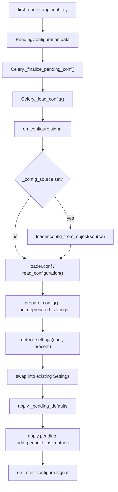

## Overview

Every Celery setting (broker URL, serializers, worker concurrency, beat schedule, backend options) is declared once in `celery/app/defaults.py` with its default value and type, and read at runtime through `app.conf`. Configuration is lazy: an app can be created, have settings assigned and be pointed at a configuration module long before anything reads a value. The first read triggers the loader, merges all sources and freezes the result into a `Settings` object.

Sources: [celery/app/defaults.py:1-8](repo://celery/app/defaults.py#L1-L8), [celery/app/base.py:208-249](repo://celery/app/base.py#L208-L249)

Three layers cooperate: the defaults table (`NAMESPACES`), the loader that imports the user's configuration object (`celery/loaders`), and `Settings`, a chained mapping that answers lookups by trying the user's changes, then the configuration object, then the defaults. The app object that owns all three is described in [[The Celery Application]].

Sources: [celery/app/utils.py:70-77](repo://celery/app/utils.py#L70-L77), [celery/app/utils.py:232-286](repo://celery/app/utils.py#L232-L286), [celery/loaders/__init__.py:1-18](repo://celery/loaders/__init__.py#L1-L18)

## Declaring settings

### Option and Namespace

An `Option` records a default, a type name (`string` unless given) and optional metadata: `old` (legacy names), `deprecate_by`, `remove_by` and `alt` (the replacement to suggest). `to_python` converts a string with `Option.typemap`, which is how values typed on a command line become ints, floats or booleans.

Sources: [celery/app/defaults.py:42-63](repo://celery/app/defaults.py#L42-L63)

```python
class Option:
    """Describes a Celery configuration option."""

    alt = None
    deprecate_by = None
    remove_by = None
    old = set()
    typemap = {'string': str, 'int': int, 'float': float, 'any': lambda v: v,
               'bool': strtobool, 'dict': dict, 'tuple': tuple}
```

Sources: [celery/app/defaults.py:42-50](repo://celery/app/defaults.py#L42-L50)

`Namespace(__old__=..., **options)` is a plain function that returns its keyword arguments as a dict. When `__old__` is given, every option in the namespace that has no explicit `old` gets one built from the template, for example `celeryd_{0}` for the worker namespace or `celerybeat_{0}` for beat.

Sources: [celery/app/defaults.py:23-39](repo://celery/app/defaults.py#L23-L39)

### The NAMESPACES table

`NAMESPACES` nests one `Namespace` per area, plus a few top-level options (`accept_content`, `enable_utc`, `imports`, `include`, `timezone`). The main groups and some representative defaults:

Sources: [celery/app/defaults.py:66-73](repo://celery/app/defaults.py#L66-L73)

| Namespace | Example keys (default) | Legacy prefix |
| --- | --- | --- |
| top level | `accept_content` (`('json',)`), `enable_utc` (`True`), `imports`, `include`, `timezone` | `CELERY_` for most |
| `beat` | `beat_schedule` (`{}`), `beat_scheduler` (`celery.beat:PersistentScheduler`), `beat_schedule_filename` (`celerybeat-schedule`) | `CELERYBEAT_` |
| `broker` | `broker_url`, `broker_connection_timeout` (`4`), `broker_connection_max_retries` (`100`), `broker_heartbeat` (`120`), `broker_pool_limit` (`10`) | `BROKER_` |
| `result` | `result_backend`, `result_expires` (1 day), `result_serializer` (`json`), `result_extended` (`False`) | `CELERY_RESULT_` |
| `task` | `task_serializer` (`json`), `task_default_queue` (`celery`), `task_acks_late` (`False`), `task_always_eager` (`False`), `task_protocol` (`2`) | `CELERY_` |
| `worker` | `worker_pool` (`prefork`), `worker_prefetch_multiplier` (`4`), `worker_concurrency` (`None`, meaning CPU count), `worker_send_task_events` (`False`) | `CELERYD_` |
| `event`, `control` | `event_queue_ttl` (`5.0`), `event_exchange` (`celeryev`), `control_queue_ttl` (`300.0`) | `CELERY_EVENT_`, none |
| backend-specific | `redis_*`, `database_*`, `cassandra_*`, `s3_*`, `gcs_*`, `mongodb_*`, `elasticsearch_*`, `azureblockblob_*`, `cosmosdbsql_*` | varies |
| `security` | `security_key`, `security_certificate`, `security_cert_store`, `security_digest` (`sha256`) | `CELERY_SECURITY_` |

Sources: [celery/app/defaults.py:66-114](repo://celery/app/defaults.py#L66-L114), [celery/app/defaults.py:151-247](repo://celery/app/defaults.py#L151-L247), [celery/app/defaults.py:265-375](repo://celery/app/defaults.py#L265-L375)

### Flattening into setting keys

`flatten` walks the nested dicts breadth-first and joins each path with underscores, so `NAMESPACES['broker']['url']` becomes `broker_url`. Three lookup tables are built from it at import time: `DEFAULTS` (new key to default), `_TO_OLD_KEY` and `_TO_NEW_KEY` (the two directions of the rename map). An option's old names come from `opt.old`, upper-cased; an option without one keeps its new name in upper case, which is why `broker_url` maps to `BROKER_URL`.

Sources: [celery/app/defaults.py:378-413](repo://celery/app/defaults.py#L378-L413)

| New name | Old name | Why |
| --- | --- | --- |
| `task_acks_late` | `CELERY_ACKS_LATE` | `task` namespace uses `celery_{0}` |
| `worker_concurrency` | `CELERYD_CONCURRENCY` | `worker` namespace uses `celeryd_{0}` |
| `beat_schedule` | `CELERYBEAT_SCHEDULE` | `beat` namespace uses `celerybeat_{0}` |
| `result_expires` | `CELERY_TASK_RESULT_EXPIRES` | explicit `old=` on the option |
| `task_eager_propagates` | `CELERY_EAGER_PROPAGATES_EXCEPTIONS` | explicit `old=` on the option |
| `broker_url` | `BROKER_URL` | no `old`, so the upper-cased new name |

Sources: [celery/app/defaults.py:73-83](repo://celery/app/defaults.py#L73-L83), [celery/app/defaults.py:216-219](repo://celery/app/defaults.py#L216-L219), [celery/app/defaults.py:265-292](repo://celery/app/defaults.py#L265-L292), [celery/app/defaults.py:325-334](repo://celery/app/defaults.py#L325-L334), [celery/app/defaults.py:382-388](repo://celery/app/defaults.py#L382-L388)

`find(name, namespace='celery')` searches the table by bare name: first inside the given namespace, then in every namespace, finally as a fully qualified key in `DEFAULTS`. `Settings.find_option` exposes it.

Sources: [celery/app/defaults.py:427-447](repo://celery/app/defaults.py#L427-L447), [celery/app/utils.py:141-160](repo://celery/app/utils.py#L141-L160)

## Supplying configuration

### Constructor arguments and conf updates

Keyword arguments to `Celery(...)` become configuration. `broker`, `backend` and `include` are stored as `broker_url`, `result_backend` and `include`; any other keyword (for example `task_acks_late=True`) is stored under its own name. They all land in `app._preconf`, and keys set this way are remembered in `_preconf_set_by_auto`.

Sources: [celery/app/base.py:392-401](repo://celery/app/base.py#L392-L401), [celery/app/base.py:447-450](repo://celery/app/base.py#L447-L450)

Until configuration is finalized, `app.conf` wraps a `PendingConfiguration` whose writes (`__setitem__`, `update`, `setdefault`) go straight into `_preconf`. So `app.conf.update(result_expires=3600)` right after construction costs nothing and does not import any configuration module. Reading a value goes through the `data` cached property, which calls back into `_finalize_pending_conf`.

Sources: [celery/app/base.py:208-249](repo://celery/app/base.py#L208-L249), [celery/app/base.py:403-408](repo://celery/app/base.py#L403-L408)

### config_from_object

`config_from_object(obj, silent=False, force=False, namespace=None)` stores the source (a module, a class, any object, or a dotted name) in `_config_source` and optionally a namespace prefix. It reads nothing unless `force=True` or the app is already configured; in that case it drops the current `Settings` and asks the loader to import the object right away.

Sources: [celery/app/base.py:703-725](repo://celery/app/base.py#L703-L725)

```python
app.config_from_object('django.conf:settings', namespace='CELERY')
```

Sources: [examples/django/proj/celery.py:14-14](repo://examples/django/proj/celery.py#L14-L14)

With `namespace='CELERY'`, `ConfigurationView` prefixes every lookup: `conf.broker_url` first tries `CELERY_BROKER_URL` (the prefix's case decides the case of the whole key), then the bare key. A prefixed configuration is always parsed with new-style names.

Sources: [celery/utils/collections.py:367-401](repo://celery/utils/collections.py#L367-L401), [celery/utils/text.py:116-117](repo://celery/utils/text.py#L116-L117), [celery/app/utils.py:264-266](repo://celery/app/utils.py#L264-L266)

### config_from_envvar

`config_from_envvar(variable_name)` reads a module name from the environment and passes it to `config_from_object`. If the variable is unset it raises `ImproperlyConfigured` with an example (`proj.celeryconfig`), or returns `False` when `silent=True`.

Sources: [celery/app/base.py:727-743](repo://celery/app/base.py#L727-L743), [celery/app/base.py:87-96](repo://celery/app/base.py#L87-L96)

### add_defaults and command-line overrides

`add_defaults(d_or_callable)` registers extra defaults; a callable is kept as a promise in `_pending_defaults` and evaluated only when configuration loads. Once loaded, each one is inserted into the chain directly after the changes map. Defaults added this way are not pickled to child processes, so they must be registered at import time.

Sources: [celery/app/base.py:679-701](repo://celery/app/base.py#L679-L701), [celery/utils/collections.py:222-226](repo://celery/utils/collections.py#L222-L226)

`celery worker` and `celery beat` accept trailing `key=value` arguments that `config_from_cmdline` parses with `BaseLoader.cmdline_config_parser`. A key may use dots or underscores (`broker.heartbeat=30`); a leading dot or underscore expands to the default namespace (`worker` for the worker command). The value is converted with the option's type, or with an explicit cast prefix such as `(json)` or `(int)`.

Sources: [celery/app/base.py:745-748](repo://celery/app/base.py#L745-L748), [celery/loaders/base.py:161-206](repo://celery/loaders/base.py#L161-L206), [celery/bin/worker.py:327-334](repo://celery/bin/worker.py#L327-L334)

## Loading flow

The first access to a key (or to `app.conf` after `config_from_object(force=True)`) runs `_load_config`.

Sources: [celery/app/base.py:1230-1280](repo://celery/app/base.py#L1230-L1280), [celery/app/base.py:1565-1574](repo://celery/app/base.py#L1565-L1574)



Sources: [celery/app/base.py:1230-1280](repo://celery/app/base.py#L1230-L1280), [celery/loaders/base.py:119-130](repo://celery/loaders/base.py#L119-L130), [celery/loaders/base.py:231-236](repo://celery/loaders/base.py#L231-L236)

1. `on_configure` is sent (it is still called as a method if a subclass overrode it the pre-4.0 way).
2. If a configuration source was registered, the loader imports it; then `self.configured = True`.
3. `prepare_config` runs `find_deprecated_settings`, warning about options that carry `deprecate_by`/`remove_by` (today `task_acks_on_failure_or_timeout`, deprecated by 6.0 in favour of `task_acks_on_failure` and `task_acks_on_timeout`).
4. `detect_settings` merges loader config, preconf and defaults into a new `Settings`. If an `app.conf` reference already exists it is updated in place with `swap_with`, so code that grabbed `app.conf` early sees the final values.
5. Pending `add_defaults` callables and `add_periodic_task` calls queued before configuration are applied, and `on_after_configure` fires with the settings as `source`.

Sources: [celery/app/base.py:1247-1280](repo://celery/app/base.py#L1247-L1280), [celery/app/base.py:1193-1195](repo://celery/app/base.py#L1193-L1195), [celery/app/defaults.py:268-272](repo://celery/app/defaults.py#L268-L272), [celery/app/defaults.py:416-424](repo://celery/app/defaults.py#L416-L424), [celery/utils/collections.py:428-438](repo://celery/utils/collections.py#L428-L438)

> [!NOTE]
> `_finalize_pending_conf` turns an `AttributeError` raised while loading into `ModuleNotFoundError`. `PendingConfiguration` would otherwise swallow it as a missing attribute and recurse.

Sources: [celery/app/base.py:1230-1245](repo://celery/app/base.py#L1230-L1245)

## Old and new setting names

`detect_settings` decides which naming scheme the user's configuration follows. It ignores keys the constructor set automatically, then counts how many of the remaining keys are new names (`SETTING_KEYS`) and how many are old (`_OLD_SETTING_KEYS`); the majority wins, new names win when nothing is set, and a namespace prefix forces new names.

Sources: [celery/app/utils.py:232-266](repo://celery/app/utils.py#L232-L266)

Keys of the losing scheme are an error unless the user also gave the equivalent key in the winning scheme. The `ImproperlyConfigured` message lists each rename using `FMT_REPLACE_SETTING`, for example `CELERY_ACKS_LATE -> task_acks_late`.

Sources: [celery/app/utils.py:42-62](repo://celery/app/utils.py#L42-L62), [celery/app/utils.py:268-277](repo://celery/app/utils.py#L268-L277)

Whichever scheme wins, the resulting `Settings` gets both converters as `keys`, so `conf.CELERY_ACKS_LATE` and `conf.task_acks_late` read the same value. The old keys found are stored as `deprecated_settings`; at worker start-up `maybe_warn_deprecated_settings` warns that they go away in 6.0 and suggests `celery upgrade settings`, except when the source is `django.conf:settings`.

Sources: [celery/app/utils.py:197-217](repo://celery/app/utils.py#L197-L217), [celery/app/utils.py:279-286](repo://celery/app/utils.py#L279-L286), [celery/apps/worker.py:155-166](repo://celery/apps/worker.py#L155-L166)

## The Settings object

`Settings` extends `ConfigurationView`, a `ChainMap` with attribute access. `detect_settings` builds it as `Settings(preconf, [conf, defaults], ...)`, so a lookup tries, in order: the changes map (constructor kwargs and anything assigned to `app.conf`), any maps added by `add_defaults`, the loaded configuration object, and finally the defaults (which already have preconf merged in). Assignments always go into the changes map.

Sources: [celery/app/utils.py:279-286](repo://celery/app/utils.py#L279-L286), [celery/utils/collections.py:202-256](repo://celery/utils/collections.py#L202-L256), [celery/utils/collections.py:384-405](repo://celery/utils/collections.py#L384-L405)

For each key, `ConfigurationView.__getitem__` tries the prefixed key, the bare key, and then the key passed through each converter (old to new, new to old) before raising `KeyError`.

Sources: [celery/utils/collections.py:376-401](repo://celery/utils/collections.py#L376-L401)

Several settings are computed properties with fallbacks; the broker and backend ones consult environment variables before any configuration:

Sources: [celery/app/utils.py:84-131](repo://celery/app/utils.py#L84-L131)

| Property | Resolution order |
| --- | --- |
| `broker_url` | `CELERY_BROKER_URL` env, then `broker_url`, then `broker_host` |
| `broker_read_url` | `CELERY_BROKER_READ_URL` env, then `broker_read_url`, then `broker_url` |
| `broker_write_url` | `CELERY_BROKER_WRITE_URL` env, then `broker_write_url`, then `broker_url` |
| `result_backend` | `CELERY_RESULT_BACKEND` env, then `result_backend`, then `CELERY_RESULT_BACKEND` key |
| `task_default_exchange` | `task_default_exchange`, then `task_default_queue` |
| `task_default_routing_key` | `task_default_routing_key`, then `task_default_queue` |
| `timezone` | `timezone`, then Django's `TIME_ZONE` |

Sources: [celery/app/utils.py:84-131](repo://celery/app/utils.py#L84-L131)

Because the `celery` command's `-b` and `--result-backend` options set `CELERY_BROKER_URL` and `CELERY_RESULT_BACKEND`, they override whatever the configuration module says.

Sources: [celery/bin/celery.py:123-131](repo://celery/bin/celery.py#L123-L131)

Other helpers on `Settings`:

Sources: [celery/app/utils.py:133-140](repo://celery/app/utils.py#L133-L140)

- `without_defaults()` drops the last map and `value_set_for(key)` tells whether the user set a key explicitly.
- `get_by_parts('worker', 'disable_rate_limits')` joins parts with `_` and looks the key up.
- `finalize()` forces a pending configuration to load by reading a bogus key.
- `table()` and `humanize()` list changed settings (or all, with `with_defaults=True`), censoring values whose key matches `API|TOKEN|KEY|SECRET|PASS|...` and masking passwords in broker and backend URLs. The worker banner and `bugreport()` use them.

Sources: [celery/app/utils.py:133-195](repo://celery/app/utils.py#L133-L195), [celery/app/utils.py:37-40](repo://celery/app/utils.py#L37-L40), [celery/app/utils.py:327-375](repo://celery/app/utils.py#L327-L375)

The app's `timezone` cached property reads `conf.timezone`; when it is empty it returns UTC if `enable_utc` is true and local time otherwise.

Sources: [celery/app/base.py:1619-1632](repo://celery/app/base.py#L1619-L1632)

## Loaders

### Choosing a loader

A loader decides where configuration comes from and how task modules are imported. `get_loader_cls` resolves a name through `LOADER_ALIASES`, so `app` means `celery.loaders.app:AppLoader` and `default` means `celery.loaders.default:Loader`; any other value is imported as `module:Class`. An app uses the `loader` argument, else the `CELERY_LOADER` environment variable (set by `celery --loader`), else `AppLoader`.

Sources: [celery/loaders/__init__.py:10-18](repo://celery/loaders/__init__.py#L10-L18), [celery/app/base.py:436-442](repo://celery/app/base.py#L436-L442), [celery/app/base.py:1586-1589](repo://celery/app/base.py#L1586-L1589), [celery/bin/celery.py:123-125](repo://celery/bin/celery.py#L123-L125)

| Loader | Used by | `read_configuration` |
| --- | --- | --- |
| `AppLoader` | Every app created in user code | Inherited from `BaseLoader`: imports the module named in `CELERY_CONFIG_MODULE` if set, otherwise returns nothing and relies on `config_from_object`. |
| `Loader` (default) | The fallback app `_state` creates when no app exists | Imports `CELERY_CONFIG_MODULE` or `celeryconfig`; a missing module yields empty settings, with a `NotConfigured` warning when `C_WNOCONF` is set. |

Sources: [celery/loaders/app.py:1-8](repo://celery/loaders/app.py#L1-L8), [celery/loaders/base.py:208-216](repo://celery/loaders/base.py#L208-L216), [celery/loaders/default.py:13-44](repo://celery/loaders/default.py#L13-L44), [celery/_state.py:92-100](repo://celery/_state.py#L92-L100)

### BaseLoader

`BaseLoader.config_from_object` accepts an object or a string. Strings go through `_smart_import`: a `module:attr` path is resolved with `symbol_by_name`; otherwise it first tries to import the string as a module and falls back to treating the last part as an attribute. The result is wrapped with `force_mapping` (a `DictAttribute` for plain objects, so module attributes act as keys), and an `override_backends` entry replaces the backend alias table.

Sources: [celery/loaders/base.py:119-145](repo://celery/loaders/base.py#L119-L145), [celery/utils/collections.py:39-44](repo://celery/utils/collections.py#L39-L44)

`_import_config_module` checks the name with `find_module` first, so `celeryconfig.py` gets a hint to drop the `.py` suffix instead of a bare import error.

Sources: [celery/loaders/base.py:21-28](repo://celery/loaders/base.py#L21-L28), [celery/loaders/base.py:147-156](repo://celery/loaders/base.py#L147-L156)

The loader also owns worker-side imports. `default_modules` is `builtin_modules + imports + include`; `init_worker` (called once from `WorkController.__init__`) sends `import_modules` (which triggers lazy `autodiscover_tasks`), re-raises any exception a receiver returned, imports each default module and calls the `on_worker_init` hook. `on_task_init`, `on_process_cleanup`, `on_worker_shutdown` and `on_worker_process_init` are empty hooks for subclasses.

Sources: [celery/loaders/base.py:63-117](repo://celery/loaders/base.py#L63-L117), [celery/loaders/base.py:223-229](repo://celery/loaders/base.py#L223-L229), [celery/worker/worker.py:90-95](repo://celery/worker/worker.py#L90-L95)

## Errors

| Error | Raised when |
| --- | --- |
| `ImproperlyConfigured` (mixed names) | Old and new setting names are mixed without equivalents |
| `ImproperlyConfigured` (env var) | `config_from_envvar` finds the variable unset and `silent` is false |
| `ImportError` / `AttributeError` | `config_from_object` cannot import the source and `silent` is false |
| `NotAPackage` | The configuration module name is invalid or ends with `.py` |
| `ModuleNotFoundError` | An `AttributeError` escapes while the pending configuration loads |
| `click.UsageError` | Extra `key=value` worker arguments cannot be parsed |

Sources: [celery/app/utils.py:268-277](repo://celery/app/utils.py#L268-L277), [celery/app/base.py:737-743](repo://celery/app/base.py#L737-L743), [celery/loaders/base.py:119-126](repo://celery/loaders/base.py#L119-L126), [celery/loaders/base.py:147-156](repo://celery/loaders/base.py#L147-L156), [celery/app/base.py:1237-1243](repo://celery/app/base.py#L1237-L1243), [celery/bin/worker.py:327-334](repo://celery/bin/worker.py#L327-L334)
