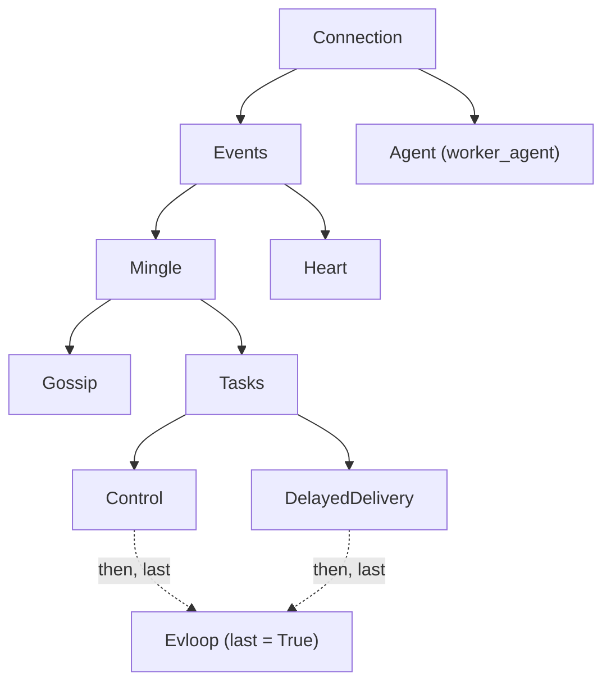
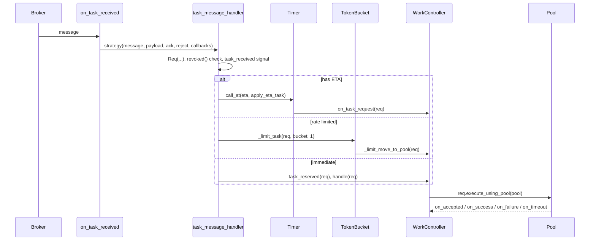
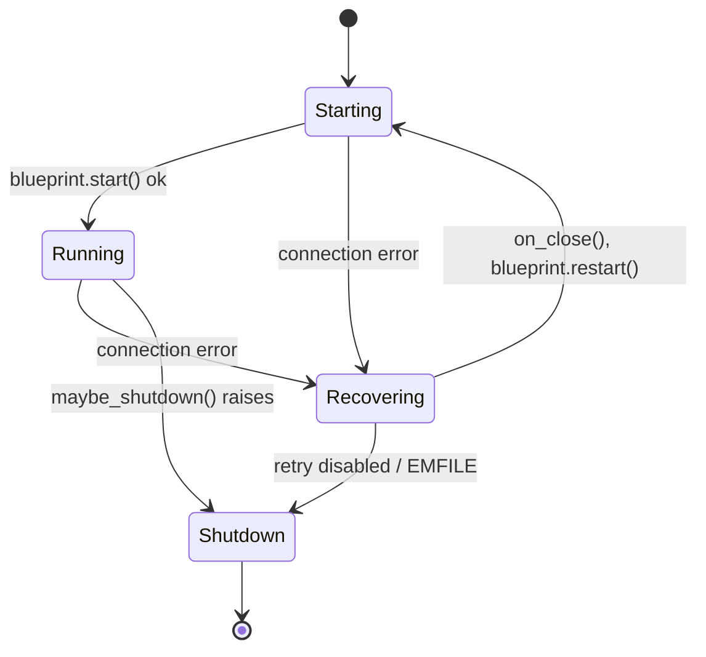

## Overview

The consumer is the part of the worker that talks to the broker. `celery.worker.consumer.Consumer` owns the broker connection, consumes task messages, turns each one into a `Request`, and hands that request to the worker's pool. It is itself a bootstep blueprint nested inside the worker blueprint: the worker's `Consumer` component instantiates it with `w.process_task` as the `on_task_request` callback, so every accepted message ends in `WorkController._process_task`, which calls `Request.execute_using_pool`.

Sources: [celery/worker/components.py:221-246](repo://celery/worker/components.py#L221-L246), [celery/worker/worker.py:220-231](repo://celery/worker/worker.py#L220-L231)

The consumer exists as a separate blueprint so it can be restarted on its own. When the broker connection drops, only the consumer steps are stopped and started again, while the pool, timer and hub owned by the worker keep running. [[Worker Architecture and Bootsteps]] describes the outer worker blueprint, [[Concurrency Pools]] the pools that execute requests, and [[Task Execution and Tracing]] what happens inside the pool process.

Sources: [celery/worker/consumer/consumer.py:366-407](repo://celery/worker/consumer/consumer.py#L366-L407)

## Consumer blueprint steps

### Default steps and dependencies

`Consumer.Blueprint` lists ten default steps. Extra steps registered in `app.steps['consumer']` are merged in when the blueprint is built in `Consumer.__init__`, and `blueprint.apply()` then creates every step with the worker options as keyword arguments.

Sources: [celery/worker/consumer/consumer.py:171-189](repo://celery/worker/consumer/consumer.py#L171-L189), [celery/worker/consumer/consumer.py:248-255](repo://celery/worker/consumer/consumer.py#L248-L255)

The start order comes from each step's `requires` tuple, not from the list order. `Evloop` sets `last = True`, so the blocking event loop always starts after every other step.

Sources: [celery/worker/consumer/events.py:15-18](repo://celery/worker/consumer/events.py#L15-L18), [celery/worker/consumer/mingle.py:13-25](repo://celery/worker/consumer/mingle.py#L13-L25), [celery/worker/consumer/tasks.py:20-23](repo://celery/worker/consumer/tasks.py#L20-L23), [celery/worker/consumer/control.py:18-21](repo://celery/worker/consumer/control.py#L18-L21), [celery/worker/consumer/consumer.py:857-866](repo://celery/worker/consumer/consumer.py#L857-L866)



Sources: [celery/worker/consumer/heart.py:10-19](repo://celery/worker/consumer/heart.py#L10-L19), [celery/worker/consumer/gossip.py:23-30](repo://celery/worker/consumer/gossip.py#L23-L30), [celery/worker/consumer/agent.py:9-17](repo://celery/worker/consumer/agent.py#L9-L17), [celery/worker/consumer/delayed_delivery.py:39-53](repo://celery/worker/consumer/delayed_delivery.py#L39-L53)

### What each step does

| Step | Starts | Enabled when |
| --- | --- | --- |
| `Connection` | `c.connection = c.connect()`; `shutdown` closes and clears it so the green pidbox thread exits | always |
| `Events` | an `EventDispatcher` on a write connection; on restart it re-sends the buffer of the previous dispatcher and re-points reserved requests at the new one | task events, gossip or heartbeat enabled |
| `Mingle` | sends `hello` through `inspect` with a 1 s timeout, then adjusts the logical clock and merges neighbours' revoked ids | not `--without-mingle`, transport is amqp, redis or gcpubsub |
| `Gossip` | a `ConsumerStep` that consumes `worker.#` events, tracks alive workers and handles `worker.elect` | not `--without-gossip`, transport is amqp or redis |
| `Heart` | `celery.worker.heartbeat.Heart` sending `worker-heartbeat` events on the timer | not `--without-heartbeat` |
| `Tasks` | strategies, `basic_qos`, the `TaskConsumer` and the `QoS` object | always |
| `Control` | `Pidbox`, or `gPidbox` for green pools, for remote control | `worker_enable_remote_control` and the transport supports fanout |
| `DelayedDelivery` | declares and binds native delayed delivery exchanges, retrying per broker URL | quorum queues are detected |
| `Evloop` | `c.loop(*c.loop_args())` | always, last |
| `Agent` | a `cell` actor agent class | `worker_agent` is set |

Sources: [celery/worker/consumer/connection.py:13-45](repo://celery/worker/consumer/connection.py#L13-L45), [celery/worker/consumer/events.py:20-71](repo://celery/worker/consumer/events.py#L20-L71), [celery/worker/consumer/mingle.py:27-76](repo://celery/worker/consumer/mingle.py#L27-L76), [celery/worker/consumer/gossip.py:36-76](repo://celery/worker/consumer/gossip.py#L36-L76), [celery/worker/consumer/heart.py:21-36](repo://celery/worker/consumer/heart.py#L21-L36), [celery/worker/consumer/control.py:23-33](repo://celery/worker/consumer/control.py#L23-L33), [celery/worker/consumer/delayed_delivery.py:55-110](repo://celery/worker/consumer/delayed_delivery.py#L55-L110), [celery/worker/consumer/agent.py:15-21](repo://celery/worker/consumer/agent.py#L15-L21)

The control commands that `Control` serves are covered in [[Remote Control and Inspection]], and the events sent by `Events`, `Heart` and `Gossip` in [[Events and Monitoring]].

Sources: [celery/worker/consumer/control.py:1-6](repo://celery/worker/consumer/control.py#L1-L6)

### The Tasks step and prefetch

`Tasks.start` first calls `c.update_strategies()`, which builds one strategy per registered task through `task.start_strategy(app, consumer)` and compiles its tracer with `build_tracer`. It then sets the initial prefetch with `basic_qos`, creates `app.amqp.TaskConsumer`, and wraps prefetch updates in a kombu `QoS` object capped by `worker_eta_task_limit`.

Sources: [celery/worker/consumer/tasks.py:29-57](repo://celery/worker/consumer/tasks.py#L29-L57), [celery/worker/consumer/consumer.py:716-721](repo://celery/worker/consumer/consumer.py#L716-L721)

The initial prefetch count is computed by the worker's `Consumer` component as `concurrency * worker_prefetch_multiplier`, or `max_concurrency * multiplier` when autoscaling. `Tasks.qos_global` applies the prefetch globally on RabbitMQ 3.3+ semantics, but switches to per-consumer QoS when `worker_detect_quorum_queues` finds quorum queues, because quorum queues do not support global QoS.

Sources: [celery/worker/components.py:226-230](repo://celery/worker/components.py#L226-L230), [celery/worker/consumer/tasks.py:103-124](repo://celery/worker/consumer/tasks.py#L103-L124)

With `worker_disable_prefetch` on a Redis broker, `Tasks.start` patches the channel's `qos.can_consume` so the worker stops fetching while `len(state.reserved_requests)` is at least the pool size (or the autoscaler's `max_concurrency`). On any other broker the setting is ignored with a warning.

Sources: [celery/worker/consumer/tasks.py:59-83](repo://celery/worker/consumer/tasks.py#L59-L83)

## Event loops

### Choosing a loop

`Consumer.__init__` picks `loops.asynloop` when the worker has a hub (the default prefork setup on a transport that supports async I/O), and `loops.synloop` otherwise: eventlet, gevent, threads, solo and transports without async support. AMQP heartbeats are only enabled when there is a hub or the pool is green.

Sources: [celery/worker/consumer/consumer.py:231-240](repo://celery/worker/consumer/consumer.py#L231-L240), [celery/worker/worker.py:239-242](repo://celery/worker/worker.py#L239-L242)

### asynloop

`asynloop` installs the task handler as `consumer.on_message`, registers the worker and consumer with the hub, starts consuming, and calls `on_ready()` (the worker's ready callback). On the first start it raises `WorkerLostError` if the pool processes did not start. The loop then iterates `hub.create_loop()` while the blueprint is in `RUN`, calling `state.maybe_shutdown()` on every turn, re-raising a stored heartbeat error, and pushing pending prefetch changes with `qos.update()` only when there are no more messages to read, so control commands are prioritized over task messages.

Sources: [celery/worker/loops.py:50-99](repo://celery/worker/loops.py#L50-L99)

On any `Exception` (typically a lost connection) the loop resets the hub and clears its timer before re-raising, so periodic entries from the old connection do not fire against the broken socket while `Consumer.start` reconnects. `WorkerShutdown` and `WorkerTerminate` derive from `SystemExit` and bypass this cleanup, so heartbeat timers keep firing while the pool drains.

Sources: [celery/worker/loops.py:100-130](repo://celery/worker/loops.py#L100-L130)

### synloop

`synloop` drains the connection with a 2 second timeout per cycle, running `perform_pending_operations()` first: without a hub, `Consumer.call_soon` queues callbacks in `_pending_operations` instead of scheduling them on the hub. Ack and reject callbacks go through `call_soon_ack`, which runs them immediately so a gevent or eventlet worker with `acks_late` does not wait for an unrelated frame before the broker can deliver the next message.

Sources: [celery/worker/loops.py:133-183](repo://celery/worker/loops.py#L133-L183), [celery/worker/consumer/consumer.py:257-294](repo://celery/worker/consumer/consumer.py#L257-L294)

## From message to pool

### Receiving a message

`create_task_handler` returns `on_task_received`, the callback for every task message. It reads the task name from `message.headers['task']` (protocol 2) or decodes the body to find `payload['task']` (protocol 1), looks up the strategy, and calls it with promises wrapping `message.ack_log_error` and `message.reject_log_error`.

Sources: [celery/worker/consumer/consumer.py:723-786](repo://celery/worker/consumer/consumer.py#L723-L786)



Sources: [celery/worker/strategy.py:132-209](repo://celery/worker/strategy.py#L132-L209), [celery/worker/consumer/consumer.py:329-364](repo://celery/worker/consumer/consumer.py#L329-L364), [celery/worker/consumer/consumer.py:659-663](repo://celery/worker/consumer/consumer.py#L659-L663), [celery/worker/worker.py:223-231](repo://celery/worker/worker.py#L223-L231)

Messages that cannot be handled are rejected without requeue: an unknown format goes to `on_unknown_message`, a missing strategy to `on_unknown_task` (which also stores a `NotRegistered` failure in the result backend and sends `task-failed`), and `InvalidTaskError` or `ContentDisallowed` to `on_invalid_task`. Decode errors are logged and the message is acknowledged so it does not loop.

Sources: [celery/worker/consumer/consumer.py:516-530](repo://celery/worker/consumer/consumer.py#L516-L530), [celery/worker/consumer/consumer.py:672-714](repo://celery/worker/consumer/consumer.py#L672-L714)

### The default strategy

`Task.Strategy` defaults to `celery.worker.strategy:default`. The strategy is a closure built once per task: it caches the event dispatcher, `consumer.timer.call_at`, the task's rate limit bucket getter and a `Request` subclass from `create_request_cls`, so the per-message handler does almost no attribute lookups.

Sources: [celery/app/task.py:222-225](repo://celery/app/task.py#L222-L225), [celery/app/task.py:520-521](repo://celery/app/task.py#L520-L521), [celery/worker/strategy.py:99-130](repo://celery/worker/strategy.py#L99-L130)

`task_message_handler` converts protocol 1 and hybrid messages to the protocol 2 `(args, kwargs, embed)` shape, builds the request, logs `Received task`, and drops it at once if it has expired or its id is in `revoked`. It then fires the `task_received` signal and, when the task sends events, a `task-received` event.

Sources: [celery/worker/strategy.py:25-96](repo://celery/worker/strategy.py#L25-L96), [celery/worker/strategy.py:132-176](repo://celery/worker/strategy.py#L132-L176)

### ETA, countdown and rate limits

A `countdown` reaches the worker as an `eta` header. The strategy converts the ETA to a timestamp (in UTC, or in `app.timezone` for non-UTC messages; a value that cannot be converted rejects the message) and schedules it on the worker timer with `call_at`. Because the message stays unacknowledged while it waits, `qos.increment_eventually()` raises the prefetch count by one so ETA tasks do not starve the worker; `apply_eta_task` lowers it again when the timer fires.

Sources: [celery/worker/strategy.py:178-201](repo://celery/worker/strategy.py#L178-L201), [celery/worker/consumer/consumer.py:659-663](repo://celery/worker/consumer/consumer.py#L659-L663)

Rate limits use one kombu `TokenBucket` per task name, built from the task's `rate_limit` by `bucket_for_task` and stored in `task_buckets`. `_schedule_bucket_request` moves requests to the pool while the bucket has tokens; otherwise it puts the request back at the head and reschedules itself after `bucket.expected_time(tokens)`. An ETA task with a rate limit first waits for its ETA and then enters the bucket through `_limit_post_eta`. `worker_disable_rate_limits` turns this off entirely.

Sources: [celery/worker/consumer/consumer.py:296-303](repo://celery/worker/consumer/consumer.py#L296-L303), [celery/worker/consumer/consumer.py:329-364](repo://celery/worker/consumer/consumer.py#L329-L364), [celery/worker/strategy.py:190-209](repo://celery/worker/strategy.py#L190-L209)

## Request lifecycle

### Building and dispatching a Request

`Request.__init__` keeps the raw body and headers rather than deserializing arguments: with protocol 2 the body is decoded inside the pool process. It reads `id`, `task` (or `shadow` for the display name), `timelimit`, `argsrepr` and `kwargsrepr`, resolves `ignore_result`, and parses `eta` and `expires` as ISO 8601, raising `InvalidTaskError` on bad values.

Sources: [celery/worker/request.py:90-175](repo://celery/worker/request.py#L90-L175)

`execute_using_pool` raises `TaskRevokedError` if the request was revoked in the meantime, then calls `pool.apply_async` with the tracer (`fast_trace_task` or `trace_task_ret`) and four callbacks. The message's `timelimit` header wins over the task's `time_limit` and `soft_time_limit`. `create_request_cls` builds a per-task subclass that binds `pool.apply_async`, the default time limits and `acks_late` as closure variables.

Sources: [celery/worker/request.py:341-372](repo://celery/worker/request.py#L341-L372), [celery/worker/request.py:818-874](repo://celery/worker/request.py#L818-L874)

```python
        result = pool.apply_async(
            trace,
            args=(self._type, task_id, self._request_dict, self._body,
                  self._content_type, self._content_encoding),
            accept_callback=self.on_accepted,
            timeout_callback=self.on_timeout,
            callback=self.on_success,
            error_callback=self.on_failure,
            soft_timeout=soft_time_limit or task.soft_time_limit,
            timeout=time_limit or task.time_limit,
            correlation_id=task_id,
        )
```

Sources: [celery/worker/request.py:358-369](repo://celery/worker/request.py#L358-L369)

### Pool callbacks and acknowledgement

| Callback | When | Acknowledgement |
| --- | --- | --- |
| `on_accepted(pid, time_accepted)` | a pool process picked up the job | records `worker_pid` and `time_start`, calls `task_accepted`, acks now unless `acks_late`, sends `task-started`, applies a pending terminate |
| `on_success` | the tracer returned | if the tracer reported failure, delegates to `on_failure(return_ok=True)`; otherwise `task_ready(successful=True)`, acks if `acks_late`, sends `task-succeeded` |
| `on_failure` | the job raised or the process died | depends on the exception and on `acks_late`, see the next table |
| `on_timeout(soft, timeout)` | a time limit expired | soft: only a warning; hard: stores `TimeLimitExceeded` as FAILURE, calls `task.on_failure`, sends the `task_failure` signal and `task-failed`, then under `acks_late` acks (`acks_on_timeout`) or requeues |

Sources: [celery/worker/request.py:515-611](repo://celery/worker/request.py#L515-L611)

`acknowledge` and `reject` call the `on_ack` / `on_reject` promises given by the consumer at most once, guarded by the `acknowledged` flag; `reject` also sends a `task-rejected` event.

Sources: [celery/worker/request.py:730-740](repo://celery/worker/request.py#L730-L740)

### Failure handling

`on_failure` dispatches on the exception type before it looks at acknowledgement settings. The exceptions themselves are described in [[Exceptions and Task States]].

Sources: [celery/worker/request.py:622-675](repo://celery/worker/request.py#L622-L675)

| Exception | Behaviour |
| --- | --- |
| `Terminated` | announces the task as revoked (`terminated=True`) unless it was already cancelled or revoked |
| `MemoryError` | re-raised as `MemoryError('Process got: ...')` |
| `Reject` | rejects with `exc.requeue`; without requeue it also stores FAILURE and sends `task_failure` |
| `Ignore` | acknowledges and stops |
| `Retry` | `on_retry`: acks if `acks_late`, sends `task-retried` |
| anything else, `acks_late` | `TimeLimitExceeded` uses `acks_on_timeout`, others `acks_on_failure`; `WorkerLostError` with `reject_on_worker_lost`, or a timeout without the ack flag, requeues; otherwise acks or rejects without requeue |

Sources: [celery/worker/request.py:630-696](repo://celery/worker/request.py#L630-L696)

The result is stored as FAILURE only when the task was not requeued and either the worker process was lost or the error did not already pass through the tracer (`return_ok` is false), since the tracer normally stores the failure itself. During a cold shutdown (`state.should_terminate`) the `task-failed` event is suppressed and the result is only stored when the worker process was lost.

Sources: [celery/worker/request.py:698-728](repo://celery/worker/request.py#L698-L728)

> [!WARNING]
> With `acks_late`, a task whose process is killed is only redelivered if `reject_on_worker_lost` is set. Otherwise the message is acknowledged or rejected without requeue according to `acks_on_failure`, and the task is marked as failed with `WorkerLostError`.

Sources: [celery/worker/request.py:677-711](repo://celery/worker/request.py#L677-L711)

## Revokes, termination and cancellation

`Request.revoked()` returns true when the request has expired (`maybe_expire` adds its id to `revoked`), when its id is in `state.revoked`, or when one of its stamped headers matches a value in `state.revoked_stamps`. A revoked request calls `_announce_revoked`, which marks it ready, sends `task-revoked`, stores REVOKED in the backend, acknowledges the message and fires the `task_revoked` signal. The check runs in the strategy on receipt, again in `execute_using_pool`, and in `Request.execute` for in-process execution.

Sources: [celery/worker/request.py:408-414](repo://celery/worker/request.py#L408-L414), [celery/worker/request.py:457-509](repo://celery/worker/request.py#L457-L509), [celery/worker/request.py:374-406](repo://celery/worker/request.py#L374-L406)

`terminate(pool, signal)` kills the pool process with `pool.terminate_job` if the job has started; if not, it stores `_terminate_on_ack` so `on_accepted` terminates it as soon as a process picks it up. `cancel` does the same without revoking: it sends `task-cancelled` and, when `emit_retry` is true, marks the task as RETRY so it can run again.

Sources: [celery/worker/request.py:416-455](repo://celery/worker/request.py#L416-L455)

`Consumer.cancel_active_requests` is used at shutdown. It cancels active requests that are not `acks_late`, or that are `acks_late` but not yet acknowledged and not already successful, and skips the retry signal for `acks_late` tasks since the broker redelivers them.

Sources: [celery/worker/consumer/consumer.py:823-854](repo://celery/worker/consumer/consumer.py#L823-L854)

## Worker state

`celery.worker.state` holds module-level state shared by the consumer, requests and control commands. Its size limits come from environment variables.

Sources: [celery/worker/state.py:34-74](repo://celery/worker/state.py#L34-L74)

| Name | Type | Updated by |
| --- | --- | --- |
| `requests` | dict id to `Request` | `task_reserved`, `task_accepted`, removed in `task_ready` |
| `reserved_requests` | `WeakSet` | `task_reserved` (received, waiting for the pool) |
| `active_requests` | `WeakSet` | `task_accepted` (running in the pool) |
| `successful_requests` | `LimitedSet`, `CELERY_WORKER_SUCCESSFUL_MAX` (1000) | `task_ready(successful=True)` |
| `total_count`, `all_total_count` | `Counter`, list | `task_accepted` |
| `revoked` | `LimitedSet`, `CELERY_WORKER_REVOKES_MAX` (50000), expiring after `CELERY_WORKER_REVOKE_EXPIRES` (10800 s) | revoke command, `maybe_expire`, Mingle, `Persistent` |
| `revoked_stamps` | dict | revoke by stamped header |
| `should_stop`, `should_terminate` | flags | shutdown signal handlers; read by `maybe_shutdown` |

Sources: [celery/worker/state.py:48-74](repo://celery/worker/state.py#L48-L74), [celery/worker/state.py:96-129](repo://celery/worker/state.py#L96-L129)

`maybe_shutdown()` raises `WorkerTerminate` when `should_terminate` is set and `WorkerShutdown` when `should_stop` is set. Both event loops and `Consumer.start` call it, which is how a signal handler stops the consumer without raising inside the handler.

Sources: [celery/worker/state.py:88-93](repo://celery/worker/state.py#L88-L93)

`Persistent` keeps revoked ids and the logical clock across restarts when the worker runs with `--statedb` (`worker_state_db`). It stores a zlib-compressed pickle of `revoked` under `zrevoked` in a `shelve` file, merges older formats on load, and purges expired entries at boot.

Sources: [celery/worker/state.py:192-288](repo://celery/worker/state.py#L192-L288)

## Connection loss and restart

`Consumer.start` loops until the blueprint reaches `CLOSE` or `TERMINATE`. Each iteration runs `blueprint.start(self)`; a recoverable error (connection errors, plus channel errors when `broker_channel_error_retry` is on) logs, cleans up, calls `on_close()` and `blueprint.restart()`, then loops. More than 5 restarts within 1 second triggers a `RestartFreqExceeded` log and a 1 second sleep. If retrying is disabled through `broker_connection_retry_on_startup` (first attempt) or `broker_connection_retry`, the worker raises `WorkerShutdown`; `EMFILE` raises `WorkerTerminate`.

Sources: [celery/worker/consumer/consumer.py:366-413](repo://celery/worker/consumer/consumer.py#L366-L413)



Sources: [celery/worker/consumer/consumer.py:366-407](repo://celery/worker/consumer/consumer.py#L366-L407)

`on_connection_error_after_connected` collects the broken connection with a 5 second socket timeout and closes it. With `worker_cancel_long_running_tasks_on_connection_loss` it cancels active `acks_late` requests that are not acknowledged, since their delivery tags died with the channel and the broker will redeliver them; otherwise it emits a pending-deprecation warning. With `worker_enable_prefetch_count_reduction` it temporarily lowers the prefetch count by the number of active tasks, and each later ack or reject raises it again through `_restore_prefetch_count_after_connection_restart`. Under per-consumer QoS (quorum queues) the reduction is skipped because the restore could not reach the running consumer.

Sources: [celery/worker/consumer/consumer.py:419-491](repo://celery/worker/consumer/consumer.py#L419-L491), [celery/worker/consumer/consumer.py:788-815](repo://celery/worker/consumer/consumer.py#L788-L815)

`on_close` clears the worker semaphore and pending rate limit buckets, drops reserved requests that are not active (their delivery tags are tied to the old channel), and flushes the pool. `ensure_connected` retries with `conn.ensure_connection` up to `broker_connection_max_retries`, calling `maybe_shutdown` between attempts so a shutdown signal interrupts the retry loop.

Sources: [celery/worker/consumer/consumer.py:532-622](repo://celery/worker/consumer/consumer.py#L532-L622)

## Configuration

| Setting | Default | Effect in the consumer |
| --- | --- | --- |
| `worker_prefetch_multiplier` | 4 | prefetch is concurrency times this value |
| `worker_eta_task_limit` | `None` | `max_prefetch` of the `QoS` object, bounding ETA prefetch growth |
| `worker_disable_prefetch` | `False` | Redis only: fetch no more than the pool can run |
| `worker_enable_prefetch_count_reduction` | `True` | reduce and restore prefetch after reconnect |
| `worker_cancel_long_running_tasks_on_connection_loss` | `False` | cancel unacked `acks_late` tasks on connection loss |
| `worker_disable_rate_limits` | `False` | skip token buckets |
| `worker_enable_remote_control` | `True` | include the `Control` step |
| `worker_detect_quorum_queues` | `True` | per-consumer QoS and `DelayedDelivery` with quorum queues |
| `worker_agent` | `None` | class for the `Agent` step |
| `broker_connection_retry`, `broker_connection_retry_on_startup`, `broker_connection_max_retries` | `True`, `None`, 100 | reconnect behaviour |
| `broker_channel_error_retry` | `False` | treat channel errors as recoverable |
| `broker_heartbeat`, `broker_heartbeat_checkrate` | 120, 3.0 | AMQP heartbeats checked from the event loop |

Sources: [celery/app/defaults.py:85-96](repo://celery/app/defaults.py#L85-L96), [celery/app/defaults.py:325-374](repo://celery/app/defaults.py#L325-L374)

See [[Configuration]] for how these settings are loaded.

Sources: [celery/app/defaults.py:325-374](repo://celery/app/defaults.py#L325-L374)

## Extension points

A task can replace its strategy by setting `Strategy` to another import path and its request class with `Request`; the strategy receives `(task, app, consumer)` and must return the message handler. Extra consumer bootsteps can be added to `app.steps['consumer']`. A subclass of `bootsteps.ConsumerStep` (as `Gossip` is) implements `get_consumers(channel)`, and the base class opens a channel on the consumer connection and starts the returned kombu consumers.

Sources: [celery/app/task.py:222-225](repo://celery/app/task.py#L222-L225), [celery/worker/consumer/consumer.py:251-255](repo://celery/worker/consumer/consumer.py#L251-L255), [celery/worker/consumer/gossip.py:171-181](repo://celery/worker/consumer/gossip.py#L171-L181), [celery/bootsteps.py:386-398](repo://celery/bootsteps.py#L386-L398)

`Consumer.add_task_queue` and `cancel_task_queue` start and stop consuming from a queue at runtime; they back the `add_consumer` and `cancel_consumer` control commands.

Sources: [celery/worker/consumer/consumer.py:632-657](repo://celery/worker/consumer/consumer.py#L632-L657)
