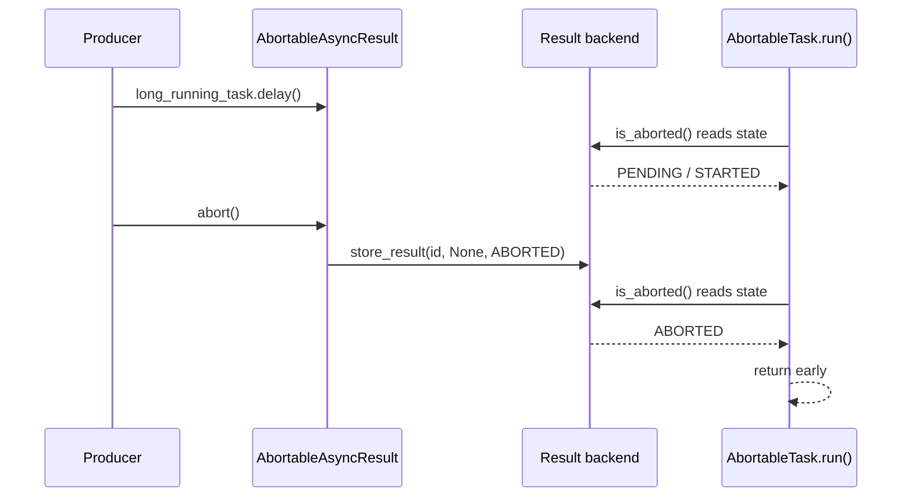
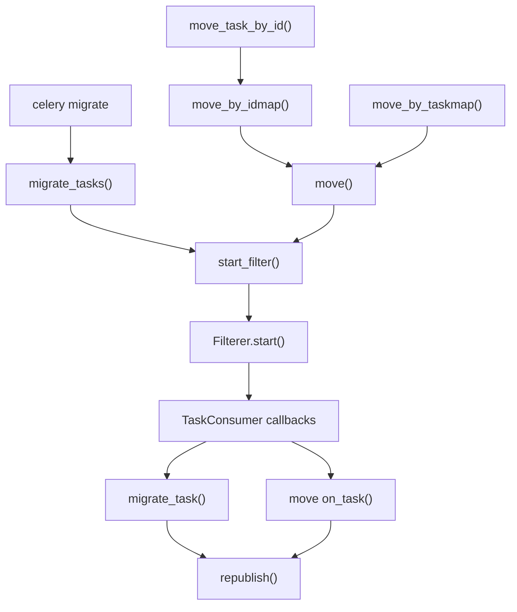
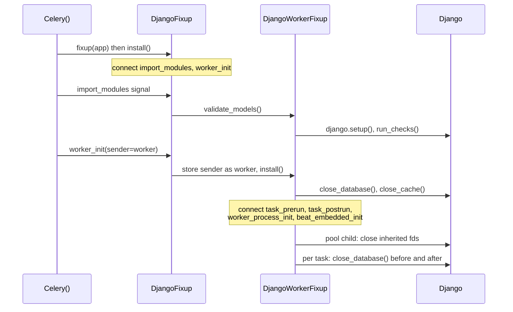

## Overview

The `celery.contrib` package holds optional tools built on top of the core APIs rather than inside them: a task base class that can be cancelled cooperatively, a telnet-based remote debugger for pool processes, broker-to-broker message migration, a Sphinx autodoc plugin for task functions, and Django helpers. None of these modules are imported by the worker unless an application asks for them, so each one can rely on extra dependencies (Sphinx, Django, `billiard`) without affecting plain Celery installs.

Sources: [celery/contrib/abortable.py:1-21](repo://celery/contrib/abortable.py#L1-L21), [celery/contrib/rdb.py:1-7](repo://celery/contrib/rdb.py#L1-L7), [celery/contrib/migrate.py:1-19](repo://celery/contrib/migrate.py#L1-L19), [celery/contrib/sphinx.py:1-12](repo://celery/contrib/sphinx.py#L1-L12)

Django support is the exception to "opt-in only": `celery/fixups/django.py` is listed in `BUILTIN_FIXUPS`, so every `Celery` app instantiates it at construction time, and it activates itself only when `DJANGO_SETTINGS_MODULE` is set. Its task class lives in `celery/contrib/django/task.py`. See [[The Celery Application]] for how the app is built and [[Defining and Calling Tasks]] for the base `Task` these extensions subclass.

Sources: [celery/app/base.py:82-84](repo://celery/app/base.py#L82-L84), [celery/app/base.py:410-413](repo://celery/app/base.py#L410-L413), [celery/fixups/django.py:52-63](repo://celery/fixups/django.py#L52-L63)

| Module | Public entry points | Used from |
| --- | --- | --- |
| `celery.contrib.abortable` | `AbortableTask`, `AbortableAsyncResult`, `ABORTED` | Task code and producers |
| `celery.contrib.rdb` | `set_trace()`, `debugger()`, `Rdb` | Task code running in a worker |
| `celery.contrib.migrate` | `migrate_tasks`, `move`, `move_task_by_id`, `move_by_idmap`, `move_by_taskmap`, `move_direct*` | Scripts and `celery migrate` |
| `celery.contrib.sphinx` | `TaskDocumenter`, `TaskDirective`, `setup()` | Sphinx `conf.py` |
| `celery.fixups.django` | `fixup()`, `DjangoFixup`, `DjangoWorkerFixup` | Loaded automatically by `Celery.__init__` |
| `celery.contrib.django.task` | `DjangoTask` | Default `task_cls` under the Django fixup |

Sources: [celery/contrib/abortable.py:84-100](repo://celery/contrib/abortable.py#L84-L100), [celery/contrib/rdb.py:51-54](repo://celery/contrib/rdb.py#L51-L54), [celery/contrib/migrate.py:14-19](repo://celery/contrib/migrate.py#L14-L19), [celery/contrib/sphinx.py:58-139](repo://celery/contrib/sphinx.py#L58-L139), [celery/fixups/django.py:31-31](repo://celery/fixups/django.py#L31-L31), [celery/contrib/django/task.py:8-21](repo://celery/contrib/django/task.py#L8-L21)

## Abortable Tasks

### Requesting an abort

Celery has no way to interrupt a running task from the outside except revoking with `terminate=True`, which kills the process. `celery.contrib.abortable` provides a cooperative alternative: the producer writes a custom `ABORTED` state into the result backend, and the task polls that state at points where it is safe to stop.

Sources: [celery/contrib/abortable.py:6-21](repo://celery/contrib/abortable.py#L6-L21), [celery/contrib/abortable.py:87-100](repo://celery/contrib/abortable.py#L87-L100)

`AbortableAsyncResult.abort()` calls `self.backend.store_result(self.id, result=None, state=ABORTED, traceback=None)`. The in-code TODO notes that `store_result` needs all four arguments even though only the state matters, so any result already stored for the id is overwritten with `None`. `AbortableAsyncResult.is_aborted()` just compares `self.state` against `ABORTED`.

Sources: [celery/contrib/abortable.py:103-127](repo://celery/contrib/abortable.py#L103-L127)

The producer gets an `AbortableAsyncResult` without asking for one: `AbortableTask` overrides `AsyncResult(task_id)`, and `Task.apply_async` passes `result_cls=self.AsyncResult` into `app.send_task`, which builds the returned result with that class.

Sources: [celery/contrib/abortable.py:130-145](repo://celery/contrib/abortable.py#L130-L145), [celery/app/task.py:703-708](repo://celery/app/task.py#L703-L708), [celery/app/base.py:1030-1030](repo://celery/app/base.py#L1030-L1030)

### Honouring an abort in the worker

`AbortableTask.is_aborted(**kwargs)` reads `task_id` from its keyword arguments, falling back to `self.request.id`, builds a result with `self.AsyncResult(task_id)`, and returns `False` if that is not an `AbortableAsyncResult`; otherwise it returns `result.is_aborted()`. Each call is a backend read (a database query with the database backend), so the docstring advises checking periodically rather than in every loop iteration.

Sources: [celery/contrib/abortable.py:147-165](repo://celery/contrib/abortable.py#L147-L165)



Sources: [celery/contrib/abortable.py:37-67](repo://celery/contrib/abortable.py#L37-L67), [celery/contrib/abortable.py:114-165](repo://celery/contrib/abortable.py#L114-L165)

> [!WARNING]
> `abort()` only records a request. Nothing stops the task if it never calls `is_aborted()`, and the worker can still overwrite `ABORTED` with its own final state. The module docstring states that this only works with the database backends, because producer and worker must read and write the same stored state. See [[Result Backends]] and [[Exceptions and Task States]].

Sources: [celery/contrib/abortable.py:69-79](repo://celery/contrib/abortable.py#L69-L79), [celery/contrib/abortable.py:114-123](repo://celery/contrib/abortable.py#L114-L123)

## Remote Debugger (rdb)

### Breakpoints in pool processes

Prefork pool children have no usable terminal, so a normal `pdb.set_trace()` cannot be driven. `celery.contrib.rdb` subclasses `Pdb` as `Rdb` and serves the debugger over a TCP socket you connect to with `telnet`. A task calls `rdb.set_trace()` where it wants to break.

Sources: [celery/contrib/rdb.py:1-21](repo://celery/contrib/rdb.py#L1-L21), [celery/contrib/rdb.py:84-89](repo://celery/contrib/rdb.py#L84-L89)

`set_trace(frame=None)` takes the caller's frame via `sys._getframe().f_back` and hands it to `debugger().set_trace(frame)`. `debugger()` keeps one instance in the module-level list `_current` and creates a new `Rdb()` only when there is none or the previous session is no longer `active`.

Sources: [celery/contrib/rdb.py:61-64](repo://celery/contrib/rdb.py#L61-L64), [celery/contrib/rdb.py:175-187](repo://celery/contrib/rdb.py#L175-L187)

### Session lifecycle

The `Rdb` constructor does all the socket work before the debugger starts:

Sources: [celery/contrib/rdb.py:91-115](repo://celery/contrib/rdb.py#L91-L115)

1. It saves the current `sys.stdin` and `sys.stdout` in `_prev_handles`.
2. `get_avail_port()` binds a listening socket, and the constructor calls `listen(1)`.
3. It prints `BANNER` (with `telnet host port`) to the worker's stdout so the log shows where to connect.
4. `self._sock.accept()` blocks the task until a client connects, then prints `SESSION_STARTED`.
5. It replaces `sys.stdin` and `sys.stdout` with `self._client.makefile('rw')` and passes the same handle to `Pdb.__init__`.

Sources: [celery/contrib/rdb.py:91-115](repo://celery/contrib/rdb.py#L91-L115), [celery/contrib/rdb.py:72-81](repo://celery/contrib/rdb.py#L72-L81)

`get_avail_port()` derives a port skew from the `billiard` process name: a pool child named `ForkPoolWorker-3` gets skew `3`, so concurrent children try different ports. It then tries up to `port_search_limit` (100) ports from `port + skew`, skipping `EADDRINUSE` and `EINVAL`, and raises an exception with `NO_AVAILABLE_PORT` if every bind fails.

Sources: [celery/contrib/rdb.py:116-135](repo://celery/contrib/rdb.py#L116-L135), [celery/contrib/rdb.py:66-70](repo://celery/contrib/rdb.py#L66-L70)

The `continue` (`c`, `cont`) and `quit` (`q`, `exit`) commands both call `_close_session()`, which restores the saved stdio handles, closes the file handle, client and listening socket, marks the instance inactive and prints `SESSION_ENDED`. `set_quit()` is overridden to call `sys.settrace(None)` instead of raising `BdbQuit`, because that exception could not be caught and would fail the task.

Sources: [celery/contrib/rdb.py:146-172](repo://celery/contrib/rdb.py#L146-L172)

### Environment variables

| Variable | Default | Effect |
| --- | --- | --- |
| `CELERY_RDB_HOST` | `127.0.0.1` | Address to bind; the default is reachable from localhost only. |
| `CELERY_RDB_PORT` | `6899` (`DEFAULT_PORT`) | Base port; the actual port is base + process skew + first free offset. |

Sources: [celery/contrib/rdb.py:26-42](repo://celery/contrib/rdb.py#L26-L42), [celery/contrib/rdb.py:56-59](repo://celery/contrib/rdb.py#L56-L59)

> [!WARNING]
> Both variables are read once at import time. Setting `CELERY_RDB_HOST` to a public address exposes an unauthenticated Python debugger running inside the worker.

Sources: [celery/contrib/rdb.py:56-59](repo://celery/contrib/rdb.py#L56-L59)

## Message Migration

### Moving and migrating messages

`celery.contrib.migrate` consumes task messages from one place and republishes them somewhere else, without running them. It has two front ends sharing one consumer loop: `migrate_tasks` copies messages from a source broker connection to a destination connection, and `move` re-routes messages on the same broker based on a predicate.

Sources: [celery/contrib/migrate.py:99-118](repo://celery/contrib/migrate.py#L99-L118), [celery/contrib/migrate.py:127-215](repo://celery/contrib/migrate.py#L127-L215)



Sources: [celery/bin/migrate.py:48-63](repo://celery/bin/migrate.py#L48-L63), [celery/contrib/migrate.py:80-118](repo://celery/contrib/migrate.py#L80-L118), [celery/contrib/migrate.py:189-215](repo://celery/contrib/migrate.py#L189-L215), [celery/contrib/migrate.py:337-406](repo://celery/contrib/migrate.py#L337-L406)

`republish()` sends the raw body bytes so the payload is not decoded and re-serialized. It keeps the original exchange and routing key unless new ones are given, pops the `compression` header so the producer can add it again on recompression, converts `expiration` to a float, and strips `application_headers`, `content_type`, `content_encoding` and `headers` from the properties before passing the rest to `producer.publish`.

Sources: [celery/contrib/migrate.py:50-77](repo://celery/contrib/migrate.py#L50-L77)

### migrate_tasks

`migrate_tasks(source, dest, ...)` normalises `queues` with `prepare_queues`, which accepts `"a:b,c"` strings or lists and returns a rename map (`a` becomes `b`, `c` stays `c`). It creates a producer on `dest` with `auto_declare=False` and binds `migrate_task` to it. `migrate_task` republishes each message using the rename map for both exchange and routing key, falling back to the original values when there is no entry.

Sources: [celery/contrib/migrate.py:80-105](repo://celery/contrib/migrate.py#L80-L105), [celery/contrib/migrate.py:236-244](repo://celery/contrib/migrate.py#L236-L244)

Before consuming, `on_declare_queue` binds each source queue to the destination channel, applies the rename to its name, and to its routing key and exchange when they matched the old queue name, then declares it, so the destination broker has the queues before messages arrive.

Sources: [celery/contrib/migrate.py:107-118](repo://celery/contrib/migrate.py#L107-L118)

### move and its helpers

`move(predicate, ...)` opens a connection with `app.connection_or_acquire(connection, pool=False)` and registers an `on_task(body, message)` callback. When the predicate returns something truthy, `transform` is applied first if given. A `kombu.Queue` result is declared with `maybe_declare` and its exchange name and routing key are used; any other value goes through `expand_dest`, which unpacks an `(exchange, routing_key)` tuple or falls back to the `exchange`/`routing_key` arguments. The message is republished, then acked on the source, `state.filtered` is incremented, and `StopFiltering` is raised once `limit` is reached.

Sources: [celery/contrib/migrate.py:189-223](repo://celery/contrib/migrate.py#L189-L223)

| Helper | Predicate | Notes |
| --- | --- | --- |
| `move_task_by_id(task_id, dest)` | Delegates to `move_by_idmap` with a one-entry map | Stops after one match |
| `move_by_idmap(map)` | `map.get(message.properties['correlation_id'])` | Passes `limit=len(map)` so consumption ends when all ids are found |
| `move_by_taskmap(map)` | `map.get(body['task'])` | Moves every message of the named tasks |
| `move_direct`, `move_direct_by_id`, `move_direct_by_idmap`, `move_direct_by_taskmap` | Same as above | `transform=worker_direct` turns a node name into that worker's direct queue |
| `task_id_eq`, `task_id_in` | `body['id'] == task_id` / `body['id'] in ids` | Building blocks for custom predicates, used with `functools.partial` |

Sources: [celery/contrib/migrate.py:226-233](repo://celery/contrib/migrate.py#L226-L233), [celery/contrib/migrate.py:358-416](repo://celery/contrib/migrate.py#L358-L416)

### The Filterer loop

`start_filter()` builds a `Filterer` and calls `start()`. The constructor turns `tasks` into a set, and sets `consume_from` to the explicit queues or else the keys of the `queues` map, resolving names through `app.amqp.queues`. `prepare_consumer` registers, in order, the filter callback, `update_state` (which increments `state.count` and raises `StopFiltering` at `limit`), an ack callback if `ack_messages` is set, and the user `callback` bound to `self.state`. When `tasks` is set, each of these is wrapped by `filter_callback`, so messages for other task names are ignored.

Sources: [celery/contrib/migrate.py:247-319](repo://celery/contrib/migrate.py#L247-L319), [celery/contrib/migrate.py:89-96](repo://celery/contrib/migrate.py#L89-L96), [celery/contrib/migrate.py:337-355](repo://celery/contrib/migrate.py#L337-L355)

`declare_queues` runs `on_declare_queue` for each consumer queue and does a passive `queue_declare` to add the message count to `state.total_apx`, which `State.strtotal` shows as the total (or `?` when unknown). `start()` then drives `kombu.eventloop(conn, timeout=..., ignore_timeouts=forever)` and treats `socket.timeout` and `StopFiltering` as a normal end, returning the `State`.

Sources: [celery/contrib/migrate.py:321-334](repo://celery/contrib/migrate.py#L321-L334), [celery/contrib/migrate.py:272-284](repo://celery/contrib/migrate.py#L272-L284), [celery/contrib/migrate.py:31-47](repo://celery/contrib/migrate.py#L31-L47)

> [!NOTE]
> `migrate_tasks` does not ack source messages unless `ack_messages=True`, so by default it copies messages and they remain on the source when the connection closes. `move` always acks after republishing.

Sources: [celery/contrib/migrate.py:291-312](repo://celery/contrib/migrate.py#L291-L312), [celery/contrib/migrate.py:205-207](repo://celery/contrib/migrate.py#L205-L207)

### The celery migrate command

`celery migrate SOURCE DESTINATION` wraps both URLs in `kombu.Connection` and calls `migrate_tasks` with a callback that echoes `Migrating task {state.count}/{state.strtotal}: {body}`. Its options map directly onto `start_filter` keyword arguments. The command is registered on the main `celery` group; see [[Command-Line Interface]].

Sources: [celery/bin/migrate.py:48-63](repo://celery/bin/migrate.py#L48-L63), [celery/bin/celery.py:180-180](repo://celery/bin/celery.py#L180-L180)

| Option | `start_filter` argument | Meaning |
| --- | --- | --- |
| `-n`, `--limit` | `limit` | Stop after this many consumed messages |
| `-t`, `--timeout` | `timeout` | Seconds to wait for messages before stopping |
| `-a`, `--ack-messages` | `ack_messages` | Ack messages on the source broker |
| `-T`, `--tasks` | `tasks` | Only migrate these task names |
| `-Q`, `--queues` | `queues` | Queues to migrate, with optional `src:dst` renames |
| `-F`, `--forever` | `forever` | Ignore timeouts and keep migrating until killed |

Sources: [celery/bin/migrate.py:9-47](repo://celery/bin/migrate.py#L9-L47)

> [!WARNING]
> The command docstring marks it as experimental and advises backing up the tasks first.

Sources: [celery/bin/migrate.py:49-55](repo://celery/bin/migrate.py#L49-L55)

## Sphinx Extension

### Registering the extension

Tasks created with `@app.task` are `Task` instances, not functions, so stock autodoc either skips them or documents them as objects. Adding `'celery.contrib.sphinx'` to `extensions` in `conf.py` makes autodoc find task objects in `automodule` output, document them with a `(task)` prefix, and enables the `:task:` cross-reference role and the `.. autotask::` directive.

Sources: [celery/contrib/sphinx.py:1-31](repo://celery/contrib/sphinx.py#L1-L31)

`setup(app)` loads `sphinx.ext.autodoc` and registers `TaskDocumenter`, a `py:task` directive (`TaskDirective`), a `py:task` role (`PyXRefRole(fix_parens=True)`), the `celery_task_prefix` config value (default `'(task)'`), and the `autodoc-skip-member` handler. It returns `parallel_read_safe: True`.

Sources: [celery/contrib/sphinx.py:111-139](repo://celery/contrib/sphinx.py#L111-L139)

On Sphinx 9.0 and later, `setup` checks `autodoc_use_legacy_class_based`. If it is not enabled, it emits a `UserWarning` and sets it to `True`, because `TaskDocumenter` is a class-based documenter that the rewritten autodoc does not use. Setting it explicitly in `conf.py` avoids the warning:

Sources: [celery/contrib/sphinx.py:117-129](repo://celery/contrib/sphinx.py#L117-L129), [celery/contrib/sphinx.py:33-46](repo://celery/contrib/sphinx.py#L33-L46)

```python
    extensions = (...,
                  'celery.contrib.sphinx')
    celery_task_prefix = '(task)'  # < default
    autodoc_use_legacy_class_based = True
```

Sources: [celery/contrib/sphinx.py:15-16](repo://celery/contrib/sphinx.py#L15-L16), [celery/contrib/sphinx.py:23-23](repo://celery/contrib/sphinx.py#L23-L23), [celery/contrib/sphinx.py:43-43](repo://celery/contrib/sphinx.py#L43-L43)

### How TaskDocumenter documents a task

| Hook | Behaviour |
| --- | --- |
| `objtype = 'task'`, `member_order = 11` | Gives the `autotask` directive name and sorts tasks after plain functions |
| `can_document_member` | Accepts members that are `BaseTask` instances with a `__wrapped__` function |
| `format_args` | Uses `inspect.signature(__wrapped__)`, dropping a leading `self` or `cls` parameter so bound tasks show their call signature |
| `document_members` | No-op: a task's attributes are not documented |
| `check_module` | Compares `__wrapped__.__module__` with the documented module, since the task object itself is created elsewhere |

Sources: [celery/contrib/sphinx.py:58-88](repo://celery/contrib/sphinx.py#L58-L88)

`TaskDirective.get_signature_prefix` returns the configured `celery_task_prefix` as a text node. `autodoc_skip_member_handler` returns `False` for task objects autodoc wanted to skip: a task's `__doc__` equals its class's `__doc__`, which autodoc's duplicate-docstring check would otherwise treat as repetition.

Sources: [celery/contrib/sphinx.py:91-108](repo://celery/contrib/sphinx.py#L91-L108)

## Django Integration

### Activating the fixup

At the end of `Celery.__init__`, every entry in `self.fixups` (by default `BUILTIN_FIXUPS`) is resolved with `symbol_by_name` and called with the app. `celery.fixups.django:fixup(app)` does nothing unless `DJANGO_SETTINGS_MODULE` is set and the app's `loader_cls` does not already contain `django`. If Django cannot be imported it emits a `FixupWarning` (`ERR_NOT_INSTALLED`); otherwise it rejects Django older than 1.11 with `ImproperlyConfigured` and returns `DjangoFixup(app).install()`.

Sources: [celery/app/base.py:410-413](repo://celery/app/base.py#L410-L413), [celery/fixups/django.py:33-63](repo://celery/fixups/django.py#L33-L63)

`DjangoFixup.__init__` makes the app the default app when none is set. `install()` then:

Sources: [celery/fixups/django.py:69-89](repo://celery/fixups/django.py#L69-L89)

1. Prepends `os.getcwd()` to `sys.path` so the project package is importable ahead of system modules.
2. Resolves `django.conf:settings` lazily and replaces `app.loader.now` with `DjangoFixup.now`, which returns UTC when asked and otherwise `django.utils.timezone.now()`.
3. Sets `app.task_cls` to `'celery.contrib.django.task:DjangoTask'` unless `_custom_task_cls_used` is true (a `task_cls` argument or a `Celery` subclass defining `task_cls`).
4. Connects `on_import_modules` to `signals.import_modules` and `on_worker_init` to `signals.worker_init`.

Sources: [celery/fixups/django.py:66-89](repo://celery/fixups/django.py#L66-L89), [celery/fixups/django.py:118-127](repo://celery/fixups/django.py#L118-L127), [celery/app/base.py:360-366](repo://celery/app/base.py#L360-L366)

`DjangoFixup.autodiscover_tasks()` returns the names of all `django.apps.apps.get_app_configs()`. When `app.autodiscover_tasks()` is called without packages, `_autodiscover_tasks_from_fixups` collects these names from every fixup, which is how the example project finds each app's `tasks.py`.

Sources: [celery/fixups/django.py:121-123](repo://celery/fixups/django.py#L121-L123), [celery/app/base.py:828-845](repo://celery/app/base.py#L828-L845)

```python
# Set the default Django settings module for the 'celery' program.
os.environ.setdefault('DJANGO_SETTINGS_MODULE', 'proj.settings')

app = Celery('proj')

# Using a string here means the worker doesn't have to serialize
# the configuration object to child processes.
# - namespace='CELERY' means all celery-related configuration keys
#   should have a `CELERY_` prefix.
app.config_from_object('django.conf:settings', namespace='CELERY')

# Load task modules from all registered Django apps.
app.autodiscover_tasks()
```

Sources: [examples/django/proj/celery.py:5-17](repo://examples/django/proj/celery.py#L5-L17)

### Worker lifecycle



Sources: [celery/fixups/django.py:75-116](repo://celery/fixups/django.py#L75-L116), [celery/fixups/django.py:146-203](repo://celery/fixups/django.py#L146-L203)

`on_import_modules` runs before task modules are imported and calls `DjangoWorkerFixup.validate_models()`, which calls `django.setup()` and then Django's `run_checks()` unless `CELERY_SKIP_CHECKS` is set in the environment. The `worker_fixup` property creates the `DjangoWorkerFixup` lazily, so non-worker processes such as producers never import `django.db` through it.

Sources: [celery/fixups/django.py:91-103](repo://celery/fixups/django.py#L91-L103), [celery/fixups/django.py:146-154](repo://celery/fixups/django.py#L146-L154)

`on_worker_init` stores the `WorkController` passed as `sender` on the worker fixup (warning with `FixupWarning` if it is missing) and calls `install()`, which connects `close_database` to `beat_embedded_init`, the task pre/post-run handlers, and `on_worker_process_init`, then closes database connections and caches in the parent before any children fork. The worker reference is stored instead of being constructed, to avoid instantiating `WorkController` recursively.

Sources: [celery/fixups/django.py:105-116](repo://celery/fixups/django.py#L105-L116), [celery/fixups/django.py:130-163](repo://celery/fixups/django.py#L130-L163)

### Database connection handling

Django connections are not safe to share across forked processes or to keep across tasks that might outlive the database's idle timeout. In each new pool child, `on_worker_process_init` re-runs `validate_models()` if `FORKED_BY_MULTIPROCESSING` is set (Windows or execv start), then closes each inherited connection's raw file descriptor with `os.close(fh.fileno())` rather than `conn.close()`, since a protocol-level close could break the parent's connection. It finishes with `_close_database()` and `close_cache()`.

Sources: [celery/fixups/django.py:165-192](repo://celery/fixups/django.py#L165-L192), [celery/fixups/django.py:39-44](repo://celery/fixups/django.py#L39-L44)

`on_task_prerun` and `on_task_postrun` call `close_database()` (and `close_cache()` after the task) unless `sender.request.is_eager` is true, so tasks run with `apply()` inside a Django request do not close the request's connection. `close_database()` honours the `CELERY_DB_REUSE_MAX` setting: when it is unset every call closes connections; when set, connections are closed only once `_db_recycles` reaches twice the value (two calls per task), and the counter then resets.

Sources: [celery/fixups/django.py:194-211](repo://celery/fixups/django.py#L194-L211), [celery/fixups/django.py:134-136](repo://celery/fixups/django.py#L134-L136)

`_close_database()` asks for `connections.all(initialized_only=True)` and falls back to `connections.all()` on Django older than 4.1. For each connection it calls `close()`, and, when the alias has `OPTIONS["pool"]` in `DATABASES` and the worker uses the prefork pool, also `close_pool()`. `_is_prefork()` checks whether `"prefork"` appears in the worker's `pool_cls` name or module. `InterfaceError` is ignored, and a `DatabaseError` is re-raised unless its message contains `closed` or `not connected`.

Sources: [celery/fixups/django.py:213-246](repo://celery/fixups/django.py#L213-L246)

### DjangoTask

`DjangoTask` adds two methods that defer sending until the surrounding database transaction commits, so a worker never receives a task referring to rows it cannot see yet. Both wrap the normal call in `functools.partial` and register it with `django.db.transaction.on_commit`; they return `None` rather than an `AsyncResult`, because the message has not been sent yet.

Sources: [celery/contrib/django/task.py:1-21](repo://celery/contrib/django/task.py#L1-L21)

```python
    def delay_on_commit(self, *args, **kwargs) -> None:
        """Call :meth:`~celery.app.task.Task.delay` with Django's ``on_commit()``."""
        transaction.on_commit(functools.partial(self.delay, *args, **kwargs))

    def apply_async_on_commit(self, *args, **kwargs) -> None:
        """Call :meth:`~celery.app.task.Task.apply_async` with Django's ``on_commit()``."""
        transaction.on_commit(functools.partial(self.apply_async, *args, **kwargs))
```

Sources: [celery/contrib/django/task.py:15-21](repo://celery/contrib/django/task.py#L15-L21)

> [!TIP]
> Passing `task_cls=` to `Celery(...)` disables the automatic switch to `DjangoTask`. To keep the on-commit helpers with a custom base, subclass `DjangoTask` instead of `Task`. Configuration keys use the `CELERY_` namespace when loaded with `config_from_object('django.conf:settings', namespace='CELERY')`; see [[Configuration]].

Sources: [celery/fixups/django.py:84-85](repo://celery/fixups/django.py#L84-L85), [celery/app/base.py:360-366](repo://celery/app/base.py#L360-L366), [examples/django/proj/celery.py:10-14](repo://examples/django/proj/celery.py#L10-L14)
