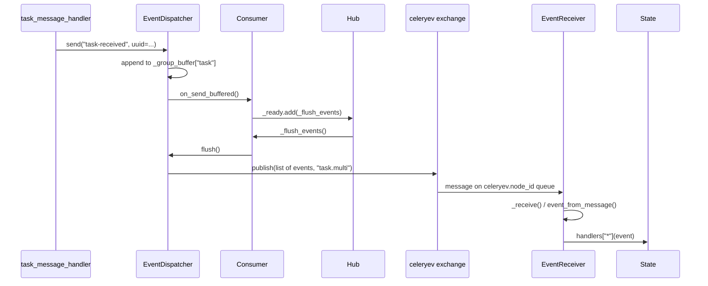
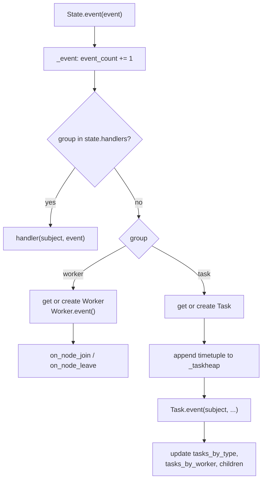

## Overview

Celery events are a stream of small messages that workers (and, optionally, clients) publish whenever something happens to a task or a worker: a task is sent, received, started, succeeds or fails, and a worker comes online, sends a heartbeat or goes offline. Monitors such as `celery events` subscribe to this stream to show what the cluster is doing without querying each worker. The `celery.events` package bundles the three building blocks: `Event` creates the message, `EventDispatcher` publishes it and `EventReceiver` consumes it.

Sources: [celery/events/__init__.py:1-15](repo://celery/events/__init__.py#L1-L15)

Applications do not import those classes directly: `app.events` exposes `Receiver`, `Dispatcher` and `State` as app-bound subclasses created with `subclass_with_self`, so each one picks up the app's configuration. `default_dispatcher()` borrows a connection from the app's producer pool for one-off publishing. On the worker side, the `Events` and `Heart` consumer bootsteps own the dispatcher (see [[Worker Architecture and Bootsteps]]), and the in-memory `State` turns received events into a model of workers and tasks that the curses monitor and snapshot cameras read.

Sources: [celery/app/events.py:7-40](repo://celery/app/events.py#L7-L40)

## Event Messages

An event is just a dictionary. `Event(type, **fields)` merges the fields, sets `type`, and stamps a `timestamp` with `time.time()` unless the caller supplied one. The group of an event is the part of its type before the first dash: `group_from('task-sent')` returns `'task'`, and `group_from('custom-my-event')` returns `'custom'`. Groups drive both filtering in the dispatcher and handler lookup in `State`.

Sources: [celery/events/event.py:18-43](repo://celery/events/event.py#L18-L43)

Events travel on a topic exchange named `celeryev`. `get_exchange()` copies the module-level `event_exchange`, switches it to a `fanout` exchange when the transport is Redis or Google Pub/Sub (those transports do not support topic routing well), and renames it when `event_exchange` is configured differently.

Sources: [celery/events/event.py:11-15](repo://celery/events/event.py#L11-L15), [celery/events/event.py:46-63](repo://celery/events/event.py#L46-L63)

When the dispatcher publishes, it fills in standard fields on top of the caller's fields: `hostname`, `utcoffset`, `pid` and `clock`, the Lamport clock value from `app.clock.forward()`. The routing key is the type with dashes replaced by dots, so `task-succeeded` is routed as `task.succeeded`, and a receiver can bind with a pattern such as `task.#`.

Sources: [celery/events/dispatcher.py:116-140](repo://celery/events/dispatcher.py#L116-L140)

## Event Types

The worker and the client send these built-in types. A `task-*` event always carries `uuid`, and a `worker-*` heartbeat carries load and software information.

Sources: [celery/worker/request.py:511-513](repo://celery/worker/request.py#L511-L513), [celery/worker/heartbeat.py:39-47](repo://celery/worker/heartbeat.py#L39-L47)

| Event | Sent by | Extra fields |
| --- | --- | --- |
| `task-sent` | Client, in `send_task_message`, when `task_send_sent_event` is on | `uuid`, `root_id`, `parent_id`, `name`, `args`, `kwargs`, `retries`, `eta`, `expires`, `queue`, `exchange`, `routing_key` |
| `task-received` | Worker strategy, when the message is accepted | `name`, `args`, `kwargs`, `root_id`, `parent_id`, `retries`, `eta`, `expires` |
| `task-started` | `Request.on_accepted` | none |
| `task-succeeded` | `Request.on_success` | `result`, `runtime` |
| `task-failed` | `Request.on_failure` | `exception`, `traceback` |
| `task-retried` | `Request.on_retry` | `exception`, `traceback` |
| `task-rejected` | `Request.reject` | `requeue` |
| `task-revoked` | `Request._announce_revoked` | `terminated`, `signum`, `expired` |
| `task-cancelled` | `Request._announce_cancelled` | none |
| `worker-online`<br>`worker-heartbeat`<br>`worker-offline` | `celery.worker.heartbeat.Heart` | `freq`, `active`, `processed`, `loadavg`, plus `SOFTWARE_INFO` (`sw_ident`, `sw_ver`, `sw_sys`) |

Sources: [celery/app/amqp.py:400-418](repo://celery/app/amqp.py#L400-L418), [celery/app/amqp.py:593-604](repo://celery/app/amqp.py#L593-L604), [celery/worker/strategy.py:167-177](repo://celery/worker/strategy.py#L167-L177), [celery/worker/request.py:436-461](repo://celery/worker/request.py#L436-L461), [celery/worker/request.py:511-523](repo://celery/worker/request.py#L511-L523), [celery/worker/request.py:611-622](repo://celery/worker/request.py#L611-L622), [celery/worker/request.py:715-741](repo://celery/worker/request.py#L715-L741), [celery/worker/heartbeat.py:39-61](repo://celery/worker/heartbeat.py#L39-L61)

Every worker-side task event goes through `Request.send_event`, which does nothing unless the request has an eventer, the eventer is enabled, and the task's `send_events` attribute is true. A task class can therefore set `send_events = False` to stay out of the stream even when the worker sends task events.

Sources: [celery/worker/request.py:511-513](repo://celery/worker/request.py#L511-L513), [celery/app/task.py:268-268](repo://celery/app/task.py#L268-L268)

## Event Dispatcher

### Construction and enabling

`EventDispatcher.__init__` resolves the connection (from `connection`, or from `channel.connection.client` when only a channel is given, or `app.connection_for_write()`), takes the serializer from `event_serializer`, and looks up the exchange with `get_exchange`. Transports in `DISABLED_TRANSPORTS` (`sql`) force `enabled = False`, because they cannot carry a broadcast stream. When enabled, `enable()` creates a kombu `Producer` with `auto_declare=False` and runs every callback in `on_enabled`; `disable()` drops the producer and runs `on_disabled`. The worker's heartbeat registers itself in those callback sets.

Sources: [celery/events/dispatcher.py:48-114](repo://celery/events/dispatcher.py#L48-L114)

### Groups and sending

`send(type, **fields)` returns immediately when the dispatcher is disabled. When `groups` is non-empty and the event's group is not in it, the event is dropped. This is how a worker started without `-E` still publishes `worker-*` events but no `task-*` events. Otherwise the event is either buffered (see below) or passed to `publish()`, which builds the event and calls `_publish` under `self.mutex`.

Sources: [celery/events/dispatcher.py:164-199](repo://celery/events/dispatcher.py#L164-L199)

`_publish` sends with `declare=[exchange]`, the dispatcher's serializer, a `hostname` header and `delivery_mode=1` (transient) by default. If publishing raises and `buffer_while_offline` is true, the event and routing key go to `_outbound_buffer` instead of propagating the error.

Sources: [celery/events/dispatcher.py:142-162](repo://celery/events/dispatcher.py#L142-L162)

### Buffering

Two buffers exist. `_outbound_buffer` holds events that failed to publish while the connection was down. `_group_buffer` holds events of the groups listed in `buffer_group`. Those are not published one by one: they are appended to a per-group list, and once the list reaches `buffer_limit` (24 by default) `flush()` runs. Before that, `on_send_buffered` is called so the owner can schedule a flush soon.

Sources: [celery/events/dispatcher.py:185-195](repo://celery/events/dispatcher.py#L185-L195)

`flush(errors=True, groups=True)` republishes the `_outbound_buffer` entries, then publishes each group buffer as a single message whose body is a list of events and whose routing key is `<group>.multi`. Receivers since Celery 4.0 detect the list body and unpack it. `extend_buffer(other)` copies another dispatcher's outbound buffer, which the worker uses to carry unsent events across reconnects.

Sources: [celery/events/dispatcher.py:201-217](repo://celery/events/dispatcher.py#L201-L217), [celery/events/receiver.py:140-145](repo://celery/events/receiver.py#L140-L145)

## Worker Integration

### The Events bootstep

The consumer's `Events` bootstep requires `Connection`. Its `__init__` sets `groups` to `None` (all groups) when task events are on, or `['worker']` otherwise, and enables the step if task events, gossip or heartbeats need a dispatcher. `task_events` comes from `worker_send_task_events` or the worker's `-E/--task-events/--events` flag.

Sources: [celery/worker/consumer/events.py:15-33](repo://celery/worker/consumer/events.py#L15-L33), [celery/worker/worker.py:377-377](repo://celery/worker/worker.py#L377-L377), [celery/bin/worker.py:212-220](repo://celery/bin/worker.py#L212-L220)

`start()` runs on every (re)connection. It closes the previous dispatcher through `_close`, which keeps the previous `groups` so changes made by remote control survive a reconnect. It then creates a new `app.events.Dispatcher` on `c.connection_for_write()`. When the worker runs an event loop (`c.hub`), it buffers the `task` group and passes `c.on_send_event_buffered` as the flush hook. If there was a previous dispatcher, its outbound buffer is copied in and flushed, and every reserved request gets the new dispatcher as its `eventer`.

Sources: [celery/worker/consumer/events.py:35-71](repo://celery/worker/consumer/events.py#L35-L71)

`Consumer.on_send_event_buffered` adds `_flush_events` to the hub's ready set, so buffered task events are published as one `task.multi` message at the next loop iteration instead of one message per event. Eventlet and gevent workers have no hub, so they publish each event right away, as the comment in `start()` says.

Sources: [celery/worker/consumer/consumer.py:624-630](repo://celery/worker/consumer/consumer.py#L624-L630)



Sources: [celery/worker/strategy.py:113-117](repo://celery/worker/strategy.py#L113-L117), [celery/events/dispatcher.py:185-213](repo://celery/events/dispatcher.py#L185-L213), [celery/worker/consumer/consumer.py:624-630](repo://celery/worker/consumer/consumer.py#L624-L630), [celery/events/receiver.py:80-145](repo://celery/events/receiver.py#L80-L145)

### Heartbeats

The `Heart` bootstep requires `Events` and is disabled by `--without-heartbeat`. Its `start()` builds a `celery.worker.heartbeat.Heart` on the consumer timer with the consumer's dispatcher and `--heartbeat-interval`. These are event heartbeats, not AMQP protocol heartbeats.

Sources: [celery/worker/consumer/heart.py:10-36](repo://celery/worker/consumer/heart.py#L10-L36), [celery/bin/worker.py:277-284](repo://celery/bin/worker.py#L277-L284)

`Heart.__init__` defaults the interval to 2 seconds and adds `start`/`stop` to the dispatcher's `on_enabled`/`on_disabled` callbacks. `start()` sends `worker-online` and then schedules `worker-heartbeat` every interval with `timer.call_repeatedly`. `stop()` cancels the timer and sends `worker-offline` with `retry=False`, so shutdown is not blocked by a dead broker. Each `_send` reports `freq`, the number of active requests, the processed total and the load average, and fires the `heartbeat_sent` signal only when it has receivers.

Sources: [celery/worker/heartbeat.py:25-61](repo://celery/worker/heartbeat.py#L25-L61)

### Remote control

Three remote control commands act on the running dispatcher (see [[Remote Control and Inspection]]). `enable_events` adds `task` to the dispatcher's `groups` and `disable_events` removes it, so task events can be turned on in a live worker without restarting it. `heartbeat` sends an immediate `worker-heartbeat`; `EventReceiver.wakeup_workers` broadcasts it when a monitor starts consuming, so the monitor sees all live workers at once instead of waiting for their next heartbeat.

Sources: [celery/worker/control.py:345-376](repo://celery/worker/control.py#L345-L376), [celery/events/receiver.py:90-111](repo://celery/events/receiver.py#L90-L111)

### Client task-sent events

`task-sent` comes from the client, not the worker. `Celery.send_task` passes `task_send_sent_event` to `amqp.create_task_message`, which only builds a `sent_event` dictionary when that setting is true. After publishing the task, `send_task_message` adds `queue`, `exchange` and `routing_key` and calls `publish('task-sent', ...)` on the given or default dispatcher, using the same producer as the task message.

Sources: [celery/app/base.py:1006-1016](repo://celery/app/base.py#L1006-L1016), [celery/app/amqp.py:593-604](repo://celery/app/amqp.py#L593-L604)

## Event Receiver

`EventReceiver` is a kombu `ConsumerMixin`. Each instance declares its own queue named `<event_queue_prefix>.<node_id>`, with a random `uuid()` as `node_id`, bound to the event exchange with `routing_key='#'` by default. The queue options come from the `event_queue_*` settings: `auto_delete` unless durable, plus `exclusive`, `message_ttl` and `expires`. Configuring a queue as both exclusive and durable raises `ImproperlyConfigured`. By default it accepts the configured `event_serializer` plus `json`.

Sources: [celery/events/receiver.py:23-78](repo://celery/events/receiver.py#L23-L78)

`handlers` maps event type names to callables, and `"*"` catches every type without its own handler. `get_consumers` consumes with `no_ack=True`, since events are disposable. `capture()` loops over `consume()` until interrupted, and `itercapture()` returns the generator so the caller can drive it.

Sources: [celery/events/receiver.py:80-106](repo://celery/events/receiver.py#L80-L106)

`event_from_message` keeps logical clocks in step. For `task-sent`, which comes from clients that never synchronize their clock, the receiver replaces `clock` with its own clock value minus one (`CLIENT_CLOCK_SKEW`), so the sent event sorts before the worker events for the same task. For other events it adjusts its clock to the event's value, or forwards it when the event has none. With `localize=True` it converts `timestamp` with `adjust_timestamp(timestamp, utcoffset)`, and it always adds `local_received`.

Sources: [celery/events/receiver.py:113-138](repo://celery/events/receiver.py#L113-L138)

## Cluster State

### Event processing

`State` keeps `workers` and `tasks` in `LRUCache` instances, bounded by `max_workers_in_memory` (5000) and `max_tasks_in_memory` (10000), so a long-running monitor does not grow without limit. `state.event(event)` takes the mutex and calls `_event`, a closure built once by `_create_dispatcher` that caches attribute lookups because it runs for every message.

Sources: [celery/events/state.py:398-440](repo://celery/events/state.py#L398-L440), [celery/events/state.py:501-503](repo://celery/events/state.py#L501-L503)

`_event` increments `event_count`, calls the optional `callback`, and splits the type into group and subject. A handler registered in `state.handlers` for that group takes over completely. Otherwise `worker` events create or update a `Worker` and fire `on_node_join`/`on_node_leave` (an offline worker is removed from `workers`). `task` events create the `Task` if needed. For `task-sent` they record the client hostname; for other subjects they attach the worker and feed its heartbeat list. Then they push a `timetuple(clock, timestamp, origin, ref(task))` into the time-ordered `_taskheap`, update the task, index it in `tasks_by_type` and `tasks_by_worker`, and link it to its parent and children.

Sources: [celery/events/state.py:540-634](repo://celery/events/state.py#L540-L634)



Sources: [celery/events/state.py:540-634](repo://celery/events/state.py#L540-L634)

The task heap may hold up to `max_tasks_in_memory * heap_multiplier` entries (4 per task, matching PENDING, RECEIVED, STARTED and a final state), and the oldest entry is dropped when it is full. `tasks_by_time()` walks the heap newest-first and dereferences the weak references, so tasks evicted from the LRU cache just disappear from the listing.

Sources: [celery/events/state.py:522-529](repo://celery/events/state.py#L522-L529), [celery/events/state.py:598-608](repo://celery/events/state.py#L598-L608), [celery/events/state.py:656-674](repo://celery/events/state.py#L656-L674)

### Worker liveness

`Worker.event` stores the event's fields as attributes. On `offline` it clears the heartbeat list. For other events it keeps at most `heartbeat_max` (4) `local_received` timestamps in sorted order, and logs `DRIFT_WARNING` once per host when the sender's timestamp and the local receive time differ by more than `HEARTBEAT_DRIFT_MAX` (16 seconds).

Sources: [celery/events/state.py:183-214](repo://celery/events/state.py#L183-L214), [celery/events/state.py:45-57](repo://celery/events/state.py#L45-L57)

`Worker.alive` is true while the current time is below `heartbeat_expires`: the last heartbeat plus `freq * HEARTBEAT_EXPIRE_WINDOW / 100`. With the 200% window and the worker's default 2-second heartbeat, a worker is shown offline after missing about 4 seconds of heartbeats. `State.alive_workers()` filters on this property.

Sources: [celery/events/state.py:114-123](repo://celery/events/state.py#L114-L123), [celery/events/state.py:224-235](repo://celery/events/state.py#L224-L235), [celery/events/state.py:706-708](repo://celery/events/state.py#L706-L708)

### Task state merging

`Task.event` maps the subject to a state with `TASK_EVENT_TO_STATE` and records the timestamp on an attribute of the same name (for example `task.succeeded`). Subjects without a mapping, such as `cancelled` or custom events, become the upper-cased subject. Events can arrive out of order, so the method compares `states.precedence`. When the incoming state logically happened before the current one, it does not overwrite `state`; only the fields listed in `merge_rules` for that state are kept (for `RECEIVED`: `name`, `args`, `kwargs`, `parent_id`, `root_id`, `retries`, `eta`, `expires`). `RETRY` is exempt from this check because a task can go back to running after a retry. See [[Exceptions and Task States]] for the state ordering.

Sources: [celery/events/state.py:66-76](repo://celery/events/state.py#L66-L76), [celery/events/state.py:264-277](repo://celery/events/state.py#L264-L277), [celery/events/state.py:305-332](repo://celery/events/state.py#L305-L332)

## Snapshots

`Polaroid` takes periodic snapshots of a `State` for consumers that prefer intervals over a live stream, such as writing to a database. `install()` schedules `capture` every `freq` seconds and `cleanup` every `cleanup_freq` seconds (3600 by default) on a `Timer`. `capture` runs `shutter` inside `state.freeze_while`, so the state cannot change mid-snapshot, and clears the state afterwards when `clear_after` is true. `shutter` respects an optional `maxrate` token bucket, sends `shutter_signal` and calls `on_shutter(state)`, the method subclasses override. `cancel()` triggers one last capture before stopping the timers.

Sources: [celery/events/snapshot.py:24-83](repo://celery/events/snapshot.py#L24-L83), [celery/events/state.py:442-449](repo://celery/events/state.py#L442-L449)

`evcam` wires the pieces together: it creates a pidlock and logging, instantiates the camera class by name with the state, installs it, and feeds a receiver into the state.

Sources: [celery/events/snapshot.py:86-101](repo://celery/events/snapshot.py#L86-L101)

```python
    state = app.events.State()
    cam = instantiate(camera, state, app=app, freq=freq,
                      maxrate=maxrate, timer=timer)
    cam.install()
    conn = app.connection_for_read()
    recv = app.events.Receiver(conn, handlers={'*': state.event})
    try:
        try:
            recv.capture(limit=None)
```

Sources: [celery/events/snapshot.py:98-106](repo://celery/events/snapshot.py#L98-L106)

## The celery events Command

### Command options

`celery events` picks one of three tools: `--dump` runs `evdump`, `--camera` runs `evcam` (optionally detached as a daemon), and with neither option it starts the curses monitor `evtop`. Each tool sets a process title such as `celery events:dump`. If the `_curses` module is missing, the monitor raises a `click.UsageError`. See [[Command-Line Interface]] for the shared options.

Sources: [celery/bin/events.py:12-98](repo://celery/bin/events.py#L12-L98)

| Option | Group | Effect |
| --- | --- | --- |
| `-d`, `--dump` | Dumper | Print every event to stdout. |
| `-c`, `--camera` | Snapshot | Camera class name passed to `evcam`, for example a `Polaroid` subclass. |
| `-d`, `--detach` | Snapshot | Run the camera in the background with `detached(...)`. |
| `-F`, `--frequency`, `--freq` | Snapshot | Seconds between snapshots (default `1.0`). |
| `-r`, `--maxrate` | Snapshot | Rate limit for shutter calls, for example `100/m`. |
| `-l`, `--loglevel` | Snapshot | Logging level (default `WARNING`). |

Sources: [celery/bin/events.py:51-83](repo://celery/bin/events.py#L51-L83)

> [!WARNING]
> `--dump` and `--detach` both declare the short flag `-d`. Use the long option names to be sure which one you get.

Sources: [celery/bin/events.py:52-65](repo://celery/bin/events.py#L52-L65)

### Event dumper

`evdump` is a `tcpdump` for Celery events. It clones a read connection, retries with `ensure_connection`, and captures with a `"*"` handler on `Dumper.on_event`, reconnecting after connection or channel errors. `on_event` prints `hostname [timestamp] type: fields`, maps worker event types to readable words through `HUMAN_TYPES` (`started`, `heartbeat`, `shutdown`), and remembers the task name and arguments from `task-received`/`task-sent` in an LRU cache so later events for the same `uuid` can show them.

Sources: [celery/events/dumper.py:15-99](repo://celery/events/dumper.py#L15-L99)

### Curses monitor

`evtop` creates a `State`, a `CursesMonitor` and a `DisplayThread` that redraws every `screen_delay` milliseconds. The main thread runs `capture_events`, which feeds a receiver into `state.event` and reconnects when the connection drops. The screen lists tasks from `state.tasks_by_time()` and the workers whose `alive` is true.

Sources: [celery/events/cursesmon.py:466-534](repo://celery/events/cursesmon.py#L466-L534)

The keymap also makes the monitor a small control panel: `J`/`K` move the selection, `I`, `T` and `R` show info, traceback and result, `C` revokes the selected task through `app.control.revoke`, and `L` prompts for a new rate limit sent with `app.control.rate_limit`.

Sources: [celery/events/cursesmon.py:51-65](repo://celery/events/cursesmon.py#L51-L65), [celery/events/cursesmon.py:173-243](repo://celery/events/cursesmon.py#L173-L243)

## Configuration

The settings below control whether events are produced and how monitor queues behave. See [[Configuration]] for how settings are loaded.

Sources: [celery/app/defaults.py:179-188](repo://celery/app/defaults.py#L179-L188)

| Setting | Default | Used by |
| --- | --- | --- |
| `worker_send_task_events` | `False` | Worker: enables the `task` group (same as `-E`). |
| `task_send_sent_event` | `False` | Client: publishes `task-sent` with each task message. |
| `event_queue_expires` | `60.0` | `EventReceiver`: queue `expires` (seconds unused before deletion). |
| `event_queue_ttl` | `5.0` | `EventReceiver`: per-message `message_ttl`. |
| `event_queue_prefix` | `'celeryev'` | `EventReceiver`: prefix of the queue name. |
| `event_queue_exclusive` | `True` | `EventReceiver`: exclusive queue. |
| `event_queue_durable` | `False` | `EventReceiver`: durable, non-auto-delete queue (cannot be combined with exclusive). |
| `event_serializer` | `'json'` | Dispatcher serializer, and accepted by receivers. |
| `event_exchange` | `'celeryev'` | Exchange name for both sides. |

Sources: [celery/app/defaults.py:179-188](repo://celery/app/defaults.py#L179-L188), [celery/app/defaults.py:311-313](repo://celery/app/defaults.py#L311-L313), [celery/app/defaults.py:366-368](repo://celery/app/defaults.py#L366-L368)

A worker started without task events says so in its startup banner (`OFF (enable -E to monitor tasks in this worker)`), but it still sends `worker-*` heartbeats unless `--without-heartbeat` is given, so monitors always see the node.

Sources: [celery/apps/worker.py:228-230](repo://celery/apps/worker.py#L228-L230), [celery/worker/consumer/events.py:20-29](repo://celery/worker/consumer/events.py#L20-L29)
