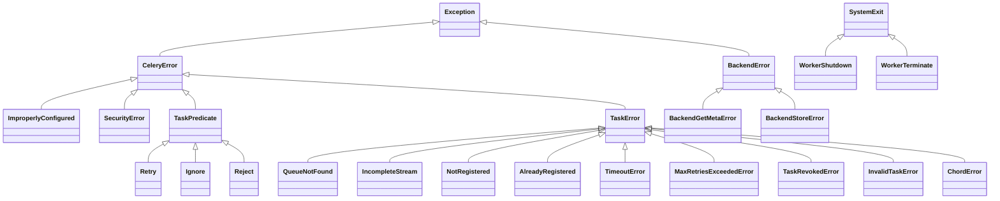
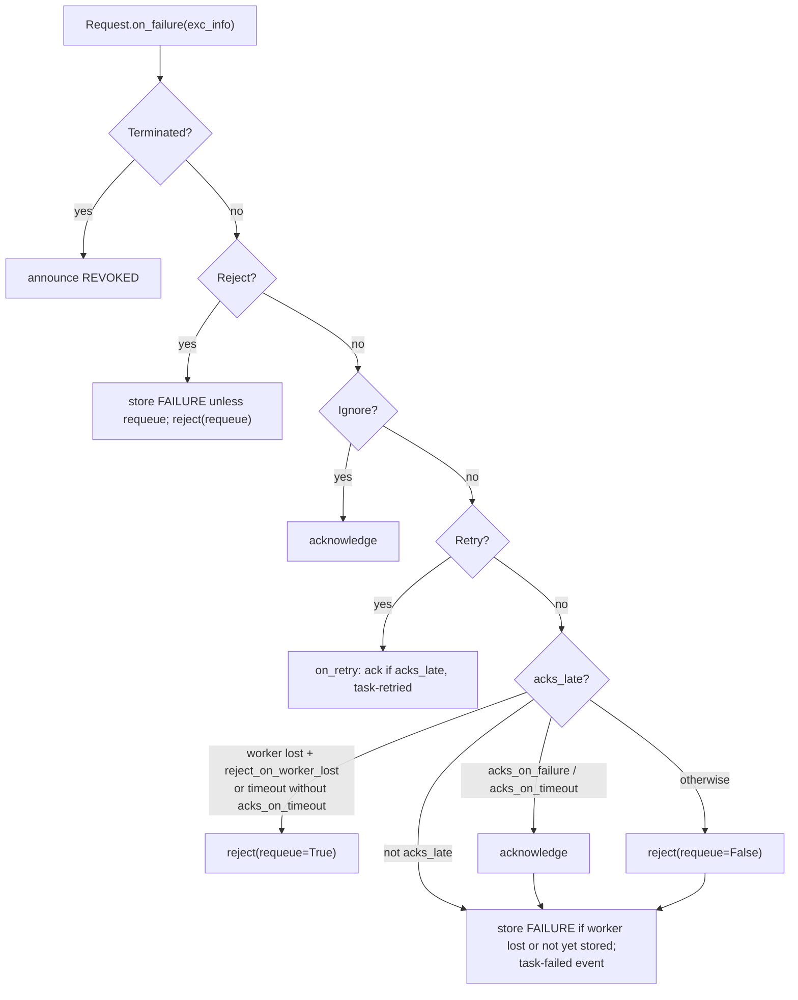

## Overview

Two small modules give the rest of Celery a shared vocabulary. `celery/states.py` defines the state strings a task moves through (`PENDING`, `STARTED`, `SUCCESS`, ...), the sets that classify them (ready, unready, exception, propagate) and a precedence order for merging out-of-order updates. `celery/exceptions.py` defines every error and warning Celery raises, including the "semi-predicate" exceptions (`Retry`, `Ignore`, `Reject`) that a task raises to steer the worker rather than to report a bug.

Sources: [celery/states.py:1-59](repo://celery/states.py#L1-L59), [celery/exceptions.py:1-52](repo://celery/exceptions.py#L1-L52)

The tracer turns these exceptions into states (see [[Task Execution and Tracing]]), result objects read the state sets to decide when a result is ready and whether to raise (see [[Task Results]]), and the worker's `Request` turns pool errors into acknowledgement decisions (see [[Consumer and Task Requests]]).

Sources: [celery/app/trace.py:104-114](repo://celery/app/trace.py#L104-L114), [celery/result.py:370-396](repo://celery/result.py#L370-L396)

## Task states

### Built-in states

| State | Meaning | Set by |
| --- | --- | --- |
| `PENDING` | Unknown; assumed waiting because the id exists. | Default for any id the backend does not know; `task-sent` events. |
| `RECEIVED` | Received by a worker. | Events only. |
| `STARTED` | Started by a worker. | Tracer, only with `task_track_started`. |
| `SUCCESS` | Finished successfully. | `backend.mark_as_done`. |
| `FAILURE` | Raised an exception. | `backend.mark_as_failure`. |
| `REVOKED` | Revoked, terminated or expired. | `backend.mark_as_revoked`. |
| `REJECTED` | Message rejected. | Events only. |
| `RETRY` | Waiting to be retried. | `backend.mark_as_retry`. |
| `IGNORED` | Ignored by the task (`Ignore`). | Tracer only, never stored. |

Sources: [celery/states.py:126-142](repo://celery/states.py#L126-L142), [celery/app/trace.py:574-578](repo://celery/app/trace.py#L574-L578), [celery/backends/base.py:180-199](repo://celery/backends/base.py#L180-L199), [celery/backends/base.py:306-323](repo://celery/backends/base.py#L306-L323)

`ALL_STATES` lists the seven states a result can hold; `REJECTED` and `IGNORED` are not part of it. Any other string is a custom state, which a task can store with `update_state(state='PROGRESS', meta=...)`.

Sources: [celery/states.py:149-151](repo://celery/states.py#L149-L151), [celery/app/task.py:1121-1133](repo://celery/app/task.py#L1121-L1133)

### State sets

```python
READY_STATES = frozenset({SUCCESS, FAILURE, REVOKED})
UNREADY_STATES = frozenset({PENDING, RECEIVED, STARTED, REJECTED, RETRY})
EXCEPTION_STATES = frozenset({RETRY, FAILURE, REVOKED})
PROPAGATE_STATES = frozenset({FAILURE, REVOKED})
```

Sources: [celery/states.py:144-147](repo://celery/states.py#L144-L147)

| Set | Used for |
| --- | --- |
| `READY_STATES` | `AsyncResult.ready()` and result consumers stop waiting once the state is in it. `RETRY` is not ready: a retried task will run again. |
| `UNREADY_STATES` | The opposite set; the Elasticsearch backend refuses to overwrite a ready state with an unready one. |
| `EXCEPTION_STATES` | The stored result is an exception: the backend serializes it with `prepare_exception` and decodes it back with `exception_to_python`. |
| `PROPAGATE_STATES` | `AsyncResult.get(propagate=True)` and `maybe_throw` re-raise the stored exception. `RETRY` is excluded so waiting on a retrying task does not raise. |

Sources: [celery/result.py:370-396](repo://celery/result.py#L370-L396), [celery/backends/base.py:108-111](repo://celery/backends/base.py#L108-L111), [celery/backends/base.py:541-544](repo://celery/backends/base.py#L541-L544), [celery/backends/base.py:573-576](repo://celery/backends/base.py#L573-L576), [celery/backends/elasticsearch.py:195-195](repo://celery/backends/elasticsearch.py#L195-L195)

The tracer adds its own `IGNORE_STATES` set (`IGNORED`, `RETRY`, `REJECTED`): for these states `after_return` is not called.

Sources: [celery/app/trace.py:114-114](repo://celery/app/trace.py#L114-L114), [celery/app/trace.py:649-654](repo://celery/app/trace.py#L649-L654)

### Precedence

`PRECEDENCE` orders states from most to least final; `None` stands for any unknown (custom) state. `precedence(state)` returns the index, with unknown states mapped to the `None` slot, so a custom state ranks below `SUCCESS` and `FAILURE` but above every other built-in state.

Sources: [celery/states.py:61-89](repo://celery/states.py#L61-L89)

```python
PRECEDENCE = [
    'SUCCESS',
    'FAILURE',
    None,
    'REVOKED',
    'STARTED',
    'RECEIVED',
    'REJECTED',
    'RETRY',
    'PENDING',
]
```

Sources: [celery/states.py:64-74](repo://celery/states.py#L64-L74)

The `state` class is a `str` whose comparisons follow precedence: a lower index compares greater, so `state(PENDING) < state(SUCCESS)` and `state('PROGRESS') > state(STARTED)`.

Sources: [celery/states.py:92-123](repo://celery/states.py#L92-L123)

The in-memory event state of monitors uses `precedence` to cope with events arriving out of order. Each event type maps to a state through `TASK_EVENT_TO_STATE`; when an incoming event's state has a higher index (it logically happened earlier) than the current one, only the fields listed in `merge_rules` are merged and the state is kept. `RETRY` is exempt in both directions, because a retried task legitimately goes back to earlier states.

Sources: [celery/events/state.py:66-76](repo://celery/events/state.py#L66-L76), [celery/events/state.py:305-329](repo://celery/events/state.py#L305-L329)

## Exception hierarchy



Sources: [celery/exceptions.py:137-203](repo://celery/exceptions.py#L137-L203), [celery/exceptions.py:206-304](repo://celery/exceptions.py#L206-L304)

The module docstring lists `BackendError` under `CeleryError`, but the class derives directly from `Exception`, so `except CeleryError` does not catch backend errors. `QueueNotFound` and `NotRegistered` also derive from `KeyError`, so code that looks up a missing queue or task with dict semantics still works. `OperationalError` is kombu's connection error, re-exported here, and does not derive from `CeleryError` either.

Sources: [celery/exceptions.py:24-35](repo://celery/exceptions.py#L24-L35), [celery/exceptions.py:218-230](repo://celery/exceptions.py#L218-L230), [celery/exceptions.py:282-283](repo://celery/exceptions.py#L282-L283), [celery/exceptions.py:56-58](repo://celery/exceptions.py#L56-L58)

## Task semi-predicates

### The TaskPredicate base

`TaskPredicate` subclasses are raised on purpose by task code (or by `Task.retry` and `Task.replace`) to end an attempt with a specific outcome.

Sources: [celery/exceptions.py:141-203](repo://celery/exceptions.py#L141-L203)

### Retry

`Retry(message, exc, when, is_eager, sig)` keeps a pickleable copy of the original exception in `exc` and its repr in `excs`, the retry time in `when` (seconds or a datetime), and in eager mode the signature to re-run in `sig`. Its string reads `Retry in 10s: <exc>` or `Retry at <eta>`. `__reduce__` drops `is_eager` and `sig`, so only message, exception and time travel back to the parent process. `RetryTaskError` is a compatibility alias.

Sources: [celery/exceptions.py:145-187](repo://celery/exceptions.py#L145-L187)

`Task.retry` raises it after re-sending the task; the tracer stores `RETRY` with `Retry.exc` as the result and calls `on_retry`; the worker's `Request.on_retry` acknowledges a late-ack message and sends `task-retried`. A request the worker cancels during shutdown (when the task is not late-acknowledged) is also recorded as `RETRY` with the reason "cancelled by Celery".

Sources: [celery/app/task.py:852-867](repo://celery/app/task.py#L852-L867), [celery/app/trace.py:212-235](repo://celery/app/trace.py#L212-L235), [celery/worker/request.py:613-620](repo://celery/worker/request.py#L613-L620), [celery/worker/request.py:439-455](repo://celery/worker/request.py#L439-L455), [celery/worker/consumer/consumer.py:823-854](repo://celery/worker/consumer/consumer.py#L823-L854)

### Ignore

`Ignore` tells the worker to record nothing: the tracer sets the `IGNORED` state without storing it, and `Request.on_failure` acknowledges the message. `Task.replace` raises it after sending the replacement, and the autoretry wrapper never retries it.

Sources: [celery/exceptions.py:190-191](repo://celery/exceptions.py#L190-L191), [celery/app/trace.py:593-598](repo://celery/app/trace.py#L593-L598), [celery/worker/request.py:672-673](repo://celery/worker/request.py#L672-L673), [celery/app/task.py:1222-1227](repo://celery/app/task.py#L1222-L1227), [celery/app/autoretry.py:37-42](repo://celery/app/autoretry.py#L37-L42)

### Reject

`Reject(reason, requeue=False)` rejects the message with `basic_reject`. With `requeue=True` it goes back to the queue (or to a dead-letter exchange, depending on the broker setup). With `requeue=False` the task will never run again, so `Request.on_failure` stores a `FAILURE` result and sends `task_failure` and `task-failed` before rejecting. `Task.retry` raises `Reject(exc, requeue=False)` when re-sending the retry message fails, and the deduplication path of the tracer raises `Reject(exc, requeue=True)` when it cannot re-dispatch callbacks.

Sources: [celery/exceptions.py:194-203](repo://celery/exceptions.py#L194-L203), [celery/worker/request.py:649-671](repo://celery/worker/request.py#L649-L671), [celery/app/task.py:861-864](repo://celery/app/task.py#L861-L864), [celery/app/trace.py:549-560](repo://celery/app/trace.py#L549-L560)

## Task and backend errors

| Exception | Raised when |
| --- | --- |
| `MaxRetriesExceededError` | `Task.retry` is called after `max_retries` and no `exc` was given; carries `task_args` and `task_kwargs`. |
| `NotRegistered` | A task name is missing from the registry; for a message naming an unknown task the consumer rejects it and stores this exception as its failure. |
| `InvalidTaskError` | A message lacks args/kwargs, kwargs is not a mapping, or a task class without `name` is registered. |
| `QueueNotFound` | The router is asked for a queue missing from `task_queues` and missing queues are not created. |
| `TaskRevokedError` | A revoked request is about to execute, and as the stored result of `mark_as_revoked`. |
| `TimeoutError` | `AsyncResult.get`, `join` or a backend wait exceeds its `timeout`. |
| `IncompleteStream` | `AsyncResult.iterdeps` reaches a result that is not ready while `intermediate=False`. |
| `ChordError` | A chord header task failed ("Dependency ... raised"), the group could not be restored, or the callback could not be sent; stored as the chord body's failure with the original exception as `__cause__`. |
| `BackendGetMetaError` | Reading task metadata from the backend failed. |
| `BackendStoreError` | Writing a result failed (for example a value too large for Redis); carries `state` and `task_id`. |
| `ImproperlyConfigured` | Invalid configuration, such as a replacement signature that is part of a chord. |
| `SecurityError` | A stored exception does not name an exception class, a signing certificate is unknown, the worker runs as root while accepting pickle (without `C_FORCE_ROOT`), or dropping privileges did not take effect. |
| `AlreadyRegistered` | Defined but unused. |

Sources: [celery/app/task.py:841-850](repo://celery/app/task.py#L841-L850), [celery/app/registry.py:12-47](repo://celery/app/registry.py#L12-L47), [celery/worker/consumer/consumer.py:677-705](repo://celery/worker/consumer/consumer.py#L677-L705), [celery/worker/strategy.py:25-35](repo://celery/worker/strategy.py#L25-L35), [celery/app/routes.py:87-96](repo://celery/app/routes.py#L87-L96), [celery/worker/request.py:351-354](repo://celery/worker/request.py#L351-L354), [celery/result.py:337-349](repo://celery/result.py#L337-L349), [celery/backends/base.py:940-945](repo://celery/backends/base.py#L940-L945), [celery/backends/base.py:68-77](repo://celery/backends/base.py#L68-L77), [celery/backends/base.py:1195-1251](repo://celery/backends/base.py#L1195-L1251), [celery/backends/base.py:1130-1137](repo://celery/backends/base.py#L1130-L1137), [celery/backends/base.py:505-513](repo://celery/backends/base.py#L505-L513), [celery/security/certificate.py:88-91](repo://celery/security/certificate.py#L88-L91), [celery/platforms.py:552-555](repo://celery/platforms.py#L552-L555), [celery/platforms.py:833-845](repo://celery/platforms.py#L833-L845), [celery/exceptions.py:233-304](repo://celery/exceptions.py#L233-L304)

## Pool and time limit errors

The billiard errors are re-exported from `billiard.exceptions` because they reach Celery from the prefork pool rather than from Celery code.

Sources: [celery/exceptions.py:36-40](repo://celery/exceptions.py#L36-L40), [celery/exceptions.py:56-56](repo://celery/exceptions.py#L56-L56)

| Exception | Origin | Worker handling |
| --- | --- | --- |
| `SoftTimeLimitExceeded` | Raised inside the task by the pool when the soft limit expires. | The task can catch it and clean up; the main process only logs a warning. Uncaught, it is an ordinary `FAILURE`. |
| `TimeLimitExceeded` | Created by `Request.on_timeout` when the hard limit kills the job. | Stores `FAILURE`, calls `on_failure`/`after_return`, sends `task_failure` and `task-failed`; with late acks, acknowledges if `acks_on_timeout` else requeues. |
| `WorkerLostError` | The child process exited abruptly, or `apply_target` caught a `BaseException` other than worker shutdown. | With late acks and `reject_on_worker_lost`, the message is requeued; otherwise stored as `FAILURE`. |
| `Terminated` | The job was terminated (for example `revoke(terminate=True)`). | Announced as `REVOKED` with the signal unless already revoked or cancelled. |

Sources: [celery/worker/request.py:529-594](repo://celery/worker/request.py#L529-L594), [celery/worker/request.py:622-646](repo://celery/worker/request.py#L622-L646), [celery/worker/request.py:677-717](repo://celery/worker/request.py#L677-L717), [celery/concurrency/base.py:25-44](repo://celery/concurrency/base.py#L25-L44)



Sources: [celery/worker/request.py:622-728](repo://celery/worker/request.py#L622-L728)

> [!WARNING]
> `reject_on_worker_lost` requeues the message every time the process dies, so a task that crashes its process (out-of-memory, segfault) is redelivered forever unless the broker limits redeliveries.

Sources: [celery/app/task.py:349-359](repo://celery/app/task.py#L349-L359)

## Worker shutdown exceptions

`WorkerShutdown` and `WorkerTerminate` derive from `SystemExit`, so ordinary `except Exception` blocks in tasks and the pool do not swallow them; `apply_target` re-raises them explicitly instead of wrapping them in `WorkerLostError`. The exit code is the exception argument.

Sources: [celery/exceptions.py:271-279](repo://celery/exceptions.py#L271-L279), [celery/concurrency/base.py:35-36](repo://celery/concurrency/base.py#L35-L36)

| Exception | Meaning | Raised by |
| --- | --- | --- |
| `WorkerShutdown` | Warm shutdown: finish running tasks, then stop. | `maybe_shutdown()` when `should_stop` is set; the `shutdown` remote control command; the consumer when broker connection retry is disabled. |
| `WorkerTerminate` (alias `SystemTerminate`) | Terminate immediately. | `maybe_shutdown()` when `should_terminate` is set; the consumer on `EMFILE`; the hard shutdown signal handler. |

Sources: [celery/worker/state.py:88-93](repo://celery/worker/state.py#L88-L93), [celery/worker/control.py:592-596](repo://celery/worker/control.py#L592-L596), [celery/worker/consumer/consumer.py:390-399](repo://celery/worker/consumer/consumer.py#L390-L399), [celery/apps/worker.py:319-335](repo://celery/apps/worker.py#L319-L335)

## Warnings and CLI errors

| Warning | Emitted when |
| --- | --- |
| `AlwaysEagerIgnored` | `send_task` is called with `task_always_eager` on: the setting has no effect there. |
| `DuplicateNodenameWarning` | Control replies show several workers with the same node name. |
| `FixupWarning` | The Django fixup finds Django is not installed. |
| `NotConfigured` | The default loader finds no configuration module. |
| `SecurityWarning` | The worker runs as root or in the `sudo`/`wheel` group, when that is not an error. |
| `CPendingDeprecationWarning` / `CDeprecationWarning` | Celery deprecations, subclasses of the Python warnings so they are always shown. |

Sources: [celery/exceptions.py:113-134](repo://celery/exceptions.py#L113-L134), [celery/exceptions.py:263-268](repo://celery/exceptions.py#L263-L268), [celery/app/base.py:869-872](repo://celery/app/base.py#L869-L872), [celery/app/control.py:51-60](repo://celery/app/control.py#L51-L60), [celery/fixups/django.py:57-59](repo://celery/fixups/django.py#L57-L59), [celery/loaders/default.py:30-40](repo://celery/loaders/default.py#L30-L40), [celery/platforms.py:820-845](repo://celery/platforms.py#L820-L845)

`CeleryCommandException` is a click `ClickException` that carries an `exit_code`, used by the command line to exit with a specific status. `reraise(tp, value, tb)` re-raises `value` with the given traceback.

Sources: [celery/exceptions.py:307-312](repo://celery/exceptions.py#L307-L312), [celery/exceptions.py:106-110](repo://celery/exceptions.py#L106-L110)
