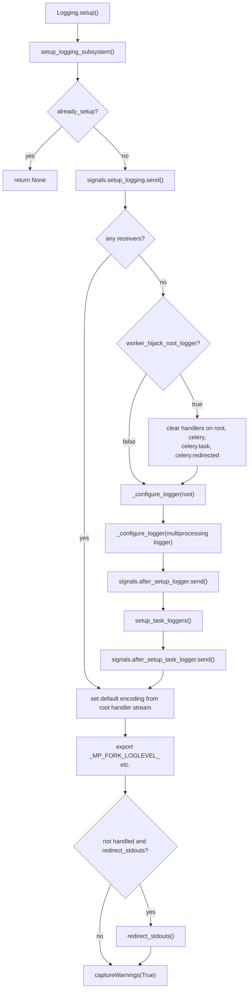

## Overview

Celery configures Python's standard `logging` module for its own programs. The worker, beat and the event snapshot camera do not ship a logging framework. They call `app.log`, an instance of `celery.app.log.Logging`, which attaches handlers and formatters to the root logger, the `celery.task` logger and the multiprocessing logger. It can also redirect `sys.stdout` and `sys.stderr` into a logger. The helpers in `celery.utils.log` (`get_logger`, `get_task_logger`, `ColorFormatter`, `LoggingProxy`) build the logger hierarchy that this setup relies on.

Sources: [celery/app/log.py:1-27](repo://celery/app/log.py#L1-L27), [celery/utils/log.py:1-36](repo://celery/utils/log.py#L1-L36)

`app.log` is a cached property that instantiates `log_cls`, which defaults to `'celery.app.log:Logging'`. Passing `log=` to the `Celery` constructor swaps in a subclass. The setup is driven by settings described in [[Configuration]], and its three logging signals are part of the catalogue in [[Signals]].

Sources: [celery/app/base.py:312-316](repo://celery/app/base.py#L312-L316), [celery/app/base.py:356-359](repo://celery/app/base.py#L356-L359), [celery/app/base.py:1591-1594](repo://celery/app/base.py#L1591-L1594)

## Logger hierarchy

Every Celery logger hangs under the `celery` logger (`base_logger`), and every task logger hangs under `celery.task`. `get_logger(name)` fetches the logger through kombu. If its parent is not the root logger, it re-parents it under `base_logger`. `get_task_logger(name)` refuses the reserved names `celery` and `celery.task`, then forces the logger's parent to be `task_logger`. Records from a module that uses `get_task_logger(__name__)` therefore flow through the handler that `setup_task_loggers` installs on `celery.task`, and they pick up the task name and id.

Sources: [celery/utils/log.py:29-36](repo://celery/utils/log.py#L29-L36), [celery/utils/log.py:91-113](repo://celery/utils/log.py#L91-L113)

```python
def get_task_logger(name):
    """Get logger for task module by name."""
    if name in RESERVED_LOGGER_NAMES:
        raise RuntimeError(f'Logger name {name!r} is reserved!')
    return _using_logger_parent(task_logger, get_logger(name))
```

Sources: [celery/utils/log.py:109-113](repo://celery/utils/log.py#L109-L113)

`_using_logger_parent` re-parents a logger only when `logger_isa` finds that it does not already descend from the wanted parent. `logger_isa` walks `.parent` links and raises `RuntimeError` on a cycle or on a chain deeper than 1000. The stamping example creates its task-module logger this way.

Sources: [celery/utils/log.py:72-94](repo://celery/utils/log.py#L72-L94), [examples/stamping/tasks.py:8-10](repo://examples/stamping/tasks.py#L8-L10)

| Logger | Created by | Configured by |
| --- | --- | --- |
| root | `logging.getLogger()` | `setup_logging_subsystem` (format `worker_log_format`) |
| `celery` | `base_logger` in `celery.utils.log` | cleared when the root logger is hijacked; propagates to root |
| `celery.task` | `task_logger = get_logger('celery.task')` | `setup_task_loggers` with `TaskFormatter`, `propagate=False` |
| `celery.worker` | `worker_logger` | inherits from `celery` |
| `celery.redirected` | `redirect_stdouts` | receives `print` output when stdouts are redirected |
| billiard multiprocessing logger | `get_multiprocessing_logger()` | level `ERROR` unless the `MP_LOG` environment variable is set |

Sources: [celery/utils/log.py:97-106](repo://celery/utils/log.py#L97-L106), [celery/utils/log.py:263-281](repo://celery/utils/log.py#L263-L281), [celery/app/log.py:78-131](repo://celery/app/log.py#L78-L131), [celery/app/log.py:156-181](repo://celery/app/log.py#L156-L181)

`mlevel` converts a level name such as `'info'` into its integer through kombu's `LOG_LEVELS` and passes integers through unchanged. That is why every `Logging` method accepts either form.

Sources: [celery/utils/log.py:116-120](repo://celery/utils/log.py#L116-L120)

## Setup flow

### Logging.setup

`Logging.__init__` reads `worker_log_format`, `worker_task_log_format` and `worker_log_color` once, and sets the default level to `WARN`. `setup()` is the entry point that programs call. It normalises the level and delegates to `setup_logging_subsystem`. It redirects stdouts only when no `setup_logging` receiver handled logging and `redirect_stdouts` is true. It exports `CELERY_LOG_LEVEL` and `CELERY_LOG_FILE` into the environment so that pool child processes can repeat the setup. Finally, it makes Celery's deprecation warnings always visible and routes `warnings` through logging with `logging.captureWarnings(True)`.

Sources: [celery/app/log.py:46-76](repo://celery/app/log.py#L46-L76)



Sources: [celery/app/log.py:61-146](repo://celery/app/log.py#L61-L146), [celery/app/log.py:156-181](repo://celery/app/log.py#L156-L181)

### setup_logging_subsystem

The subsystem is configured once per process. `_setup` is a class attribute exposed through the `already_setup` class property, so a second call returns `None` straight away. If a `hostname` is given, the log file name is expanded with `node_format`, so a pattern such as `%n.log` becomes per-node. The format falls back to `self.format`, `supports_color` decides colour, and the billiard logger is reset. Then `signals.setup_logging` is sent with `loglevel`, `logfile`, `format` and `colorize`.

Sources: [celery/app/log.py:87-101](repo://celery/app/log.py#L87-L101), [celery/app/log.py:242-248](repo://celery/app/log.py#L242-L248)

When no receiver is connected, Celery configures logging itself. The root logger receives a handler with `ColorFormatter` and the worker format. The multiprocessing logger is set to `ERROR`, or to the full level when the `MP_LOG` environment variable is set. `after_setup_logger` is sent with the root logger, and `setup_task_loggers` runs. Whichever path ran, the stream of the root logger's first handler becomes kombu's default encoding file. The level, log file and format are exported as `_MP_FORK_LOGLEVEL_`, `_MP_FORK_LOGFILE_` and `_MP_FORK_LOGFORMAT_` for multiprocessing's fork+exec start. The method returns the receivers list, which `setup()` and the worker treat as "custom logging is in use".

Sources: [celery/app/log.py:103-146](repo://celery/app/log.py#L103-L146)

### Handlers and task loggers

`setup_handlers` leaves a logger alone if `_is_configured` reports that it already has a handler other than a `NullHandler` and is not flagged `_rudimentary_setup`. Otherwise `_detect_handler` builds the handler. With no log file it uses a `StreamHandler` on `sys.__stderr__`. With an object that has `write` it uses a `StreamHandler` on that object. With a path it uses a `WatchedFileHandler` (UTF-8), which reopens the file after external log rotation.

Sources: [celery/app/log.py:148-154](repo://celery/app/log.py#L148-L154), [celery/app/log.py:213-237](repo://celery/app/log.py#L213-L237)

`setup_task_loggers` repeats this for `celery.task` with `worker_task_log_format` and the `TaskFormatter` class. It sets `propagate` to `0` by default, so task records are written once by the task handler and are not formatted a second time by the root handler. It then sends `after_setup_task_logger` with the configured logger.

Sources: [celery/app/log.py:156-181](repo://celery/app/log.py#L156-L181)

## Formatters

### ColorFormatter

`ColorFormatter` subclasses `logging.Formatter` and maps levels to terminal colours: `DEBUG` blue, `WARNING` yellow, `ERROR` red, `CRITICAL` magenta. `INFO` stays uncoloured. If colouring the message raises, the formatter swaps the record's message for `<Unrepresentable ...>` and formats it again with exception info, so a bad log argument never kills the handler. Without colour it returns `safe_str(msg)`.

Sources: [celery/utils/log.py:123-175](repo://celery/utils/log.py#L123-L175)

Colour is decided by `Logging.supports_color`. It is always off on Windows. When `worker_log_color` is unset or true, colour is used only if there is no log file and `sys.stderr` is a TTY. An explicit `False` disables it. `Logging.colored()` returns a `celery.utils.term.colored` helper with the same decision, which the worker uses for its banner.

Sources: [celery/app/log.py:199-211](repo://celery/app/log.py#L199-L211), [celery/apps/worker.py:106-120](repo://celery/apps/worker.py#L106-L120)

### TaskFormatter

`TaskFormatter` extends `ColorFormatter`. For each record it looks up `get_current_task()`. Inside a task it injects `task_id` and `task_name` into the record, so the `%(task_name)s[%(task_id)s]` fields in `worker_task_log_format` resolve. Outside a task it fills both with `???` rather than failing on a missing key.

Sources: [celery/app/log.py:32-43](repo://celery/app/log.py#L32-L43), [celery/app/defaults.py:12-17](repo://celery/app/defaults.py#L12-L17)

```python
DEFAULT_PROCESS_LOG_FMT = """
    [%(asctime)s: %(levelname)s/%(processName)s] %(message)s
""".strip()
DEFAULT_TASK_LOG_FMT = """[%(asctime)s: %(levelname)s/%(processName)s] \
%(task_name)s[%(task_id)s]: %(message)s"""
```

Sources: [celery/app/defaults.py:13-17](repo://celery/app/defaults.py#L13-L17)

## Redirecting standard output

`redirect_stdouts(loglevel, name='celery.redirected')` calls `redirect_stdouts_to_logger`. That method replaces `sys.stdout` and `sys.stderr` with one `LoggingProxy` writing to the `celery.redirected` logger. It also exports `CELERY_LOG_REDIRECT=1` and `CELERY_LOG_REDIRECT_LEVEL` for child processes. A `print()` inside a task therefore becomes a log record at `worker_redirect_stdouts_level` (`WARNING` by default).

Sources: [celery/app/log.py:78-85](repo://celery/app/log.py#L78-L85), [celery/app/log.py:183-197](repo://celery/app/log.py#L183-L197)

`LoggingProxy` is a minimal file object (`write`, `writelines`, `flush`, `close`, `isatty` returning `False`). Its level comes from the argument, then the logger's level, then `ERROR`. On construction it wraps each handler's `handleError` so that handler failures print to `sys.__stderr__` instead of looping back into the proxy. `write` strips trailing newlines and logs non-empty data. It uses a thread-local `recurse_protection` flag to drop writes that come back from the logger itself. While the `in_sighandler()` context is active it prints straight to `sys.__stderr__`, because logging from a signal handler can deadlock on the handler's lock.

Sources: [celery/utils/log.py:39-69](repo://celery/utils/log.py#L39-L69), [celery/utils/log.py:178-260](repo://celery/utils/log.py#L178-L260)

## Where programs call setup

| Program | Call | Notes |
| --- | --- | --- |
| Worker (`celery.apps.worker.Worker`) | `setup_logging()` from `on_init_blueprint` | Passes `redirect_stdouts=False` and the worker hostname; the result is stored as `_custom_logging`. |
| Worker start | `app.log.redirect_stdouts(...)` in `on_start` | Runs after the banner is printed, only when `_custom_logging` is falsy and `worker_redirect_stdouts` is on. |
| Prefork child (`process_initializer`) | `app.log.setup(...)` from the `CELERY_LOG_*` environment | Resets `already_setup` when the log file name contains `%i`, so each child opens its own file. |
| Beat (`celery.apps.beat.Beat`) | `setup_logging()` in `run` | Passes `worker_redirect_stdouts` and `worker_redirect_stdouts_level` straight to `setup`. |
| `celery worker --detach` failure | `setup_logging_subsystem('ERROR', logfile, hostname=...)` | Logs the `execv` failure to the pre-formatted log file. |
| Event snapshot camera | `setup_logging_subsystem(loglevel, logfile)` | No stdout redirection. |
| Test worker (`celery.contrib.testing.worker`) | `app.log.setup(loglevel=..., logfile=...)` | See [[Testing Celery Applications]]. |

Sources: [celery/apps/worker.py:122-147](repo://celery/apps/worker.py#L122-L147), [celery/apps/worker.py:184-190](repo://celery/apps/worker.py#L184-L190), [celery/concurrency/prefork.py:39-67](repo://celery/concurrency/prefork.py#L39-L67), [celery/apps/beat.py:86-106](repo://celery/apps/beat.py#L86-L106), [celery/bin/worker.py:108-133](repo://celery/bin/worker.py#L108-L133), [celery/events/snapshot.py:88-95](repo://celery/events/snapshot.py#L88-L95), [celery/contrib/testing/worker.py:225-225](repo://celery/contrib/testing/worker.py#L225-L225)

The worker delays redirection until `on_start` so that the startup banner, which is printed to `sys.__stdout__`, is never swallowed by the proxy. The level and log file come from the command line: `-l/--loglevel` (default `WARNING`) on `celery worker`, and `-f/--logfile` on every daemon command (stderr when omitted). The worker hands the raw `logfile` to `app.log.setup`, which applies node formatting. See [[Worker Architecture and Bootsteps]] for where `on_init_blueprint` and `on_start` run.

Sources: [celery/apps/worker.py:168-180](repo://celery/apps/worker.py#L168-L180), [celery/bin/worker.py:162-168](repo://celery/bin/worker.py#L162-L168), [celery/bin/base.py:221-221](repo://celery/bin/base.py#L221-L221), [celery/bin/worker.py:359-361](repo://celery/bin/worker.py#L359-L361)

## Settings

| Setting | Default | Effect |
| --- | --- | --- |
| `worker_hijack_root_logger` | `True` | Removes every handler on the root, `celery`, `celery.task` and `celery.redirected` loggers before Celery installs its own. |
| `worker_log_color` | unset (`None`) | `None` or `True`: colour only on a TTY with no log file; `False`: never. |
| `worker_log_format` | `DEFAULT_PROCESS_LOG_FMT` | Format for the root logger handler. |
| `worker_task_log_format` | `DEFAULT_TASK_LOG_FMT` | Format for the `celery.task` handler; may use `task_name` and `task_id`. |
| `worker_redirect_stdouts` | `True` | Redirect `sys.stdout`/`sys.stderr` to the `celery.redirected` logger (worker and beat). |
| `worker_redirect_stdouts_level` | `'WARNING'` | Level of records produced from redirected output. |

Sources: [celery/app/defaults.py:346-348](repo://celery/app/defaults.py#L346-L348), [celery/app/defaults.py:360-365](repo://celery/app/defaults.py#L360-L365), [celery/app/defaults.py:370-370](repo://celery/app/defaults.py#L370-L370), [celery/app/log.py:54-59](repo://celery/app/log.py#L54-L59)

> [!WARNING]
> With `worker_hijack_root_logger` left on, handlers that an application adds to the root logger before the worker starts, for example in a Django settings module, are removed. Turn it off, or install handlers from `after_setup_logger`, to keep them.

Sources: [celery/app/log.py:103-115](repo://celery/app/log.py#L103-L115)

## Customising logging

The three signals are the extension points. They are declared in `celery.signals` with these arguments:

Sources: [celery/signals.py:117-136](repo://celery/signals.py#L117-L136)

| Signal | Sent from | Arguments | Use |
| --- | --- | --- | --- |
| `setup_logging` | `setup_logging_subsystem`, before any handler is touched | `loglevel`, `logfile`, `format`, `colorize` | Connecting any receiver disables Celery's own configuration entirely (and the worker's stdout redirection); configure logging yourself, e.g. with `logging.config.dictConfig`. |
| `after_setup_logger` | after the root and multiprocessing loggers are configured | `logger` (root), `loglevel`, `logfile`, `format`, `colorize` | Add handlers or filters on top of Celery's root configuration. |
| `after_setup_task_logger` | at the end of `setup_task_loggers` | `logger` (`celery.task`), `loglevel`, `logfile`, `format`, `colorize` | Adjust the task logger or its formatter. |

Sources: [celery/app/log.py:98-131](repo://celery/app/log.py#L98-L131), [celery/app/log.py:176-180](repo://celery/app/log.py#L176-L180), [celery/apps/worker.py:146-147](repo://celery/apps/worker.py#L146-L147)

Every signal is sent with `sender=None`, so receivers connect without a sender filter. The two `after_*` signals fire only on the default path. When a `setup_logging` receiver exists, neither of them is sent and `celery.task` keeps whatever configuration the receiver gave it. A deeper change is to subclass `Logging` and pass it as `Celery(log=...)`.

Sources: [celery/app/log.py:98-131](repo://celery/app/log.py#L98-L131), [celery/app/base.py:356-359](repo://celery/app/base.py#L356-L359)
