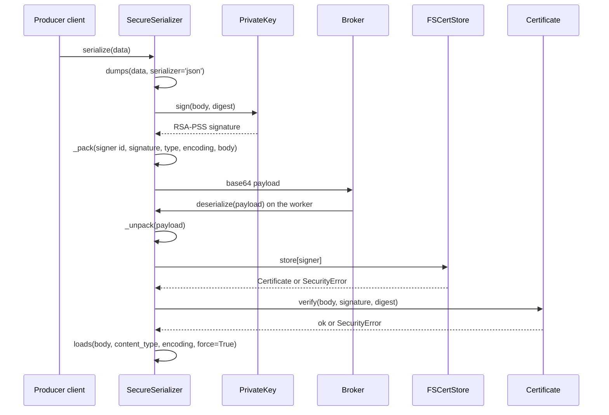
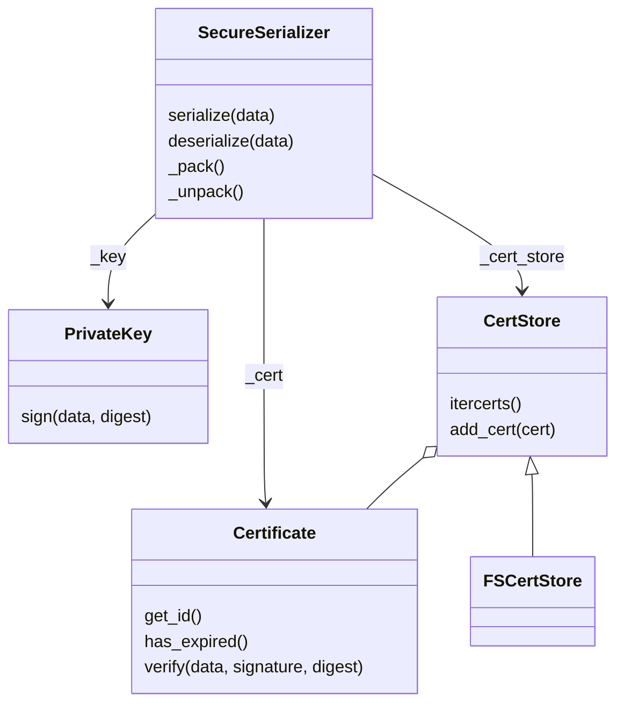

## Overview

Celery messages travel through a broker that any client with broker credentials can write to. The `celery.security` package adds an `auth` serializer that signs every outgoing message body with an RSA private key and makes the receiver verify the signature against a store of trusted X.509 certificates before it decodes anything. A worker configured this way only runs tasks that come from a holder of a trusted key. The serializer signs messages but does not encrypt them.

Sources: [celery/security/serialization.py:20-58](repo://celery/security/serialization.py#L20-L58), [docs/userguide/security.rst:143-166](repo://docs/userguide/security.rst#L143-L166)

The package is a layer on top of Kombu's serializer registry. `setup_security` reads the security settings, builds a `SecureSerializer` from a `PrivateKey`, a `Certificate` and an `FSCertStore`, registers it under the name `auth`, and makes it Kombu's default serializer. Task, event and result serialization in general is covered in [[Task Messages and Routing]], and every setting below also appears in [[Configuration]].

Sources: [celery/security/__init__.py:44-70](repo://celery/security/__init__.py#L44-L70), [celery/security/serialization.py:80-90](repo://celery/security/serialization.py#L80-L90)

Importing `celery.security` fails at once with `ImproperlyConfigured` if the `cryptography` library is missing. The rest of Celery never imports the package unless security is set up, so the dependency stays optional.

Sources: [celery/security/__init__.py:9-14](repo://celery/security/__init__.py#L9-L14), [celery/security/__init__.py:38-41](repo://celery/security/__init__.py#L38-L41)

## Enabling Signing

### Configuration Settings

The settings live in the `security` namespace of the defaults table. `__old__=old_ns('celery_security')` keeps the old upper-case `CELERY_SECURITY_*` names working.

Sources: [celery/app/defaults.py:239-247](repo://celery/app/defaults.py#L239-L247)

| Setting | Type | Default | Used for |
| --- | --- | --- | --- |
| `security_key` | string | none | Path to the PEM private key that signs outgoing messages (read by `PrivateKey`). |
| `security_key_password` | bytes | none | Passphrase for an encrypted private key, passed to `load_pem_private_key`. |
| `security_certificate` | string | none | Path to the PEM certificate matching the key. Its issuer and serial number become the signer id. |
| `security_cert_store` | string | none | A directory or glob pattern of trusted certificates loaded by `FSCertStore`. |
| `security_digest` | string | `'sha256'` | Name of the hash algorithm, resolved by `get_digest_algorithm` as an attribute of `cryptography.hazmat.primitives.hashes`. |

Sources: [celery/app/defaults.py:18-20](repo://celery/app/defaults.py#L18-L20), [celery/app/defaults.py:239-247](repo://celery/app/defaults.py#L239-L247), [celery/security/__init__.py:58-62](repo://celery/security/__init__.py#L58-L62), [celery/security/utils.py:13-16](repo://celery/security/utils.py#L13-L16)

Signing also depends on three core settings. `task_serializer` must be `'auth'` and `accept_content` must be exactly `['auth']`, or `setup_security` refuses to continue. A worker that signs nothing, or that still accepts unsigned content, gets no protection from signing. Setting `event_serializer='auth'` signs the event stream as well.

Sources: [celery/security/__init__.py:26-34](repo://celery/security/__init__.py#L26-L34), [celery/security/__init__.py:53-56](repo://celery/security/__init__.py#L53-L56), [docs/userguide/security.rst:155-158](repo://docs/userguide/security.rst#L155-L158)

### Example Application

The bundled example configures the key, the certificate and a glob store, switches tasks and events to `auth`, and calls `app.setup_security()` at import time, so both the client and the worker register the serializer.

Sources: [examples/security/mysecureapp.py:28-53](repo://examples/security/mysecureapp.py#L28-L53)

```python
app.conf.update(
    security_key='ssl/worker.key',
    security_certificate='ssl/worker.pem',
    security_cert_store='ssl/*.pem',
    task_serializer='auth',
    event_serializer='auth',
    accept_content=['auth'],
    result_accept_content=['json']
)
app.setup_security()
```

Sources: [examples/security/mysecureapp.py:35-44](repo://examples/security/mysecureapp.py#L35-L44)

Results are not signed. The example keeps `result_accept_content=['json']` so the client can still read the plain JSON results that the worker stores. The key pair in the example comes from `openssl req -x509 -newkey rsa:4096`, and the passphrase is then removed. Both the key and the certificate must be RSA, because `PrivateKey` and `Certificate` reject every other key type.

Sources: [examples/security/mysecureapp.py:5-13](repo://examples/security/mysecureapp.py#L5-L13), [celery/security/key.py:24-25](repo://celery/security/key.py#L24-L25), [celery/security/certificate.py:41-42](repo://celery/security/certificate.py#L41-L42)

## setup_security

`Celery.setup_security` is a thin wrapper. It imports `celery.security.setup_security` lazily and passes itself as `app`. The docstring warns that the call affects all application instances, because it changes the process-wide Kombu registry.

Sources: [celery/app/base.py:750-780](repo://celery/app/base.py#L750-L780)

The module-level function `celery.security.setup_security` runs seven steps in order, listed below.

Sources: [celery/security/__init__.py:44-70](repo://celery/security/__init__.py#L44-L70), [celery/app/base.py:753-762](repo://celery/app/base.py#L753-L762)

1. It resolves `app`, falling back to `current_app` when none is given.
2. It calls Kombu's `disable_insecure_serializers(allowed_serializers)`, which disables untrusted serializers; names or content types in `allowed_serializers` are exempt.
3. It checks `conf.task_serializer == 'auth'` and `conf.accept_content == ['auth']` and raises `ImproperlyConfigured(SETTING_MISSING)` if either check fails.
4. It fills each argument left empty from configuration: `security_key`, `security_key_password`, `security_certificate`, `security_cert_store`, `security_digest`.
5. If the key, the certificate or the store is still missing, it raises `ImproperlyConfigured(SECURITY_SETTING_MISSING)`.
6. It opens the key and certificate files, reads them as text and calls `register_auth(...)` with the store path and the digest.
7. It calls `registry._set_default_serializer('auth')`.

Sources: [celery/security/__init__.py:44-70](repo://celery/security/__init__.py#L44-L70), [celery/security/__init__.py:16-24](repo://celery/security/__init__.py#L16-L24)

> [!NOTE]
> `Celery.setup_security` declares `digest=DEFAULT_SECURITY_DIGEST` (`'sha256'`) instead of `None`. Step 4 only falls back to `conf.security_digest` for an empty argument, so a call to `app.setup_security()` with no arguments signs with SHA-256 whatever `security_digest` is set to. To use another algorithm, pass `digest=` explicitly or call `celery.security.setup_security`, whose `digest` defaults to `None`.

Sources: [celery/app/base.py:750-752](repo://celery/app/base.py#L750-L752), [celery/security/__init__.py:44-45](repo://celery/security/__init__.py#L44-L45), [celery/security/__init__.py:58-62](repo://celery/security/__init__.py#L58-L62)

The `serializer` argument (default `'json'`) is the inner serializer. It encodes the task payload before signing, so `auth` is a wrapper around another Kombu serializer rather than a format of its own. `disable_untrusted_serializers(whitelist)` is a separate helper that only performs step 2.

Sources: [celery/security/__init__.py:73-74](repo://celery/security/__init__.py#L73-L74), [celery/security/serialization.py:31-37](repo://celery/security/serialization.py#L31-L37)

## The auth Serializer

### Registration

`register_auth` wraps the raw PEM text in `PrivateKey(key, password=key_password)` and `Certificate(cert)`, builds `FSCertStore(store)` from the store path, and hands all three to a `SecureSerializer`. Its bound `serialize` and `deserialize` methods are registered with Kombu under the name `auth` and the content type `application/data`. Each component is built only when its argument is truthy (`key and PrivateKey(...)`), so a process that only receives messages could in principle build a serializer without a key. `setup_security` still demands all three.

Sources: [celery/security/serialization.py:80-90](repo://celery/security/serialization.py#L80-L90)

`SecureSerializer.__init__` stores the components and turns the digest name into a `cryptography` hash object once with `get_digest_algorithm`. The function upper-cases the name and looks it up on `cryptography.hazmat.primitives.hashes`, so `'sha256'` becomes `hashes.SHA256()`. An unknown name raises `AttributeError` when the serializer is built.

Sources: [celery/security/serialization.py:20-29](repo://celery/security/serialization.py#L20-L29), [celery/security/utils.py:13-16](repo://celery/security/utils.py#L13-L16)

### Sign and Verify Flow



Sources: [celery/security/serialization.py:31-77](repo://celery/security/serialization.py#L31-L77), [celery/security/key.py:27-35](repo://celery/security/key.py#L27-L35), [celery/security/certificate.py:65-91](repo://celery/security/certificate.py#L65-L91)

`serialize` first encodes `data` with the inner serializer through Kombu's `dumps`. It then signs those encoded bytes, not the Python object. The source comment gives the reason: the receiver can check the signature before decoding anything, so a flaw in a decoder cannot be reached by an unsigned message. The signer id is `self._cert.get_id()`, the certificate's issuer and serial number.

Sources: [celery/security/serialization.py:31-46](repo://celery/security/serialization.py#L31-L46)

`deserialize` unpacks the payload, looks up `self._cert_store[signer]`, and calls `verify` on the encoded body. Only after verification succeeds does it call `loads(..., force=True)`. The `force=True` flag is needed because `accept_content` is `['auth']` and would otherwise reject the inner JSON content type.

Sources: [celery/security/serialization.py:48-58](repo://celery/security/serialization.py#L48-L58)

### Wire Format

`_pack` base64-encodes the signer and the signature, joins five fields with `DEFAULT_SEPARATOR` (`b"\x00\x01"`), and base64-encodes the result once more. `_unpack` reverses this with `split(sep, maxsplit=4)`, so the body (the last field) may contain the separator bytes without breaking the split.

Sources: [celery/security/serialization.py:14-17](repo://celery/security/serialization.py#L14-L17), [celery/security/serialization.py:60-77](repo://celery/security/serialization.py#L60-L77)

```python
    def _pack(self, body, content_type, content_encoding, signer, signature,
              sep=DEFAULT_SEPARATOR):
        fields = sep.join(
            ensure_bytes(s) for s in [b64encode(signer), b64encode(signature),
                                      content_type, content_encoding, body]
        )
        return b64encode(fields)
```

Sources: [celery/security/serialization.py:60-66](repo://celery/security/serialization.py#L60-L66)

## Keys and Certificates

### PrivateKey

`PrivateKey` loads a PEM key with `serialization.load_pem_private_key`, using the optional password, and rejects anything that is not an `rsa.RSAPrivateKey`. `sign(data, digest)` uses RSA with PSS padding, `MGF1(digest)` and `PSS.MAX_LENGTH` salt, and wraps any `cryptography` exception as a `SecurityError` reading "Unable to sign data".

Sources: [celery/security/key.py:12-35](repo://celery/security/key.py#L12-L35)

### Certificate

`Certificate` parses a PEM X.509 certificate and also accepts only RSA public keys. `get_id()` returns `f'{self.get_issuer()} {self.get_serial_number()}'`. An issuer and serial number pair identifies a certificate uniquely, and this string is both the signer field in every message and the key under which stores index certificates. `verify` uses the same PSS parameters as `PrivateKey.sign`, so the two sides agree only when they use the same digest. `has_expired()` compares `not_valid_after_utc` with the current UTC time.

Sources: [celery/security/certificate.py:31-73](repo://celery/security/certificate.py#L31-L73)

### CertStore and FSCertStore

`CertStore` is a dict of certificates indexed by `get_id()`. `__getitem__` raises `SecurityError('Unknown certificate: ...')` for a signer that is not in the store, so a message signed by an untrusted key fails at lookup before any signature math runs. `add_cert` refuses a second certificate with the same id.

Sources: [celery/security/certificate.py:76-97](repo://celery/security/certificate.py#L76-L97)

`FSCertStore(path)` turns a directory into `path/*`, globs the pattern, and loads each matching file as a `Certificate`. An expired certificate aborts the whole load with `SecurityError('Expired certificate: ...')` instead of being skipped. Because expiry is only checked here, when the store is built, a certificate that expires while a worker is running keeps verifying until the worker restarts. The signer's own certificate from `security_certificate` is never checked for expiry, but receivers that list it in their store will refuse to start once it has expired.

Sources: [celery/security/certificate.py:100-113](repo://celery/security/certificate.py#L100-L113), [celery/security/serialization.py:80-86](repo://celery/security/serialization.py#L80-L86)



Sources: [celery/security/serialization.py:20-29](repo://celery/security/serialization.py#L20-L29), [celery/security/key.py:12-35](repo://celery/security/key.py#L12-L35), [celery/security/certificate.py:31-113](repo://celery/security/certificate.py#L31-L113)

## Errors

`reraise_errors(msg, errors)` is a context manager that catches the given exception types, by default the `cryptography.exceptions` module's exceptions, and re-raises them as `celery.exceptions.SecurityError` with the formatted message and the original traceback. `SecurityError` is a plain `CeleryError` subclass. Each call site chooses what it catches, which sets how wide the error net is, as the table below shows.

Sources: [celery/security/utils.py:19-28](repo://celery/security/utils.py#L19-L28), [celery/exceptions.py:106-110](repo://celery/exceptions.py#L106-L110), [celery/exceptions.py:210-211](repo://celery/exceptions.py#L210-L211)

| Where | Caught | Raised as |
| --- | --- | --- |
| `import celery.security` | `ImportError` for `cryptography` | `ImproperlyConfigured` (install hint) |
| `setup_security` | wrong `task_serializer` / `accept_content`, or missing key, certificate or store | `ImproperlyConfigured` |
| `PrivateKey.__init__` / `Certificate.__init__` | `ValueError` (bad PEM, non-RSA key) | `SecurityError('Invalid private key/certificate: ...')` |
| `PrivateKey.sign` / `Certificate.verify` | `cryptography` exceptions, e.g. `InvalidSignature` | `SecurityError('Unable to sign data: ...')` / `SecurityError('Bad signature: ...')` |
| `CertStore.__getitem__` | unknown signer id | `SecurityError('Unknown certificate: ...')` |
| `FSCertStore.__init__` / `add_cert` | expired or duplicate certificate | `SecurityError('Expired certificate: ...')` / `SecurityError('Duplicate certificate: ...')` |
| `SecureSerializer.serialize` / `deserialize` | any `Exception` | `SecurityError('Unable to serialize/deserialize: ...')` |

Sources: [celery/security/__init__.py:38-65](repo://celery/security/__init__.py#L38-L65), [celery/security/key.py:15-35](repo://celery/security/key.py#L15-L35), [celery/security/certificate.py:34-113](repo://celery/security/certificate.py#L34-L113), [celery/security/serialization.py:31-58](repo://celery/security/serialization.py#L31-L58)

> [!WARNING]
> Because `serialize` and `deserialize` catch `Exception`, a malformed payload, a missing field or an inner decoding failure inside the guarded block all surface as `SecurityError`, just like a forged signature. On the worker a rejected message is meant to surface as a decode error rather than a task failure, and when it reaches `Consumer.on_decode_error`, that handler logs a critical "Can't decode message body" line and acknowledges the message, so it is dropped and not redelivered. See [[Consumer and Task Requests]] for the rest of the consumer's message handling.

Sources: [celery/security/serialization.py:31-58](repo://celery/security/serialization.py#L31-L58), [celery/worker/consumer/consumer.py:516-530](repo://celery/worker/consumer/consumer.py#L516-L530), [celery/worker/consumer/consumer.py:736-784](repo://celery/worker/consumer/consumer.py#L736-L784)

> [!NOTE]
> The duplicate-certificate message formats `id!r`, which names Python's built-in `id` function and not the certificate id, so the message does not say which certificate was duplicated.

Sources: [celery/security/certificate.py:93-97](repo://celery/security/certificate.py#L93-L97)
