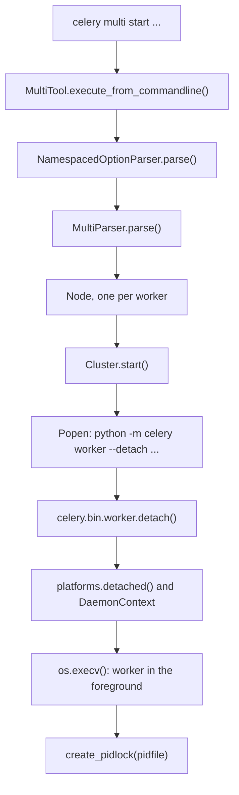
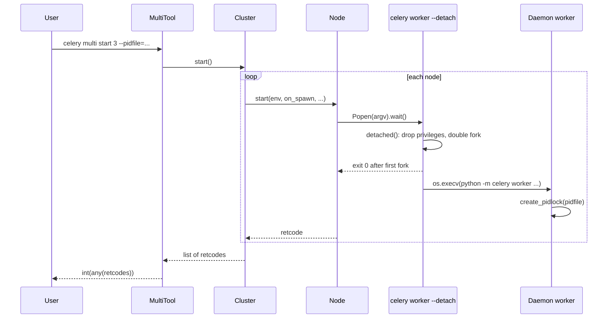
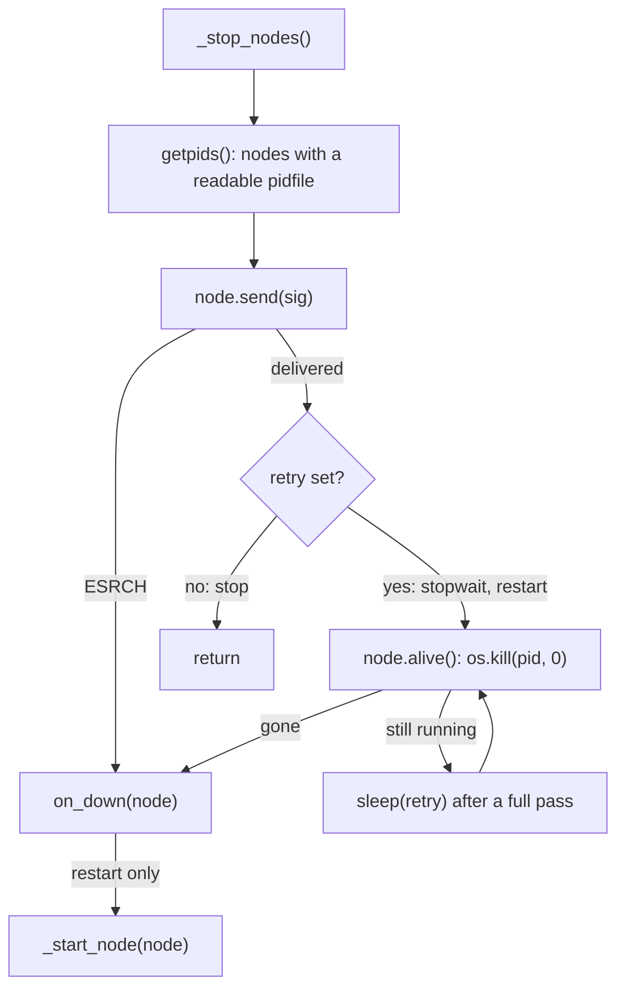

## Overview

A production deployment often runs several worker processes on one machine, each with its own node name, pidfile and logfile, all in the background with no terminal attached. `celery multi` handles this. It turns a short description such as `start 3 -c 3 -c:1 10` into one `celery worker --detach` command line per node and launches each one. Later calls find the same processes again through their pidfiles and signal them. `celery multi` stores no state of its own: every call rebuilds the node list from its arguments, so `stop` and `restart` need the same `--pidfile` template that `start` used.

Sources: [celery/bin/multi.py:1-27](repo://celery/bin/multi.py#L1-L27), [celery/apps/multi.py:122-142](repo://celery/apps/multi.py#L122-L142)

The work is split across four modules:

Sources: [celery/bin/multi.py:109-116](repo://celery/bin/multi.py#L109-L116), [celery/apps/multi.py:15-19](repo://celery/apps/multi.py#L15-L19)

- `celery/bin/multi.py` holds `MultiTool`, which dispatches the commands and prints the results.
- `celery/apps/multi.py` holds the model. `NamespacedOptionParser` and `MultiParser` build `Node` objects, and `Cluster` starts and stops them.
- `celery/utils/nodenames.py` expands `%n`, `%h`, `%i` and the other abbreviations in names and paths.
- `celery/platforms.py` holds the POSIX primitives that the worker and beat use when they detach: `detached`/`DaemonContext`, `Pidfile`/`create_pidlock`, `maybe_drop_privileges` and the `signals` registry.

Sources: [celery/bin/multi.py:226-260](repo://celery/bin/multi.py#L226-L260), [celery/apps/multi.py:70-122](repo://celery/apps/multi.py#L70-L122), [celery/utils/nodenames.py:83-114](repo://celery/utils/nodenames.py#L83-L114), [celery/platforms.py:38-46](repo://celery/platforms.py#L38-L46)

[[Command-Line Interface]] covers the general command layer, and [[Worker Architecture and Bootsteps]] covers what the worker does once it runs.

Sources: [celery/bin/multi.py:463-480](repo://celery/bin/multi.py#L463-L480), [celery/bin/worker.py:358-368](repo://celery/bin/worker.py#L358-L368)



Sources: [celery/bin/multi.py:359-393](repo://celery/bin/multi.py#L359-L393), [celery/apps/multi.py:406-421](repo://celery/apps/multi.py#L406-L421), [celery/bin/worker.py:108-133](repo://celery/bin/worker.py#L108-L133), [celery/worker/worker.py:150-152](repo://celery/worker/worker.py#L150-L152)

## The celery multi Command

### Commands

`MultiTool.__init__` maps each subcommand name to a method. `call_command` looks the name up, prints usage for an unknown name, and returns `EX_OK` when the method returns nothing. Methods decorated with `@using_cluster` receive a `Cluster` built from the remaining argv. Methods decorated with `@using_cluster_and_sig` also receive a signal number parsed from the same arguments.

Sources: [celery/bin/multi.py:152-167](repo://celery/bin/multi.py#L152-L167), [celery/bin/multi.py:240-280](repo://celery/bin/multi.py#L240-L280)

| Command | Implementation | Behaviour |
| --- | --- | --- |
| `start` | `Cluster.start` | Runs each node's command in turn and waits for it to return. The exit status is 1 if any node failed. |
| `stop` | `Cluster.stop` | Sends the signal (`SIGTERM` by default) to every node that has a pid, then returns at once (`retry=None`). |
| `stopwait` (alias `stop_verify`) | `Cluster.stopwait` | Sends the signal, then polls each pid until every node has exited (`retry=2`). |
| `restart` | `Cluster.restart` | Works like `stopwait`, but starts each node again as soon as that node is down. |
| `kill` | `Cluster.kill` | Sends `SIGKILL` to every node that has a pid. |
| `show` | `MultiTool.show` | Prints each node's full command line, executable included, without running it. |
| `names` | `MultiTool.names` | Prints the node names, one per line. |
| `get` | `MultiTool.get` | Prints the argv of one node, selected by its full node name. |
| `expand` | `MultiTool.expand` | Expands a template such as `/var/run/celery/%n.pid` once for every node. |
| `help` | `MultiTool.help` | Prints the module docstring with its examples. |

Sources: [celery/bin/multi.py:289-342](repo://celery/bin/multi.py#L289-L342), [celery/apps/multi.py:406-454](repo://celery/apps/multi.py#L406-L454)

`--nosplash`, `--quiet`/`-q`, `--verbose` and `--no-color` belong to `celery multi` itself. `_handle_reserved_options` removes them from argv before parsing, so the workers never receive them.

Sources: [celery/bin/multi.py:232-238](repo://celery/bin/multi.py#L232-L238), [celery/bin/multi.py:282-287](repo://celery/bin/multi.py#L282-L287)

The click entry point `multi` also reorders `sys.argv`: it moves everything before the word `multi`, such as `-A proj`, to after it. Celery 5 made `--app` a global option, but `MultiTool` still expects to find it among the worker options.

Sources: [celery/bin/multi.py:463-480](repo://celery/bin/multi.py#L463-L480)

### Parsing node lists and per-node options

`NamespacedOptionParser.parse` walks argv once and sorts each word:

Sources: [celery/apps/multi.py:79-98](repo://celery/apps/multi.py#L79-L98)

- A bare word is a positional value: a node name or a node count.
- `--name=value` is a long option. A long option without `=` is a flag.
- A short option takes the next word as its value, unless that word starts with `-`.
- Everything from a literal `--` onward is kept in `passthrough` and appended to every worker command.
- An option name that contains a colon, such as `-c:2` or `-Q:image`, goes into `namespaces[ns]` instead of the global `options`.

Sources: [celery/apps/multi.py:70-119](repo://celery/apps/multi.py#L70-L119)

> [!WARNING]
> `celery multi` reads `--logfile /tmp/x.log` as the flag `--logfile` followed by a node named `/tmp/x.log`. Always write long options as `--name=value`.

Sources: [celery/apps/multi.py:79-103](repo://celery/apps/multi.py#L79-L103)

`MultiParser.parse` turns the positional values into node names:

Sources: [celery/apps/multi.py:297-321](repo://celery/apps/multi.py#L297-L321)

- If there is exactly one value and it is an integer, `_get_ranges` replaces it with `1` … `N`, and the prefix becomes `--range-prefix` (default `celery`). The nodes are then named `celery1`, `celery2`, and so on.
- The host part comes from `--suffix`, then `--hostname`/`-n`, then `gethostname()`. A suffix of `""` gives names with an empty host.
- `--cmd` replaces the command run for each node, and `--append` adds an argument after it.

Sources: [celery/apps/multi.py:285-332](repo://celery/apps/multi.py#L285-L332)

Namespaced options are resolved in two passes:

Sources: [celery/apps/multi.py:314-315](repo://celery/apps/multi.py#L314-L315)

1. `_update_ns_opts` maps a numeric namespace to the node at that 1-based position, so `-c:1 10` applies to the first node whatever its name. Index 0, or an index past the end, raises `KeyError`.
2. `_update_ns_ranges` splits comma lists such as `-c:foo,bar` into one namespace per node. For numbered clusters it also splits dash ranges such as `-Q:1-3`.

Sources: [celery/apps/multi.py:334-364](repo://celery/apps/multi.py#L334-L364)

`_node_from_options` then calls `optmerge`, which lays the node's namespace over the global options. It prefers a namespace keyed by the full node name over one keyed by the short name.

Sources: [celery/apps/multi.py:108-111](repo://celery/apps/multi.py#L108-L111), [celery/apps/multi.py:323-328](repo://celery/apps/multi.py#L323-L328)

```console
$ # 3 workers: Two with 3 processes, and one with 10 processes.
$ celery multi start 3 -c 3 -c:1 10
celery worker -n celery1@myhost -c 10
celery worker -n celery2@myhost -c 3
celery worker -n celery3@myhost -c 3
```

Sources: [celery/bin/multi.py:73-77](repo://celery/bin/multi.py#L73-L77)

### Building each worker's command line

`Node.__init__` sets defaults for every node:

Sources: [celery/apps/multi.py:125-135](repo://celery/apps/multi.py#L125-L135)

- `-n` is always the node name.
- `--pidfile` defaults to `/var/run/celery/%n.pid`, unless `-p` was given.
- `--logfile` defaults to `/var/log/celery/%n%I.log`, unless `-f` was given.
- `--executable` defaults to `sys.executable`.
- The command defaults to `-m celery worker --detach`, run by the `--executable` interpreter.

Sources: [celery/apps/multi.py:125-142](repo://celery/apps/multi.py#L125-L142)

When `--pidfile` or `--logfile` is set, from the defaults or written in long form, `_setdefaultopt` calls `os.makedirs` on the parent directory of the unexpanded template if that directory is missing. This happens while the cluster is built, so `show` and `names` can also create `/var/run/celery`.

Sources: [celery/apps/multi.py:144-154](repo://celery/apps/multi.py#L144-L154)

`_prepare_argv` expands the command with the node's expander. It then takes the global options out of the worker options and inserts them right after the word `celery`, where Celery 5 requires them: `-A`/`--app`, `-b`/`--broker`, `--result-backend`, `--loader`, `--config`, `--workdir`, `-C`/`--no-color` and `-q`/`--quiet`.

Sources: [celery/apps/multi.py:161-181](repo://celery/apps/multi.py#L161-L181)

The remaining options are expanded and rendered by `format_opt`:

Sources: [celery/apps/multi.py:182-187](repo://celery/apps/multi.py#L182-L187)

- long options as `--opt=value`
- short options as `-o value`
- the bare option when the value is empty

Sources: [celery/apps/multi.py:54-59](repo://celery/apps/multi.py#L54-L59)

The passthrough arguments follow, then the expanded `--append` value.

Sources: [celery/apps/multi.py:182-190](repo://celery/apps/multi.py#L182-L190)

## Node Names and %-Expansion

### Name helpers

A node name has the form `name@host`. It is joined and split on `NODENAME_SEP` (`@`):

Sources: [celery/utils/nodenames.py:19-20](repo://celery/utils/nodenames.py#L19-L20), [celery/utils/nodenames.py:56-58](repo://celery/utils/nodenames.py#L56-L58)

- `nodesplit` returns `(None, host)` for a string that has no `@`.
- `default_nodename` fills a missing name with `celery` and a missing host with `gethostname()`. `gethostname()` is memoized, so each process looks the hostname up only once.

Sources: [celery/utils/nodenames.py:22-24](repo://celery/utils/nodenames.py#L22-L24), [celery/utils/nodenames.py:69-80](repo://celery/utils/nodenames.py#L69-L80)

The worker's `-n`/`--hostname` option passes every value through `Hostname.convert`, which is `host_format(default_nodename(value))`. So `-n w1@%h` becomes `w1@` followed by the machine's hostname.

Sources: [celery/bin/worker.py:66-72](repo://celery/bin/worker.py#L66-L72), [celery/bin/worker.py:136-145](repo://celery/bin/worker.py#L136-L145)

### Expansion keys

`host_format` builds a table of keys and passes it to `simple_format`. `simple_format` replaces each `%x` with the key's value, calling it first if it is callable. An unknown key raises `ValueError`, and `%%` gives a literal `%`.

Sources: [celery/utils/nodenames.py:99-114](repo://celery/utils/nodenames.py#L99-L114), [celery/utils/text.py:120-138](repo://celery/utils/text.py#L120-L138)

`node_format` splits a node name and calls `host_format` with the host part, the short name, and `p` set to the full node name. `%i` and `%I` are callables that read the current pool process index, so they give different values in the main process and in each pool child.

Sources: [celery/utils/nodenames.py:83-96](repo://celery/utils/nodenames.py#L83-L96), [celery/utils/log.py:293-295](repo://celery/utils/log.py#L293-L295)

`celery multi` builds each node's expander from `node_format` with some keys overridden. `%h` becomes the full node name and `%d` becomes the host part. `%i` and `%I` expand to themselves, so the worker process expands them later:

Sources: [celery/apps/multi.py:156-159](repo://celery/apps/multi.py#L156-L159)

```python
def build_expander(nodename, shortname, hostname):
    return partial(
        node_format,
        name=nodename,
        N=shortname,
        d=hostname,
        h=nodename,
        i='%i',
        I='%I',
    )
```

Sources: [celery/apps/multi.py:42-51](repo://celery/apps/multi.py#L42-L51)

The same template therefore expands differently in the two places. The examples use the node `celery1@george.example.com`:

Sources: [celery/utils/nodenames.py:83-86](repo://celery/utils/nodenames.py#L83-L86), [celery/apps/multi.py:42-51](repo://celery/apps/multi.py#L42-L51)

| Key | In the worker (`node_format`) | In `celery multi` (`Node.expander`) |
| --- | --- | --- |
| `%h` | Host part: `george.example.com` | Full node name: `celery1@george.example.com` |
| `%n` | Short name: `celery1`, or `celery` if the name has none | Short name: `celery1` |
| `%d` | Domain, the host after its first dot: `example.com` | Host part: `george.example.com` |
| `%N` | Not defined, so it raises `ValueError` | Short name: `celery1` |
| `%p` | Full node name | Full node name |
| `%i` | Pool process index, starting at 1; `0` in the main process | Kept as `%i` |
| `%I` | `-` plus the index in pool processes; empty in the main process | Kept as `%I` |

Sources: [celery/utils/nodenames.py:83-114](repo://celery/utils/nodenames.py#L83-L114), [celery/apps/multi.py:42-51](repo://celery/apps/multi.py#L42-L51)

Because of this, the default logfile `/var/log/celery/%n%I.log` reaches the worker as `/var/log/celery/celery1%I.log`. The worker's main process then writes `celery1.log`, and each pool process writes its own file with a `-N` suffix.

Sources: [celery/apps/multi.py:137-142](repo://celery/apps/multi.py#L137-L142), [celery/utils/nodenames.py:89-96](repo://celery/utils/nodenames.py#L89-L96)

## Starting and Stopping a Cluster

### Starting nodes

`Cluster.start` calls `start_node` for each node in turn. `Node._waitexec` takes these steps:

Sources: [celery/apps/multi.py:406-421](repo://celery/apps/multi.py#L406-L421)

1. It joins the executable and the argv, then splits the result with `shlex.split`, using non-POSIX rules on Windows.
2. It calls the `on_child_spawn` hook, which prints the command only with `--verbose`.
3. It runs the command with `Popen(...).wait()`.

Sources: [celery/apps/multi.py:208-216](repo://celery/apps/multi.py#L208-L216), [celery/apps/multi.py:231-233](repo://celery/apps/multi.py#L231-L233), [celery/bin/multi.py:441-442](repo://celery/bin/multi.py#L441-L442)

The command is `celery worker --detach`, and that process exits as soon as it has forked the daemon, so the wait is short. A negative return code is reported as termination by a signal, and a positive one as a failure.

Sources: [celery/apps/multi.py:128-128](repo://celery/apps/multi.py#L128-L128), [celery/apps/multi.py:217-229](repo://celery/apps/multi.py#L217-L229), [celery/bin/multi.py:444-448](repo://celery/bin/multi.py#L444-L448), [celery/platforms.py:365-373](repo://celery/platforms.py#L365-L373)



Sources: [celery/bin/multi.py:289-293](repo://celery/bin/multi.py#L289-L293), [celery/apps/multi.py:208-229](repo://celery/apps/multi.py#L208-L229), [celery/bin/worker.py:108-133](repo://celery/bin/worker.py#L108-L133), [celery/platforms.py:365-373](repo://celery/platforms.py#L365-L373)

### Finding running nodes

`Node.pid` reads the pid with `Pidfile(self.pidfile).read_pid()`, where `pidfile` is the node's expanded `--pidfile`/`-p` option. A missing file gives `None`, and a malformed file also counts as no pid. `Cluster.getpids` yields only the nodes that have a pid and calls `on_down` for the rest; `MultiTool.on_node_down` prints those as `DOWN`. The pidfile is the only link between one `celery multi` call and the processes an earlier call started.

Sources: [celery/apps/multi.py:235-273](repo://celery/apps/multi.py#L235-L273), [celery/apps/multi.py:491-496](repo://celery/apps/multi.py#L491-L496), [celery/bin/multi.py:428-429](repo://celery/bin/multi.py#L428-L429)

### Stop, stopwait, restart and kill

`_find_sig_argument` looks for a signal in the arguments that follow the node names, starting from the end. It accepts two forms:

Sources: [celery/bin/multi.py:344-346](repo://celery/bin/multi.py#L344-L346)

- a two-character form such as `-9`
- an uppercase name such as `-KILL` or `-SIGKILL`, resolved with `signals.signum`

Sources: [celery/bin/multi.py:346-356](repo://celery/bin/multi.py#L346-L356), [celery/platforms.py:647-656](repo://celery/platforms.py#L647-L656)

It skips anything else, including worker options such as `-c`. If it finds nothing, it returns `SIGTERM`. Multi-digit numbers such as `-15` fail the uppercase check in `signum` and are skipped too, so write those signals by name.

Sources: [celery/bin/multi.py:344-357](repo://celery/bin/multi.py#L344-L357), [celery/platforms.py:651-653](repo://celery/platforms.py#L651-L653)

`Cluster.shutdown_nodes` first sends the signal to every node. If `send` fails with `ESRCH`, the process is already gone, and the node is yielded at once.

Sources: [celery/apps/multi.py:456-465](repo://celery/apps/multi.py#L456-L465), [celery/apps/multi.py:195-206](repo://celery/apps/multi.py#L195-L206)

- With `retry` unset, as in `stop`, it ends there.
- With `retry` set (`stopwait` and `restart` use 2), it polls the remaining nodes with `alive()`, which is `os.kill(pid, 0)`. A node that no longer answers is yielded and dropped from the set. After each full pass over the set it sleeps `retry` seconds.

Sources: [celery/apps/multi.py:466-483](repo://celery/apps/multi.py#L466-L483), [celery/apps/multi.py:192-193](repo://celery/apps/multi.py#L192-L193)

`_stop_nodes` calls `on_down` for every node yielded. `restart` passes `restart_on_down` as `on_down`, which starts that node again right away. Nodes are therefore restarted one by one as each one exits, without waiting for the whole cluster to go down.

Sources: [celery/apps/multi.py:431-454](repo://celery/apps/multi.py#L431-L454)



Sources: [celery/apps/multi.py:431-496](repo://celery/apps/multi.py#L431-L496)

`kill` skips the wait loop. `send_all(signal.SIGKILL)` signals every node that has a pid and returns. A worker killed with `SIGKILL` cannot run its `atexit` handler, so its pidfile stays behind; the next start detects the file as stale and removes it (see the Pidfiles section below).

Sources: [celery/apps/multi.py:423-429](repo://celery/apps/multi.py#L423-L429), [celery/platforms.py:244-272](repo://celery/platforms.py#L244-L272)

## Detaching a Process

### worker --detach

With `--detach`/`-D`, the `worker` command does not start a worker in the current process. Instead it:

Sources: [celery/bin/worker.py:336-347](repo://celery/bin/worker.py#L336-L347)

1. builds `['-m', 'celery'] + sys.argv[1:]` and removes the `--detach`, `-D`, `--uid` and `--gid` tokens from it
2. calls `detach()`, which formats the logfile with `node_format(logfile, hostname)`
3. enters `detached(...)`, which needs that formatted logfile because it touches the file before any logging is set up
4. replaces the daemon process with `os.execv(path, [path] + argv)`, where `path` is `--executable` when given

Sources: [celery/bin/worker.py:108-123](repo://celery/bin/worker.py#L108-L123), [celery/bin/worker.py:336-356](repo://celery/bin/worker.py#L336-L356)

If `execv` fails, stderr is already closed, so `detach` sets up `ERROR`-level logging to the logfile, logs "Can't exec" and returns `EX_FAILURE`. The new worker runs in the foreground of the detached process and does the real startup, including taking the pidlock.

Sources: [celery/bin/worker.py:124-133](repo://celery/bin/worker.py#L124-L133), [celery/worker/worker.py:150-152](repo://celery/worker/worker.py#L150-L152)

Setting the `C_FAKEFORK` environment variable forces `fake=1`. `DaemonContext` then neither forks nor closes file descriptors, so the process stays in the foreground and errors stay visible on the terminal. The init script's `dryrun` action uses this.

Sources: [celery/bin/worker.py:105-112](repo://celery/bin/worker.py#L105-L112), [celery/platforms.py:333-355](repo://celery/platforms.py#L333-L355), [extra/generic-init.d/celeryd:266-268](repo://extra/generic-init.d/celeryd#L266-L268)

### beat --detach

`celery beat` uses the same primitive without re-executing itself:

Sources: [celery/bin/beat.py:47-48](repo://celery/bin/beat.py#L47-L48)

- Without `--detach`, it calls `maybe_drop_privileges` directly.
- With `--detach`, `detached(logfile, pidfile, uid, gid, umask, workdir)` drops privileges and forks, and `app.Beat(...).run()` continues inside the context.

Sources: [celery/bin/beat.py:61-72](repo://celery/bin/beat.py#L61-L72)

Beat takes its pidlock in `Beat.start_scheduler`. [[Celery Beat Scheduler]] describes the service itself.

Sources: [celery/apps/beat.py:93-95](repo://celery/apps/beat.py#L93-L95)

### detached() and DaemonContext

`detached()` runs in the original process:

Sources: [celery/platforms.py:376-377](repo://celery/platforms.py#L376-L377)

1. It raises `RuntimeError` when the `resource` module is missing, as on Windows.
2. It defaults `workdir` to the current directory.
3. It resets `SIGCLD` to the default handler.
4. It calls `maybe_drop_privileges(uid=uid, gid=gid)` before anything forks.
5. It returns a `DaemonContext` whose `after_chdir` hook checks the logfile and the pidfile.

Sources: [celery/platforms.py:412-429](repo://celery/platforms.py#L412-L429)

The hook touches the logfile with `open(logfile, 'a')` and runs `_create_pidlock(pidfile).release()`. The pidfile is not kept: the call exits with `EX_CANTCREAT` if a live process holds the file, and removes the file if it is stale.

Sources: [celery/platforms.py:419-425](repo://celery/platforms.py#L419-L425), [celery/platforms.py:266-272](repo://celery/platforms.py#L266-L272)

`DaemonContext.open` performs these steps in order:

Sources: [celery/platforms.py:333-357](repo://celery/platforms.py#L333-L357)

1. `_detach()` forks, and the parent calls `os._exit(0)`. The child calls `os.setsid()` to start a new session with no controlling terminal and forks again; the middle process exits, so the daemon can never get a terminal back.
2. `os.chdir(self.workdir)`, then `os.umask(self.umask)` if a umask is set. A string umask is read as octal when it starts with `0`, and as decimal otherwise.
3. `after_chdir()` runs the logfile and pidfile checks. stdin, stdout and stderr are still open at this point, so error messages reach the terminal of the command that started the daemon.
4. `close_open_fds(keep)` closes every other descriptor. It keeps the three standard streams and any descriptor open on `/dev/urandom`, which beat's `shelve` needs. `redirect_to_null` then points each standard stream at `os.devnull`.
5. `mputil._run_after_forkers()` runs the after-fork hooks registered with `multiprocessing`. The worker passes `after_forkers=False` to `detached()`, but `detached()` drops unknown keyword arguments, so this step still runs.

Sources: [celery/platforms.py:310-373](repo://celery/platforms.py#L310-L373), [celery/bin/worker.py:118-119](repo://celery/bin/worker.py#L118-L119)

> [!NOTE]
> The original process exits with status 0 right after the first fork, before the pidfile check runs. `celery multi start` therefore reports `OK` for a node even if its daemon then exits because a live process already holds the pidfile. The error is printed only on the terminal.

Sources: [celery/platforms.py:333-343](repo://celery/platforms.py#L333-L343), [celery/platforms.py:365-373](repo://celery/platforms.py#L365-L373), [celery/platforms.py:419-425](repo://celery/platforms.py#L419-L425)

The global `--workdir` option is eager and calls `os.chdir` while the command line is parsed. `detached()` defaults `workdir` to `os.getcwd()`, so the daemon stays in that directory. `DAEMON_WORKDIR` (`/`) applies only when `DaemonContext` is created without a workdir.

Sources: [celery/bin/celery.py:84-89](repo://celery/bin/celery.py#L84-L89), [celery/platforms.py:59-59](repo://celery/platforms.py#L59-L59), [celery/platforms.py:315-321](repo://celery/platforms.py#L315-L321), [celery/platforms.py:414-414](repo://celery/platforms.py#L414-L414)

## Pidfiles

`Pidfile` is a lock based on whether the file exists. `acquire` calls `write_pid`, which:

Sources: [celery/platforms.py:140-155](repo://celery/platforms.py#L140-L155)

1. opens the path with `O_CREAT | O_EXCL | O_WRONLY` and mode `0644` (`PIDFILE_MODE`), so creation fails if the file already exists
2. writes the pid followed by a newline, then flushes and calls `fsync`
3. reads the file back and raises `LockFailed` if the content differs

Sources: [celery/platforms.py:61-62](repo://celery/platforms.py#L61-L62), [celery/platforms.py:215-238](repo://celery/platforms.py#L215-L238)

`acquire` re-raises any `OSError` as `LockFailed`. `read_pid` returns `None` when the file is missing. It raises `ValueError` when the line has no trailing newline, which means a partial write, or when the content is not a number.

Sources: [celery/platforms.py:143-149](repo://celery/platforms.py#L143-L149), [celery/platforms.py:163-176](repo://celery/platforms.py#L163-L176)

Both the worker and beat call `create_pidlock(pidfile)`. The worker calls it from `Worker.on_start`, with the path already passed through `node_format(pidfile, hostname)` by the CLI.

Sources: [celery/worker/worker.py:150-152](repo://celery/worker/worker.py#L150-L152), [celery/apps/beat.py:93-95](repo://celery/apps/beat.py#L93-L95), [celery/bin/worker.py:358-363](repo://celery/bin/worker.py#L358-L363)

`_create_pidlock` calls `remove_if_stale` on an existing file before acquiring it. If a live process holds the file, it prints `PIDLOCKED` and raises `SystemExit(EX_CANTCREAT)`. `create_pidlock` registers `pidlock.release` with `atexit`, so a clean exit removes the file.

Sources: [celery/platforms.py:244-272](repo://celery/platforms.py#L244-L272)

`remove_if_stale` decides whether an existing pidfile can be removed:

Sources: [celery/platforms.py:183-187](repo://celery/platforms.py#L183-L187)

| Pidfile state | Result |
| --- | --- |
| Cannot be parsed (`ValueError`) | Removed, with the message "Broken pidfile found" |
| Empty pid | Removed |
| Pid equals `os.getpid()` | Removed. This is common with PID 1 in a restarted Kubernetes pod. |
| `os.kill(pid, 0)` fails with `ESRCH` or `EPERM`, or raises `SystemError` | Removed, with the message "Stale pidfile exists" |
| Process answers signal 0 | Kept, and the caller exits |

Sources: [celery/platforms.py:183-213](repo://celery/platforms.py#L183-L213)

## Privileges and Running as Root

### Dropping privileges

`--uid` and `--gid` accept numbers or names. `parse_uid` and `parse_gid` look names up with `pwd` and `grp` and raise `KeyError` for unknown ones.

Sources: [celery/platforms.py:432-463](repo://celery/platforms.py#L432-L463)

`maybe_drop_privileges` does nothing on Windows. It raises `SecurityError('contact support')` in the inconsistent state where the effective uid is not root but the real uid is. Given a uid, it calls `_setuid`; given only a gid, it calls `setgid`. It then checks the result and raises `SecurityError` if the process is still root.

Sources: [celery/platforms.py:528-555](repo://celery/platforms.py#L528-L555)

`_setuid` orders its calls so that no privilege is left behind:

Sources: [celery/platforms.py:558-561](repo://celery/platforms.py#L558-L561)

1. If no gid was given, it uses the user's primary group.
2. It calls `setgid` before `initgroups`, because `setgid` can clear the supplementary group list on some platforms.
3. It calls `setuid` last: once the process has given up root, it can no longer change its group.
4. It calls `setuid(0)` as a check. That call must fail with `EPERM`; if it succeeds, `_setuid` raises `SecurityError('non-root user able to restore privileges after setuid.')`.

Sources: [celery/platforms.py:485-525](repo://celery/platforms.py#L485-L525), [celery/platforms.py:558-583](repo://celery/platforms.py#L558-L583)

### The root check and C_FORCE_ROOT

The worker always calls `check_privileges(app.conf.accept_content)` in `on_before_init`, after the CLI has dropped any privileges. It treats the process as privileged if:

Sources: [celery/apps/worker.py:94-104](repo://celery/apps/worker.py#L94-L104), [celery/bin/worker.py:358-359](repo://celery/bin/worker.py#L358-L359)

- the real or effective uid is 0, or
- the real or effective group is `sudo` or `wheel`, or
- the gid is not found, which also emits a `SecurityWarning` saying it assumes root

Sources: [celery/platforms.py:788-831](repo://celery/platforms.py#L788-L831)

A privileged worker that accepts `pickle` or `application/group-python-serialize` content raises `SecurityError` with `ROOT_DISALLOWED`, unless the `C_FORCE_ROOT` environment variable is set. In every other privileged case it only warns with `ROOT_DISCOURAGED`. The `worker` command catches the `SecurityError`, prints it and exits with status 1. Serializer settings are covered in [[Configuration]] and [[Message Signing Security]].

Sources: [celery/platforms.py:67-84](repo://celery/platforms.py#L67-L84), [celery/platforms.py:833-845](repo://celery/platforms.py#L833-L845), [celery/bin/worker.py:369-371](repo://celery/bin/worker.py#L369-L371)

> [!WARNING]
> `C_FORCE_ROOT` only turns the error into a warning. A root worker that accepts pickle runs whatever a publisher sends it. Use `--uid`/`--gid`, or the `User=`/`Group=` settings of the service manager, instead.

Sources: [celery/platforms.py:67-75](repo://celery/platforms.py#L67-L75), [extra/systemd/celery.service:5-8](repo://extra/systemd/celery.service#L5-L8)

## Signal Handling

### The signals registry

`platforms.signals` is a `Signals` instance that wraps the standard `signal` module and ignores signals the platform lacks:

Sources: [celery/platforms.py:594-631](repo://celery/platforms.py#L594-L631)

- `signum` accepts an int, or an uppercase name with or without the `SIG` prefix. It raises `TypeError` for names that are not uppercase.
- `signals['TERM'] = handler` installs a handler and swallows `AttributeError` and `ValueError`.
- `reset` installs `SIG_DFL` and `ignore` installs `SIG_IGN`.
- `update` installs handlers from a mapping.

Sources: [celery/platforms.py:638-698](repo://celery/platforms.py#L638-L698)

`signal_name` maps a number back to its short name, such as `TERM`, through `SIGMAP`. `celery multi` uses it to print which signal it sends to each node.

Sources: [celery/platforms.py:91-95](repo://celery/platforms.py#L91-L95), [celery/platforms.py:701-703](repo://celery/platforms.py#L701-L703), [celery/apps/multi.py:423-426](repo://celery/apps/multi.py#L423-L426)

### Worker signal handlers

`install_platform_tweaks` registers the handlers that decide what each signal from `celery multi` or a service manager does to a running worker. Every shutdown handler also sends the `worker_shutting_down` signal described in [[Signals]].

Sources: [celery/apps/worker.py:254-274](repo://celery/apps/worker.py#L254-L274), [celery/apps/worker.py:288-316](repo://celery/apps/worker.py#L288-L316)

| Signal | Installed by | Effect |
| --- | --- | --- |
| `SIGTERM` | `install_worker_term_handler` | Warm shutdown: sets `state.should_stop`, and running tasks finish. It is a cold shutdown instead when billiard's `REMAP_SIGTERM` is `SIGQUIT`. |
| `SIGQUIT` | `install_worker_term_hard_handler` | Cold shutdown: sets `state.should_terminate` with `EX_FAILURE`. |
| `SIGINT` | `install_worker_int_handler` | Warm shutdown on the first Ctrl+C, after which `SIGINT` is re-registered for cold shutdown. |
| `SIGHUP` | `install_worker_restart_handler` | Installed only when stdout is not a terminal. It registers `_reload_current_worker` with `atexit` and stops the worker; at exit the worker closes its descriptors and runs `os.execv` with its own argv. On macOS, a warning handler is installed instead. |
| `SIGUSR1` | `install_cry_handler` | Prints the stack trace of every thread. Not installed on PyPy. |
| `SIGUSR2` | `install_rdb_handler` | Opens a remote debugger. Only installed when `CELERY_RDBSIG` is set. |

Sources: [celery/apps/worker.py:433-499](repo://celery/apps/worker.py#L433-L499), [celery/apps/worker.py:502-514](repo://celery/apps/worker.py#L502-L514), [celery/apps/worker.py:116-116](repo://celery/apps/worker.py#L116-L116)

## Daemon Options and Service Files

### Shared daemon options

`CeleryDaemonCommand` is the base of both `worker` and `beat`, and it adds the same set of `DaemonOption`s to each. Each option's callback, `daemon_setting`, falls back to an app setting named after the command, such as `worker_pidfile` or `beat_logfile`, when the option is missing from the command line.

Sources: [celery/bin/base.py:197-227](repo://celery/bin/base.py#L197-L227)

| Option | Effect |
| --- | --- |
| `--logfile`, `-f` | Log destination. `detached()` touches it before stdio is closed. |
| `--pidfile` | Path passed to `create_pidlock`. No pidfile when unset. |
| `--uid`, `--gid` | Passed to `maybe_drop_privileges`. |
| `--umask` | Applied by `DaemonContext` after `chdir`. |
| `--executable` | Interpreter that `detach()` runs with `execv`. |
| `--detach` (worker also `-D`) | Daemonize with `detached()`. |

Sources: [celery/bin/base.py:214-227](repo://celery/bin/base.py#L214-L227), [celery/bin/worker.py:146-152](repo://celery/bin/worker.py#L146-L152), [celery/bin/beat.py:13-18](repo://celery/bin/beat.py#L13-L18)

### systemd and init scripts

`extra/systemd/celery.service` runs `celery multi` with `Type=forking`. `ExecStart` runs `multi start`, `ExecStop` runs `multi stopwait` and `ExecReload` runs `multi restart`. All three take the same `--pidfile` and `--logfile` templates from `/etc/conf.d/celery`, so the later calls find the processes the first one started. `User=` and `Group=` make systemd run multi, and so every worker, as an unprivileged user.

Sources: [extra/systemd/celery.service:1-22](repo://extra/systemd/celery.service#L1-L22)

```ini
[Service]
Type=forking
User=celery
Group=celery
EnvironmentFile=-/etc/conf.d/celery
WorkingDirectory=/opt/celery
ExecStart=/bin/sh -c '${CELERY_BIN} -A $CELERY_APP multi start $CELERYD_NODES \
	--pidfile=${CELERYD_PID_FILE} --logfile=${CELERYD_LOG_FILE} \
	--loglevel="${CELERYD_LOG_LEVEL}" $CELERYD_OPTS'
ExecStop=/bin/sh -c '${CELERY_BIN} multi stopwait $CELERYD_NODES \
	--pidfile=${CELERYD_PID_FILE} --logfile=${CELERYD_LOG_FILE}'
```

Sources: [extra/systemd/celery.service:5-15](repo://extra/systemd/celery.service#L5-L15)

The sample `/etc/conf.d/celery` uses the same `%n.pid` and `%n%I.log` templates as the `Node` defaults. `celery.tmpfiles` creates `/var/run/celery` and `/var/log/celery`, owned by the `celery` user. `celerybeat.service` runs beat with `Type=simple` and does not detach it.

Sources: [extra/systemd/celery.conf:4-10](repo://extra/systemd/celery.conf#L4-L10), [extra/systemd/celery.tmpfiles:1-2](repo://extra/systemd/celery.tmpfiles#L1-L2), [extra/systemd/celerybeat.service:5-13](repo://extra/systemd/celerybeat.service#L5-L13)

`extra/generic-init.d/celeryd` wraps the same commands for SysV init:

Sources: [extra/generic-init.d/celeryd:20-29](repo://extra/generic-init.d/celeryd#L20-L29)

- It refuses to run unless started as root.
- `_chuid` runs `celery multi` through `su` as `CELERYD_USER`.
- The `graceful` action collects pids with `celery multi expand "$CELERYD_PID_FILE" $CELERYD_NODES` and sends `SIGHUP` to each worker directly.
- `dryrun` runs `start` with `C_FAKEFORK=1` and `--verbose`, so the commands are printed and the worker runs in the foreground.

Sources: [extra/generic-init.d/celeryd:30-37](repo://extra/generic-init.d/celeryd#L30-L37), [extra/generic-init.d/celeryd:218-305](repo://extra/generic-init.d/celeryd#L218-L305)
