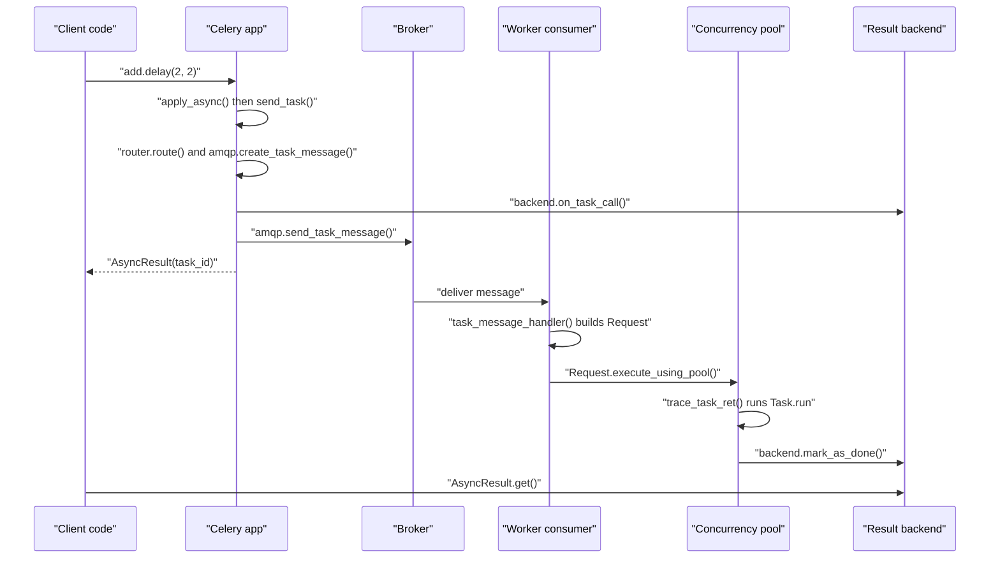

## Overview

Celery is a distributed task queue: a client turns a function call into a message, a broker holds the message in a queue, and dedicated worker processes take messages off the queue and run them. Because everything goes through messages, a deployment can grow to many workers and many brokers, and clients in other languages can speak the same protocol.

Sources: [README.rst:91-118](repo://README.rst#L91-L118)

This repository is the Python implementation, version 5.6.2 (series "recovery"). The top-level `celery` package exposes a small public surface (`Celery`, `shared_task`, `Task`, `current_app`, `current_task` and the canvas primitives `chain`, `chord`, `group`, `signature` and friends) and loads each name lazily on first attribute access, so `import celery` stays cheap.

Sources: [celery/__init__.py:25-41](repo://celery/__init__.py#L25-L41), [celery/__init__.py:155-180](repo://celery/__init__.py#L155-L180)

Messaging is delegated to Kombu, process pools to billiard and promises to vine; these are the core runtime dependencies alongside Click for the command line.

Sources: [requirements/default.txt:1-10](repo://requirements/default.txt#L1-L10)

## Main parts

A running Celery system is made of five cooperating pieces. Only the app and a broker are strictly required; a result backend is needed only when callers want return values, and beat only for periodic work.

Sources: [celery/app/base.py:252-287](repo://celery/app/base.py#L252-L287)

| Part | What it is | Where it lives |
| --- | --- | --- |
| Application | A `Celery` instance holding configuration, the task registry, broker connection pools and lazily built helpers (`amqp`, `backend`, `control`, `events`, `loader`, `log`). Both clients and workers create one. | `celery/app/base.py` |
| Broker | The message transport (RabbitMQ, Redis, SQS, Pub/Sub and others), reached through a Kombu connection built from `broker_url`. | `Celery.connection_for_write()` / `connection_for_read()` |
| Worker | `WorkController`, a set of bootsteps (`Hub`, `Pool`, `Timer`, `Consumer`, optional `Beat` and autoscaler) that consumes task messages and executes them in a concurrency pool. | `celery/worker/worker.py` |
| Beat | The periodic scheduler that publishes entries of `beat_schedule` on time; the default scheduler class is `celery.beat:PersistentScheduler`. | `celery/beat.py`, `celery/apps/beat.py` |
| Result backend | Optional store for task states and return values, picked from `result_backend` by URL scheme (`redis://`, `rpc://`, `db+...`, `s3://`, ...). | `celery/backends/`, `celery/app/backends.py` |

Sources: [celery/app/base.py:1534-1609](repo://celery/app/base.py#L1534-L1609), [celery/app/base.py:1043-1057](repo://celery/app/base.py#L1043-L1057), [celery/worker/worker.py:76-88](repo://celery/worker/worker.py#L76-L88), [celery/app/defaults.py:73-82](repo://celery/app/defaults.py#L73-L82), [celery/app/backends.py:15-38](repo://celery/app/backends.py#L15-L38)

The app resolves the backend the first time `app.backend` is read: `_get_backend` passes `result_backend` to `backends.by_url`, which splits a `db+postgresql://...` style URL on `+`, maps the scheme through `BACKEND_ALIASES` (plus any `override_backends` from the loader and `celery.result_backends` entry points) and instantiates the class. An unset backend resolves to `disabled`.

Sources: [celery/app/base.py:1224-1228](repo://celery/app/base.py#L1224-L1228), [celery/app/base.py:1558-1563](repo://celery/app/base.py#L1558-L1563), [celery/app/backends.py:41-69](repo://celery/app/backends.py#L41-L69)

## How a task travels

The path from a call in client code to a value in `AsyncResult.get()` crosses the app, the broker, the worker's consumer, the pool and the backend.

Sources: [celery/app/task.py:523-534](repo://celery/app/task.py#L523-L534), [celery/app/base.py:846-862](repo://celery/app/base.py#L846-L862), [celery/app/base.py:1007-1041](repo://celery/app/base.py#L1007-L1041), [celery/worker/strategy.py:132-208](repo://celery/worker/strategy.py#L132-L208)

Sources: [celery/app/task.py:682-708](repo://celery/app/task.py#L682-L708), [celery/app/base.py:1007-1041](repo://celery/app/base.py#L1007-L1041), [celery/worker/worker.py:223-231](repo://celery/worker/worker.py#L223-L231), [celery/worker/request.py:341-367](repo://celery/worker/request.py#L341-L367), [celery/app/trace.py:615-627](repo://celery/app/trace.py#L615-L627)

1. **Call.** `Task.delay(*args, **kwargs)` is a shortcut for `apply_async(args, kwargs)`. Unless `task_always_eager` is set (in which case the task runs in-process through `Task.apply`), `apply_async` hands off to `app.send_task(self.name, ..., task_type=self)`.
2. **Build the message.** `send_task` generates a task id, merges the task's execution options, asks the router (`amqp.router.route`) for queue, exchange and routing key, converts `expires` into a message expiration, inherits `root_id`/`parent_id` from the currently executing worker task, and calls `amqp.create_task_message` to build protocol headers and body.
3. **Publish.** A producer is taken from the app's producer pool with `producer_or_acquire`; the backend gets `on_task_call` (so RPC-style backends can prepare a reply queue) and `amqp.send_task_message` publishes. The caller immediately gets an `AsyncResult` for the id.
4. **Receive.** In the worker, the consumer's per-task strategy (`celery.worker.strategy.default`) decodes each message into a `Request`, defers it to the timer when it has an ETA, applies rate-limit buckets, and otherwise calls `handle(req)`.
5. **Execute.** `WorkController._process_task` calls `req.execute_using_pool(self.pool)`, which refuses revoked tasks and submits `trace_task_ret` (or `fast_trace_task`) to the pool with the time limits and success/failure callbacks.
6. **Store.** The tracer runs the task body, dispatches callbacks and chains, and records the outcome with `task.backend.mark_as_done` (or the failure equivalent). `AsyncResult.get()` waits on the backend for that state.

Sources: [celery/app/task.py:523-534](repo://celery/app/task.py#L523-L534), [celery/app/task.py:682-708](repo://celery/app/task.py#L682-L708), [celery/app/base.py:863-966](repo://celery/app/base.py#L863-L966), [celery/app/base.py:967-1041](repo://celery/app/base.py#L967-L1041), [celery/backends/rpc.py:217-221](repo://celery/backends/rpc.py#L217-L221), [celery/worker/strategy.py:99-208](repo://celery/worker/strategy.py#L99-L208), [celery/worker/request.py:341-367](repo://celery/worker/request.py#L341-L367), [celery/result.py:191-215](repo://celery/result.py#L191-L215)

The details of each step have their own pages: [[Defining and Calling Tasks]], [[Task Messages and Routing]], [[Consumer and Task Requests]], [[Task Execution and Tracing]] and [[Task Results]].

Sources: [celery/app/base.py:846-862](repo://celery/app/base.py#L846-L862)

## Starting the processes

The `celery` console script maps to `celery.__main__:main`. Before importing the Click command tree it calls `maybe_patch_concurrency`, which scans `argv` for `-P`/`--pool` and applies eventlet or gevent monkey patches as early as possible; `celery multi` is excluded because it only spawns other processes.

Sources: [setup.py:155-159](repo://setup.py#L155-L159), [celery/__main__.py:10-15](repo://celery/__main__.py#L10-L15), [celery/__init__.py:123-152](repo://celery/__init__.py#L123-L152)

The worker program builds a `WorkController`. Its constructor runs `app.loader.init_worker()` (importing task modules from `imports`/`include`), picks the concurrency (defaulting to the CPU count), sends the `worker_init` signal, resolves the pool class through `celery.concurrency.get_implementation` and applies the worker `Blueprint`, whose bootsteps start in dependency order when `start()` is called.

Sources: [celery/worker/worker.py:90-139](repo://celery/worker/worker.py#L90-L139), [celery/worker/worker.py:201-212](repo://celery/worker/worker.py#L201-L212)

| Pool alias | Implementation |
| --- | --- |
| `prefork` (default), `processes` | `celery.concurrency.prefork:TaskPool` |
| `eventlet` | `celery.concurrency.eventlet:TaskPool` |
| `gevent` | `celery.concurrency.gevent:TaskPool` |
| `solo` | `celery.concurrency.solo:TaskPool` |
| `threads` | `celery.concurrency.thread:TaskPool` |
| `custom` | the class named by `CELERY_CUSTOM_WORKER_POOL` |

Sources: [celery/concurrency/__init__.py:11-43](repo://celery/concurrency/__init__.py#L11-L43), [celery/app/defaults.py:11-11](repo://celery/app/defaults.py#L11-L11)

See [[Worker Architecture and Bootsteps]], [[Concurrency Pools]], [[Celery Beat Scheduler]] and [[Command-Line Interface]] for these processes.

Sources: [celery/app/base.py:1430-1455](repo://celery/app/base.py#L1430-L1455)

## Package layout

The `celery` package is organised by role. The application layer under `celery/app` is shared by clients and workers; everything a worker alone needs sits under `celery/worker` and `celery/concurrency`.

Sources: [celery/app/__init__.py:1-13](repo://celery/app/__init__.py#L1-L13), [celery/worker/worker.py:1-13](repo://celery/worker/worker.py#L1-L13)

| Path | Responsibility | Read more |
| --- | --- | --- |
| `celery/app/` | `Celery` class (`base.py`), `Task` (`task.py`), messaging (`amqp.py`), routing (`routes.py`), tracing (`trace.py`), settings (`defaults.py`, `utils.py`), remote control client (`control.py`), built-in tasks | [[The Celery Application]], [[Configuration]] |
| `celery/_state.py`, `celery/local.py` | Current/default app, task stack, `Proxy` and `PromiseProxy` | [[The Celery Application]] |
| `celery/loaders/` | How configuration and task modules are loaded (`AppLoader`, default `Loader`) | [[Configuration]] |
| `celery/canvas.py` | Signatures and workflow primitives (`chain`, `group`, `chord`, `chunks`) | [[Canvas: Signatures and Workflows]] |
| `celery/result.py`, `celery/states.py` | `AsyncResult`, `GroupResult`, task states | [[Task Results]], [[Exceptions and Task States]] |
| `celery/backends/` | Result backend implementations (Redis, RPC, database, cache, cloud stores) | [[Result Backends]] |
| `celery/worker/` | `WorkController`, bootstep components, consumer, request, strategy, remote control handlers | [[Worker Architecture and Bootsteps]], [[Consumer and Task Requests]] |
| `celery/concurrency/` | Pool implementations: prefork, eventlet, gevent, solo, threads | [[Concurrency Pools]] |
| `celery/beat.py`, `celery/schedules.py` | Periodic scheduler and schedule types (`crontab`, `solar`, intervals) | [[Celery Beat Scheduler]], [[Schedule Types]] |
| `celery/bin/`, `celery/apps/` | Click commands (`worker`, `beat`, `call`, `inspect`, `multi`, ...) and the worker/beat/multi programs | [[Command-Line Interface]], [[Running Multiple Workers and Daemonization]] |
| `celery/events/` | Event dispatcher, receiver, in-memory state, snapshot camera, curses monitor | [[Events and Monitoring]] |
| `celery/signals.py` | Observer-style signals sent across the lifecycle | [[Signals]] |
| `celery/security/` | Message signing serializer | [[Message Signing Security]] |
| `celery/fixups/` | Framework fix-ups (Django) applied to every app | [[The Celery Application]] |
| `celery/contrib/` | pytest plugin and testing helpers, abortable tasks, remote debugger, Sphinx | [[Testing Celery Applications]], [[Contrib Extensions]] |
| `celery/bootsteps.py`, `celery/platforms.py` | Bootstep dependency graph; signals, pidfiles and daemonization helpers | [[Worker Architecture and Bootsteps]] |

Sources: [celery/app/amqp.py:1-1](repo://celery/app/amqp.py#L1-L1), [celery/app/trace.py:1-3](repo://celery/app/trace.py#L1-L3), [celery/loaders/__init__.py:1-13](repo://celery/loaders/__init__.py#L1-L13), [celery/canvas.py:1-3](repo://celery/canvas.py#L1-L3), [celery/result.py:1-1](repo://celery/result.py#L1-L1), [celery/beat.py:1-1](repo://celery/beat.py#L1-L1), [celery/schedules.py:1-1](repo://celery/schedules.py#L1-L1), [celery/events/__init__.py:1-3](repo://celery/events/__init__.py#L1-L3), [celery/signals.py:1-3](repo://celery/signals.py#L1-L3), [celery/security/__init__.py:1-1](repo://celery/security/__init__.py#L1-L1), [celery/bootsteps.py:1-1](repo://celery/bootsteps.py#L1-L1), [celery/platforms.py:1-3](repo://celery/platforms.py#L1-L3)

## Supported platforms

`setup.py` declares `python_requires=">=3.10"` and classifiers for CPython 3.10 to 3.14 and PyPy, while the README still lists Python 3.9 for the 5.6.x series. Windows is not supported by the project, though it may work.

Sources: [setup.py:150-182](repo://setup.py#L150-L182), [README.rst:120-153](repo://README.rst#L120-L153)

> [!NOTE]
> Installation extras, a first app and a running worker are covered in [[Quickstart]].

Sources: [README.rst:299-331](repo://README.rst#L299-L331)
