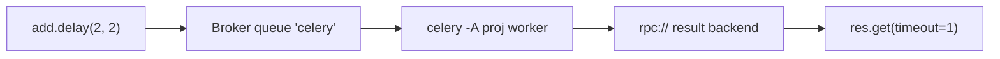

## Overview

This page takes you from an empty virtualenv to a task that runs on a worker and returns a result. It follows the two example projects shipped in the repository: `examples/tutorial` (one module, no result backend) and `examples/next-steps/proj` (a small package with a result backend and several tasks).

Sources: [examples/tutorial/tasks.py:1-12](repo://examples/tutorial/tasks.py#L1-L12), [examples/next-steps/proj/celery.py:1-14](repo://examples/next-steps/proj/celery.py#L1-L14)

You need a running broker. The examples use RabbitMQ at `amqp://` (localhost, guest account); Redis works the same way once the `redis` extra is installed. For how the pieces fit together see [[Overview]].

Sources: [README.rst:147-153](repo://README.rst#L147-L153)

## Install

Install the package from PyPI. Celery 5.6 requires Python 3.10 or newer according to `setup.py`, and pulls in Kombu, billiard, vine, Click and python-dateutil.

Sources: [README.rst:304-312](repo://README.rst#L304-L312), [setup.py:150-151](repo://setup.py#L150-L151), [requirements/default.txt:1-10](repo://requirements/default.txt#L1-L10)

```bash
pip install -U celery
```

Sources: [README.rst:307-312](repo://README.rst#L307-L312)

Optional features are installed as bundles. `setup.py` builds `extras_require` from the `EXTENSIONS` tuple: each name `x` maps to `requirements/extras/x.txt`, so `celery[redis]` installs `kombu[redis]`, `celery[sqs]` installs `kombu[sqs]` plus boto3 and pycurl, and so on. Several bundles can be combined with commas.

Sources: [setup.py:12-47](repo://setup.py#L12-L47), [setup.py:113-125](repo://setup.py#L113-L125), [requirements/extras/redis.txt:1-1](repo://requirements/extras/redis.txt#L1-L1), [requirements/extras/sqs.txt:1-5](repo://requirements/extras/sqs.txt#L1-L5)

```bash
pip install "celery[redis]"
pip install "celery[redis,auth,msgpack]"
```

Sources: [README.rst:326-331](repo://README.rst#L326-L331)

| Group | Extras |
| --- | --- |
| Serializers | `auth`, `msgpack`, `yaml` |
| Concurrency | `eventlet`, `gevent` |
| Transports | `redis`, `sqs`, `gcpubsub`, `zookeeper`, `pyro`, `slmq`, `consul`, `librabbitmq` |
| Result backends | `redis`, `memcache`, `pymemcache`, `cassandra`, `azureblockblob`, `s3`, `gcs`, `couchbase`, `couchdb`, `arangodb`, `elasticsearch`, `cosmosdbsql`, `dynamodb`, `mongodb`, `sqlalchemy`, `consul` |
| Other | `tblib` (remote tracebacks), `pydantic`, `pytest`, `django`, `solar`, `brotli`, `zstd` |

Sources: [setup.py:12-47](repo://setup.py#L12-L47), [README.rst:333-426](repo://README.rst#L333-L426)

> [!NOTE]
> The README also lists `celery[amqp]` and `celery[riak]`, but neither name is in `EXTENSIONS`, so pip will not find those extras in this version.

Sources: [README.rst:359-399](repo://README.rst#L359-L399), [setup.py:12-47](repo://setup.py#L12-L47)

## A first app

The tutorial module creates an app and registers one task. The first argument to `Celery` is the main module name; it becomes the prefix of task names when the module runs as `__main__`.

Sources: [examples/tutorial/tasks.py:1-12](repo://examples/tutorial/tasks.py#L1-L12), [celery/utils/imports.py:122-141](repo://celery/utils/imports.py#L122-L141)

```python
from celery import Celery

app = Celery('tasks', broker='amqp://')


@app.task()
def add(x, y):
    return x + y


if __name__ == '__main__':
    app.start()
```

Sources: [examples/tutorial/tasks.py:1-12](repo://examples/tutorial/tasks.py#L1-L12)

`@app.task()` wraps `add` in a `Task` subclass and records it in the app's registry under the name `tasks.add` (module name plus function name). The `app.start()` line lets the module act as its own command line, so `python tasks.py worker` is equivalent to `celery -A tasks worker`. See [[The Celery Application]] for what the decorator does.

Sources: [celery/app/base.py:515-585](repo://celery/app/base.py#L515-L585), [celery/app/base.py:480-497](repo://celery/app/base.py#L480-L497)

## Start a worker

From the directory that contains `tasks.py`, start a worker and point it at the app with `-A`:

Sources: [examples/app/myapp.py:13-22](repo://examples/app/myapp.py#L13-L22)

```bash
celery -A tasks worker --loglevel=INFO
```

Sources: [celery/bin/celery.py:57-66](repo://celery/bin/celery.py#L57-L66), [celery/bin/worker.py:162-168](repo://celery/bin/worker.py#L162-L168)

`-A` accepts `module`, `module:attribute` or a package. `find_app` imports the module and looks for an attribute named `app`, then `celery`; for a package without either it retries with `<package>.celery`, and as a last resort returns the first `Celery` instance found in the module. That is why `-A proj` finds the app defined in `proj/celery.py`.

Sources: [celery/app/utils.py:378-415](repo://celery/app/utils.py#L378-L415), [celery/bin/celery.py:136-153](repo://celery/bin/celery.py#L136-L153)

Global options on the `celery` command override configuration through environment variables before the app loads: `-b/--broker` sets `CELERY_BROKER_URL`, `--result-backend` sets `CELERY_RESULT_BACKEND`, `--config` sets `CELERY_CONFIG_MODULE` and `--loader` sets `CELERY_LOADER`. Every option can also be given as a `CELERY_`-prefixed environment variable, such as `CELERY_APP`.

Sources: [celery/bin/celery.py:113-133](repo://celery/bin/celery.py#L113-L133), [celery/bin/celery.py:220-226](repo://celery/bin/celery.py#L220-L226)

The worker's log level defaults to `WARNING`; `-c/--concurrency` and `-P/--pool` choose how many tasks run at once and in which kind of pool. More options are described in [[Command-Line Interface]] and [[Concurrency Pools]].

Sources: [celery/bin/worker.py:162-168](repo://celery/bin/worker.py#L162-L168), [celery/bin/worker.py:194-210](repo://celery/bin/worker.py#L194-L210)

## Call the task

In another shell, import the task and call it. `delay` publishes a message and returns an `AsyncResult` immediately:

Sources: [celery/app/task.py:523-534](repo://celery/app/task.py#L523-L534)

```python
>>> from tasks import add
>>> result = add.delay(4, 4)
>>> result.id
```

Sources: [celery/app/task.py:523-534](repo://celery/app/task.py#L523-L534), [celery/app/base.py:1030-1041](repo://celery/app/base.py#L1030-L1041)

The worker log shows the task being received and succeeding. Reading the value back, however, needs a result backend: the tutorial app configures none, so `result_backend` resolves to `DisabledBackend`, whose `get_state`, `get_result` and `wait_for` raise `NotImplementedError("No result backend is configured...")`.

Sources: [celery/app/backends.py:41-45](repo://celery/app/backends.py#L41-L45), [celery/backends/base.py:48-51](repo://celery/backends/base.py#L48-L51), [celery/backends/base.py:1263-1281](repo://celery/backends/base.py#L1263-L1281)

## A project with results

The next-steps example is a package. `proj/celery.py` creates the app with an RPC result backend (results travel back as AMQP messages), lists the task modules the worker must import in `include`, and sets `result_expires` so stored results expire after an hour.

Sources: [examples/next-steps/proj/celery.py:1-14](repo://examples/next-steps/proj/celery.py#L1-L14)

```python
from celery import Celery

app = Celery('proj',
             broker='amqp://',
             backend='rpc://',
             include=['proj.tasks'])

# Optional configuration, see the application user guide.
app.conf.update(
    result_expires=3600,
)

if __name__ == '__main__':
    app.start()
```

Sources: [examples/next-steps/proj/celery.py:1-14](repo://examples/next-steps/proj/celery.py#L1-L14)

`proj/tasks.py` imports that app and defines `add`, `mul` and `xsum`; their names become `proj.tasks.add`, `proj.tasks.mul` and `proj.tasks.xsum`.

Sources: [examples/next-steps/proj/tasks.py:1-16](repo://examples/next-steps/proj/tasks.py#L1-L16), [celery/utils/imports.py:122-141](repo://celery/utils/imports.py#L122-L141)

```python
from .celery import app


@app.task
def add(x, y):
    return x + y


@app.task
def mul(x, y):
    return x * y


@app.task
def xsum(numbers):
    return sum(numbers)
```

Sources: [examples/next-steps/proj/tasks.py:1-16](repo://examples/next-steps/proj/tasks.py#L1-L16)

Run these steps from `examples/next-steps`, the directory that contains the `proj` package:

Sources: [examples/next-steps/setup.py:9-22](repo://examples/next-steps/setup.py#L9-L22), [celery/app/utils.py:399-406](repo://celery/app/utils.py#L399-L406)

1. Start the worker: `celery -A proj worker -l INFO`. While booting, `WorkController` calls `app.loader.init_worker()`, which imports every module in `imports` and `include`, so `proj.tasks` is registered before the first message arrives.
2. Call a task from Python: `from proj.tasks import add` then `res = add.delay(2, 2)`.
3. Read the result: `res.get(timeout=1)` returns `4`. `res.ready()` tells whether the task has finished, `res.successful()` and `res.failed()` check the final state, and `get` re-raises the task's exception unless you pass `propagate=False`.
4. Or do the same from the shell: `celery -A proj call proj.tasks.add --args='[2, 2]'` prints the task id, and `celery -A proj result <task_id>` prints the return value.

Sources: [celery/worker/worker.py:90-99](repo://celery/worker/worker.py#L90-L99), [celery/loaders/base.py:97-111](repo://celery/loaders/base.py#L97-L111), [celery/loaders/base.py:223-229](repo://celery/loaders/base.py#L223-L229), [celery/result.py:191-215](repo://celery/result.py#L191-L215), [celery/result.py:369-383](repo://celery/result.py#L369-L383), [celery/bin/call.py:8-71](repo://celery/bin/call.py#L8-L71), [celery/bin/result.py:7-27](repo://celery/bin/result.py#L7-L27)



Sources: [examples/next-steps/proj/celery.py:3-6](repo://examples/next-steps/proj/celery.py#L3-L6), [celery/app/defaults.py:283-283](repo://celery/app/defaults.py#L283-L283)

> [!WARNING]
> Every `AsyncResult` keeps backend resources until it is consumed: call `get()` or `forget()` on each result you receive, and never wait on another task's result from inside a task.

Sources: [celery/result.py:195-205](repo://celery/result.py#L195-L205)

## Packaging tasks

`examples/next-steps/setup.py` shows how to ship tasks and their app as an installable package that depends on `celery>=5.0`, so workers on other machines can `pip install` the same code the clients use.

Sources: [examples/next-steps/setup.py:1-39](repo://examples/next-steps/setup.py#L1-L39)

## Next steps

- [[Configuration]]: move settings into a module with `config_from_object`.
- [[Defining and Calling Tasks]]: task options, retries and `apply_async` arguments.
- [[Canvas: Signatures and Workflows]]: compose `add`, `mul` and `xsum` with `chain`, `group` and `chord`.
- [[Celery Beat Scheduler]]: run tasks on a schedule.

Sources: [celery/__init__.py:36-41](repo://celery/__init__.py#L36-L41)
