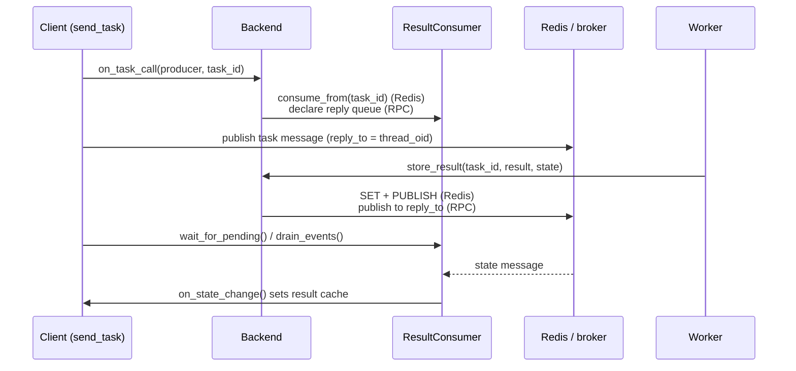

## Overview

The Redis and RPC backends are the two result backends that push results to waiting clients instead of being polled. Both combine the shared backend logic with `AsyncBackendMixin`, and each has a `ResultConsumer` that listens for state messages: Redis through pub/sub on the result key, RPC through an AMQP reply queue on the broker. `RedisBackend` (`redis://`, `rediss://`, `socket://` URLs) and `SentinelBackend` (`sentinel://`) live in `celery/backends/redis.py`; `RPCBackend` (`rpc://`) in `celery/backends/rpc.py`. The shared base classes and backend selection are described in [[Result Backends]].

Sources: [celery/backends/redis.py:1-38](repo://celery/backends/redis.py#L1-L38), [celery/backends/redis.py:204-221](repo://celery/backends/redis.py#L204-L221), [celery/backends/rpc.py:1-31](repo://celery/backends/rpc.py#L1-L31), [celery/backends/rpc.py:147-159](repo://celery/backends/rpc.py#L147-L159), [celery/app/backends.py:15-20](repo://celery/app/backends.py#L15-L20)

The difference that matters most: Redis stores results under keys that any client can read later, while RPC sends each result as a message to the queue of the client that sent the task, so only that client can receive it, and RPC has no chord support.

Sources: [celery/backends/redis.py:532-539](repo://celery/backends/redis.py#L532-L539), [celery/backends/rpc.py:214-238](repo://celery/backends/rpc.py#L214-L238)

## The asynchronous result path

### AsyncBackendMixin and result consumers

`AsyncBackendMixin` replaces polling with a result consumer. When a client creates an `AsyncResult`, `add_pending_result()` starts the consumer's drainer, resolves the result from the `_pending_messages` buffer if its message already arrived, and otherwise records it in `_pending_results` and calls `result_consumer.consume_from(task_id)`. `wait_for_pending()` drains events until `result.on_ready` fires; `on_result_fulfilled()` calls `cancel_for()` to stop listening.

Sources: [celery/backends/asynchronous.py:225-313](repo://celery/backends/asynchronous.py#L225-L313)

`BaseResultConsumer.on_state_change()` handles each incoming meta: for a ready state it finds the pending result and sets its cache, or buffers the meta when the message arrived before the result was registered. `reconnect_on_error()` wraps transport calls: a connection error triggers `_reconnect()`, and a second failure raises `RuntimeError` saying the application must be restarted.

Sources: [celery/backends/asynchronous.py:316-335](repo://celery/backends/asynchronous.py#L316-L335), [celery/backends/asynchronous.py:393-440](repo://celery/backends/asynchronous.py#L393-L440), [celery/backends/asynchronous.py:22-25](repo://celery/backends/asynchronous.py#L22-L25)



Sources: [celery/app/base.py:1005-1028](repo://celery/app/base.py#L1005-L1028), [celery/backends/redis.py:501-503](repo://celery/backends/redis.py#L501-L503), [celery/backends/redis.py:532-539](repo://celery/backends/redis.py#L532-L539), [celery/backends/rpc.py:217-271](repo://celery/backends/rpc.py#L217-L271)

`app.send_task()` calls `backend.on_task_call(P, task_id)` before publishing unless the task ignores its result. Both backends skip their work there when `task_join_will_block()` is true, that is inside a prefork worker child, where waiting on results is not allowed.

Sources: [celery/app/base.py:1024-1028](repo://celery/app/base.py#L1024-L1028), [celery/backends/redis.py:501-503](repo://celery/backends/redis.py#L501-L503), [celery/backends/rpc.py:217-223](repo://celery/backends/rpc.py#L217-L223)

## RedisBackend

### Connection parameters

`RedisBackend.__init__` raises `ImproperlyConfigured` when the `redis` package is missing. It builds `connparams` from the `redis_*` settings, then lets the URL override them:

Sources: [celery/backends/redis.py:227-262](repo://celery/backends/redis.py#L227-L262)

| Source | Keys |
| --- | --- |
| `redis_host`, `redis_port`, `redis_db`, `redis_password` | `host` (`localhost`), `port` (6379), `db` (0), `password` |
| `redis_max_connections` | `max_connections` of the pool |
| `redis_socket_timeout`, `redis_socket_connect_timeout`, `redis_retry_on_timeout`, `redis_socket_keepalive` | Socket behaviour (socket timeout defaults to 120 s) |
| `redis_client_name`, `redis_username` | `client_name`, `username` (added only when set) |
| `redis_backend_credential_provider` | A `redis.CredentialProvider` instance or dotted path; removes `username` and `password` |
| `redis_backend_health_check_interval` | `health_check_interval` |
| `redis_backend_use_ssl` | Dict of `ssl_*` keys; switches `connection_class` to `SSLConnection` |

Sources: [celery/backends/redis.py:227-306](repo://celery/backends/redis.py#L227-L306), [celery/app/defaults.py:190-204](repo://celery/app/defaults.py#L190-L204)

`expires` is passed as an `int` (`expires_type=int`) because Redis TTLs are whole seconds. A host argument containing `://` is treated as the URL. The client is a cached `redis.StrictRedis` over a `ConnectionPool` built from `connparams`, and `_add_driver_info()` identifies Celery to the server through `DriverInfo` or `lib_name`/`lib_version`.

Sources: [celery/backends/redis.py:230-236](repo://celery/backends/redis.py#L230-L236), [celery/backends/redis.py:462-485](repo://celery/backends/redis.py#L462-L485), [celery/backends/redis.py:688-707](repo://celery/backends/redis.py#L688-L707)

### URL parsing

`_params_from_url()` parses the URL with kombu's `_parse_url` and overlays host, port, username, password and database:

Sources: [celery/backends/redis.py:388-394](repo://celery/backends/redis.py#L388-L394)

1. `socket://` URLs use `UnixDomainSocketConnection` with the URL path as the socket path and drop host, port and connect timeout; the database comes from the `virtual_host` query parameter.
2. Other schemes take the database from the path (`redis://host:6379/2`), stripped of `/` and converted to `int`.
3. `redis://` with `ssl_ca_certs`, `ssl_certfile`, `ssl_keyfile` or `ssl_cert_reqs` in the query raises `ValueError` (use `rediss://`); SSL settings from `redis_backend_use_ssl` are still honoured.
4. `rediss://` selects `SSLConnection` and URL-decodes the SSL query parameters.
5. A `credential_provider` query parameter is resolved like the setting.
6. Remaining query parameters are converted with redis-py's `URL_QUERY_ARGUMENT_PARSERS` and override everything else.

Sources: [celery/backends/redis.py:388-460](repo://celery/backends/redis.py#L388-L460)

With an SSL connection class, `ssl_cert_reqs` must be one of `CERT_REQUIRED`, `CERT_OPTIONAL`, `CERT_NONE` (or `required`, `optional`, `none`); a missing or invalid value raises `ValueError`, and the two weaker values log a man-in-the-middle warning.

Sources: [celery/backends/redis.py:50-70](repo://celery/backends/redis.py#L50-L70), [celery/backends/redis.py:310-331](repo://celery/backends/redis.py#L310-L331)

```python
app.conf.result_backend = 'rediss://:secret@redis.example.com:6380/1?ssl_cert_reqs=required'
```

Sources: [celery/backends/redis.py:413-433](repo://celery/backends/redis.py#L413-L433)

### Storing results

`RedisBackend` is a `BaseKeyValueStoreBackend`, so tasks live under `celery-task-meta-<id>`. `set()` refuses strings larger than 512 MB with `BackendStoreError`, then runs `_set()` through `ensure()`. `_set()` writes the value with `SETEX` when `expires` is set (`SET` otherwise) and `PUBLISH`es the same value on a channel named after the key, in one pipeline. That publish is what the result consumer receives.

Sources: [celery/backends/redis.py:204-225](repo://celery/backends/redis.py#L204-L225), [celery/backends/redis.py:505-552](repo://celery/backends/redis.py#L505-L552)

### Pub/sub ResultConsumer

The Redis `ResultConsumer` subscribes to one channel per awaited task key. `start()` opens a pub/sub object and `_consume_from()` subscribes to the task's key; `cancel_for()` unsubscribes, and `on_state_change()` cancels automatically once a ready state arrives. `drain_events()` reads one message with `get_message(timeout=...)` and decodes it with `decode_result()`. `on_wait_for_pending()` also reads the current meta directly, so a result stored before the subscription is not missed, and removes the buffered copy of finished `SUCCESS`/`FAILURE` metas to avoid leaking memory.

Sources: [celery/backends/redis.py:77-87](repo://celery/backends/redis.py#L77-L87), [celery/backends/redis.py:134-201](repo://celery/backends/redis.py#L134-L201)

On a connection error, `_reconnect()` runs `_reconnect_pubsub()` under the backend's retry policy: it resets the pool, fetches every subscribed key with `MGET` and feeds the metas to `on_state_change()` (a state may have changed while disconnected), then re-subscribes. After a fork, `on_after_fork()` resets the pool and closes the inherited pub/sub connection.

Sources: [celery/backends/redis.py:88-132](repo://celery/backends/redis.py#L88-L132)

### Retry policy and connection errors

`ensure()` wraps calls in kombu's `retry_over_time` with `retry_policy` (20 retries, 0-1 s intervals by default, overridable with `retry_policy` in `result_backend_transport_options`), logging `Connection to Redis lost: Retry (n/max) in ...` on each attempt. `connection_errors` come from kombu's Redis transport, extended by `additional_connection_errors` in the transport options (exception classes or dotted paths; invalid entries are logged and ignored). `exception_safe_to_retry()` returns true for those errors, which is what lets `result_backend_always_retry` retry Redis operations.

Sources: [celery/backends/redis.py:338-386](repo://celery/backends/redis.py#L338-L386), [celery/backends/redis.py:487-524](repo://celery/backends/redis.py#L487-L524), [celery/backends/base.py:131-136](repo://celery/backends/base.py#L131-L136)

## Redis chords

### Keys and counters

Redis does not use the base class's counter chord. It keeps three keys per group id:

Sources: [celery/backends/redis.py:593-605](repo://celery/backends/redis.py#L593-L605)

| Key | Type | Content |
| --- | --- | --- |
| `celery-taskset-meta-<gid>.j` | sorted set (default) or list | Encoded `[1, task_id, state, result]` of every finished header task |
| `celery-taskset-meta-<gid>.s` | string | Chord size, written by `set_chord_size()` |
| `celery-taskset-meta-<gid>.t` | integer | Adjustment added by `add_to_chord()` when tasks join the chord at run time |

Sources: [celery/backends/redis.py:554-571](repo://celery/backends/redis.py#L554-L571), [celery/backends/redis.py:593-613](repo://celery/backends/redis.py#L593-L613)

`apply_chord()` stores nothing in the common case. It saves the header `GroupResult` only when one of its results is itself a `GroupResult`, so the nested structure can be rebuilt when the chord completes.

Sources: [celery/backends/redis.py:573-583](repo://celery/backends/redis.py#L573-L583)

### on_chord_part_return

Each finishing header task runs one pipeline: add its encoded result to `.j` (`ZADD` scored by `group_index`, or `RPUSH` when `result_chord_ordered` is false in the transport options), count the entries, read `.t` and `.s`, and refresh the expiry of all three keys. When the count equals size plus adjustment, the last task builds the body's arguments, calls `callback.delay(resl)` and deletes the three keys.

Sources: [celery/backends/redis.py:585-687](repo://celery/backends/redis.py#L585-L687)

```mermaid
flowchart TD
  start["on_chord_part_return(request, state, result)"] --> pipe["pipeline: ZADD/RPUSH .j, ZCOUNT/LLEN .j,<br>GET .t, GET .s, EXPIRE"]
  pipe --> sized{".s set?"}
  sized -->|no| done["return"]
  sized -->|yes| full{"readycount == size + .t?"}
  full -->|no| done
  full -->|yes| saved{"GroupResult.restore(gid)<br>found?"}
  saved -->|yes| join["on_ready() + join()<br>nested results"]
  saved -->|no| range["ZRANGE / LRANGE .j<br>_unpack_chord_result()"]
  join --> call["callback.delay(resl)"]
  range --> call
  call --> clean["DEL .j .t .s"]
  range -->|"dependency failed"| err["chord_error_from_stack(ChordError)"]
```

Sources: [celery/backends/redis.py:557-568](repo://celery/backends/redis.py#L557-L568), [celery/backends/redis.py:593-686](repo://celery/backends/redis.py#L593-L686)

Because the results ride along in `.j`, the body is called without fetching each header result again. The sorted set keeps them in header order by `group_index`; a list keeps arrival order. `_unpack_chord_result()` decodes each entry and raises `ChordError('Dependency <id> raised ...')` for a header task in a propagating state. Any `ChordError`, join error or callback error is passed to `chord_error_from_stack()`, which fails the body and runs its errbacks.

Sources: [celery/backends/redis.py:557-568](repo://celery/backends/redis.py#L557-L568), [celery/backends/redis.py:650-686](repo://celery/backends/redis.py#L650-L686)

## SentinelBackend

`SentinelBackend` accepts several `sentinel://` URLs separated by `;`, such as `sentinel://h1:26379/0;sentinel://h2:26379/0`. `_params_from_url()` parses each chunk with the Redis parser into `hosts` and copies `db`, `password` and `username` from the first one. `_get_pool()` builds a `redis.sentinel.Sentinel` over the hosts and returns the connection pool of `master_for(master_name)`, so the client follows failovers. `as_uri()` sanitizes the password of every chunk.

Sources: [celery/backends/redis.py:727-806](repo://celery/backends/redis.py#L727-L806)

| Transport option | Effect |
| --- | --- |
| `master_name` | Sentinel service name of the master. |
| `sentinel_kwargs` | Connection options for the sentinels themselves. |
| `min_other_sentinels` | Passed to `Sentinel`. |

Sources: [celery/backends/redis.py:778-806](repo://celery/backends/redis.py#L778-L806)

For TLS through Sentinel, `connection_class_ssl` is `SentinelManagedSSLConnection`, which combines `SentinelManagedConnection` with `SSLConnection`. A redis package without `redis.sentinel` makes the constructor raise `ImproperlyConfigured`.

Sources: [celery/backends/redis.py:715-740](repo://celery/backends/redis.py#L715-L740)

```python
app.conf.result_backend = 'sentinel://:pw@10.0.0.1:26379/0;sentinel://:pw@10.0.0.2:26379/0'
app.conf.result_backend_transport_options = {'master_name': 'mymaster'}
```

Sources: [celery/backends/redis.py:730-731](repo://celery/backends/redis.py#L730-L731), [celery/backends/redis.py:762-806](repo://celery/backends/redis.py#L762-L806)

## RPCBackend

### Reply queues

`RPCBackend` sends results back as AMQP messages. Every client thread has an id, `app.thread_oid`, which `send_task()` puts in the task message as `reply_to`. The backend's `binding` is a queue named after that oid, bound to the default (nameless) exchange with the oid as routing key, `auto_delete=True` and `expires=result_expires`. All tasks sent from one thread share that queue, which is why `_create_binding()` returns the same binding for every task id.

Sources: [celery/backends/rpc.py:205-212](repo://celery/backends/rpc.py#L205-L212), [celery/backends/rpc.py:389-401](repo://celery/backends/rpc.py#L389-L401), [celery/app/base.py:1525-1532](repo://celery/app/base.py#L1525-L1532), [celery/app/base.py:1005-1011](repo://celery/app/base.py#L1005-L1011)

`on_task_call()` declares that queue (`maybe_declare(..., retry=True)`) before the task is published, so the reply cannot arrive before the queue exists.

Sources: [celery/backends/rpc.py:217-223](repo://celery/backends/rpc.py#L217-L223)

### Sending a result

On the worker, `store_result()` asks `destination_for()` for `(request.reply_to, request.correlation_id or task_id)` and does nothing when there is no `reply_to`. It publishes `{task_id, status, result, traceback, children}` through the app's producer pool to the default exchange with the reply-to as routing key, the result serializer, the backend's `retry_policy`, and `delivery_mode` 2 when `persistent` is true (`result_persistent`, default false for RPC) or 1 otherwise.

Sources: [celery/backends/rpc.py:178-199](repo://celery/backends/rpc.py#L178-L199), [celery/backends/rpc.py:225-280](repo://celery/backends/rpc.py#L225-L280)

### ResultConsumer

The RPC `ResultConsumer` opens a broker connection and a kombu `Consumer` on the reply queue with `on_state_change` as callback. `consume_from()` adds the queue if not already consumed, `drain_events()` calls `connection.drain_events(timeout)`, and `cancel_for()` cancels by queue name. `_reconnect()` cancels the stale consumer, closes the connection and rebuilds both with the same queues. After a fork, the backend clears pending results and the consumer drops its connection, registered through `register_after_fork`.

Sources: [celery/backends/rpc.py:37-145](repo://celery/backends/rpc.py#L37-L145), [celery/backends/rpc.py:197-203](repo://celery/backends/rpc.py#L197-L203)

### Polling with get_task_meta

`get_task_meta()` is used when a result is read without the consumer. It first returns any buffered out-of-band message for the task, then reads up to `backlog_limit` (1000) messages from the queue with `basic_get`. For each task id only the newest message is kept and older ones are acked; the newest message for this task is requeued and cached, messages for other tasks go to the out-of-band buffer. With nothing new it returns the cached meta or `PENDING`. More than 1000 messages raises `BacklogLimitExceeded`.

Sources: [celery/backends/rpc.py:282-350](repo://celery/backends/rpc.py#L282-L350)

### Limitations

| Operation | Behaviour |
| --- | --- |
| Chords (`ensure_chords_allowed`) | `NotImplementedError`: "The rpc result backend does not support chords!" |
| `save_group`, `restore_group`, `delete_group` | `NotImplementedError` |
| `reload_task_result`, `reload_group_result` | `NotImplementedError` |
| Reading another client's result | Not possible: the result goes only to the sender's `reply_to` queue |

Sources: [celery/backends/rpc.py:23-30](repo://celery/backends/rpc.py#L23-L30), [celery/backends/rpc.py:214-215](repo://celery/backends/rpc.py#L214-L215), [celery/backends/rpc.py:355-374](repo://celery/backends/rpc.py#L355-L374)

> [!WARNING]
> A group chained into another task is upgraded to a chord, so with the RPC backend such a canvas also fails with the chord error. Use Redis or another chord-capable backend for workflows from [[Canvas: Signatures and Workflows]].

Sources: [celery/backends/rpc.py:23-30](repo://celery/backends/rpc.py#L23-L30)
