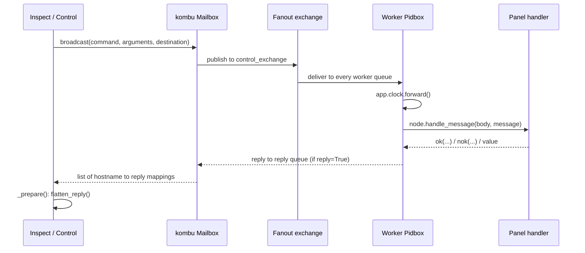

## Overview

Remote control lets a client talk to running workers without going through task queues: it can ask what a worker is doing (inspect commands, no side effects) or change its behaviour at runtime (control commands such as revoking a task, changing a rate limit or resizing the pool). The client half lives in `celery/app/control.py` and is reached through `app.control`; the server half is the command registry in `celery/worker/control.py`.

Sources: [celery/app/control.py:1-13](repo://celery/app/control.py#L1-L13), [celery/app/base.py:1576-1579](repo://celery/app/base.py#L1576-L1579)

Both halves meet on a kombu pidbox `Mailbox` bound to a fanout exchange. Every worker listens on that mailbox through the consumer's `Control` bootstep, so one broadcast reaches all workers, and each worker decides from the message's destination whether to handle it. The step chain is `Control` -> `celery.worker.pidbox` -> `kombu.pidbox`, and the commands themselves are plain functions registered in `Panel`. The bootstep sits inside the consumer described in [[Consumer and Task Requests]], and the `celery inspect` and `celery control` commands in [[Command-Line Interface]] are thin wrappers over this API.

Sources: [celery/worker/consumer/control.py:1-33](repo://celery/worker/consumer/control.py#L1-L33), [celery/app/control.py:426-452](repo://celery/app/control.py#L426-L452)

## Request and reply flow

A call such as `app.control.inspect().active()` goes through `Inspect._request`, which calls `Control.broadcast` with `reply=True`. `broadcast` gets a connection from the pool and calls `Mailbox._broadcast`, which publishes the command to the fanout exchange and, when a reply is wanted, collects answers from the reply queue until `timeout` passes or `limit` replies have arrived. On the worker, `Pidbox.on_message` hands the message to the kombu `Node`, which looks up the handler in `Panel.data`, calls it with the node state and sends the return value back.

Sources: [celery/app/control.py:107-117](repo://celery/app/control.py#L107-L117), [celery/app/control.py:755-790](repo://celery/app/control.py#L755-L790), [celery/worker/pidbox.py:25-49](repo://celery/worker/pidbox.py#L25-L49)



Sources: [celery/app/control.py:94-117](repo://celery/app/control.py#L94-L117), [celery/worker/pidbox.py:39-53](repo://celery/worker/pidbox.py#L39-L53), [celery/worker/control.py:31-36](repo://celery/worker/control.py#L31-L36)

## Client API

### Control

`Control` is built once per app (`app.control` is a cached property instantiating `control_cls`, by default `celery.app.control:Control`). Its constructor refuses a configuration where `control_queue_durable` and `control_queue_exclusive` are both true, because exclusive queues are deleted automatically and cannot be durable. It then creates the `Mailbox` from the `control_*` settings, using `accept_content` and `task_serializer` for the payload and the app's producer pool lazily. An after-fork hook deletes `mailbox.producer_pool` so a forked child never reuses the parent's producers.

Sources: [celery/app/control.py:426-456](repo://celery/app/control.py#L426-L456), [celery/app/base.py:1576-1579](repo://celery/app/base.py#L1576-L1579)

Each control method only packs its arguments and calls `broadcast`. `terminate` is `revoke` with `terminate=True`; `ping` is the only control method that sets `reply=True` itself, so the others are fire-and-forget unless the caller passes `reply=True`. `purge` (alias `discard_all`) is the exception: it does not broadcast at all but purges the task queues through `app.amqp.TaskConsumer`.

Sources: [celery/app/control.py:462-478](repo://celery/app/control.py#L462-L478), [celery/app/control.py:548-576](repo://celery/app/control.py#L548-L576)

`revoke_by_stamped_headers` works in two rounds. It first broadcasts `revoke_by_stamped_headers`; if any worker answers with a set of task ids in its `ok` field, it collects them and sends a second, ordinary `revoke` for those ids so they are also recorded by id.

Sources: [celery/app/control.py:512-546](repo://celery/app/control.py#L512-L546)

### Inspect

`app.control.inspect(...)` returns an `Inspect` built through `app.subclass_with_self`, holding `destination`, `timeout` (default `1.0`), `callback`, `connection`, `limit`, `pattern` and `matcher`. Every query method (`active`, `scheduled`, `reserved`, `stats`, `revoked`, `registered`, `ping`, `active_queues`, `query_task`, `conf`, `report`, `clock`, `memsample`, `memdump`, `objgraph`, `hello`) is one call to `_request(command, **kwargs)`.

Sources: [celery/app/control.py:73-117](repo://celery/app/control.py#L73-L117), [celery/app/control.py:457-460](repo://celery/app/control.py#L457-L460)

`query_task` still accepts the old unary form `query_task(ids=[...])` by unpacking a single list or tuple argument, and `Inspect.ping(destination=...)` overwrites `self.destination` before sending.

Sources: [celery/app/control.py:276-296](repo://celery/app/control.py#L276-L296), [celery/app/control.py:342-372](repo://celery/app/control.py#L342-L372)

### Replies and destinations

The mailbox returns a list of one-entry dictionaries, one per replying node. `Inspect._prepare` merges them with `flatten_reply`, which warns with `DuplicateNodenameWarning` when two replies carry the same node name (two workers started without distinct `-n` names). The result is then shaped by the destination: a single string destination returns only that node's value, a `pattern` keeps the nodes whose name matches through `kombu.matcher.match` with the chosen `matcher`, and otherwise the full mapping is returned. `Control` methods return the raw list.

Sources: [celery/app/control.py:31-63](repo://celery/app/control.py#L31-L63), [celery/app/control.py:94-105](repo://celery/app/control.py#L94-L105)

```python
with self.app.connection_or_acquire(connection) as conn:
    arguments = dict(arguments or {}, **extra_kwargs)
    if pattern and matcher:
        # tests pass easier without requiring pattern/matcher to
        # always be sent in
        return self.mailbox(conn)._broadcast(
            command, arguments, destination, reply, timeout,
            limit, callback, channel=channel,
            pattern=pattern, matcher=matcher,
        )
```

Sources: [celery/app/control.py:776-785](repo://celery/app/control.py#L776-L785)

Extra keyword arguments to `broadcast` are merged into `arguments`, so `app.control.revoke(id, reply=True, timeout=2)` passes `reply` and `timeout` to the mailbox while any unknown keyword becomes a command argument. `callback` is called for every reply as it arrives, which is how the CLI prints replies while it is still waiting.

Sources: [celery/app/control.py:755-777](repo://celery/app/control.py#L755-L777), [celery/bin/control.py:236-262](repo://celery/bin/control.py#L236-L262)

## Worker side

### Control bootstep

`celery.worker.consumer.control.Control` is a `StartStopStep` of the consumer blueprint that requires the `Tasks` step. `include_if` enables it only when `worker_enable_remote_control` is true and the transport supports fanout exchanges. Its constructor picks `gPidbox` when the pool is green (eventlet, gevent) and `Pidbox` otherwise, and forwards `start`, `stop` and `shutdown` to the chosen box.

Sources: [celery/worker/consumer/control.py:18-33](repo://celery/worker/consumer/control.py#L18-L33), [celery/worker/consumer/consumer.py:176-185](repo://celery/worker/consumer/consumer.py#L176-L185)

### Pidbox and gPidbox

`Pidbox` creates a mailbox `Node` named after the worker hostname, with `Panel.data` as its handler table and an `AttributeDict` state of `app`, `hostname`, `consumer` and `tset`. `tset` is `pass1` under the event loop and `set` otherwise, so commands that read the weak sets of requests copy them when another thread could change them during iteration.

Sources: [celery/worker/pidbox.py:20-37](repo://celery/worker/pidbox.py#L20-L37)

`start` opens a channel on the consumer connection and calls `node.listen(callback=self.on_message)`. `on_message` first forwards the Lamport clock (clients rarely have a valid clock to merge), then dispatches. A `KeyError` is logged as an unknown command; any other `Exception` is logged and the box is reset by stopping and restarting the consumer on a fresh channel.

Sources: [celery/worker/pidbox.py:39-80](repo://celery/worker/pidbox.py#L39-L80)

`gPidbox` runs the mailbox in its own greenlet spawned with `c.pool.spawn_n(self.loop, c)`. The loop opens a separate read connection, drains events with a one-second timeout until a shutdown event is set or the consumer connection is gone, and applies a reset by comparing a counter, since `reset` only increments `_resets`. `on_stop` sets the shutdown event and waits for the loop to finish.

Sources: [celery/worker/pidbox.py:83-126](repo://celery/worker/pidbox.py#L83-L126)

### Panel registry

`Panel` is a `UserDict` whose class-level `data` and `meta` dictionaries are global. `Panel._register` stores the function under its name (and its `alias`, if any) in `data`, and a `controller_info_t` tuple in `meta` with the command type, visibility, default timeout, help text (the first docstring line), signature, typed `args` and the `variadic` argument name. `control_command` and `inspect_command` are `Panel.register` with `type` preset.

Sources: [celery/worker/control.py:25-74](repo://celery/worker/control.py#L25-L74)

The CLI reads `Panel.meta` to list the visible commands of each type and to convert positional words into typed keyword arguments, so `celery control rate_limit tasks.add 10/m` becomes `{'task_name': 'tasks.add', 'rate_limit': '10/m'}`. Words beyond the typed `args` go into the `variadic` argument.

Sources: [celery/bin/control.py:26-53](repo://celery/bin/control.py#L26-L53), [celery/bin/control.py:99-104](repo://celery/bin/control.py#L99-L104)

## Built-in commands

| Command | Type | Alias | What the worker does |
| --- | --- | --- | --- |
| `revoke` | control | | Adds ids to `worker_state.revoked`, marks them revoked in the backend, optionally terminates running requests |
| `revoke_by_stamped_headers` | control | | Adds stamps to `worker_state.revoked_stamps`; with `terminate` kills active requests whose stamps match |
| `terminate` | control | | `revoke(..., terminate=True, signal=signal)` |
| `rate_limit` | control | | Validates with `rate()`, sets `task.rate_limit`, calls `consumer.reset_rate_limits()` |
| `time_limit` | control | | Sets `task.soft_time_limit` and `task.time_limit` |
| `election` | control | | Passes to `consumer.gossip.election` |
| `enable_events` / `disable_events` | control | | Adds or removes the `task` group on the event dispatcher |
| `heartbeat` | control | | Sends a `worker-heartbeat` event now |
| `pool_grow` / `pool_shrink` | control | | `pool.grow(n)` / `pool.shrink(n)` and adjusts prefetch; refused under autoscale |
| `pool_restart` | control | | `controller.reload(...)` if `worker_pool_restarts` is on |
| `autoscale` | control | | `autoscaler.update(max, min)` |
| `shutdown` | control | | Raises `WorkerShutdown(EX_OK)` |
| `add_consumer` / `cancel_consumer` | control | | Schedules `add_task_queue` / `cancel_task_queue` with `call_soon` |
| `ping` | inspect | | Returns `ok('pong')`, default timeout `0.2` |
| `stats` | inspect | | `controller.stats()` |
| `active` | inspect | `dump_active` | `info()` of every active request |
| `scheduled` | inspect | `dump_schedule` | Requests waiting in the timer for their ETA |
| `reserved` | inspect | `dump_reserved` | Reserved minus active requests |
| `revoked` | inspect | `dump_revoked` | List of `worker_state.revoked` |
| `registered` | inspect | `dump_tasks` | Sorted task names, with chosen attributes |
| `query_task` | inspect | | State and info of requests by id |
| `active_queues` | inspect | | `queue.as_dict()` for each consumed queue |
| `conf` | inspect | `dump_conf` | JSON-safe configuration table |
| `report`, `clock`, `memsample`, `memdump`, `objgraph` | inspect | | Bug report, logical clock, memory debugging |
| `hello` | inspect (hidden) | | Mingle sync: merges and returns revoked ids and clock |

Sources: [celery/worker/control.py:79-131](repo://celery/worker/control.py#L79-L131), [celery/worker/control.py:134-242](repo://celery/worker/control.py#L134-L242), [celery/worker/control.py:245-319](repo://celery/worker/control.py#L245-L319), [celery/worker/control.py:322-376](repo://celery/worker/control.py#L322-L376), [celery/worker/control.py:379-487](repo://celery/worker/control.py#L379-L487), [celery/worker/control.py:520-637](repo://celery/worker/control.py#L520-L637)

## Command behaviour

### Revoking and terminating

`revoke` turns `task_id` into a set and calls `_revoke`. `_revoke` adds the ids to `worker_state.revoked`, a `LimitedSet` capped by `CELERY_WORKER_REVOKES_MAX` (50000) with entries expiring after `CELERY_WORKER_REVOKE_EXPIRES` (10800 seconds), and calls `app.backend.mark_as_revoked` for each id, logging a warning if the backend fails. With `terminate`, it resolves the signal name with `platforms.signals.signum`, looks each id up in `worker_state.requests` and calls `request.terminate(state.consumer.pool, signal=signum)`, stopping once every id has been handled.

Sources: [celery/worker/control.py:134-242](repo://celery/worker/control.py#L134-L242), [celery/worker/state.py:34-71](repo://celery/worker/state.py#L34-L71)

Revoking does not remove messages from the queue. The flag is checked when the request is about to run: `Request.revoked()` returns true when the id is in the revoked set, when the task has expired, or when one of its stamped headers matches `revoked_stamps`. Because the set lives in worker memory, it survives restarts only with the state database, and new workers learn it from their neighbours through the hidden `hello` command that the Mingle step sends at startup.

Sources: [celery/worker/request.py:470-500](repo://celery/worker/request.py#L470-L500), [celery/worker/state.py:67-68](repo://celery/worker/state.py#L67-L68), [celery/worker/control.py:381-396](repo://celery/worker/control.py#L381-L396), [celery/worker/consumer/mingle.py:51-56](repo://celery/worker/consumer/mingle.py#L51-L56)

### Rate and time limits

`rate_limit` validates the string with `celery.utils.time.rate`, answering `nok('Invalid rate limit string: ...')` on a `ValueError` and `nok('unknown task')` when the task is not registered. On success it sets the task class's `rate_limit` and calls `Consumer.reset_rate_limits`, which rebuilds a `TokenBucket` for every task. `time_limit` sets `soft_time_limit` and `time_limit` on the registered task, which affects requests created afterwards.

Sources: [celery/worker/control.py:255-319](repo://celery/worker/control.py#L255-L319), [celery/worker/consumer/consumer.py:296-303](repo://celery/worker/consumer/consumer.py#L296-L303)

### Pool resizing and restarts

`pool_grow` and `pool_shrink` refuse with `nok(...)` when an autoscaler is running, since its range would undo the change; use `autoscale` instead, which raises `ValueError('Autoscale not enabled')` without one. Otherwise they call `pool.grow(n)` or `pool.shrink(n)` and `Consumer._update_prefetch_count(±n)`, which recomputes `initial_prefetch_count` as processes times `prefetch_multiplier` and moves QoS up or down. [[Concurrency Pools]] covers the pool and autoscaler side.

Sources: [celery/worker/control.py:541-589](repo://celery/worker/control.py#L541-L589), [celery/worker/consumer/consumer.py:305-327](repo://celery/worker/consumer/consumer.py#L305-L327)

`pool_restart` raises `ValueError('Pool restarts not enabled')` unless `worker_pool_restarts` is set. When enabled it calls `WorkController.reload`, which imports or reloads the task modules, refreshes the consumer's strategies and rate limits, and calls `pool.restart()`, ignoring pools that raise `NotImplementedError`.

Sources: [celery/worker/control.py:569-576](repo://celery/worker/control.py#L569-L576), [celery/worker/worker.py:269-294](repo://celery/worker/worker.py#L269-L294)

### Queues

`add_consumer` and `cancel_consumer` do not touch the task consumer directly; they schedule the change with `consumer.call_soon`, which goes through the hub under the event loop or onto `_pending_operations` otherwise, so the channel is changed from the consumer's own thread. `Consumer.add_task_queue` reuses a queue already declared in `app.amqp.queues` and otherwise declares one whose exchange defaults to the queue name, then starts consuming if it was not already. As the client docstring notes, the command ignores the configured default queue and exchange options; see [[Task Messages and Routing]].

Sources: [celery/worker/control.py:599-637](repo://celery/worker/control.py#L599-L637), [celery/app/control.py:600-635](repo://celery/app/control.py#L600-L635), [celery/worker/consumer/consumer.py:257-262](repo://celery/worker/consumer/consumer.py#L257-L262), [celery/worker/consumer/consumer.py:632-657](repo://celery/worker/consumer/consumer.py#L632-L657)

### Shutdown

`shutdown` logs the message and raises `WorkerShutdown(EX_OK)`. `WorkerShutdown` derives from `SystemExit`, not `Exception`, so `Pidbox.on_message` does not catch it; it propagates out of the consumer and reaches `WorkController.start`, which calls `stop(exitcode=exc.code)` for a warm shutdown. The lifecycle is described in [[Worker Architecture and Bootsteps]].

Sources: [celery/worker/control.py:592-596](repo://celery/worker/control.py#L592-L596), [celery/exceptions.py:271-279](repo://celery/exceptions.py#L271-L279), [celery/worker/worker.py:201-212](repo://celery/worker/worker.py#L201-L212)

### Inspect commands

`active`, `reserved` and `scheduled` read the worker state module. `active` returns `request.info(safe=safe)` for each item of `active_requests`; `reserved` subtracts active from reserved requests; `scheduled` walks the timer queue and yields entries whose first argument is a `Request`, with its ISO `eta` and priority. `query_task` reports each known id as `active`, `reserved` or `ready`. `stats` is `WorkController.stats`, which merges uptime, pid, clock and per-task totals with the info of both blueprints and `rusage`.

Sources: [celery/worker/control.py:103-131](repo://celery/worker/control.py#L103-L131), [celery/worker/control.py:405-448](repo://celery/worker/control.py#L405-L448), [celery/worker/worker.py:296-334](repo://celery/worker/worker.py#L296-L334)

## Configuration

| Setting | Default | Effect |
| --- | --- | --- |
| `worker_enable_remote_control` | `True` | Includes the consumer `Control` step |
| `control_exchange` | `'celery'` | Name of the fanout mailbox exchange |
| `control_queue_ttl` | `300.0` | Message TTL for the control and reply queues |
| `control_queue_expires` | `10.0` | Idle expiry of the control and reply queues |
| `control_queue_exclusive` | `True` | Declare worker control queues exclusive |
| `control_queue_durable` | `False` | Declare them durable; cannot be combined with exclusive |
| `worker_pool_restarts` | `False` | Allows the `pool_restart` command |

Sources: [celery/app/defaults.py:151-157](repo://celery/app/defaults.py#L151-L157), [celery/app/defaults.py:343-354](repo://celery/app/defaults.py#L343-L354), [celery/app/control.py:431-451](repo://celery/app/control.py#L431-L451)

The full settings reference is in [[Configuration]].

Sources: [celery/app/defaults.py:151-157](repo://celery/app/defaults.py#L151-L157)

## Custom commands

Because `Panel.data` is global and `Pidbox` passes it to the node as its handler table, any module imported by the worker can add a command by decorating a function with `control_command` or `inspect_command`. The function receives the node state (with `app`, `hostname`, `consumer` and `tset`) as its first argument and should return `ok(...)` or `nok(...)` style dictionaries; `args`, `signature` and `variadic` make it usable from the CLI.

Sources: [celery/worker/control.py:39-74](repo://celery/worker/control.py#L39-L74), [celery/worker/pidbox.py:28-36](repo://celery/worker/pidbox.py#L28-L36)

```python
@inspect_command(default_timeout=0.2)
def ping(state, **kwargs):
    """Ping worker(s)."""
    return ok('pong')
```

Sources: [celery/worker/control.py:399-402](repo://celery/worker/control.py#L399-L402)

> [!WARNING]
> Commands run inside the consumer, so a slow handler delays message handling for that worker. `Pidbox.on_message` logs any exception that escapes the mailbox node and resets the broadcast channel. When no node answers before the timeout, `celery inspect` and `celery control` exit with "No nodes replied within time constraint".

Sources: [celery/worker/pidbox.py:39-65](repo://celery/worker/pidbox.py#L39-L65), [celery/bin/control.py:241-259](repo://celery/bin/control.py#L241-L259)
