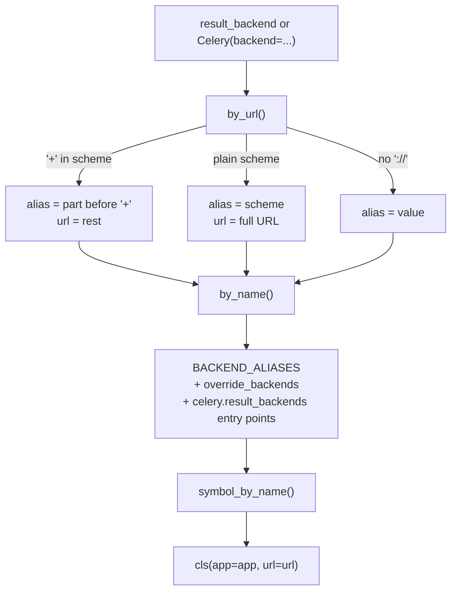
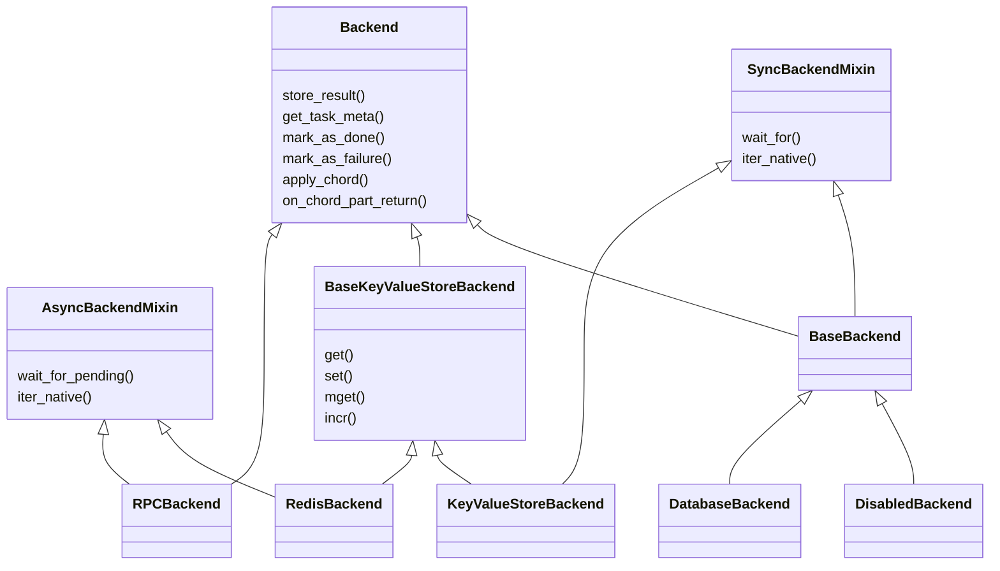
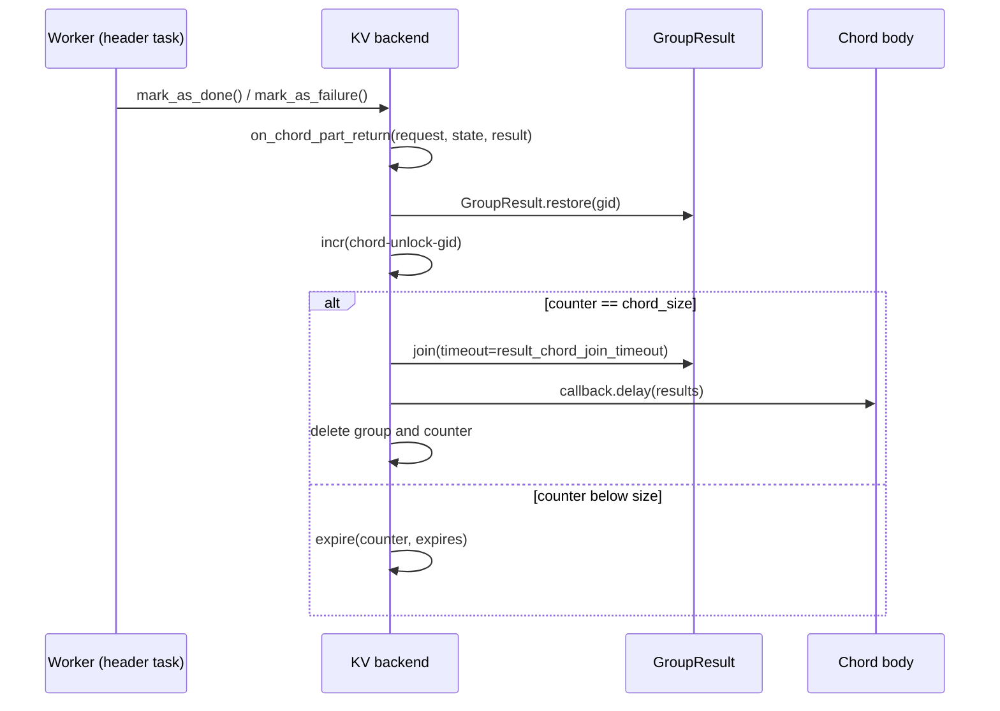

## Overview

A result backend is where workers record task state and return values and where clients read them back through `AsyncResult`. It is also what synchronises chords: the backend counts finished header tasks and starts the chord body. The interface and the shared logic live in `celery/backends/base.py`; `celery/app/backends.py` maps the `result_backend` setting to a backend class; each module in `celery/backends/` implements one storage system. How clients wait on results is covered in [[Task Results]].

Sources: [celery/backends/base.py:1-60](repo://celery/backends/base.py#L1-L60), [celery/app/backends.py:1-69](repo://celery/app/backends.py#L1-L69), [celery/backends/__init__.py:1-1](repo://celery/backends/__init__.py#L1-L1)

## Choosing a backend

### From result_backend to a class

`app.backend` is created lazily by `_get_backend()`, which passes `app.backend_cls` (the `backend` argument of `Celery()`) or the `result_backend` setting to `by_url()` and instantiates the class with `app=self, url=url`. The instance is cached on the app when the backend sets `thread_safe` (from `result_backend_thread_safe`), and in a thread-local otherwise, so each thread gets its own connection.

Sources: [celery/app/base.py:1224-1228](repo://celery/app/base.py#L1224-L1228), [celery/app/base.py:1538-1563](repo://celery/app/base.py#L1538-L1563), [celery/backends/base.py:157-161](repo://celery/backends/base.py#L157-L161)

`by_url()` splits on `://`. A scheme containing `+` such as `db+postgresql://...` selects the backend by the part before `+` and hands the rest (`postgresql://...`) to the backend as its URL; otherwise the whole scheme is the alias and the full URL is kept. `by_name()` merges `BACKEND_ALIASES`, the loader's `override_backends` and classes registered under the `celery.result_backends` entry-point namespace, then resolves the name with `symbol_by_name`, so a dotted path such as `myproject.backends:MyBackend` also works. An unknown name raises `ImproperlyConfigured`, as does a name that resolves to a module instead of a class. With no backend configured the name falls back to `disabled`.

Sources: [celery/app/backends.py:41-69](repo://celery/app/backends.py#L41-L69), [celery/loaders/base.py:54-54](repo://celery/loaders/base.py#L54-L54)



Sources: [celery/app/backends.py:41-69](repo://celery/app/backends.py#L41-L69), [celery/app/base.py:1224-1228](repo://celery/app/base.py#L1224-L1228)

### Built-in backends

| Alias | Class | Base | Auto-expire | Native chord counter |
| --- | --- | --- | --- | --- |
| `rpc` | `celery.backends.rpc.RPCBackend` | `Backend`, `AsyncBackendMixin` | yes | no (uses `chord_unlock`) |
| `redis`, `rediss` | `celery.backends.redis:RedisBackend` | `BaseKeyValueStoreBackend`, `AsyncBackendMixin` | yes | yes (own `on_chord_part_return`) |
| `sentinel` | `celery.backends.redis:SentinelBackend` | `RedisBackend` | yes | yes |
| `db`, `database` | `celery.backends.database:DatabaseBackend` | `BaseBackend` | no | no |
| `cache` | `celery.backends.cache:CacheBackend` | `KeyValueStoreBackend` | yes | yes (`implements_incr`) |
| `mongodb` | `celery.backends.mongodb:MongoBackend` | `BaseBackend` | no | no |
| `elasticsearch` | `celery.backends.elasticsearch:ElasticsearchBackend` | `KeyValueStoreBackend` | no | no |
| `cassandra` | `celery.backends.cassandra:CassandraBackend` | `BaseBackend` | yes | no |
| `couchbase` | `celery.backends.couchbase:CouchbaseBackend` | `KeyValueStoreBackend` | yes | no |
| `couchdb` | `celery.backends.couchdb:CouchBackend` | `KeyValueStoreBackend` | no | no |
| `cosmosdbsql` | `celery.backends.cosmosdbsql:CosmosDBSQLBackend` | `KeyValueStoreBackend` | no | no |
| `file` | `celery.backends.filesystem:FilesystemBackend` | `KeyValueStoreBackend` | no | no |
| `consul` | `celery.backends.consul:ConsulBackend` | `KeyValueStoreBackend` | yes | no |
| `dynamodb` | `celery.backends.dynamodb:DynamoDBBackend` | `KeyValueStoreBackend` | yes | yes (`implements_incr`) |
| `azureblockblob` | `celery.backends.azureblockblob:AzureBlockBlobBackend` | `KeyValueStoreBackend` | no | no |
| `arangodb` | `celery.backends.arangodb:ArangoDbBackend` | `KeyValueStoreBackend` | no | no |
| `s3` | `celery.backends.s3:S3Backend` | `KeyValueStoreBackend` | no | no |
| `gs` | `celery.backends.gcs:GCSBackend` | `GCSBackendBase` (`KeyValueStoreBackend`) | no | yes (`implements_incr`) |
| `disabled` | `celery.backends.base:DisabledBackend` | `BaseBackend` | n/a | no chords |

Sources: [celery/app/backends.py:15-38](repo://celery/app/backends.py#L15-L38), [celery/backends/rpc.py:147-159](repo://celery/backends/rpc.py#L147-L159), [celery/backends/redis.py:204-221](repo://celery/backends/redis.py#L204-L221), [celery/backends/redis.py:727-727](repo://celery/backends/redis.py#L727-L727), [celery/backends/database/__init__.py:45-45](repo://celery/backends/database/__init__.py#L45-L45), [celery/backends/cache.py:90-96](repo://celery/backends/cache.py#L90-L96), [celery/backends/mongodb.py:36-55](repo://celery/backends/mongodb.py#L36-L55), [celery/backends/cassandra.py:71-86](repo://celery/backends/cassandra.py#L71-L86), [celery/backends/couchbase.py:23-37](repo://celery/backends/couchbase.py#L23-L37), [celery/backends/consul.py:27-32](repo://celery/backends/consul.py#L27-L32), [celery/backends/dynamodb.py:29-66](repo://celery/backends/dynamodb.py#L29-L66), [celery/backends/gcs.py:43-43](repo://celery/backends/gcs.py#L43-L43), [celery/backends/gcs.py:161-168](repo://celery/backends/gcs.py#L161-L168)

The Redis, Sentinel and RPC backends are described in [[Redis and RPC Backends]] and the SQLAlchemy backend in [[Database Backend]].

Sources: [celery/backends/redis.py:204-221](repo://celery/backends/redis.py#L204-L221), [celery/backends/rpc.py:147-159](repo://celery/backends/rpc.py#L147-L159), [celery/backends/database/__init__.py:45-45](repo://celery/backends/database/__init__.py#L45-L45)

> [!NOTE]
> `BACKEND_ALIASES` still lists `riak` (`celery.backends.riak:RiakBackend`), but there is no `celery/backends/riak.py` in the tree, so selecting it raises an import error.

Sources: [celery/app/backends.py:29-29](repo://celery/app/backends.py#L29-L29)

## Class hierarchy

### Base classes

`Backend` holds everything storage-independent: serialization, the result cache, `store_result`/`get_task_meta`, the `mark_as_*` helpers, the retry loop and the chord fallback. Two families extend it: `BaseKeyValueStoreBackend` implements the storage methods on top of `get`/`set`/`mget`/`delete`/`incr`, and backends with a richer store (database, MongoDB, Cassandra) subclass `BaseBackend` and implement `_store_result`, `_get_task_meta_for`, `_save_group`, `_restore_group` and friends themselves. The waiting side comes from a mixin: `SyncBackendMixin` polls, `AsyncBackendMixin` (in `celery/backends/asynchronous.py`) consumes pushed messages through a `ResultConsumer`.

Sources: [celery/backends/base.py:108-166](repo://celery/backends/base.py#L108-L166), [celery/backends/base.py:879-990](repo://celery/backends/base.py#L879-L990), [celery/backends/base.py:1259-1281](repo://celery/backends/base.py#L1259-L1281), [celery/backends/asynchronous.py:225-240](repo://celery/backends/asynchronous.py#L225-L240)



Sources: [celery/backends/base.py:957-964](repo://celery/backends/base.py#L957-L964), [celery/backends/base.py:1259-1263](repo://celery/backends/base.py#L1259-L1263), [celery/backends/redis.py:204-204](repo://celery/backends/redis.py#L204-L204), [celery/backends/rpc.py:147-147](repo://celery/backends/rpc.py#L147-L147), [celery/backends/database/__init__.py:45-45](repo://celery/backends/database/__init__.py#L45-L45)

### Class flags

| Attribute | Default | Meaning |
| --- | --- | --- |
| `supports_native_join` | `False` | The backend implements `get_many`, so `GroupResult.join_native` can fetch many results at once. |
| `supports_autoexpire` | `False` | The store expires results by itself; beat then skips the daily `celery.backend_cleanup` entry. |
| `persistent` | `True` | Default for `result_persistent`; `prepare_persistent()` lets the setting override it. |
| `retry_policy` | 20 retries, 1 s steps | Connection retry policy used by backends that connect through kombu. |
| `implements_incr` | `False` (`BaseKeyValueStoreBackend`) | The store has an atomic `incr`, enabling the counter-based chord. |

Sources: [celery/backends/base.py:108-136](repo://celery/backends/base.py#L108-L136), [celery/backends/base.py:567-571](repo://celery/backends/base.py#L567-L571), [celery/backends/base.py:964-978](repo://celery/backends/base.py#L964-L978), [celery/beat.py:268-277](repo://celery/beat.py#L268-L277)

### DisabledBackend

`DisabledBackend` is used when no backend is configured. `store_result()` does nothing, so tasks run normally, but every read (`get_state`, `get_result`, `get_task_meta_for`, `wait_for`, `get_many`, ...) raises `NotImplementedError` with "No result backend is configured", and `ensure_chords_allowed()` raises the message explaining that chords, including a group chained into a task, need a backend.

Sources: [celery/backends/base.py:48-60](repo://celery/backends/base.py#L48-L60), [celery/backends/base.py:1263-1281](repo://celery/backends/base.py#L1263-L1281)

## Storing and reading results

### Writing state

Workers call the `mark_as_*` helpers, which all end in `store_result()`:

Sources: [celery/backends/base.py:176-199](repo://celery/backends/base.py#L176-L199)

| Helper | State | Extra behaviour |
| --- | --- | --- |
| `mark_as_started` | `STARTED` | Meta is the stored value. |
| `mark_as_done` | `SUCCESS` | Skipped when the request has `ignore_result`; calls `on_chord_part_return` for chord members. |
| `mark_as_failure` | `FAILURE` | Stores the exception, propagates it to chained tasks and chord bodies, runs errbacks. |
| `mark_as_revoked` | `REVOKED` | Stores `TaskRevokedError(reason)`; notifies the chord. |
| `mark_as_retry` | `RETRY` | Stores the exception that caused the retry. |

Sources: [celery/backends/base.py:176-199](repo://celery/backends/base.py#L176-L199), [celery/backends/base.py:306-323](repo://celery/backends/base.py#L306-L323)

On failure, `mark_as_failure()` walks `request.chain`: every later chain element with a task id gets the same failure stored, chain elements that belong to a chord trigger `on_chord_part_return`, and a chord step is descended into so its body's result is failed too. Without this, a client waiting on the chain's last result would wait forever. Errbacks are then called by `_call_task_errbacks()`: signatures whose task function takes more than one argument are called directly with `(request, exc, traceback)`, the rest are sent as a group with the failed task id as argument.

Sources: [celery/backends/base.py:188-304](repo://celery/backends/base.py#L188-L304)

`store_result()` encodes the value with `encode_result()` and calls the backend's `_store_result()` inside `_ensure_retryable()`. `_get_result_meta()` builds the stored dict: `status`, `result`, `traceback`, `children`, `date_done` (only for ready states), plus `group_id` and `parent_id`. With `result_extended` enabled it adds `name`, `args`, `kwargs`, `worker`, `retries`, `queue` and any stamps.

Sources: [celery/backends/base.py:581-630](repo://celery/backends/base.py#L581-L630), [celery/backends/base.py:673-693](repo://celery/backends/base.py#L673-L693)

### Reading state

`get_task_meta()` first checks the in-memory `_cache` (an `LRUCache` of `result_cache_max` entries, disabled when that is `-1`), then calls `_get_task_meta_for()` under the retry loop, and caches the meta only when its status is `SUCCESS`. `get_state`, `get_result`, `get_traceback` and `get_children` are thin readers over it. A warning is emitted when `task_always_eager` is set without `task_store_eager_result`, since nothing was stored.

Sources: [celery/backends/base.py:138-148](repo://celery/backends/base.py#L138-L148), [celery/backends/base.py:702-768](repo://celery/backends/base.py#L702-L768)

`SyncBackendMixin.wait_for()` polls `get_task_meta()` every `interval` seconds until the state is ready and raises `TimeoutError('The operation timed out.')` after `timeout`. `iter_native()` fetches group members through `get_many()`. Async backends replace both with a result consumer that receives state messages as they are published.

Sources: [celery/backends/base.py:879-954](repo://celery/backends/base.py#L879-L954), [celery/backends/asynchronous.py:427-440](repo://celery/backends/asynchronous.py#L427-L440)

### Key-value layout

`BaseKeyValueStoreBackend` stores a task under `celery-task-meta-<id>`, a group under `celery-taskset-meta-<id>` and a chord counter under `chord-unlock-<id>`. A `global_keyprefix` in `result_backend_transport_options` is prepended to all three (with `_` added unless it already ends in `:`, `_`, `-` or `.`). Its `_store_result()` reads the current meta first and does nothing when the task is already `SUCCESS`, so a redelivered or lost duplicate cannot overwrite a successful result. `get_many()` serves ready results from the cache, then polls `mget` until every id is ready.

Sources: [celery/backends/base.py:964-1044](repo://celery/backends/base.py#L964-L1044), [celery/backends/base.py:1075-1153](repo://celery/backends/base.py#L1075-L1153)

## Serialization of results and exceptions

The serializer comes from `result_serializer` (default `json`); accepted content types come from `result_accept_content`, falling back to `accept_content`. `prepare_value()` turns `ResultBase` values into tuples for non-pickle serializers. For exception states, `prepare_exception()` pickles the exception (via `get_pickleable_exception`) when the serializer is `pickle`, and otherwise stores a dict:

Sources: [celery/backends/base.py:143-155](repo://celery/backends/base.py#L143-L155), [celery/backends/base.py:528-532](repo://celery/backends/base.py#L528-L532)

```python
return {'exc_type': getattr(exctype, '__qualname__', exctype.__name__),
        'exc_message': ensure_serializable(exc.args, self.encode),
        'exc_module': exctype.__module__}
```

Sources: [celery/backends/base.py:143-155](repo://celery/backends/base.py#L143-L155), [celery/backends/base.py:447-455](repo://celery/backends/base.py#L447-L455), [celery/backends/base.py:528-576](repo://celery/backends/base.py#L528-L576)

When decoding, `meta_from_decoded()` passes exception results to `exception_to_python()`. It looks the class up in the already-imported module `exc_module` (following dotted `__qualname__` parts), and if the module or class is missing it synthesises a class of the same name with `create_exception_cls`. If the resolved object is not a `BaseException` subclass it raises `SecurityError`: otherwise a forged result such as module `os`, type `system` could make the client call an arbitrary function. If constructing the exception fails, a plain `Exception` describing it is returned.

Sources: [celery/backends/base.py:457-526](repo://celery/backends/base.py#L457-L526), [celery/backends/base.py:541-556](repo://celery/backends/base.py#L541-L556)

> [!WARNING]
> Only modules already imported in the reading process are searched, so a custom exception whose module the client never imported comes back as a generated class with the same name, not the original type.

Sources: [celery/backends/base.py:484-492](repo://celery/backends/base.py#L484-L492)

## Retries on backend errors

`_ensure_retryable()` wraps `store_result`, `get_task_meta`, `forget` and the group operations. It retries only when `result_backend_always_retry` is enabled and the backend's `exception_safe_to_retry(exc)` returns true (the base returns `False`, so each backend opts in). Each retry calls the `on_backend_retryable_error()` hook and sleeps an exponential backoff with full jitter between `result_backend_base_sleep_between_retries_ms` and `result_backend_max_sleep_between_retries_ms`. After `result_backend_max_retries` it raises `BackendStoreError` or `BackendGetMetaError`, carrying `task_id` and `state`.

Sources: [celery/backends/base.py:635-671](repo://celery/backends/base.py#L635-L671), [celery/backends/base.py:732-744](repo://celery/backends/base.py#L732-L744), [celery/utils/time.py:463-477](repo://celery/utils/time.py#L463-L477)

## Chords

### Starting a chord

When a chord is applied, the canvas freezes the header group and calls `app.backend.apply_chord(header_result_args, body, ...)` before sending the header tasks; `set_chord_size()` is called for chains that end in a group. The base `apply_chord()` checks `ensure_chords_allowed()` and falls back to `fallback_chord_unlock()`. Key-value backends with `implements_incr` replace `apply_chord` with `_apply_chord_incr()`, which only saves the `GroupResult` so it can be restored later.

Sources: [celery/canvas.py:1805-1813](repo://celery/canvas.py#L1805-L1813), [celery/canvas.py:2262-2276](repo://celery/canvas.py#L2262-L2276), [celery/backends/base.py:835-867](repo://celery/backends/base.py#L835-L867), [celery/backends/base.py:976-978](repo://celery/backends/base.py#L976-L978), [celery/backends/base.py:1183-1186](repo://celery/backends/base.py#L1183-L1186)

### Polling fallback: chord_unlock

`fallback_chord_unlock()` sends the built-in `celery.chord_unlock` task with the header results as tuples, routed to the body's queue (or the default route) and priority, with a `countdown` of 1 s. That task rebuilds the `GroupResult`, retries itself every `result_chord_retry_interval` seconds until `ready()` is true, then joins the results (with `result_chord_join_timeout`) and calls the body; a failed join reports the first failing dependency as a `ChordError`. This works on every backend, at the cost of a polling task per chord.

Sources: [celery/backends/base.py:838-859](repo://celery/backends/base.py#L838-L859), [celery/app/builtins.py:37-87](repo://celery/app/builtins.py#L37-L87)

### Counter-based chords

With `implements_incr`, each finishing header task calls `on_chord_part_return()`, which restores the group, increments the `chord-unlock-<gid>` counter and compares it with `chord_size` from the request (or the group length). The last task joins the results, calls `callback.delay(ret)`, then deletes the group and the counter; earlier ones only refresh the counter's expiry.

Sources: [celery/backends/base.py:1188-1256](repo://celery/backends/base.py#L1188-L1256)



Sources: [celery/backends/base.py:180-199](repo://celery/backends/base.py#L180-L199), [celery/backends/base.py:1188-1256](repo://celery/backends/base.py#L1188-L1256)

### Chord errors

Failures while restoring the group, joining it or calling the body go through `chord_error_from_stack()`. It calls the body's `link_error` errbacks with a fake request and stores the error as the body's result with `fail_from_current_stack()`, generating a body task id if none exists. When the body is a group, `_handle_group_chord_error()` revokes every task of the frozen group, fails each one with the original exception and fails the group id too, so group bodies do not hang. See [[Canvas: Signatures and Workflows]] for chord semantics.

Sources: [celery/backends/base.py:68-92](repo://celery/backends/base.py#L68-L92), [celery/backends/base.py:325-440](repo://celery/backends/base.py#L325-L440)

## Expiry and cleanup

`prepare_expires()` resolves the backend's `expires` from its argument or `result_expires` (default one day), converting a `timedelta` to seconds. Backends with native TTLs apply it on write and set `supports_autoexpire`. For the others, `Backend.cleanup()` is a no-op hook that the database, MongoDB, filesystem and ArangoDB backends override to delete old results. The built-in task `celery.backend_cleanup` calls `app.backend.cleanup()`, and beat schedules it daily at 04:00 when `result_expires` is set and the backend does not auto-expire.

Sources: [celery/backends/base.py:558-565](repo://celery/backends/base.py#L558-L565), [celery/backends/base.py:820-824](repo://celery/backends/base.py#L820-L824), [celery/app/builtins.py:13-23](repo://celery/app/builtins.py#L13-L23), [celery/beat.py:268-277](repo://celery/beat.py#L268-L277), [celery/app/defaults.py:216-219](repo://celery/app/defaults.py#L216-L219)

> [!TIP]
> Without a running beat, results in backends that lack auto-expiry are never removed; schedule `celery.backend_cleanup` yourself or call `app.backend.cleanup()` from your own job.

Sources: [celery/app/builtins.py:13-23](repo://celery/app/builtins.py#L13-L23)

## Settings

| Setting | Default | Effect |
| --- | --- | --- |
| `result_backend` | `None` (disabled) | Backend alias or URL. |
| `result_serializer` | `json` | Serializer for stored results. |
| `result_accept_content` | `None` (uses `accept_content`) | Content types accepted when reading. |
| `result_expires` | 1 day | Expiry passed to backends; enables `celery.backend_cleanup`. |
| `result_cache_max` | `-1` (no cache) | Size of the client-side LRU cache of finished results. |
| `result_extended` | `False` | Store task name, args, kwargs, worker, retries and queue. |
| `result_persistent` | `None` | Override the backend's `persistent` default. |
| `result_backend_transport_options` | `{}` | Backend-specific options, including `global_keyprefix`. |
| `result_chord_retry_interval` | 1.0 | Retry delay of `celery.chord_unlock`. |
| `result_chord_join_timeout` | 3.0 | Timeout when joining chord header results. |
| `result_backend_always_retry` | `False` | Retry recoverable backend errors. |
| `result_backend_max_retries` | infinite | Retry limit. |
| `result_backend_base_sleep_between_retries_ms` | 10 | Backoff base. |
| `result_backend_max_sleep_between_retries_ms` | 10000 | Backoff cap. |

Sources: [celery/app/defaults.py:205-229](repo://celery/app/defaults.py#L205-L229), [celery/app/defaults.py:68-68](repo://celery/app/defaults.py#L68-L68), [celery/backends/base.py:138-161](repo://celery/backends/base.py#L138-L161)

The full settings namespace is described in [[Configuration]].

Sources: [celery/app/defaults.py:205-229](repo://celery/app/defaults.py#L205-L229)

## Writing a backend

For a key-value store, subclass `KeyValueStoreBackend` and implement `get`, `set`, `mget`, `delete`, and optionally `incr` with `implements_incr = True` for counter-based chords and `expire` for TTLs. For a document or relational store, subclass `BaseBackend` and implement `_store_result`, `_get_task_meta_for`, `_save_group`, `_restore_group`, `_delete_group`, `_forget` and `cleanup`. Override `exception_safe_to_retry()` to opt into `result_backend_always_retry`. Register it with a dotted path in `result_backend`, a loader `override_backends` entry or a `celery.result_backends` entry point.

Sources: [celery/backends/base.py:695-700](repo://celery/backends/base.py#L695-L700), [celery/backends/base.py:732-744](repo://celery/backends/base.py#L732-L744), [celery/backends/base.py:1000-1019](repo://celery/backends/base.py#L1000-L1019), [celery/backends/base.py:1113-1181](repo://celery/backends/base.py#L1113-L1181), [celery/app/backends.py:41-56](repo://celery/app/backends.py#L41-L56)
