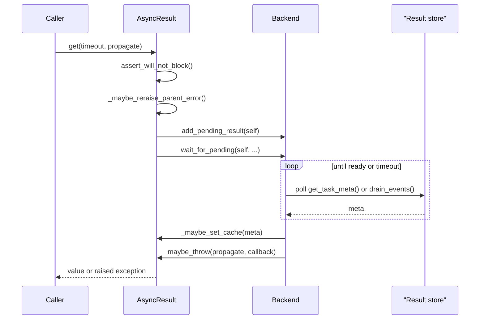
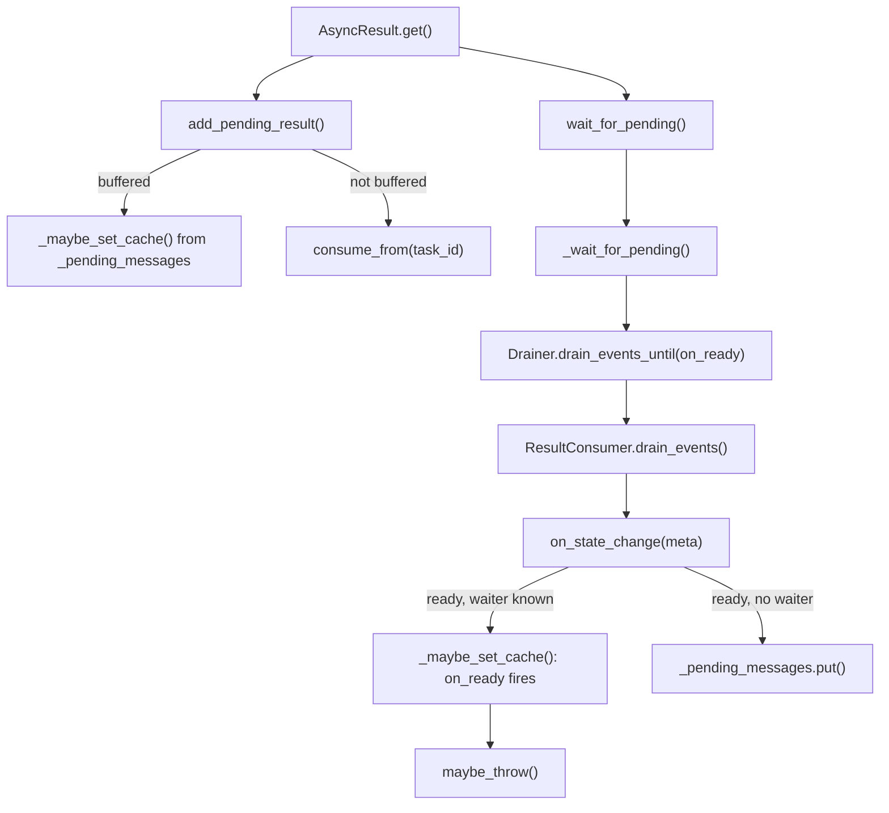

## Overview

Calling a task returns a handle, not a value: the work happens later in a worker, and the outcome lands in the result backend. `celery/result.py` defines the handles a caller uses to look that outcome up: `AsyncResult` for one task, `ResultSet` and `GroupResult` for many, and `EagerResult` for tasks run locally. Every handle reads through `self.backend`, so the same `get()` call polls a key-value store or listens on a message stream depending on the backend configured in [[Result Backends]].

Sources: [celery/result.py:62-101](repo://celery/result.py#L62-L101), [celery/result.py:578-597](repo://celery/result.py#L578-L597)

`app.send_task` builds the handle right after publishing: it instantiates `result_cls or self.AsyncResult` with the new task id, sets `ignored` from `ignore_result`, and, when called inside a running task, adds the result to the parent's trail so it shows up later as a child. `Task.apply` (eager execution) returns an `EagerResult` instead. Workflows built with [[Canvas: Signatures and Workflows]] return chains of `AsyncResult` linked by `parent` and `GroupResult` objects for groups.

Sources: [celery/app/base.py:1025-1041](repo://celery/app/base.py#L1025-L1041), [celery/app/task.py:936-951](repo://celery/app/task.py#L936-L951)

## Result classes

| Class | Created by | Identity | Notes |
| --- | --- | --- | --- |
| `ResultBase` | base class | none | Only holds `parent = None` |
| `AsyncResult` | `app.send_task`, `Task.apply_async`, `app.AsyncResult(id)` | task id | Registered as a `vine.Thenable`; caches the meta once the task is ready |
| `ResultSet` | `app.ResultSet([...])` | list of results | `ready()`/`successful()`/`failed()` aggregate the members |
| `GroupResult` | `group(...)()` | group id | `ResultSet` plus `id`, `parent`, `save()`/`restore()` |
| `EagerResult` | `Task.apply` | task id | Value known up front; `ready()` is always `True` |

Sources: [celery/result.py:62-101](repo://celery/result.py#L62-L101), [celery/result.py:578-597](repo://celery/result.py#L578-L597), [celery/result.py:928-952](repo://celery/result.py#L928-L952), [celery/result.py:1024-1037](repo://celery/result.py#L1024-L1037)

`app.AsyncResult`, `app.ResultSet` and `app.GroupResult` are cached properties that call `subclass_with_self`, so each handle is bound to the app that made it. `AsyncResult.__init__` refuses a `None` id with a `ValueError`, falls back to `app.backend` when no backend is passed, and creates `on_ready` as a weak `promise` wired to `_on_fulfilled`.

Sources: [celery/app/base.py:1466-1486](repo://celery/app/base.py#L1466-L1486), [celery/result.py:89-101](repo://celery/result.py#L89-L101)

## Reading state and metadata

Every attribute that describes the task (`state`/`status`, `result`/`info`, `traceback`, `name`, `args`, `kwargs`, `worker`, `retries`, `queue`, `date_done`, `children`) is a property that reads one key of the dict returned by `_get_task_meta()`. `date_done` is parsed with `isoparse` when the backend stored it as a string.

Sources: [celery/result.py:487-575](repo://celery/result.py#L487-L575), [celery/result.py:457-459](repo://celery/result.py#L457-L459)

`_get_task_meta` asks `backend.get_task_meta(self.id)` only while `_cache` is empty. `_maybe_set_cache` stores the meta only when its status is in `READY_STATES`, converts serialized `children` back into result objects with `result_from_tuple`, and fires `on_ready`. A pending task is therefore queried again on every attribute access, while a finished one is read once.

Sources: [celery/result.py:461-485](repo://celery/result.py#L461-L485)

| Method | Returns |
| --- | --- |
| `ready()` | `state in backend.READY_STATES` |
| `successful()` | `state == SUCCESS` |
| `failed()` | `state == FAILURE` |
| `exists()` | `backend.task_result_exists(id)`: tells a real `PENDING` task from an unknown or expired id (added in 5.7.0) |
| `maybe_throw()` | Re-raises the stored exception when the state is in `PROPAGATE_STATES`, then calls `callback(id, value)` |

Sources: [celery/result.py:351-397](repo://celery/result.py#L351-L397)

When `task_remote_tracebacks` is on and `tblib` is installed, `_to_remote_traceback` rebuilds the worker's traceback string into a traceback object, so the re-raised exception points into the remote code.

Sources: [celery/result.py:20-23](repo://celery/result.py#L20-L23), [celery/result.py:399-401](repo://celery/result.py#L399-L401), [celery/app/defaults.py:309-309](repo://celery/app/defaults.py#L309-L309)

## Waiting for a result

### The get() flow

`AsyncResult.get()` (alias `wait`) returns `None` right away for an ignored result. It runs the deadlock check, then, if `follow_parents` and `propagate` are set and the result has a `parent`, re-raises any parent's failure first and keeps checking parents on every polling interval. A cached result skips the backend entirely. Otherwise the handle registers itself with `backend.add_pending_result` and hands control to `backend.wait_for_pending`.

Sources: [celery/result.py:191-280](repo://celery/result.py#L191-L280)

Sources: [celery/result.py:243-269](repo://celery/result.py#L243-L269), [celery/backends/base.py:900-944](repo://celery/backends/base.py#L900-L944), [celery/backends/asynchronous.py:295-309](repo://celery/backends/asynchronous.py#L295-L309)

### Polling backends

Backends built on `SyncBackendMixin` (database, cache, most key-value stores) implement `wait_for_pending` with `wait_for`: a loop that calls `get_task_meta`, returns once the status is ready, calls `on_interval`, sleeps `interval` seconds and raises `TimeoutError` when the accumulated sleep reaches `timeout`. These backends reject an `on_message` callback with `ImproperlyConfigured`, and their `add_pending_result`/`remove_pending_result` do nothing.

Sources: [celery/backends/base.py:879-958](repo://celery/backends/base.py#L879-L958)

### Deadlock protection

A task that blocks on another task's result can hold every pool slot while the subtask waits for one. `assert_will_not_block()` raises `RuntimeError` with the "Never call result.get() within a task!" message whenever the process-wide `_task_join_will_block` flag is set and `disable_sync_subtasks` is left at `True`.

Sources: [celery/result.py:30-39](repo://celery/result.py#L30-L39), [celery/_state.py:40-61](repo://celery/_state.py#L40-L61)

The worker sets the flag from its pool: `BasePool.task_join_will_block` is `True`, the gevent and eventlet pools set it to `False`, and every prefork child sets it again in `process_initializer`. `allow_join_result()` and `denied_join_result()` are context managers that flip the flag and restore it afterwards. Celery itself uses `allow_join_result` where a join is intended, such as the `celery.chord_unlock` task joining the header results, and `Task.apply_async` wraps eager execution in `denied_join_result`.

Sources: [celery/worker/components.py:171-172](repo://celery/worker/components.py#L171-L172), [celery/concurrency/base.py:70-70](repo://celery/concurrency/base.py#L70-L70), [celery/concurrency/prefork.py:41-49](repo://celery/concurrency/prefork.py#L41-L49), [celery/result.py:42-59](repo://celery/result.py#L42-L59), [celery/app/builtins.py:63-81](repo://celery/app/builtins.py#L63-L81), [celery/app/task.py:699-701](repo://celery/app/task.py#L699-L701)

> [!WARNING]
> `get()` is not the only blocking call: `ResultSet.join`, `join_native` and `EagerResult.get` run the same check. Passing `disable_sync_subtasks=False` removes the guard, not the deadlock.

Sources: [celery/result.py:800-801](repo://celery/result.py#L800-L801), [celery/result.py:862-863](repo://celery/result.py#L862-L863), [celery/result.py:1058-1061](repo://celery/result.py#L1058-L1061)

## Groups of results

### ResultSet

`ResultSet` wraps a list of results and a `vine.barrier` over them; when the barrier completes and the backend is asynchronous, `on_ready` fires with the set. `add`, `remove`, `discard`, `update` and `clear` edit the list in place, `completed_count()` counts successful members, and `revoke()` sends one revoke for all ids. Its `app` falls back to the first member's app, then to `current_app`.

Sources: [celery/result.py:591-642](repo://celery/result.py#L591-L642), [celery/result.py:684-717](repo://celery/result.py#L684-L717), [celery/result.py:912-925](repo://celery/result.py#L912-L925)

`ResultSet.get()` chooses between two strategies through `supports_native_join`, which is read from the first member's backend:

Sources: [celery/result.py:726-740](repo://celery/result.py#L726-L740), [celery/result.py:905-910](repo://celery/result.py#L905-L910)

| Method | How it waits | Result order |
| --- | --- | --- |
| `join()` | Calls `result.get()` on each member in turn, spending what remains of `timeout` | Same as `results`; empty list when a `callback` is given |
| `join_native()` | Iterates `backend.iter_native(self)` and places each value by `order_index` | Same as `results`; `None` when a `callback` is given |

Sources: [celery/result.py:742-825](repo://celery/result.py#L742-L825), [celery/result.py:848-882](repo://celery/result.py#L848-L882), [celery/result.py:905-910](repo://celery/result.py#L905-L910)

`join()` raises `ImproperlyConfigured` for `on_message`, and `TimeoutError('join operation timed out')` once the shared budget is spent. `join_native()` raises the stored exception as soon as a member's state is in `PROPAGATE_STATES`, and for a nested group entry (a list) it calls `get()` on each child. Redis, RPC, cache and GCS backends declare `supports_native_join = True`; for key-value stores the sync `iter_native` uses `get_many`, which yields cached ready entries first and then polls `mget` for the rest.

Sources: [celery/result.py:800-825](repo://celery/result.py#L800-L825), [celery/result.py:862-882](repo://celery/result.py#L862-L882), [celery/backends/base.py:1075-1111](repo://celery/backends/base.py#L1075-L1111), [celery/backends/redis.py:221-221](repo://celery/backends/redis.py#L221-L221), [celery/backends/rpc.py:159-159](repo://celery/backends/rpc.py#L159-L159)

### GroupResult

`GroupResult` adds the group `id` and a `parent`, and its `children` are its `results`. `save()` and `delete()` call `backend.save_group` and `backend.delete_group`, and the class method `GroupResult.restore(id)` rebuilds a saved group through `backend.restore_group`, so another process can wait on a group knowing only its id. When the barrier fires, `_on_ready` also removes the group from the backend's pending results.

Sources: [celery/result.py:949-1021](repo://celery/result.py#L949-L1021)

## Result trees and serialization

A result can be serialized and rebuilt. `as_tuple()` returns `((id, parent_tuple), None)` for an `AsyncResult` and `((id, parent_tuple), [child tuples])` for a `GroupResult`; `result_from_tuple` reverses it, building a `GroupResult` when the node list is present and recursing through parents. Backends store `children` in this form, which is why `_set_cache` runs `result_from_tuple` on them.

Sources: [celery/result.py:123-134](repo://celery/result.py#L123-L134), [celery/result.py:1004-1008](repo://celery/result.py#L1004-L1008), [celery/result.py:1112-1131](repo://celery/result.py#L1112-L1131)

`collect()` walks the tree of results a task produced, yielding `(result, value)` for each node, and `get_leaf()` returns the last value. Both use `iterdeps()`, a breadth-first walk that only descends into nodes that are ready; with `intermediate=False` it raises `IncompleteStream` on the first node still running. `build_graph()` turns the same walk into a `DependencyGraph`, exposed as the cached `graph` property. Children are only recorded when the task's `trail` option is on, the default.

Sources: [celery/result.py:282-349](repo://celery/result.py#L282-L349), [celery/result.py:403-411](repo://celery/result.py#L403-L411), [celery/result.py:449-451](repo://celery/result.py#L449-L451)

## Eager results

`EagerResult` skips `AsyncResult.__init__`: it stores the return value, state, traceback and name, and resolves its `on_ready` promise immediately. `_cache` is a property built from those fields, so the inherited metadata properties work without a backend. `get()` returns the value on success and, for a state in `PROPAGATE_STATES`, raises the stored exception (wrapping a non-exception in `Exception`) unless `propagate=False`. `forget()` does nothing and `revoke()` only sets the local state to `REVOKED`.

Sources: [celery/result.py:1024-1109](repo://celery/result.py#L1024-L1109)

## Forgetting and revoking

`forget()` clears the local cache, forgets every parent, removes the handle from the backend's pending results, and calls `backend.forget(id)`, which drops the backend's own cache entry and then deletes the stored result (`_forget` raises `NotImplementedError` on backends that cannot delete). The `get()` docstring asks callers to eventually call `get()` or `forget()` on every result so backends can release resources.

Sources: [celery/result.py:136-143](repo://celery/result.py#L136-L143), [celery/backends/base.py:695-700](repo://celery/backends/base.py#L695-L700), [celery/result.py:202-207](repo://celery/result.py#L202-L207)

`revoke()` does not touch the backend: it broadcasts `app.control.revoke(id, ...)`, with `wait=True` mapped to `reply=True`, so workers drop the task or, with `terminate=True`, signal the process running it. `revoke_by_stamped_headers()` broadcasts a revoke for every task whose stamped headers match. [[Remote Control and Inspection]] covers how workers apply these commands.

Sources: [celery/result.py:145-189](repo://celery/result.py#L145-L189)

## Asynchronous result consumption

### AsyncBackendMixin

Redis and RPC backends mix in `AsyncBackendMixin`, so waiting means consuming messages instead of polling. Each backend keeps `_pending_results`, a `(concrete, weak)` pair of dicts keyed by task id, and `_pending_messages`, a `BufferMap` of up to 8192 messages that arrived before anyone waited for them.

Sources: [celery/backends/redis.py:204-204](repo://celery/backends/redis.py#L204-L204), [celery/backends/rpc.py:147-147](repo://celery/backends/rpc.py#L147-L147), [celery/backends/base.py:42-46](repo://celery/backends/base.py#L42-L46), [celery/backends/base.py:163-164](repo://celery/backends/base.py#L163-L164)

`add_pending_result` starts the drainer, then tries to resolve the result from the message buffer; only if nothing is buffered does it record the result and call `result_consumer.consume_from(task_id)`. `remove_pending_result` drops both entries and calls `on_result_fulfilled`, which cancels the subscription. `AsyncResult.then()` registers the result weakly and chains a callback on `on_ready`, and `__del__` removes the result when the handle is garbage-collected.

Sources: [celery/backends/asynchronous.py:260-293](repo://celery/backends/asynchronous.py#L260-L293), [celery/result.py:115-121](repo://celery/result.py#L115-L121), [celery/result.py:444-447](repo://celery/result.py#L444-L447)

### BaseResultConsumer

`wait_for_pending` runs `result_consumer._wait_for_pending` to completion and then calls `maybe_throw`. The consumer first calls the `on_wait_for_pending` hook, swaps in the caller's `on_message`, and loops over `drain_events_until(result.on_ready, ...)`, turning a `socket.timeout` into Celery's `TimeoutError`. Each decoded message goes to `on_state_change`, which forwards the meta to `on_message`; for a ready state it fills the waiting result's cache (firing `on_ready`) and appends it to the result's bucket, or buffers the meta in `_pending_messages` when no waiter is registered yet.

Sources: [celery/backends/asynchronous.py:295-309](repo://celery/backends/asynchronous.py#L295-L309), [celery/backends/asynchronous.py:397-449](repo://celery/backends/asynchronous.py#L397-L449)

Sources: [celery/backends/asynchronous.py:260-309](repo://celery/backends/asynchronous.py#L260-L309), [celery/backends/asynchronous.py:79-106](repo://celery/backends/asynchronous.py#L79-L106), [celery/backends/asynchronous.py:427-449](repo://celery/backends/asynchronous.py#L427-L449)

Subclasses supply the transport: `start`, `drain_events`, `consume_from` and `cancel_for` raise `NotImplementedError` in the base class. The Redis consumer subscribes to the task's key over pub/sub and, in `on_wait_for_pending`, reads the current meta once so a result stored before the subscription is not missed. The RPC consumer adds one queue binding per task id to a kombu `Consumer`. `reconnect_on_error` wraps their calls: a connection error triggers `_reconnect()`, and a second failure logs and raises `RuntimeError` saying the application must be restarted.

Sources: [celery/backends/asynchronous.py:316-391](repo://celery/backends/asynchronous.py#L316-L391), [celery/backends/redis.py:143-201](repo://celery/backends/redis.py#L143-L201), [celery/backends/rpc.py:52-72](repo://celery/backends/rpc.py#L52-L72), [celery/backends/rpc.py:134-144](repo://celery/backends/rpc.py#L134-L144)

For a `ResultSet`, the async `iter_native` hands each unfinished member a shared `deque` through `result_consumer.buckets`; as `on_state_change` fulfils members it appends them to the bucket, and the generator yields `(id, meta)` pairs as they arrive rather than in member order.

Sources: [celery/backends/asynchronous.py:228-258](repo://celery/backends/asynchronous.py#L228-L258)

### Drainers

`BaseResultConsumer` picks its drainer from the `drainers` registry by `kombu.utils.compat.detect_environment()`, so the waiting strategy matches the concurrency library in use. New drainers register with the `register_drainer(name)` decorator.

Sources: [celery/backends/asynchronous.py:55-63](repo://celery/backends/asynchronous.py#L55-L63), [celery/backends/asynchronous.py:324-333](repo://celery/backends/asynchronous.py#L324-L333)

| Drainer | Registered as | Behaviour |
| --- | --- | --- |
| `Drainer` | `default` | Calls `drain_events` in the waiting thread, `interval` seconds at a time, until the promise is ready or `timeout` elapses; logs and sleeps on `OSError` |
| `eventletDrainer` | `eventlet` | Spawns a green thread running `drain_events(timeout=1)` in a loop; waiters block on a "drain complete" event |
| `geventDrainer` | `gevent` | Same as eventlet with `gevent.spawn` and `gevent.event.Event` |

Sources: [celery/backends/asynchronous.py:66-113](repo://celery/backends/asynchronous.py#L66-L113), [celery/backends/asynchronous.py:198-222](repo://celery/backends/asynchronous.py#L198-L222)

The green-thread drainers keep `_started`, `_stopped` and `_shutdown` events. If the background loop dies, `_ensure_not_shut_down` re-raises its exception on the next `start()` or `wait_for()`, or raises "Celery must be restarted because a shutdown signal was detected." when it was stopped.

Sources: [celery/backends/asynchronous.py:115-195](repo://celery/backends/asynchronous.py#L115-L195), [celery/backends/asynchronous.py:20-20](repo://celery/backends/asynchronous.py#L20-L20)

## Configuration

| Setting | Default | Effect on results |
| --- | --- | --- |
| `result_cache_max` | `-1` | Size of the backend's LRU meta cache; `-1` disables it |
| `result_chord_join_timeout` | `3.0` | Timeout of the join performed by `celery.chord_unlock` |
| `task_remote_tracebacks` | `False` | Rebuild remote tracebacks with `tblib` when re-raising |
| `task_store_eager_result` | `False` | Without it, reading results while `task_always_eager` is on emits a `RuntimeWarning` |

Sources: [celery/app/defaults.py:205-225](repo://celery/app/defaults.py#L205-L225), [celery/app/defaults.py:290-309](repo://celery/app/defaults.py#L290-L309), [celery/backends/base.py:147-148](repo://celery/backends/base.py#L147-L148), [celery/backends/base.py:723-730](repo://celery/backends/base.py#L723-L730), [celery/app/builtins.py:76-81](repo://celery/app/builtins.py#L76-L81)

## Errors

| Error | Raised by | When |
| --- | --- | --- |
| `celery.exceptions.TimeoutError` | `get`, `join`, `wait_for`, `get_many`, async `_wait_for_pending` | No ready result within `timeout` |
| `RuntimeError` (E_WOULDBLOCK) | `assert_will_not_block` | Blocking join inside a worker task |
| `ImproperlyConfigured` | `join`, sync `wait_for_pending` | `on_message` passed to a backend that cannot stream |
| `IncompleteStream` | `iterdeps`, `collect` | A node in the tree is not ready and `intermediate=False` |
| `ValueError` | `AsyncResult.__init__` | `id` is `None` |
| The task's own exception | `maybe_throw`, `join_native` | State in `PROPAGATE_STATES` and `propagate=True` |

Sources: [celery/result.py:30-39](repo://celery/result.py#L30-L39), [celery/result.py:89-94](repo://celery/result.py#L89-L94), [celery/result.py:337-349](repo://celery/result.py#L337-L349), [celery/result.py:388-397](repo://celery/result.py#L388-L397), [celery/result.py:800-815](repo://celery/result.py#L800-L815), [celery/backends/base.py:900-944](repo://celery/backends/base.py#L900-L944), [celery/backends/asynchronous.py:397-411](repo://celery/backends/asynchronous.py#L397-L411)
