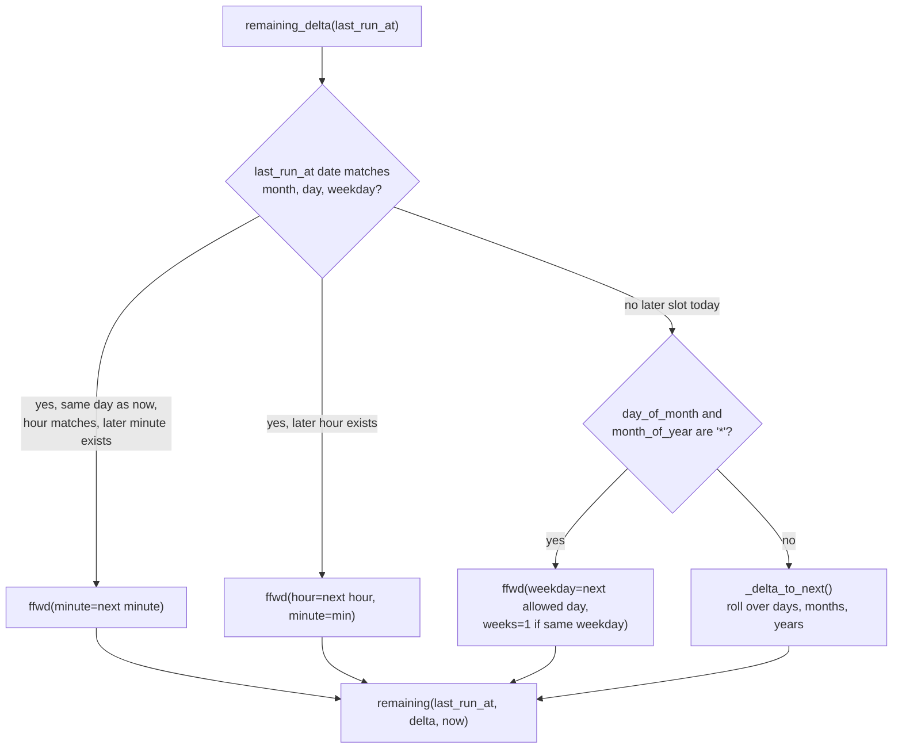

## Overview

A schedule type answers one question for the beat scheduler: given when an entry last ran, is it due now, and how long until it should be checked again. `celery/schedules.py` provides three implementations of that contract, `schedule` (fixed interval), `crontab` (cron-style calendar fields) and `solar` (sunrise, sunset and similar events), all built on `BaseSchedule`. Every `ScheduleEntry` in [[Celery Beat Scheduler]] holds one of them and calls its `is_due(last_run_at)` on each tick.

Sources: [celery/schedules.py:1-24](repo://celery/schedules.py#L1-L24), [celery/schedules.py:65-109](repo://celery/schedules.py#L65-L109), [celery/beat.py:161-163](repo://celery/beat.py#L161-L163)

The time arithmetic behind them, making datetimes timezone-aware, computing remaining time across DST changes and stepping to the next calendar date, lives in `celery/utils/time.py`.

Sources: [celery/schedules.py:16-17](repo://celery/schedules.py#L16-L17), [celery/utils/time.py:33-40](repo://celery/utils/time.py#L33-L40)

## The schedule contract

### is_due and remaining_estimate

`BaseSchedule` declares two methods that subclasses implement:

Sources: [celery/schedules.py:65-78](repo://celery/schedules.py#L65-L78)

| Method | Returns | Meaning |
| --- | --- | --- |
| `remaining_estimate(last_run_at)` | `timedelta` | Time from now until the next run after `last_run_at`; negative or zero when overdue. |
| `is_due(last_run_at)` | `schedstate(is_due, next)` | Whether to send the task now, and the number of seconds until the scheduler should check again. |

Sources: [celery/schedules.py:24-24](repo://celery/schedules.py#L24-L24), [celery/schedules.py:65-78](repo://celery/schedules.py#L65-L78)

`next` is a hint, not a promise: the scheduler sleeps `min(next, max_interval)`, so a schedule changed at run time takes effect within `beat_max_loop_interval`. When `is_due` is true, `next` is the delay from now to the following run, which `Scheduler.tick()` uses to place the next instance of the entry on its heap.

Sources: [celery/schedules.py:138-173](repo://celery/schedules.py#L138-L173), [celery/beat.py:348-364](repo://celery/beat.py#L348-L364)

### Shared behaviour in BaseSchedule

`now()` calls `nowfun` if one was given, else `app.now()`, which returns the current UTC time converted to `app.timezone`. `tz` and `utc_enabled` are cached from `app.timezone` and `enable_utc`. The `app` property falls back to `current_app` when no app was set; `maybe_schedule()` assigns the entry's app to any schedule object it receives. `BaseSchedule.maybe_make_aware()` wraps the module-level helper with the schedule's own `tz`, and `to_local()` converts to the system local zone only when `enable_utc` is off.

Sources: [celery/schedules.py:65-103](repo://celery/schedules.py#L65-L103), [celery/schedules.py:703-714](repo://celery/schedules.py#L703-L714), [celery/app/base.py:1197-1200](repo://celery/app/base.py#L1197-L1200)

## Interval schedules

`schedule(run_every, relative=False, nowfun=None, app=None)` converts `run_every` with `maybe_timedelta()`, so a number means seconds. `remaining_estimate()` calls `remaining(last_run_at, run_every, now, relative)` with both datetimes made aware. `is_due()` returns `(True, self.seconds)` once the remaining time reaches zero (so the next check is one full interval away) and `(False, remaining_s)` otherwise.

Sources: [celery/schedules.py:111-193](repo://celery/schedules.py#L111-L193), [celery/utils/time.py:184-188](repo://celery/utils/time.py#L184-L188)

With `relative=True`, `remaining()` rounds the end date down with `delta_resolution()` to the largest unit the interval covers: days for an interval of a day or more, hours for an hour or more, minutes for a minute or more. An hourly relative schedule therefore fires on the hour instead of one hour after beat started.

Sources: [celery/utils/time.py:191-250](repo://celery/utils/time.py#L191-L250)

```python
def is_due(self, last_run_at: datetime) -> tuple[bool, datetime]:
    last_run_at = self.maybe_make_aware(last_run_at)
    rem_delta = self.remaining_estimate(last_run_at)
    remaining_s = max(rem_delta.total_seconds(), 0)
    if remaining_s == 0:
        return schedstate(is_due=True, next=self.seconds)
    return schedstate(is_due=False, next=remaining_s)
```

Sources: [celery/schedules.py:138-173](repo://celery/schedules.py#L138-L173)

Two `schedule` objects are equal when their `run_every` match, and a `schedule` also compares equal to a bare `timedelta`. This equality is what `Scheduler.schedules_equal()` relies on to detect configuration changes.

Sources: [celery/schedules.py:178-185](repo://celery/schedules.py#L178-L185), [celery/beat.py:366-379](repo://celery/beat.py#L366-L379)

## Crontab schedules

### Fields and expansion

`crontab(minute='*', hour='*', day_of_week='*', day_of_month='*', month_of_year='*')` stores the original values (for `repr` and pickling) and expands each one into a set with `_expand_cronspec()`. An `int` becomes a one-element set, a `str` is parsed by `crontab_parser`, a `set` is used as is and any other iterable is converted to a set; anything else raises `TypeError`. Every number is then checked against the field's range and a `ValueError` names the valid range when one falls outside.

Sources: [celery/schedules.py:401-414](repo://celery/schedules.py#L401-L414), [celery/schedules.py:433-478](repo://celery/schedules.py#L433-L478)

| Field | `max_`, `min_` | Valid values |
| --- | --- | --- |
| `minute` | 60, 0 | 0-59 |
| `hour` | 24, 0 | 0-23 |
| `day_of_week` | 7, 0 | 0-6, Sunday is 0; names such as `mon-fri` |
| `day_of_month` | 31, 1 | 1-31 |
| `month_of_year` | 12, 1 | 1-12; names such as `jan` |

Sources: [celery/schedules.py:409-413](repo://celery/schedules.py#L409-L413), [celery/utils/time.py:44-48](repo://celery/utils/time.py#L44-L48)

`crontab.from_string('m h dom mon dow')` splits a standard five-field cron line and passes the fields in crontab's own order (`minute, hour, day_of_week, day_of_month, month_of_year`).

Sources: [celery/schedules.py:416-431](repo://celery/schedules.py#L416-L431)

> [!NOTE]
> All three day and month fields must match for a date to run. `day_of_week=1, day_of_month='1-7,15-21'` means the first and third Monday of each month, not every Monday plus those days. `day_of_week='*/2'` means days whose number is divisible by two, not every other day.

Sources: [celery/schedules.py:354-398](repo://celery/schedules.py#L354-L398)

### crontab_parser

`crontab_parser(max_, min_).parse(spec)` splits on commas and unions the result of each part; an empty part raises `ParseException('empty part')`. Each part is matched against four patterns in order, falling back to a single number:

Sources: [celery/schedules.py:260-273](repo://celery/schedules.py#L260-L273)

| Pattern | Example | Handler | Result |
| --- | --- | --- | --- |
| range with step | `1-30/5` | `_range_steps` | Every fifth value of the range |
| range | `9-17`, `fri-mon` | `_expand_range` | Inclusive range; wraps past `max_` when the end is smaller than the start |
| star with step | `*/15` | `_star_steps` | Every fifteenth value from `min_` |
| star | `*` | `_expand_star` | `min_` to `max_ + min_ - 1` |
| anything else | `7`, `sun` | `_expand_range` | Single value |

Sources: [celery/schedules.py:196-296](repo://celery/schedules.py#L196-L296)

`_expand_number()` accepts digits, then month names via `yearmonth()`, then weekday names via `weekday()` (both match on the first three letters). Negative numbers raise `ParseException`, an unknown name raises `ValueError('Invalid weekday literal ...')`, and values outside `min_` to `min_ + max_ - 1` raise `ValueError`.

Sources: [celery/schedules.py:298-320](repo://celery/schedules.py#L298-L320), [celery/utils/time.py:263-290](repo://celery/utils/time.py#L263-L290)

### Finding the next run

`remaining_delta(last_run_at)` works out the next fire time as an `ffwd` (a forward-only `relativedelta`) applied to `last_run_at`, picking the smallest step that still matches:

Sources: [celery/schedules.py:572-628](repo://celery/schedules.py#L572-L628)



Sources: [celery/schedules.py:572-639](repo://celery/schedules.py#L572-L639)

`_delta_to_next()` handles restricted day-of-month or month-of-year fields. It walks sorted lists of allowed days and months from the last run, skipping dates that do not exist (31 February), dates before `last_run_at`, and dates whose weekday is not in `day_of_week`. After 2000 roll-overs without a match it raises `RuntimeError('unable to rollover, time specification is probably invalid')`, which catches impossible combinations such as 30 February.

Sources: [celery/schedules.py:480-555](repo://celery/schedules.py#L480-L555)

`ffwd.__radd__` replaces year, month, day, hour and minute on the base datetime, clamps the day to the month's length, moves forward to the requested `weekday` and adds whole weeks.

Sources: [celery/utils/time.py:404-445](repo://celery/utils/time.py#L404-L445)

### is_due and the starting deadline

`crontab.is_due()` is due when `remaining_estimate(last_run_at)` is zero or negative. When it is due, `next` is recomputed from `now()`, not from `last_run_at`, so an overdue entry fires once and then waits for the next real slot instead of catching up on every missed one.

Sources: [celery/schedules.py:641-688](repo://celery/schedules.py#L641-L688)

`beat_cron_starting_deadline` (seconds, default `None`) limits how stale a missed run may be. When set, `is_due()` steps forward from `last_run_at` through each missed slot to find the latest one that was feasible, and if that slot is more than the deadline in the past the entry is not due; the next check is again computed from now. This stops a beat that was down for a long time from firing a crontab task as soon as it starts.

Sources: [celery/schedules.py:656-688](repo://celery/schedules.py#L656-L688), [celery/app/defaults.py:73-82](repo://celery/app/defaults.py#L73-L82)

## Solar schedules

`solar(event, lat, lon)` imports `ephem` at construction, validates the event name and the coordinate ranges (raising `ValueError` with the messages `SOLAR_INVALID_EVENT`, `SOLAR_INVALID_LATITUDE`, `SOLAR_INVALID_LONGITUDE`), and builds an `ephem.Observer` at sea level with zero pressure and the event's horizon.

Sources: [celery/schedules.py:41-51](repo://celery/schedules.py#L41-L51), [celery/schedules.py:717-818](repo://celery/schedules.py#L717-L818)

| Event | Horizon | ephem method | Uses sun centre |
| --- | --- | --- | --- |
| `dawn_astronomical` | -18 | `next_rising` | yes |
| `dawn_nautical` | -12 | `next_rising` | yes |
| `dawn_civil` | -6 | `next_rising` | yes |
| `sunrise` | -0:34 | `next_rising` | no |
| `solar_noon` | 0 | `next_transit` | no |
| `sunset` | -0:34 | `next_setting` | no |
| `dusk_civil` | -6 | `next_setting` | yes |
| `dusk_nautical` | -12 | `next_setting` | yes |
| `dusk_astronomical` | -18 | `next_setting` | yes |

Sources: [celery/schedules.py:747-790](repo://celery/schedules.py#L747-L790)

`remaining_estimate()` sets the observer's date to `last_run_at` in UTC and asks for the next event after it. If the sun never reaches the horizon that day (`ephem.CircumpolarError`, polar day or night) it returns the time to one minute after the next anti-transit, so beat checks again the next day. `is_due()` follows the crontab pattern: due when the estimate is not positive, with `next` recomputed from now.

Sources: [celery/schedules.py:828-878](repo://celery/schedules.py#L828-L878)

> [!NOTE]
> `solar` needs the optional `ephem` package; the import happens in `__init__`, so a missing package fails when the schedule is created, typically at configuration load.

Sources: [celery/schedules.py:792-798](repo://celery/schedules.py#L792-L798)

## Timezone handling

### The timezone object

`celery.utils.time.timezone` is a `_Zone` instance. Its `utc` is `ZoneInfo('UTC')`; its `local` comes from `tzlocal.get_localzone()` and falls back to the `LocalTimezone` class (built from the `time` module's offsets) if that fails. `get_timezone()` turns a zone name into a `ZoneInfo`, and `tz_or_local()` returns `local` for `None`. The app's `timezone` property uses the `timezone` setting when set, else UTC when `enable_utc` is true and the local zone otherwise.

Sources: [celery/utils/time.py:68-181](repo://celery/utils/time.py#L68-L181), [celery/app/base.py:1619-1632](repo://celery/app/base.py#L1619-L1632)

### Aware datetimes

Every schedule makes its inputs aware before comparing them. `maybe_make_aware(dt, tz, naive_as_utc=True)` leaves aware datetimes alone; a naive one is first treated as UTC (`to_utc`) and then converted to `tz` with `localize()`. `make_aware()` attaches a zone and resolves DST edge cases through `dateutil`: a non-existent wall time (spring forward) is moved with `resolve_imaginary`, and an ambiguous one (fall back) takes the earlier of the two folds.

Sources: [celery/utils/time.py:327-401](repo://celery/utils/time.py#L327-L401)

`remaining(start, ends_in, now, relative)` converts both the end date and `now` to UTC before subtracting. Python subtracts two datetimes in the same non-UTC zone by wall time, which would be off by an hour across a DST change; doing it in UTC gives the real elapsed time.

Sources: [celery/utils/time.py:214-250](repo://celery/utils/time.py#L214-L250)

> [!TIP]
> Set the environment variable `C_REMDEBUG` to make `remaining()` print every input and its result, which helps when a schedule fires at an unexpected time.

Sources: [celery/utils/time.py:42-42](repo://celery/utils/time.py#L42-L42), [celery/utils/time.py:244-249](repo://celery/utils/time.py#L244-L249)

## Writing a custom schedule

Subclass `BaseSchedule` and implement `remaining_estimate()` and `is_due()` returning `schedstate`. Implement `__eq__` so `Scheduler.schedules_equal()` can tell when the configuration changed, and `__reduce__` so `PersistentScheduler` can pickle the entry into its shelve file, as `crontab` and `solar` do by pickling only their constructor arguments. Use `self.now()` and `self.maybe_make_aware()` rather than `datetime.now()` so `nowfun` and the app's timezone are honoured.

Sources: [celery/schedules.py:65-109](repo://celery/schedules.py#L65-L109), [celery/schedules.py:557-570](repo://celery/schedules.py#L557-L570), [celery/schedules.py:820-826](repo://celery/schedules.py#L820-L826), [celery/beat.py:143-147](repo://celery/beat.py#L143-L147)
