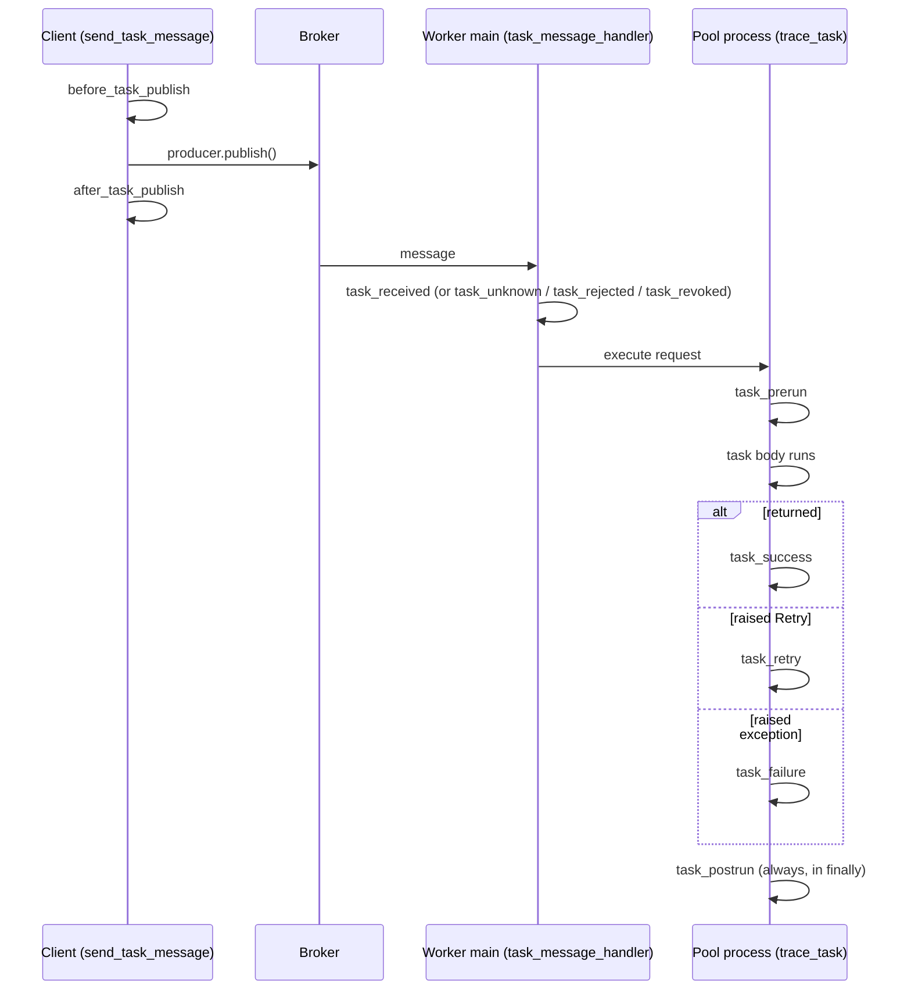
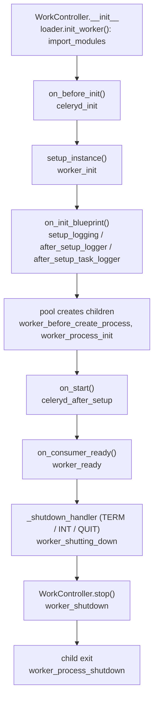

## Overview

Signals let code outside Celery react to events inside it without subclassing anything: a receiver function connected to `task_prerun` runs before every task, one connected to `worker_process_init` runs in every new pool child, and so on. Celery uses a small observer implementation of its own, `celery.utils.dispatch.Signal`, modelled on Django's dispatcher, and declares every built-in signal as a module-level instance in `celery/signals.py`.

Sources: [celery/signals.py:1-28](repo://celery/signals.py#L1-L28), [celery/utils/dispatch/signal.py:73-102](repo://celery/utils/dispatch/signal.py#L73-L102)

Signals are sent from many layers: the publisher in `celery/app/amqp.py`, the tracer in `celery/app/trace.py` that wraps every task call (see [[Task Execution and Tracing]]), the worker controller and its bootsteps (see [[Worker Architecture and Bootsteps]]), the pools, the logging setup (see [[Logging]]) and beat. Celery itself is also a receiver: `app.autodiscover_tasks()` and the Django fixup hook into `import_modules`, `worker_init`, `task_prerun` and others.

Sources: [celery/app/base.py:822-826](repo://celery/app/base.py#L822-L826), [celery/fixups/django.py:87-88](repo://celery/fixups/django.py#L87-L88), [celery/fixups/django.py:156-162](repo://celery/fixups/django.py#L156-L162)

## The Signal class

### Construction and state

`Signal(providing_args=None, use_caching=False, name=None)` keeps its receivers in a plain list of `(lookup_key, receiver)` pairs guarded by a `threading.Lock`. `providing_args` is only documentation: `send()` never checks the keyword arguments against it, and `__repr__` prints it. With `use_caching=True` the signal memoises, per sender, which receivers apply, in a `WeakKeyDictionary`; `connect()` and `disconnect()` clear that cache. None of the built-in signals turn caching on.

Sources: [celery/utils/dispatch/signal.py:87-102](repo://celery/utils/dispatch/signal.py#L87-L102), [celery/utils/dispatch/signal.py:352-358](repo://celery/utils/dispatch/signal.py#L352-L358)

### Connecting receivers

`connect()` works both as a plain call and as a decorator. When its first positional argument is callable it registers it straight away; otherwise it returns a decorator that captures the options `sender`, `weak`, `dispatch_uid` and `retry`.

Sources: [celery/utils/dispatch/signal.py:110-145](repo://celery/utils/dispatch/signal.py#L110-L145)

```python
        if args and callable(args[0]):
            return _handle_options(*args[1:], **kwargs)(args[0])
        return _handle_options(*args, **kwargs)
```

Sources: [celery/utils/dispatch/signal.py:184-186](repo://celery/utils/dispatch/signal.py#L184-L186)

The bare decorator form is the common one. The stamping example connects a receiver to `task_received`; the receiver takes `sender`, `signal` and the signal's own arguments, and ends in `**kwargs` so new arguments never break it.

Sources: [examples/stamping/myapp.py:37-47](repo://examples/stamping/myapp.py#L37-L47)

```python
@task_received.connect
def task_received_handler(sender=None, request=None, signal=None, **kwargs):
    print(f"In {signal.name} for: {repr(request)}")
```

Sources: [examples/stamping/myapp.py:40-42](repo://examples/stamping/myapp.py#L40-L42)

1. `_connect_signal` first requires the receiver to be callable and to accept keyword arguments (`fun_accepts_kwargs`), otherwise `ValueError('Signal receiver must accept keyword arguments.')` is raised.
2. If `sender` is a `PromiseProxy` (a lazy object such as an unfinalized task), connection is deferred with `sender.__then__(self._connect_proxy, ...)` until the proxy is evaluated, and `_connect_proxy` connects to the real object.
3. A lookup key is built by `_make_lookup_key`: `(dispatch_uid, id(sender))` when a `dispatch_uid` is given, `(receiver._dispatch_uid, id(sender))` for retry-wrapped receivers, else `(id(receiver), id(sender))`. `_make_id` unwraps `Proxy` objects, keeps strings as-is (so a task name works as a sender) and uses `id(__func__)` for bound methods.
4. With `weak=True` (the default) the receiver is stored as a `weakref.ref`, or a `WeakMethod` for bound methods, and `weakref.finalize` marks the signal as having dead receivers when the target is collected.
5. Under the lock, dead receivers are purged and the pair is appended only if no existing entry has the same key, so connecting twice with the same `dispatch_uid` is a no-op.

Sources: [celery/utils/dispatch/signal.py:21-61](repo://celery/utils/dispatch/signal.py#L21-L61), [celery/utils/dispatch/signal.py:104-108](repo://celery/utils/dispatch/signal.py#L104-L108), [celery/utils/dispatch/signal.py:188-216](repo://celery/utils/dispatch/signal.py#L188-L216)

> [!WARNING]
> Because receivers are weakly referenced by default, a receiver defined inside a function or as a lambda is dropped as soon as nothing else holds it. Pass `weak=False` for such receivers, as `autodiscover_tasks` does for its `starpromise`.

Sources: [celery/utils/dispatch/signal.py:202-205](repo://celery/utils/dispatch/signal.py#L202-L205), [celery/app/base.py:822-826](repo://celery/app/base.py#L822-L826)

`retry=True` wraps the receiver in `_try_receiver_over_time`, which calls it through kombu's `retry_over_time` and logs `RECEIVER_RETRY_ERROR` with the next interval on every exception. A retrying receiver is always held strongly, and when no `dispatch_uid` was given the id of the original function becomes the `dispatch_uid` (stored on the wrapper as `_dispatch_uid`), so `disconnect(original_function)` still finds it.

Sources: [celery/utils/dispatch/signal.py:147-180](repo://celery/utils/dispatch/signal.py#L147-L180), [celery/utils/dispatch/signal.py:68-70](repo://celery/utils/dispatch/signal.py#L68-L70)

### Sender filtering and dispatch

`send(sender, **named)` returns `[]` immediately when there are no receivers. Otherwise `_live_receivers(sender)` selects every entry whose stored sender key is `NONE_ID` (connected with `sender=None`, meaning any sender) or equals `_make_id(sender)`, dereferences weak references and skips dead ones. Each receiver is called as `receiver(signal=self, sender=sender, **named)`.

Sources: [celery/utils/dispatch/signal.py:258-289](repo://celery/utils/dispatch/signal.py#L258-L289), [celery/utils/dispatch/signal.py:303-340](repo://celery/utils/dispatch/signal.py#L303-L340)

An exception raised by a receiver never propagates: `send()` logs it with `logger.exception('Signal handler %r raised: %r', ...)` and places the exception object in the response list in place of a return value. `send_robust` is just an alias of `send`, unlike Django where `send` re-raises. Callers that must not swallow errors inspect the responses themselves: `BaseLoader.import_default_modules` re-raises any exception returned by `import_modules` receivers, because logging is not configured yet at that point.

Sources: [celery/utils/dispatch/signal.py:278-290](repo://celery/utils/dispatch/signal.py#L278-L290), [celery/loaders/base.py:97-105](repo://celery/loaders/base.py#L97-L105)

### Disconnecting and introspection

`disconnect(receiver=None, sender=None, weak=None, dispatch_uid=None)` rebuilds the same lookup key and deletes the first matching entry, returning `True` if one was removed; passing `weak` only emits a `CDeprecationWarning`. `has_listeners(sender=None)` reports whether any live receiver applies to a sender. Dead weak references are not removed from inside the garbage collector callback (`_remove_receiver` only sets `_dead_receivers`), because the callback could fire while the lock is held; the next `connect`, `disconnect` or `_live_receivers` call purges them via `_clear_dead_receivers`.

Sources: [celery/utils/dispatch/signal.py:218-256](repo://celery/utils/dispatch/signal.py#L218-L256), [celery/utils/dispatch/signal.py:292-301](repo://celery/utils/dispatch/signal.py#L292-L301), [celery/utils/dispatch/signal.py:342-350](repo://celery/utils/dispatch/signal.py#L342-L350)

Several hot paths read `signal.receivers` once and skip `send()` entirely when it is empty: the task publisher, the tracer and the heartbeat. For the tracer and the heartbeat this check happens when the tracer or `Heart` object is built, so a receiver must be connected before the worker builds its tracers (for example at import time of the module that defines tasks) to be called.

Sources: [celery/app/amqp.py:491-497](repo://celery/app/amqp.py#L491-L497), [celery/app/trace.py:410-412](repo://celery/app/trace.py#L410-L412), [celery/worker/heartbeat.py:35-41](repo://celery/worker/heartbeat.py#L35-L41)

## Task signals

### Signal order over a task's life

A task call emits signals in three processes: the client that publishes it, the worker's main process that receives the message, and the pool process that runs it inside `build_tracer`'s `trace_task`.

Sources: [celery/app/amqp.py:558-579](repo://celery/app/amqp.py#L558-L579), [celery/worker/strategy.py:162-165](repo://celery/worker/strategy.py#L162-L165), [celery/app/trace.py:568-660](repo://celery/app/trace.py#L568-L660)



Sources: [celery/app/amqp.py:558-592](repo://celery/app/amqp.py#L558-L592), [celery/worker/strategy.py:132-165](repo://celery/worker/strategy.py#L132-L165), [celery/app/trace.py:212-271](repo://celery/app/trace.py#L212-L271), [celery/app/trace.py:568-660](repo://celery/app/trace.py#L568-L660)

`task_success` is sent only after callbacks are dispatched, the result is stored with `mark_as_done` and `on_success` has run; an `EncodeError` while storing turns the outcome into a failure instead. `task_postrun` sits in the `finally` block, so it fires for every outcome, and passes an extra `state` argument not listed in `providing_args`. Eager calls go through the same tracer, so prerun, postrun, success, retry and failure fire for `apply()` too; the Django fixup checks `sender.request.is_eager` to ignore them.

Sources: [celery/app/trace.py:610-660](repo://celery/app/trace.py#L610-L660), [celery/fixups/django.py:194-203](repo://celery/fixups/django.py#L194-L203)

### Task signal reference

| Signal | Sender | Arguments | Sent by and when |
| --- | --- | --- | --- |
| `before_task_publish` | task name (str) | `body`, `exchange`, `routing_key`, `headers`, `properties`, `declare`, `retry_policy` | `send_task_message` in `AMQP._create_task_sender`, just before `producer.publish()`; receivers may mutate `headers` and `properties` |
| `after_task_publish` | task name | `body`, `headers`, `exchange`, `routing_key` | `send_task_message` right after `producer.publish()` returns |
| `task_sent` | task name | `task_id`, `task`, `args`, `kwargs`, `eta`, `taskset` | Deprecated (use `after_task_publish`); still sent after publishing for protocol 1 and 2 bodies |
| `task_received` | the consumer | `request` | `task_message_handler` in `strategy.default`, after the revoked/expired check and before the request is queued |
| `task_prerun` | task | `task_id`, `task`, `args`, `kwargs` | `trace_task` before `loader.on_task_init` and the STARTED state |
| `task_success` | task | `result` | `trace_task` after the result is stored and `on_success` ran |
| `task_retry` | task | `request`, `reason`, `einfo` | `TraceInfo.handle_retry` after `on_retry`; also `Request._announce_cancelled` with `einfo=None` when a task is cancelled on connection loss |
| `task_failure` | task | `task_id`, `exception`, `args`, `kwargs`, `traceback`, `einfo` | `TraceInfo.handle_failure` after `on_failure`; also `Request.on_timeout` (hard limit), `Request.on_failure` for a non-requeued `Reject` and for failures the pool reported (e.g. `WorkerLostError`) |
| `task_postrun` | task | `task_id`, `task`, `args`, `kwargs`, `retval`, `state` | `trace_task` in its `finally` block, for every outcome |
| `task_internal_error` | task | `task_id`, `args`, `kwargs`, `request`, `exception`, `traceback`, `einfo` | `_signal_internal_error`, when the tracing machinery itself raises outside the task body |
| `task_revoked` | task | `request`, `terminated`, `signum`, `expired` | `Request._announce_revoked`: discarded revoked or expired task, `terminate()`, or a pool job killed by `Terminated` |
| `task_rejected` | the consumer | `message`, `exc` | `Consumer.on_unknown_message` (`exc=None`) and `Consumer.on_invalid_task` |
| `task_unknown` | the consumer | `message`, `exc`, `name`, `id` | `Consumer.on_unknown_task` after marking the result as `NotRegistered` failure |

Sources: [celery/signals.py:30-94](repo://celery/signals.py#L30-L94), [celery/app/amqp.py:558-592](repo://celery/app/amqp.py#L558-L592), [celery/worker/strategy.py:162-165](repo://celery/worker/strategy.py#L162-L165), [celery/app/trace.py:568-660](repo://celery/app/trace.py#L568-L660), [celery/app/trace.py:212-271](repo://celery/app/trace.py#L212-L271), [celery/app/trace.py:673-721](repo://celery/app/trace.py#L673-L721), [celery/worker/request.py:416-468](repo://celery/worker/request.py#L416-L468), [celery/worker/request.py:529-572](repo://celery/worker/request.py#L529-L572), [celery/worker/request.py:622-717](repo://celery/worker/request.py#L622-L717), [celery/worker/consumer/consumer.py:672-714](repo://celery/worker/consumer/consumer.py#L672-L714)

> [!NOTE]
> For `before_task_publish` and `after_task_publish` the sender is the task name string, not the task object, because publishing can happen from a client that never imported the task. Connect with `sender='proj.tasks.add'` to filter by task; `_make_id` keeps strings as values for exactly this reason.

Sources: [celery/app/amqp.py:558-579](repo://celery/app/amqp.py#L558-L579), [celery/utils/dispatch/signal.py:21-29](repo://celery/utils/dispatch/signal.py#L21-L29)

## Worker and program signals

### Worker startup and shutdown order

`celery worker` creates `celery.apps.worker.Worker`, a `WorkController` subclass whose hooks send the program-level signals around the generic controller's own. `WorkController.__init__` calls `app.loader.init_worker()` before anything else, so `import_modules` precedes `celeryd_init`; `setup_instance` then sends `worker_init` before `on_init_blueprint` configures logging.

Sources: [celery/worker/worker.py:90-141](repo://celery/worker/worker.py#L90-L141), [celery/apps/worker.py:94-136](repo://celery/apps/worker.py#L94-L136)



Sources: [celery/worker/worker.py:90-141](repo://celery/worker/worker.py#L90-L141), [celery/apps/worker.py:94-136](repo://celery/apps/worker.py#L94-L136), [celery/apps/worker.py:180-190](repo://celery/apps/worker.py#L180-L190), [celery/apps/worker.py:288-316](repo://celery/apps/worker.py#L288-L316), [celery/worker/worker.py:195-260](repo://celery/worker/worker.py#L195-L260), [celery/concurrency/prefork.py:41-92](repo://celery/concurrency/prefork.py#L41-L92)

### Worker signal reference

| Signal | Sender | Arguments | Sent by and when |
| --- | --- | --- | --- |
| `celeryd_init` | worker hostname (str) | `instance`, `conf`, `options` | `Worker.on_before_init`, before the app is configured further; use it to change config per node name |
| `worker_init` | the `WorkController` | none | `WorkController.setup_instance`, after queues and includes are set up and before `on_init_blueprint` builds the blueprint |
| `import_modules` | the app | none | `BaseLoader.import_default_modules`, via `loader.init_worker()` at the start of `WorkController.__init__` (and in `celery beat`); exceptions returned by receivers are re-raised |
| `worker_before_create_process` | the `AsynPool` | none | `AsynPool._create_worker_process`, in the parent just before forking each child |
| `worker_process_init` | `None` | none | `process_initializer` in each prefork child after the app and tracers are rebuilt; also `solo.TaskPool.__init__` |
| `celeryd_after_setup` | worker hostname | `instance`, `conf` | `Worker.on_start`, after options such as `-Q` are applied and before purging |
| `worker_ready` | the consumer | none | `Worker.on_consumer_ready`, when the consumer is connected and consuming |
| `heartbeat_sent` | the `Heart` | none | `Heart._send`, before each `worker-online`, `worker-heartbeat` and `worker-offline` event (only if receivers existed when `Heart` was created) |
| `worker_shutting_down` | worker hostname | `sig`, `how`, `exitcode` | `_shutdown_handler`, the handler installed for SIGTERM, SIGINT and SIGQUIT, in the MainProcess only |
| `worker_shutdown` | the `WorkController` | none | `WorkController.stop()` via `_send_worker_shutdown`, after a warm shutdown |
| `worker_process_shutdown` | `None` | `pid`, `exitcode` | `process_destructor`, the prefork pool's `on_process_exit` callback |
| `user_preload_options` | the wrapped command function | `app`, `options` | `handle_preload_options` in `celery/bin/base.py`, when the app declared custom preload options |

Sources: [celery/signals.py:96-115](repo://celery/signals.py#L96-L115), [celery/signals.py:150-154](repo://celery/signals.py#L150-L154), [celery/apps/worker.py:94-136](repo://celery/apps/worker.py#L94-L136), [celery/apps/worker.py:180-182](repo://celery/apps/worker.py#L180-L182), [celery/apps/worker.py:288-316](repo://celery/apps/worker.py#L288-L316), [celery/apps/worker.py:430-462](repo://celery/apps/worker.py#L430-L462), [celery/worker/worker.py:90-141](repo://celery/worker/worker.py#L90-L141), [celery/apps/beat.py:128-134](repo://celery/apps/beat.py#L128-L134), [celery/worker/worker.py:198-252](repo://celery/worker/worker.py#L198-L252), [celery/loaders/base.py:97-111](repo://celery/loaders/base.py#L97-L111), [celery/concurrency/asynpool.py:490-493](repo://celery/concurrency/asynpool.py#L490-L493), [celery/concurrency/prefork.py:41-114](repo://celery/concurrency/prefork.py#L41-L114), [celery/concurrency/solo.py:16-20](repo://celery/concurrency/solo.py#L16-L20), [celery/worker/heartbeat.py:35-61](repo://celery/worker/heartbeat.py#L35-L61), [celery/bin/base.py:143-160](repo://celery/bin/base.py#L143-L160)

> [!TIP]
> `worker_process_init` runs inside each child, so it is the place to open per-process resources such as database connections that must not be shared across a fork. The Django fixup connects its `on_worker_process_init` here for that reason.

Sources: [celery/concurrency/prefork.py:76-82](repo://celery/concurrency/prefork.py#L76-L82), [celery/fixups/django.py:156-162](repo://celery/fixups/django.py#L156-L162)

`worker_shutdown` is only sent from `stop()`; `terminate()` (cold shutdown) calls `_shutdown(warm=False)` without sending it.

Sources: [celery/worker/worker.py:244-260](repo://celery/worker/worker.py#L244-L260)

## Logging, beat and eventlet signals

`Logging.setup_logging_subsystem` sends `setup_logging` first; if any receiver is connected, Celery assumes the application configures logging itself and skips its own handler setup, including the root-logger hijack controlled by `worker_hijack_root_logger`. Only when no receiver answered does it configure the root and multiprocessing loggers, send `after_setup_logger`, and call `setup_task_loggers`, which sends `after_setup_task_logger` for the `celery.task` logger. [[Logging]] covers this flow in detail.

Sources: [celery/app/log.py:87-146](repo://celery/app/log.py#L87-L146), [celery/app/log.py:156-181](repo://celery/app/log.py#L156-L181)

| Signal | Sender | Arguments | Sent by and when |
| --- | --- | --- | --- |
| `setup_logging` | `None` | `loglevel`, `logfile`, `format`, `colorize` | `Logging.setup_logging_subsystem`, once per process (guarded by `already_setup`) |
| `after_setup_logger` | `None` | `logger`, `loglevel`, `logfile`, `format`, `colorize` | same method, after the root logger got Celery's handlers; not sent if `setup_logging` had receivers |
| `after_setup_task_logger` | `None` | `logger`, `loglevel`, `logfile`, `format`, `colorize` | `Logging.setup_task_loggers`, after the `celery.task` logger got a `TaskFormatter` handler |
| `beat_init` | the beat `Service` | none | `Service.start`, before the scheduler loop |
| `beat_embedded_init` | the beat `Service` | none | `Service.start(embedded_process=True)`, when beat runs inside a worker (`-B`) via `_Process.run` |
| `eventlet_pool_started` | the eventlet `TaskPool` | none | `TaskPool.on_start` after the green pool is created |
| `eventlet_pool_apply` | the eventlet `TaskPool` | `target`, `args`, `kwargs` | `TaskPool.on_apply`, before each job is spawned |
| `eventlet_pool_preshutdown` | the eventlet `TaskPool` | none | `TaskPool.on_stop` before `waitall()` |
| `eventlet_pool_postshutdown` | the eventlet `TaskPool` | none | `TaskPool.on_stop` after all green threads finished |

Sources: [celery/signals.py:117-148](repo://celery/signals.py#L117-L148), [celery/app/log.py:87-131](repo://celery/app/log.py#L87-L131), [celery/app/log.py:156-181](repo://celery/app/log.py#L156-L181), [celery/beat.py:633-641](repo://celery/beat.py#L633-L641), [celery/beat.py:705-720](repo://celery/beat.py#L705-L720), [celery/concurrency/eventlet.py:110-126](repo://celery/concurrency/eventlet.py#L110-L126)

## Writing receivers safely

Every receiver is called with `signal` and `sender` as keywords plus the signal's arguments, so its signature must end in `**kwargs`; the check happens at connect time, not at send time. Because `send()` catches and logs receiver exceptions, a failing receiver never breaks the task or the worker, but it also never stops anything: to abort a publish or a task, a receiver has no return-value channel, and `before_task_publish` receivers can only change the message by mutating the `headers` and `properties` dicts they are handed.

Sources: [celery/utils/dispatch/signal.py:188-192](repo://celery/utils/dispatch/signal.py#L188-L192), [celery/utils/dispatch/signal.py:278-289](repo://celery/utils/dispatch/signal.py#L278-L289), [celery/app/amqp.py:558-576](repo://celery/app/amqp.py#L558-L576)

Pass `sender=` to filter: a task object (or a lazy task proxy, which is resolved later through `PromiseProxy.__then__`) for the tracer's task signals, a task name string for publish signals, or a hostname string for `celeryd_init` and `celeryd_after_setup`. Use `dispatch_uid` when the module that connects a receiver may be imported more than once, so the receiver is registered once.

Sources: [celery/utils/dispatch/signal.py:194-213](repo://celery/utils/dispatch/signal.py#L194-L213), [celery/apps/worker.py:100-103](repo://celery/apps/worker.py#L100-L103), [celery/apps/worker.py:134-136](repo://celery/apps/worker.py#L134-L136)
