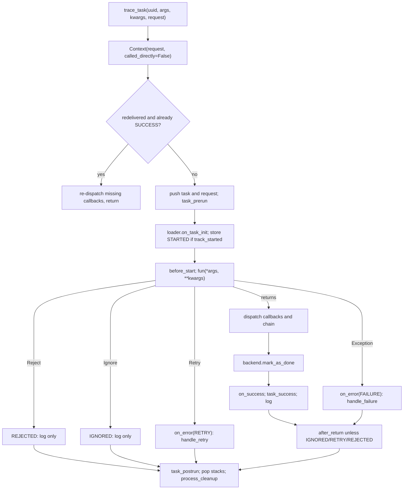

## Overview

`celery/app/trace.py` is the inner loop of the worker: it runs one task call and records everything around it. For each task class `build_tracer` returns a closure, `trace_task`, that pushes the request, sends the `task_prerun` signal, calls the task body, turns the outcome into a state (`SUCCESS`, `RETRY`, `FAILURE`, `IGNORED`, `REJECTED`), stores the result in the backend, dispatches callbacks and chains, runs the task's handlers and cleans up. The module comment explains why it is one long function: the earlier class-based design cost performance and produced unreadable tracebacks.

Sources: [celery/app/trace.py:1-46](repo://celery/app/trace.py#L1-L46), [celery/app/trace.py:344-370](repo://celery/app/trace.py#L344-L370)

The same tracer runs eagerly from `Task.apply` (see [[Defining and Calling Tasks]]) and in worker pool processes, where `Request` hands it the raw message body (see [[Consumer and Task Requests]]). States and exceptions it uses are listed in [[Exceptions and Task States]].

Sources: [celery/app/task.py:937-951](repo://celery/app/task.py#L937-L951), [celery/worker/request.py:351-372](repo://celery/worker/request.py#L351-L372)

## Entry points

`Request.execute_using_pool` sends either `fast_trace_task` or `trace_task_ret` to the pool, depending on `app.use_fast_trace_task`, with the task name, id, request dict, body and content type. Both deserialize the body with kombu `loads` against `accept_content`, merge the embedded `callbacks`/`errbacks`/`chain`/`chord` into the request, run the tracer and return `(1, R, T)` on failure or `(0, Rstr, T)` on success to the parent process. `Request.execute` (used by in-process execution) calls `trace_task` directly and rejects the message without requeue when trace info is returned, acknowledging it otherwise.

Sources: [celery/worker/request.py:351-405](repo://celery/worker/request.py#L351-L405), [celery/app/trace.py:735-788](repo://celery/app/trace.py#L735-L788)

| Function | Role |
| --- | --- |
| `build_tracer(name, task, loader, hostname, store_errors, Info, eager, propagate, app)` | Builds the per-task `trace_task` closure. |
| `trace_task(task, uuid, args, kwargs, request, **opts)` | Builds and caches the tracer in `task.__trace__`, then calls it; converts errors outside the body into an internal failure. |
| `trace_task_ret(name, uuid, request, body, content_type, content_encoding)` | Pool entry point using the current app's registry. |
| `fast_trace_task(task, uuid, request, body, content_type, content_encoding)` | Pool entry point using the registry, accept list and hostname cached by `setup_worker_optimizations`. |
| `setup_worker_optimizations(app, hostname)` | Installs stack protection, makes the app current and default, finalizes it and fills `_localized`. |
| `reset_worker_optimizations(app)` | Undoes the `__call__` patch and turns fast tracing off. |

Sources: [celery/app/trace.py:689-700](repo://celery/app/trace.py#L689-L700), [celery/app/trace.py:735-788](repo://celery/app/trace.py#L735-L788), [celery/app/trace.py:804-844](repo://celery/app/trace.py#L804-L844)

`fast_trace_task` raises a `RuntimeError` that names the cause when `_localized` is empty, which happens when a pool process was spawned instead of forked and `setup_worker_optimizations` never ran there. The worker calls `setup_worker_optimizations` from `on_before_init` and `on_init_blueprint`, and prefork child processes call it again after an `execv`.

Sources: [celery/app/trace.py:757-774](repo://celery/app/trace.py#L757-L774), [celery/apps/worker.py:94-96](repo://celery/apps/worker.py#L94-L96), [celery/apps/worker.py:122-126](repo://celery/apps/worker.py#L122-L126), [celery/concurrency/prefork.py:67-69](repo://celery/concurrency/prefork.py#L67-L69)

## Building the tracer

`build_tracer` does every lookup that does not depend on the call once, at build time:

Sources: [celery/app/trace.py:344-415](repo://celery/app/trace.py#L344-L415)

- `fun` is `task.run` unless the class overrides `__call__` (checked with `task_has_custom`, an MRO lookup that stops at `Task`), which saves a frame per call.
- `before_start`, `on_success` and `after_return` are kept only if the class overrides them, so the default no-op handlers are never called.
- Deduplication is enabled when acks are late, `worker_deduplicate_successful_tasks` is on and the result backend is persistent.
- Signal receiver lists, the request and task stacks, the loader hooks, `task_inherit_parent_priority`, the hostname and the pid are bound to local names.

Sources: [celery/app/trace.py:374-415](repo://celery/app/trace.py#L374-L415), [celery/app/trace.py:131-134](repo://celery/app/trace.py#L131-L134)

`on_error` is the shared failure path. With `propagate` set (eager calls with `task_eager_propagates` or `apply(throw=True)`) it re-raises; otherwise it wraps the exception in `TraceInfo(state, exc)` and calls `handle_error_state`.

Sources: [celery/app/trace.py:417-424](repo://celery/app/trace.py#L417-L424)

## The trace_task flow

### Control flow

Sources: [celery/app/trace.py:475-575](repo://celery/app/trace.py#L475-L575), [celery/app/trace.py:576-686](repo://celery/app/trace.py#L576-L686)

### Preparing the request

`trace_task` first checks that `kwargs` is a mapping (`InvalidTaskError` otherwise) and builds a `Context` from the request dict with `called_directly=False`. It derives three flags: the effective `ignore_result` (an explicit value on the request wins over the task attribute), `track_started` (never for eager calls or ignored results), and `publish_result` (true for non-eager calls that keep results, and for eager calls only with `store_eager_result`).

Sources: [celery/app/trace.py:487-506](repo://celery/app/trace.py#L487-L506), [celery/app/trace.py:157-176](repo://celery/app/trace.py#L157-L176)

### Deduplicating redelivered tasks

When deduplication is enabled and the message is marked `redelivered`, the tracer skips tasks already in the worker's `successful_requests` set, then asks the backend for the task's state. If it is `SUCCESS`, the task is not run again: it logs "Task already completed successfully.", and dispatches the callbacks and chain from the stored result only if the stored metadata has no `children` (meaning the original run died before dispatching them). A dispatch error raises `Reject(exc, requeue=True)` so the message is redelivered.

Sources: [celery/app/trace.py:508-561](repo://celery/app/trace.py#L508-L561)

### Running the body

The tracer pushes the task on `_task_stack` and the context on `task.request_stack`, sends `task_prerun`, calls `loader.on_task_init`, and with `track_started` stores `STARTED` with the worker's pid and hostname. It then calls `before_start` (if overridden) and the task function.

Sources: [celery/app/trace.py:563-585](repo://celery/app/trace.py#L563-L585)

### Success, callbacks and chains

On success, callbacks are dispatched before the result is stored so that `result.children` already contains them. `_dispatch_callbacks_and_chain` sends a single link with `apply_async((retval,))`; with several links, group links are applied separately and the remaining signatures are sent together as one `group`, so the trail is not recorded twice. For a chain, the last element of `request.chain` is the next step: it is sent with the rest of the list as its `chain`. All of these carry `parent_id=uuid`, the root id and, with `task_inherit_parent_priority`, the message priority.

Sources: [celery/app/trace.py:426-473](repo://celery/app/trace.py#L426-L473), [celery/app/trace.py:610-627](repo://celery/app/trace.py#L610-L627)

`backend.mark_as_done` stores the result unless results are ignored and, when the request belongs to a chord, calls `on_chord_part_return` so the backend can count the header and trigger the chord body. An `EncodeError` while storing turns into a failure. Otherwise the tracer computes the runtime and a `saferepr` of the result (capped by `resultrepr_maxsize`), calls `on_success`, sends `task_success` and logs "Task ... succeeded in ...".

Sources: [celery/backends/base.py:180-186](repo://celery/backends/base.py#L180-L186), [celery/app/trace.py:625-647](repo://celery/app/trace.py#L625-L647)

### Cleanup

`after_return` runs for every state except `IGNORED`, `RETRY` and `REJECTED`. In a `finally` block the tracer sends `task_postrun` with the return value and state, pops the task and request, and outside eager mode calls `backend.process_cleanup()` and `loader.on_process_cleanup()`, logging but not raising cleanup errors.

Sources: [celery/app/trace.py:649-672](repo://celery/app/trace.py#L649-L672), [celery/app/trace.py:114-114](repo://celery/app/trace.py#L114-L114)

## Outcome handling

### Outcomes by exception

| Raised by the body | State | What happens |
| --- | --- | --- |
| nothing | `SUCCESS` | Callbacks and chain dispatched, `mark_as_done`, `on_success`, `task_success`. |
| `Reject` | `REJECTED` | `handle_reject` logs at WARNING; nothing stored. |
| `Ignore` | `IGNORED` | `handle_ignore` logs at INFO; nothing stored. |
| `Retry` | `RETRY` | `on_error(RETRY, call_errbacks=False)` then `handle_retry`. |
| any other `Exception` | `FAILURE` | `on_error` then `handle_failure`. |
| `BaseException` (`SystemExit`, `KeyboardInterrupt`, ...) | none | Re-raised to the pool. |

Sources: [celery/app/trace.py:581-609](repo://celery/app/trace.py#L581-L609)

### TraceInfo

`TraceInfo` holds a `state` and the `retval` (the exception). `handle_error_state` decides whether to store the error: tasks that ignore results store it only with `store_errors_even_if_ignored`, eager calls only with `store_eager_result`, and worker calls always. It then calls `handle_retry` or `handle_failure` by state.

Sources: [celery/app/trace.py:179-204](repo://celery/app/trace.py#L179-L204)

`handle_retry` stores `RETRY` through `backend.mark_as_retry` with the original exception (`Retry.exc`), calls `task.on_retry`, sends `task_retry` and logs "Task ... retry: ...". `handle_failure` converts the exception to a pickleable one with `get_pickleable_exception`, calls `backend.mark_as_failure`, `task.on_failure`, sends `task_failure` and logs. Both clear traceback frames with `traceback_clear` to avoid retaining locals (issue #8882).

Sources: [celery/app/trace.py:212-282](repo://celery/app/trace.py#L212-L282), [celery/app/trace.py:314-341](repo://celery/app/trace.py#L314-L341)

`mark_as_failure` stores the failure, notifies the chord if the task is a chord member, walks the remaining `request.chain` to store the same failure on each later step (descending into chord bodies so the result a parent waits on is failed too), and finally calls the errbacks. Errbacks whose task accepts more than one argument are called inline as `errback(request, exc, traceback)`; older single-argument errbacks are sent as a group with the failed task id.

Sources: [celery/backends/base.py:188-252](repo://celery/backends/base.py#L188-L252), [celery/backends/base.py:254-304](repo://celery/backends/base.py#L254-L304)

### Log policies

`_log_error` picks a policy with `get_log_policy`: `Reject` logs at WARNING with traceback, `Ignore` at INFO without, internal errors at CRITICAL, exceptions listed in `task.throws` as "raised expected" at INFO without traceback, and everything else as "raised unexpected" at ERROR with traceback. The log record carries the context dict in `extra['data']` for custom handlers.

Sources: [celery/app/trace.py:87-102](repo://celery/app/trace.py#L87-L102), [celery/app/trace.py:137-147](repo://celery/app/trace.py#L137-L147), [celery/app/trace.py:284-311](repo://celery/app/trace.py#L284-L311)

### Errors outside the task body

An exception raised by the tracer itself (a signal handler, the backend, cleanup) is caught by the outer `try`: it sends `task_internal_error`, re-raises in eager mode, and otherwise builds an internal `ExceptionInfo` through `report_internal_error` (which also warns "Exception raised outside body") and marks the task failed. `MemoryError` and `Reject` always propagate, so a `Reject` from deduplication reaches the worker.

Sources: [celery/app/trace.py:673-684](repo://celery/app/trace.py#L673-L684), [celery/app/trace.py:703-732](repo://celery/app/trace.py#L703-L732), [celery/app/trace.py:791-801](repo://celery/app/trace.py#L791-L801)

## Signals fired

| Signal | When | Arguments |
| --- | --- | --- |
| `task_prerun` | Before the body | `task_id`, `task`, `args`, `kwargs` |
| `task_success` | After the result is stored | `result` |
| `task_retry` | On `Retry` | `request`, `reason`, `einfo` |
| `task_failure` | On failure | `task_id`, `exception`, `args`, `kwargs`, `traceback`, `einfo` |
| `task_postrun` | Always, after handlers | `task_id`, `task`, `args`, `kwargs`, `retval`, `state` |
| `task_internal_error` | Error outside the body | `task_id`, `args`, `kwargs`, `request`, `exception`, `traceback`, `einfo` |

Sources: [celery/app/trace.py:570-572](repo://celery/app/trace.py#L570-L572), [celery/app/trace.py:637-638](repo://celery/app/trace.py#L637-L638), [celery/app/trace.py:226-227](repo://celery/app/trace.py#L226-L227), [celery/app/trace.py:267-271](repo://celery/app/trace.py#L267-L271), [celery/app/trace.py:657-660](repo://celery/app/trace.py#L657-L660), [celery/app/trace.py:712-721](repo://celery/app/trace.py#L712-L721)

All signals are sent with the task as sender; the signal objects themselves are covered in [[Signals]].

Sources: [celery/app/trace.py:104-106](repo://celery/app/trace.py#L104-L106)

## Stack protection

The worker calls `task.run` directly when `__call__` is not overridden, so the request stack is pushed only by the tracer. A custom `__call__` that calls `super().__call__()` would push a second request. `_install_stack_protection` replaces `Task.__call__` with `__protected_call__`, which, when exactly one non-direct request is on the stack and it is not yet marked, marks it `_protected` and calls `run` without pushing again.

Sources: [celery/app/trace.py:847-873](repo://celery/app/trace.py#L847-L873)

## Configuration

| Setting | Default | Effect on tracing |
| --- | --- | --- |
| `task_track_started` | `False` | Store `STARTED` before running. |
| `task_ignore_result` | `False` | Skip storing results. |
| `task_store_errors_even_if_ignored` | `False` | Store failures and retries despite `ignore_result`. |
| `task_store_eager_result` | `False` | Store results of eager calls. |
| `task_eager_propagates` | `False` | Re-raise exceptions from eager calls. |
| `task_inherit_parent_priority` | `False` | Callbacks and chain steps reuse the message priority. |
| `worker_deduplicate_successful_tasks` | `False` | Skip redelivered tasks already marked `SUCCESS` (needs late acks and a persistent backend). |

Sources: [celery/app/defaults.py:281-294](repo://celery/app/defaults.py#L281-L294), [celery/app/defaults.py:321-322](repo://celery/app/defaults.py#L321-L322), [celery/app/defaults.py:340-342](repo://celery/app/defaults.py#L340-L342)
