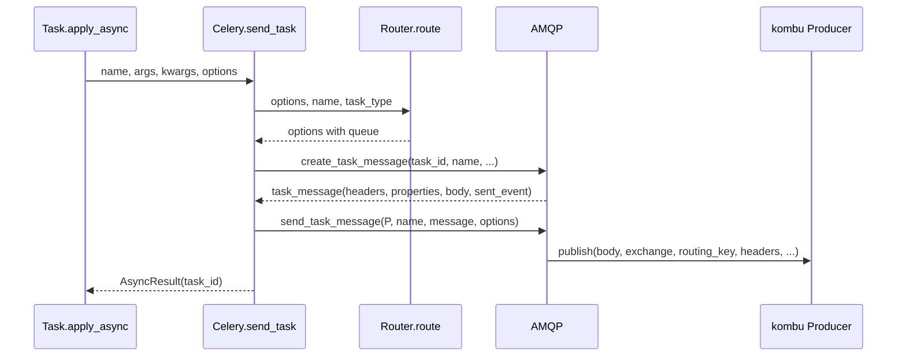
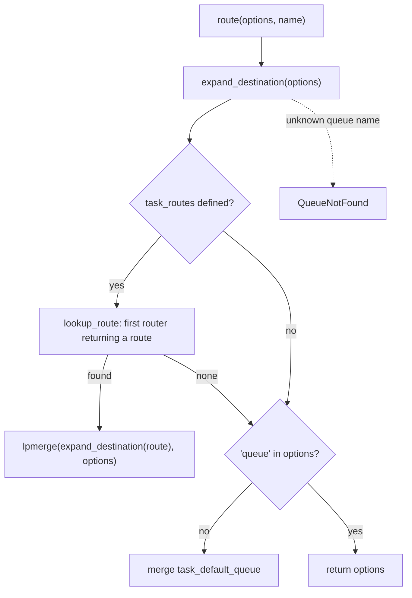

## Overview

Between `Task.apply_async` and the broker sit three pieces: `Celery.send_task`, which resolves options, routing and parent links; the `AMQP` object at `app.amqp`, which builds the message in the configured protocol version and publishes it; and the `Router`, which turns the `task_routes` setting into a destination queue. Every task call that is not eager goes through this path, and the worker reads the same message format back (see [[Consumer and Task Requests]]).

Sources: [celery/app/base.py:846-932](repo://celery/app/base.py#L846-L932), [celery/app/base.py:933-1041](repo://celery/app/base.py#L933-L1041), [celery/app/amqp.py:225-271](repo://celery/app/amqp.py#L225-L271)

`AMQP` exposes kombu's `Connection`, `Consumer` and `Producer` classes, builds the `Queues` table from `task_queues`, owns the router and the producer pool, and re-reads `task_routes` whenever that setting changes through `_handle_conf_update`. How the task API produces the options is described in [[Defining and Calling Tasks]].

Sources: [celery/app/amqp.py:225-264](repo://celery/app/amqp.py#L225-L264), [celery/app/amqp.py:608-663](repo://celery/app/amqp.py#L608-L663)

## From send_task to the broker

`send_task(name, args, kwargs, ...)` can be called directly with a task name that the caller does not import; `Task.apply_async` also ends here. The steps:

Sources: [celery/app/base.py:846-862](repo://celery/app/base.py#L846-L862)

1. Generates `task_id` when absent and picks `router` (default `amqp.router`). A `task_always_eager` setting only triggers an `AlwaysEagerIgnored` warning here.
2. For a plain `send_task` call, looks the name up in the local registry (without finalizing the app) and merges that task's non-`None` execution options under the caller's options.
3. Pops `time_limit`, `soft_time_limit` and `expires` out of `options`, so an explicit argument (even `None`) wins over the merged task default.
4. Calls `router.route(options, route_name or name, args, kwargs, task_type)` to fill in the queue.
5. With `eta` or `countdown` on a RabbitMQ broker that has quorum queues, rewrites the destination to the `celery_delayed_27` topic exchange (see below).
6. Converts `expires` into a relative `expiration` property in seconds, clamping a past date to 0 with a warning.
7. Inside a running task, fills `root_id` and `parent_id` from the current worker task, and with `task_inherit_parent_priority` inherits its priority.
8. Builds the message with `amqp.create_task_message(...)`, acquires a producer, calls `backend.on_task_call` unless the result is ignored, and publishes with `amqp.send_task_message(P, name, message, **options)`.
9. Returns `result_cls(task_id)` (an `AsyncResult` by default) and, when `add_to_parent` is set, records it in the parent's `request.children` through `add_trail`.

Sources: [celery/app/base.py:863-932](repo://celery/app/base.py#L863-L932), [celery/app/base.py:968-1041](repo://celery/app/base.py#L968-L1041)



Sources: [celery/app/base.py:931-1041](repo://celery/app/base.py#L931-L1041), [celery/app/amqp.py:506-606](repo://celery/app/amqp.py#L506-L606)

## Message protocols

### Protocol selection

`AMQP.task_protocols` maps protocol `1` to `as_task_v1` and `2` to `as_task_v2`; `create_task_message` is the one chosen by `task_protocol` (default `2`). Both return a `task_message` named tuple of `headers`, `properties`, `body` and `sent_event`, so the sender does not care which version built it.

Sources: [celery/app/amqp.py:32-33](repo://celery/app/amqp.py#L32-L33), [celery/app/amqp.py:257-267](repo://celery/app/amqp.py#L257-L267), [celery/app/defaults.py:295-295](repo://celery/app/defaults.py#L295-L295)

### Protocol 2

`as_task_v2` validates that `args` is a list or tuple and `kwargs` a mapping (`TypeError` otherwise), converts `countdown` into an absolute, timezone-aware `eta`, turns a numeric `expires` into a datetime, and serializes both as ISO 8601 strings. `argsrepr` and `kwargsrepr` are `saferepr` strings capped at 1024 characters, used for logs and events so the worker need not deserialize the body to describe the task. An empty `root_id` defaults to the task id, and `origin` defaults to the sender's node name.

Sources: [celery/app/amqp.py:326-370](repo://celery/app/amqp.py#L326-L370), [celery/app/amqp.py:250-255](repo://celery/app/amqp.py#L250-L255)

All task metadata lives in the headers, and the body only carries the call and its workflow links:

Sources: [celery/app/amqp.py:371-406](repo://celery/app/amqp.py#L371-L406)

```python
        return task_message(
            headers=headers,
            properties={
                'correlation_id': task_id,
                'reply_to': reply_to or '',
            },
            body=(
                args, kwargs, {
                    'callbacks': callbacks,
                    'errbacks': errbacks,
                    'chain': chain,
                    'chord': chord,
                },
            ),
```

Sources: [celery/app/amqp.py:393-406](repo://celery/app/amqp.py#L393-L406)

| Header | Content |
| --- | --- |
| `lang` | Always `'py'`. |
| `task` / `id` / `shadow` | Task name, task id, display name override. |
| `eta` / `expires` | ISO 8601 strings or `None`. |
| `group` / `group_index` | Group id and the task's position in it. |
| `retries` | Number of retries so far. |
| `timelimit` | `[time_limit, soft_time_limit]`. |
| `root_id` / `parent_id` | Workflow ancestry. |
| `argsrepr` / `kwargsrepr` | Truncated reprs of the arguments. |
| `origin` | Node name of the sender. |
| `ignore_result` | Whether the worker should skip storing the result. |
| `replaced_task_nesting` | How many times the task has been replaced. |
| `stamped_headers` / `stamps` | Canvas stamping names and values. |

Sources: [celery/app/amqp.py:371-391](repo://celery/app/amqp.py#L371-L391)

When `task_send_sent_event` is on, `sent_event` holds the fields of a `task-sent` event (uuid, ids, name, reprs, retries, eta, expires).

Sources: [celery/app/amqp.py:407-418](repo://celery/app/amqp.py#L407-L418), [celery/app/base.py:1007-1016](repo://celery/app/base.py#L1007-L1016)

### Protocol 1

`as_task_v1` sends empty headers and puts everything in a dict body: `task`, `id`, `args`, `kwargs`, `group`, `group_index`, `retries`, `eta`, `expires`, `utc`, `callbacks`, `errbacks`, `timelimit`, `taskset` (a copy of the group id) and `chord`. It has no root/parent ids, origin or stamps. The worker accepts both: its message handler converts a body containing `args` with `hybrid_to_proto2` and other v1 payloads with `proto1_to_proto2`.

Sources: [celery/app/amqp.py:420-478](repo://celery/app/amqp.py#L420-L478), [celery/worker/strategy.py:132-143](repo://celery/worker/strategy.py#L132-L143)

## Publishing a message

`send_task_message` is created once by `_create_task_sender`, which captures the publish defaults (`task_publish_retry`, `task_publish_retry_policy`, `task_default_delivery_mode`, `task_serializer`, `task_compression`, the default exchange and routing key) and the signal receivers in a closure. On each call it:

Sources: [celery/app/amqp.py:485-513](repo://celery/app/amqp.py#L485-L513)

1. Merges extra `headers` into the message headers and any leftover keyword arguments (such as `priority` or `expiration`) into the AMQP properties.
2. Resolves `queue`: `amqp.default_queue` when neither queue nor exchange is set, a name looked up in `Queues`, or a `Queue` object.
3. Takes `delivery_mode` and `exchange_type` from the queue's exchange, falling back to the configured delivery mode and `direct`.
4. For a direct exchange without both exchange and routing key, publishes to the default (anonymous) exchange `''` with the queue name as routing key; otherwise fills the exchange and routing key from the queue or the defaults.
5. Declares the queue on publish (unless it is a `Broadcast` queue) and merges the per-call `retry_policy` over the default.
6. Sends `before_task_publish`, calls `producer.publish(...)`, then sends `after_task_publish` and the deprecated `task_sent`, and finally publishes the `task-sent` event with the queue, exchange and routing key added.

Sources: [celery/app/amqp.py:487-606](repo://celery/app/amqp.py#L487-L606)

| Setting | Default | Used for |
| --- | --- | --- |
| `task_protocol` | `2` | Message builder. |
| `task_serializer` | `'json'` | Body serializer. |
| `task_compression` | `None` | Body compression. |
| `task_default_delivery_mode` | `2` (persistent) | Delivery mode when the exchange has none. |
| `task_publish_retry` | `True` | Retry publishing on connection errors. |
| `task_publish_retry_policy` | `max_retries` 3, `interval_start` 0, `interval_max` 1, `interval_step` 0.2 | Retry timing. |
| `task_send_sent_event` | `False` | Emit `task-sent` events. |
| `task_inherit_parent_priority` | `False` | Child tasks inherit the parent's priority. |

Sources: [celery/app/defaults.py:277-314](repo://celery/app/defaults.py#L277-L314)

Publishing signals are described in [[Signals]]; the `task-sent` event in [[Events and Monitoring]].

Sources: [celery/app/amqp.py:491-497](repo://celery/app/amqp.py#L491-L497), [celery/app/amqp.py:593-604](repo://celery/app/amqp.py#L593-L604)

## Queues

`Queues` is a dict of queue name to `kombu.Queue` built by `AMQP.Queues` from `task_queues`. When `task_queues` is empty it creates one queue named `task_default_queue` (default `celery`) on the default exchange, declared as a quorum queue when `task_default_queue_type` is `'quorum'`. Queues given as dicts go through `add_compat`, which accepts the old `binding_key` and defaults the routing key to the queue name. Every added queue receives the default exchange and routing key when it has none, and `x-max-priority` from `task_queue_max_priority`.

Sources: [celery/app/amqp.py:273-306](repo://celery/app/amqp.py#L273-L306), [celery/app/amqp.py:104-146](repo://celery/app/amqp.py#L104-L146)

Looking up an unknown name calls `__missing__`: with `task_create_missing_queues` (default on) it creates a queue whose exchange and routing key are both the queue name, using `task_create_missing_queue_exchange_type` when set and `x-queue-type` from `task_create_missing_queue_type` (`classic` or `quorum`, anything else raises `ValueError`); with it off, `KeyError` is raised. Queue aliases are tracked in a `WeakValueDictionary` and resolved first.

Sources: [celery/app/amqp.py:86-102](repo://celery/app/amqp.py#L86-L102), [celery/app/amqp.py:201-216](repo://celery/app/amqp.py#L201-L216)

The worker consumes from `consume_from`: all queues by default, or the subset chosen with `select` (the `-Q` option), minus those removed with `deselect` (`-X`). `select_add` adds a queue that is both routable and consumed. `TaskConsumer` creates a kombu `Consumer` over those queues accepting `accept_content`.

Sources: [celery/app/amqp.py:159-222](repo://celery/app/amqp.py#L159-L222), [celery/app/amqp.py:317-324](repo://celery/app/amqp.py#L317-L324)

| Setting | Default | Meaning |
| --- | --- | --- |
| `task_queues` | `None` | Queue declarations. |
| `task_default_queue` | `'celery'` | Queue used when nothing routes the task. |
| `task_default_queue_type` | `'classic'` | `'quorum'` declares the default queue as quorum. |
| `task_default_exchange` | the default queue name | Exchange for queues without one. |
| `task_default_exchange_type` | `'direct'` | Type of the default exchange. |
| `task_default_routing_key` | the default queue name | Routing key for queues without one. |
| `task_create_missing_queues` | `True` | Create unknown queues on demand. |
| `task_create_missing_queue_type` | `'classic'` | Queue type for created queues. |
| `task_create_missing_queue_exchange_type` | `None` | Exchange type for created queues. |
| `task_queue_max_priority` | `None` | Default `x-max-priority`. |

Sources: [celery/app/defaults.py:278-307](repo://celery/app/defaults.py#L278-L307), [celery/app/utils.py:114-126](repo://celery/app/utils.py#L114-L126)

## Routing

### The task_routes setting

`task_routes` may be a single router or a list. `routes.prepare` expands each entry: a dict, list or tuple becomes a `MapRoute`; a string is a dotted path loaded lazily with `expand_router_string` (instantiating old-style classes that have `route_for_task`); anything else must be a callable router. The prepared list is cached in `AMQP._rtable` and rebuilt by `flush_routes`.

Sources: [celery/app/routes.py:114-136](repo://celery/app/routes.py#L114-L136), [celery/app/amqp.py:314-315](repo://celery/app/amqp.py#L314-L315), [celery/app/amqp.py:621-625](repo://celery/app/amqp.py#L621-L625)

`MapRoute` keeps exact task names in a dict and keys containing `*` (translated with `fnmatch`) or compiled regular expressions as ordered patterns. Exact names win, then patterns in definition order. A value may be a dict of options or a bare queue name, which becomes `{'queue': name}`.

Sources: [celery/app/routes.py:26-53](repo://celery/app/routes.py#L26-L53)

```python
task_routes = {
    'feeds.tasks.import_feed': 'feeds',
    'media.*': {'queue': 'media', 'routing_key': 'media.video'},
}
```

Sources: [celery/app/routes.py:29-53](repo://celery/app/routes.py#L29-L53)

### How Router resolves a destination

`Router.route` first expands a `queue` already present in the options into a `Queue` object. If routes exist, `lookup_route` asks each router in turn (`router(name, args, kwargs, options, task=task_type)`, or `route_for_task(name, args, kwargs)` for pre-4.0 routers) and takes the first non-`None` answer; the route is expanded and merged with `lpmerge(route, options)`, which copies every non-`None` caller option over the route, so explicit call options win and `None` values leave the route's values in place. Without a match and without a `queue`, `task_default_queue` is used. A queue name not present in `Queues` raises `QueueNotFound`.

Sources: [celery/app/routes.py:56-111](repo://celery/app/routes.py#L56-L111), [celery/utils/collections.py:47-55](repo://celery/utils/collections.py#L47-L55)



Sources: [celery/app/routes.py:66-96](repo://celery/app/routes.py#L66-L96)

`AMQP.Router()` builds the router with the prepared routes, the `Queues` table and `task_create_missing_queues`. `send_task` accepts a custom `router` and a `route_name` that differs from the task name.

Sources: [celery/app/amqp.py:308-312](repo://celery/app/amqp.py#L308-L312), [celery/app/base.py:846-854](repo://celery/app/base.py#L846-L854)

## Quorum queues

`detect_quorum_queues(app, driver_type)` returns `(True, name)` for the first queue in `app.amqp.queues` declared with `x-queue-type: quorum`, but only when the transport driver is `amqp` (RabbitMQ); for other brokers it returns `(False, "")`.

Sources: [celery/utils/quorum_queues.py:4-20](repo://celery/utils/quorum_queues.py#L4-L20)

Quorum queues do not support global QoS, so the result changes behaviour in two places:

Sources: [celery/worker/consumer/tasks.py:103-124](repo://celery/worker/consumer/tasks.py#L103-L124)

- In `send_task`, a task with `eta` or `countdown` routed to a non-direct exchange is re-addressed to the `celery_delayed_27` topic exchange, with a routing key computed by kombu's `calculate_routing_key` from the countdown in seconds, so RabbitMQ holds the message until it is due. A direct exchange cannot be used this way and only logs a warning that the worker may block until the ETA.
- In the worker's task consumer step, when `worker_detect_quorum_queues` is on (default), global QoS is disabled and the prefetch count stays static.

Sources: [celery/app/base.py:934-966](repo://celery/app/base.py#L934-L966), [celery/worker/consumer/tasks.py:113-124](repo://celery/worker/consumer/tasks.py#L113-L124), [celery/app/defaults.py:373-373](repo://celery/app/defaults.py#L373-L373)

> [!WARNING]
> Native delayed delivery requires the destination exchange to be a topic or fanout exchange. With the default `direct` exchange type, an ETA task sent to quorum queues is published unchanged and may block the worker process until its ETA arrives.

Sources: [celery/app/base.py:943-966](repo://celery/app/base.py#L943-L966)
