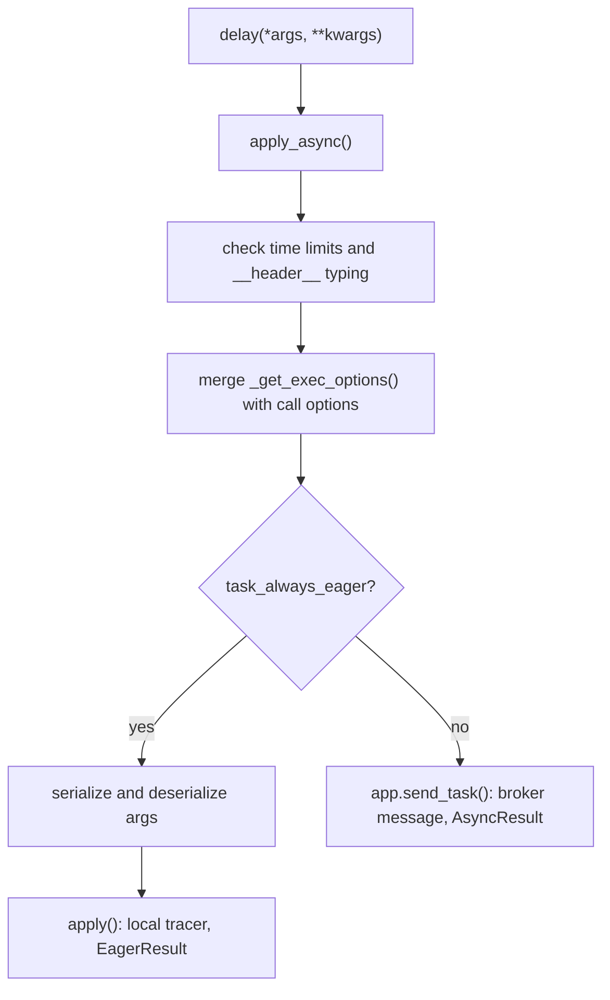
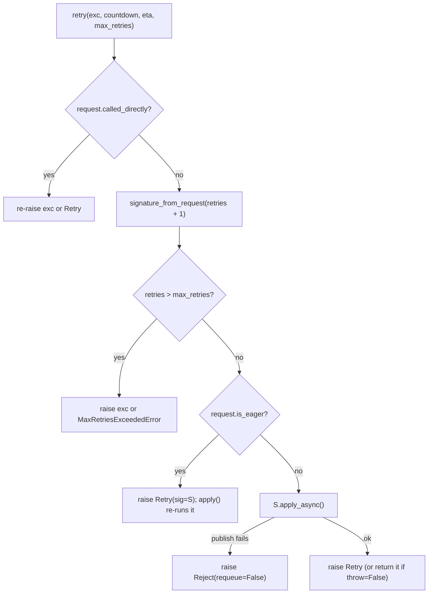

## Overview

A Celery task is an instance of a `Task` subclass whose `run` method holds the work. `Task` carries the per-task options (retries, time limits, acknowledgement policy, serializer), the calling API (`delay`, `apply_async`, `apply`), the retry and replace machinery, and the handler hooks the worker calls after execution. The class is registered with `abstract.CallableTask` so anything that checks for a callable task accepts it.

Sources: [celery/app/task.py:205-226](repo://celery/app/task.py#L205-L226)

Most tasks are not written as classes: the `app.task` decorator builds a `Task` subclass around a plain function and registers one instance in the app's task registry. Calling a task sends a message through the app (see [[Task Messages and Routing]]); a worker then runs it inside the tracer described in [[Task Execution and Tracing]]. The app object, registry and finalization are covered in [[The Celery Application]].

Sources: [celery/app/base.py:590-633](repo://celery/app/base.py#L590-L633), [celery/app/task.py:659-708](repo://celery/app/task.py#L659-L708)

## Creating a task

### The task decorator

`Celery.task` accepts either a bare callable (`@app.task`) or options (`@app.task(bind=True, ...)`); any other positional use raises `TypeError`. With `shared=True` (the default) it also registers a constructor through `connect_on_app_finalize`, so every app created later gets the task too. When the app is not finalized and `lazy` is true, it returns a `PromiseProxy` that calls `_task_from_fun` on first use and queues it in `app._pending`; `finalize()` evaluates every pending proxy. When the process was started through `execv`, the decorator delegates to `shared_task(lazy=False)` so the module-level name points at the current app's instance.

Sources: [celery/app/base.py:545-585](repo://celery/app/base.py#L545-L585), [celery/app/base.py:657-677](repo://celery/app/base.py#L657-L677)

### The generated task class

`_task_from_fun` names the task with `gen_task_name(fun.__name__, fun.__module__)` unless `name` is given, and uses `base` (default `app.Task`) as the parent class. The function becomes `run`: as-is when `bind=True`, so its first argument is the task instance (`self`), otherwise wrapped in `staticmethod`. Extra decorator options become class attributes, which is how `@app.task(max_retries=5)` overrides the default. With `pydantic=True` the function is first wrapped by `pydantic_wrapper`, which validates `BaseModel`-annotated arguments and dumps a returned model.

Sources: [celery/app/base.py:590-621](repo://celery/app/base.py#L590-L621), [celery/app/base.py:127-200](repo://celery/app/base.py#L127-L200)

```python
            run = fun if bind else staticmethod(fun)
            task = type(fun.__name__, (base,), dict({
                'app': self,
                'name': name,
                'run': run,
                '_decorated': True,
                '__doc__': fun.__doc__,
                '__module__': fun.__module__,
                '__annotations__': _get_annotations(fun),
                '__header__': self.type_checker(fun, bound=bind),
                '__wrapped__': run}, **options))()
```

Sources: [celery/app/base.py:611-621](repo://celery/app/base.py#L611-L621)

The instance is stored in `app._tasks[name]`, bound with `task.bind(app)`, and passed to `add_autoretry_behaviour`. If the name is already registered the existing instance is returned, so decorating the same function twice yields one task. Class-based tasks go through `register_task`, which instantiates the class, generates a name when missing and performs the same binding.

Sources: [celery/app/base.py:622-652](repo://celery/app/base.py#L622-L652)

### Binding to the app

`Task.bind` runs once per class (and again at finalize): it sets `typing` from `app.strict_typing`, copies every `None` attribute listed in `from_config` from the matching setting, and resolves `acks_on_failure` and `acks_on_timeout` from the deprecated `acks_on_failure_or_timeout` (defaulting both to `True`). On the first bind it applies annotations and creates the thread-local `request_stack`, then calls the `on_bound` class hook. Accessing `Task.app` on an unbound class falls back to `current_app` and binds on the spot.

Sources: [celery/app/task.py:418-475](repo://celery/app/task.py#L418-L475)

| Task attribute | Setting it defaults from |
| --- | --- |
| `serializer` | `task_serializer` |
| `rate_limit` | `task_default_rate_limit` |
| `priority` | `task_default_priority` |
| `time_limit` / `soft_time_limit` | `task_time_limit` / `task_soft_time_limit` |
| `track_started` | `task_track_started` |
| `acks_late` | `task_acks_late` |
| `acks_on_failure_or_timeout` | `task_acks_on_failure_or_timeout` |
| `acks_on_failure` / `acks_on_timeout` | `task_acks_on_failure` / `task_acks_on_timeout` |
| `reject_on_worker_lost` | `task_reject_on_worker_lost` |
| `ignore_result` | `task_ignore_result` |
| `store_eager_result` | `task_store_eager_result` |
| `store_errors_even_if_ignored` | `task_store_errors_even_if_ignored` |

Sources: [celery/app/task.py:396-411](repo://celery/app/task.py#L396-L411)

## Task options

These attributes are read by the caller and the worker; those without a setting keep the class default shown. Each can be set on a subclass, passed to `@app.task(...)`, or patched through annotations.

Sources: [celery/app/task.py:228-300](repo://celery/app/task.py#L228-L300), [celery/app/task.py:349-380](repo://celery/app/task.py#L349-L380)

| Attribute | Default | Meaning |
| --- | --- | --- |
| `name` | generated | Registry key and the `task` header of every message. |
| `typing` | `app.strict_typing` | Check call arguments against the function signature before sending. |
| `max_retries` | `3` | Retries allowed before `MaxRetriesExceededError`; `None` retries forever. |
| `default_retry_delay` | `180` | Seconds before a retry when neither `countdown` nor `eta` is given. |
| `trail` | `True` | Record subtasks started by this task in `request.children`. |
| `send_events` | `True` | Allow task events from the worker for this task. |
| `throws` | `()` | Expected exceptions: stored as failures but logged without traceback. |
| `expires` | `None` | Default expiry for messages of this task. |
| `priority` | `None` | 0-9; meaning depends on the broker. |
| `resultrepr_maxsize` | `1024` | Maximum length of the result repr in logs and events. |
| `reject_on_worker_lost` | `None` | Requeue instead of acknowledging when the worker process dies under `acks_late`. |
| `Strategy` | `celery.worker.strategy:default` | Worker-side strategy used to turn messages into requests. |
| `Request` | `celery.worker.request:Request` | Request class the worker instantiates for each message. |

Sources: [celery/app/task.py:221-260](repo://celery/app/task.py#L221-L260), [celery/app/task.py:262-268](repo://celery/app/task.py#L262-L268), [celery/app/task.py:349-380](repo://celery/app/task.py#L349-L380)

## Calling a task

### delay and apply_async

`delay(*args, **kwargs)` is `apply_async(args, kwargs)` with no options. `apply_async` validates and enriches the options before handing off:

Sources: [celery/app/task.py:523-537](repo://celery/app/task.py#L523-L537)

1. Raises `ValueError` when the task's `soft_time_limit` exceeds its `time_limit`.
2. When `typing` is on, calls the generated `__header__` with the arguments, so a wrong call raises `TypeError` in the caller instead of in the worker.
3. Computes `shadow` (the display name) from `shadow_name()` unless given.
4. Merges the task's cached execution options (`queue`, `routing_key`, `exchange`, `priority`, `expires`, `serializer`, `delivery_mode`, `compression`, `time_limit`, `soft_time_limit`, ...) under the call's options, and defaults `ignore_result` and `priority` from the task.
5. With `task_always_eager`, round-trips the arguments through the serializer (so unserializable arguments fail like they would in production) and runs `apply()` under `denied_join_result()`; otherwise calls `app.send_task(...)` with `result_cls=self.AsyncResult` and `task_type=self`.

Sources: [celery/app/task.py:523-534](repo://celery/app/task.py#L523-L534), [celery/app/task.py:659-708](repo://celery/app/task.py#L659-L708), [celery/app/task.py:31-36](repo://celery/app/task.py#L31-L36), [celery/app/task.py:1256-1259](repo://celery/app/task.py#L1256-L1259)



Sources: [celery/app/task.py:523-534](repo://celery/app/task.py#L523-L534), [celery/app/task.py:659-708](repo://celery/app/task.py#L659-L708)

The main keyword arguments `apply_async` documents are `countdown`, `eta`, `expires`, `shadow`, `connection`, `retry`, `retry_policy`, `time_limit`, `soft_time_limit`, `queue`, `exchange`, `routing_key`, `priority`, `serializer`, `compression`, `link`, `link_error`, `producer`, `add_to_parent`, `ignore_result`, `headers` and `task_id`; anything else is passed through to `kombu.Producer.publish`.

Sources: [celery/app/task.py:539-658](repo://celery/app/task.py#L539-L658)

### Eager execution with apply

`apply()` runs the task in the calling process and returns an `EagerResult`. It builds a request dictionary with `is_eager=True`, the caller's task as parent (from `_task_stack.top`), the `link`/`link_error` callbacks, time limits and a synthetic `delivery_info`, then runs `build_tracer(..., eager=True, propagate=throw)` on it. `throw` defaults to `task_eager_propagates`. If the traced result is a `Retry` carrying a signature, `apply` recurses into `retval.sig.apply(retries=retries + 1)`, so eager retries run inline.

Sources: [celery/app/task.py:869-951](repo://celery/app/task.py#L869-L951)

### Signature shortcuts

`signature()` (alias `subtask`), `s()` and `si()` wrap a call into a `Signature` (immutable for `si`); `chunks`, `map` and `starmap` build the matching canvas primitives from `self.s()`. Their behaviour is described in [[Canvas: Signatures and Workflows]].

Sources: [celery/app/task.py:962-1001](repo://celery/app/task.py#L962-L1001)

## Request context

`Task.request` returns the top of the thread-local `request_stack`, a `Context` describing the current invocation; outside execution it returns a shared default `Context`. `push_request` copies the current context and overlays new values, and `__call__` pushes a context and the task onto `_task_stack` around `run`, so calling a task object directly still produces a request with `called_directly = True`.

Sources: [celery/app/task.py:1234-1254](repo://celery/app/task.py#L1234-L1254), [celery/app/task.py:495-502](repo://celery/app/task.py#L495-L502)

`Context` holds the message fields as attributes: `id`, `args`, `kwargs`, `retries`, `eta`, `expires`, `group`, `group_index`, `chord`, `chain`, `callbacks`, `errbacks`, `root_id`, `parent_id`, `correlation_id`, `reply_to`, `delivery_info`, `hostname`, `is_eager`, `timelimit`, `stamps` and more. `update()` keeps `time_limit` and `soft_time_limit` in sync whenever `timelimit` changes, and any keys that are not Celery fields are collected into `headers` as custom headers.

Sources: [celery/app/task.py:75-150](repo://celery/app/task.py#L75-L150)

`as_execution_options()` turns a request back into `apply_async` options (task id, root and parent ids, group, chord, chain, links, limits, headers, retries, stamps). It drops RabbitMQ dead-lettering headers (`x-death` and the `x-first-death-*`/`x-last-death-*` family) so a re-sent message is not treated as a dead-letter cycle. `signature_from_request` uses it to rebuild a signature of the running task, routing it back to the original queue: to the `routing_key` when the message came through the default exchange, otherwise with the original `delivery_info`.

Sources: [celery/app/task.py:43-52](repo://celery/app/task.py#L43-L52), [celery/app/task.py:160-195](repo://celery/app/task.py#L160-L195), [celery/app/task.py:731-754](repo://celery/app/task.py#L731-L754)

## Retrying

### Manual retry

`retry()` re-sends the current task and raises `Retry` to tell the worker the attempt ended on purpose. It is meant to be raised by a bound task:

Sources: [celery/app/task.py:756-817](repo://celery/app/task.py#L756-L817)

```python
            >>> @app.task(bind=True)
            ... def tweet(self, auth, message):
            ...     twitter = Twitter(oauth=auth)
            ...     try:
            ...         twitter.post_status_update(message)
            ...     except twitter.FailWhale as exc:
            ...         # Retry in 5 minutes.
            ...         raise self.retry(countdown=60 * 5, exc=exc)
```

Sources: [celery/app/task.py:764-771](repo://celery/app/task.py#L764-L771)



Sources: [celery/app/task.py:818-867](repo://celery/app/task.py#L818-L867)

The countdown defaults to `default_retry_delay` when neither `eta` nor `countdown` is passed. A `max_retries` argument applies to this call only and is remembered in `override_max_retries` for the autoretry wrapper. With `throw=False`, the `Retry` is returned instead of raised, so the task's own outcome (success or failure) decides its state.

Sources: [celery/app/task.py:818-833](repo://celery/app/task.py#L818-L833), [celery/app/task.py:794-807](repo://celery/app/task.py#L794-L807)

### Automatic retry

`add_autoretry_behaviour` wraps `run` once (it checks `_orig_run`) when `autoretry_for` is non-empty. The wrapper lets `Ignore`, `Retry` and anything in `dont_autoretry_for` propagate, and turns any `autoretry_for` exception into `task.retry(exc=exc, **retry_kwargs)`. With `retry_backoff`, the countdown is `get_exponential_backoff_interval(factor, retries, retry_backoff_max, retry_jitter)`: `min(maximum, factor * 2 ** retries)`, randomised in `[0, countdown]` when jitter is on.

Sources: [celery/app/autoretry.py:8-66](repo://celery/app/autoretry.py#L8-L66), [celery/utils/time.py:463-477](repo://celery/utils/time.py#L463-L477)

| Option | Default | Effect |
| --- | --- | --- |
| `autoretry_for` | `()` | Exception classes that trigger a retry. |
| `dont_autoretry_for` | `()` | Subclasses to exclude from `autoretry_for`. |
| `retry_kwargs` | `{}` | Keyword arguments passed to `retry()` (for example `max_retries`, `countdown`). |
| `retry_backoff` | `False` | `True` or a number: exponential backoff factor in seconds. |
| `retry_backoff_max` | `600` | Upper bound of the backoff countdown. |
| `retry_jitter` | `True` | Randomise the backoff countdown. |

Sources: [celery/app/autoretry.py:10-31](repo://celery/app/autoretry.py#L10-L31)

## Replacing a task and extending chords

`replace(sig)` hands the rest of the work to another signature while keeping the current task id, so existing `AsyncResult` objects stay valid. It refuses a signature that carries a `chord` option or an empty chain (`ImproperlyConfigured`), upgrades a group to a chord ending in `celery.accumulate`, moves the current request's callbacks and errbacks onto the new signature, freezes it with `self.request.id`, copies `chord`, `group_id`, `group_index` and `root_id`, increments `replaced_task_nesting`, and appends the remaining tasks of the current chain. `on_replace` then either applies it eagerly and returns its value, or calls `sig.delay()` and raises `Ignore('Replaced by new task')` so the worker records nothing for the replaced task.

Sources: [celery/app/task.py:1029-1095](repo://celery/app/task.py#L1029-L1095), [celery/app/task.py:1211-1227](repo://celery/app/task.py#L1211-L1227)

`add_to_chord(sig, lazy=False)` adds a signature to the chord the current task belongs to: it sets the group and chord fields on `sig`, freezes it, calls `backend.add_to_chord(group_id, result)` and sends it unless `lazy`. It raises `ValueError` outside a chord, and only the Redis backend supports it.

Sources: [celery/app/task.py:1097-1119](repo://celery/app/task.py#L1097-L1119)

## Handlers and state helpers

Subclasses override these hooks; the worker calls them from the tracer, and their return values are ignored.

Sources: [celery/app/task.py:1135-1227](repo://celery/app/task.py#L1135-L1227)

| Hook | Called |
| --- | --- |
| `on_bound(cls, app)` | Class method, when the task class is bound to an app. |
| `before_start(task_id, args, kwargs)` | Before `run` executes. |
| `on_success(retval, task_id, args, kwargs)` | After `run` returns successfully. |
| `on_retry(exc, task_id, args, kwargs, einfo)` | When the task raised `Retry`. |
| `on_failure(exc, task_id, args, kwargs, einfo)` | When the task raised an exception. |
| `after_return(status, retval, task_id, args, kwargs, einfo)` | After success or failure; skipped when the task raised `Retry`, `Ignore` or `Reject`. |
| `on_replace(sig)` | From `replace()`; overrides must return `super().on_replace(sig)`. |

Sources: [celery/app/task.py:457-464](repo://celery/app/task.py#L457-L464), [celery/app/task.py:1135-1227](repo://celery/app/task.py#L1135-L1227), [celery/app/trace.py:649-654](repo://celery/app/trace.py#L649-L654)

`update_state(task_id=None, state=None, meta=None)` writes a custom state straight to the result backend through `backend.store_result`, defaulting to the current request id. `send_event(type_, **fields)` publishes a custom monitoring event with the request's id and hostname through the app's default event dispatcher. The `backend` property returns the task's own backend or falls back to `app.backend`.

Sources: [celery/app/task.py:1121-1133](repo://celery/app/task.py#L1121-L1133), [celery/app/task.py:1003-1027](repo://celery/app/task.py#L1003-L1027), [celery/app/task.py:1261-1270](repo://celery/app/task.py#L1261-L1270)

## Annotations

The `task_annotations` setting patches task classes from configuration. `app.annotations` expands it with `prepare`: a dict becomes a `MapAnnotation` (task name or `'*'` to attribute dict), a string is lazily imported and instantiated, and any other object is used as-is if it has `annotate(task)` / `annotate_any()` methods.

Sources: [celery/app/annotations.py:18-47](repo://celery/app/annotations.py#L18-L47), [celery/app/base.py:1462-1464](repo://celery/app/base.py#L1462-L1464)

```python
task_annotations = {
    'tasks.add': {'rate_limit': '10/s'},
    '*': {'acks_late': True},
}
```

Sources: [celery/app/annotations.py:18-31](repo://celery/app/annotations.py#L18-L31)

During the first `bind`, `annotate()` applies the first match for the task's name and then the first `'*'` match, so a key set by both ends up with the `'*'` value. A key starting with `@` wraps a method instead of setting an attribute: `add_around` calls the value with the original method and stores the result, keeping the original in `__wrapped__`.

Sources: [celery/app/annotations.py:50-52](repo://celery/app/annotations.py#L50-L52), [celery/app/task.py:477-493](repo://celery/app/task.py#L477-L493)
