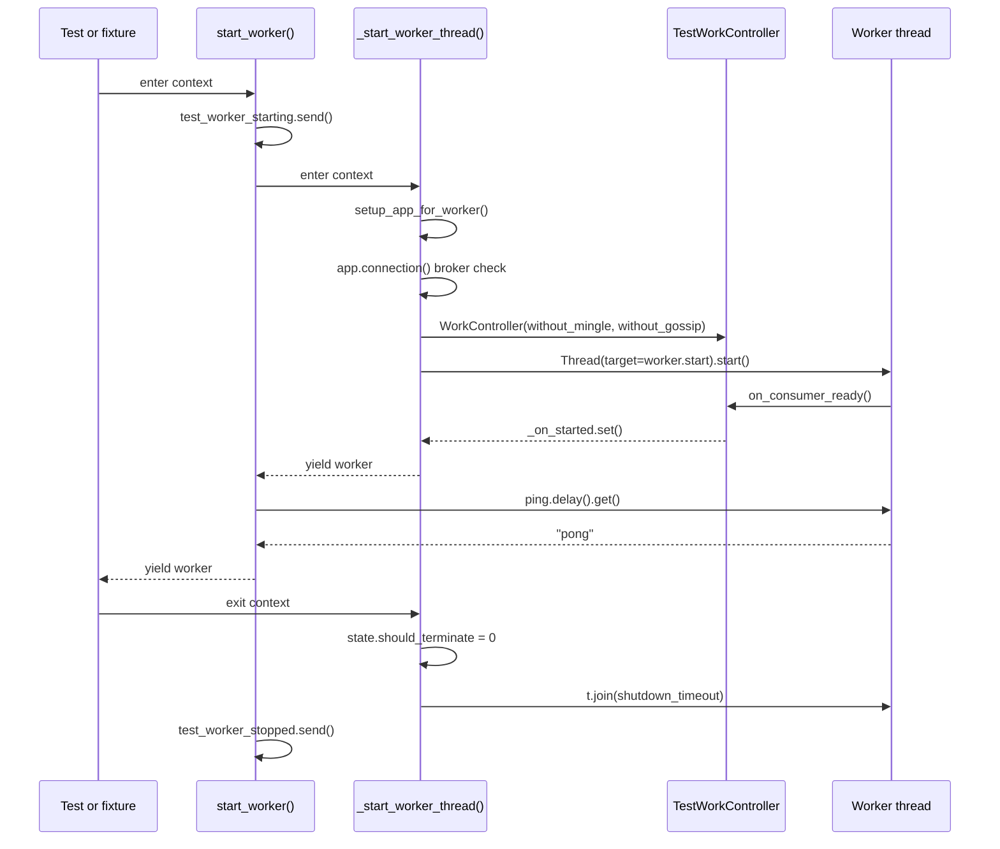

## Overview

Celery ships its own testing toolkit so that application code can be exercised without a production broker or a separately launched worker. The toolkit lives in `celery.contrib`: `celery.contrib.pytest` is a pytest plugin of fixtures, and `celery.contrib.testing` holds the pieces those fixtures are built from: `TestApp` and the app trap in `app.py`, the embedded thread worker `start_worker` / `TestWorkController` in `worker.py`, message mocks in `mocks.py`, the `celery.ping` task in `tasks.py`, and the `Manager` polling helper in `manager.py`. Celery's own test suites under `t/` are written with these same fixtures.

Sources: [celery/contrib/pytest.py:1-50](repo://celery/contrib/pytest.py#L1-L50), [celery/contrib/testing/worker.py:1-28](repo://celery/contrib/testing/worker.py#L1-L28), [celery/contrib/testing/tasks.py:1-9](repo://celery/contrib/testing/tasks.py#L1-L9)

The project documentation splits testing in two: unit and integration tests use the mock-based `celery.contrib.pytest`, while smoke and production-like tests use the Docker-based `pytest-celery` package. The two APIs are not compatible with each other. Installing `pytest-celery` also brings in the `celery.contrib.pytest` infrastructure.

Sources: [docs/userguide/testing.rst:1-22](repo://docs/userguide/testing.rst#L1-L22)

## Enabling the pytest plugin

Celery's own `setup.py` declares no `pytest11` entry point: its only `entry_points` entry is the `celery` console script. The `pytest` extra resolves to `requirements/extras/pytest.txt`, which installs `pytest-celery[all]>=1.3.0`. The user guide lists three ways to turn the fixtures on: `pip install celery[pytest]`, the environment variable `PYTEST_PLUGINS=celery.contrib.pytest`, or `pytest_plugins = ("celery.contrib.pytest", )` in the root `conftest.py`.

Sources: [setup.py:123-125](repo://setup.py#L123-L125), [setup.py:155-159](repo://setup.py#L155-L159), [requirements/extras/pytest.txt:1-1](repo://requirements/extras/pytest.txt#L1-L1), [docs/userguide/testing.rst:118-129](repo://docs/userguide/testing.rst#L118-L129)

Celery's own suites do not depend on the plugin being registered. Both `t/unit/conftest.py` and `t/integration/conftest.py` import the fixtures they need by name from `celery.contrib.pytest` and re-export them in `__all__`, so pytest discovers them as ordinary conftest fixtures even before the package is installed in develop mode.

Sources: [t/unit/conftest.py:20-31](repo://t/unit/conftest.py#L20-L31), [t/integration/conftest.py:9-45](repo://t/integration/conftest.py#L9-L45)

When loaded, `pytest_configure` registers the `celery(**overrides)` marker so that pytest's `--strict-markers` mode accepts `@pytest.mark.celery(...)`. `t/unit/contrib/test_pytest.py` checks that the marker raises no `PytestUnknownMarkWarning`.

Sources: [celery/contrib/pytest.py:22-29](repo://celery/contrib/pytest.py#L22-L29), [t/unit/contrib/test_pytest.py:11-31](repo://t/unit/contrib/test_pytest.py#L11-L31)

## Fixtures

### Configuration fixtures

Most fixtures exist only to be overridden. Each one is session-scoped and returns a neutral default. Redefine it in a `conftest.py` to change how the app or worker fixtures behave.

Sources: [celery/contrib/pytest.py:53-169](repo://celery/contrib/pytest.py#L53-L169), [celery/contrib/pytest.py:188-191](repo://celery/contrib/pytest.py#L188-L191)

| Fixture | Default | Consumed by |
| --- | --- | --- |
| `celery_config` | `{}` | `celery_app`, `celery_session_app`: passed as `config` to `TestApp` |
| `celery_parameters` | `{}` | `celery_app`, `celery_session_app`: keyword arguments for the `Celery` constructor |
| `celery_enable_logging` | `False` | `TestApp(enable_logging=...)`: `False` installs `UnitLogging` |
| `use_celery_app_trap` | `False` | `setup_default_app(use_trap=...)`: raise on any use of the current/default app |
| `celery_includes` | `()` | worker fixtures: modules imported via `app.loader.import_task_module` |
| `celery_class_tasks` | `[]` | `celery_session_worker` only: classes passed to `app.register_task` |
| `celery_worker_pool` | `'solo'` | worker fixtures: `pool=` for `start_worker` |
| `celery_worker_parameters` | `{}` | worker fixtures: extra keyword arguments for `start_worker` and `WorkController` |

Sources: [celery/contrib/pytest.py:53-169](repo://celery/contrib/pytest.py#L53-L169), [celery/contrib/pytest.py:188-191](repo://celery/contrib/pytest.py#L188-L191)

### App and worker fixtures

`celery_app` is function-scoped. It reads the closest `celery` marker on the test, merges the marker's kwargs over `celery_config`, and enters `_create_app`, which builds a `TestApp(set_as_current=False, ...)` inside `setup_default_app`. Each test therefore gets a fresh app, and the global app state is restored when the test returns.

Sources: [celery/contrib/pytest.py:32-50](repo://celery/contrib/pytest.py#L32-L50), [celery/contrib/pytest.py:172-185](repo://celery/contrib/pytest.py#L172-L185)

```python
mark = request.node.get_closest_marker('celery')
config = dict(celery_config, **mark.kwargs if mark else {})
```

Sources: [celery/contrib/pytest.py:179-180](repo://celery/contrib/pytest.py#L179-L180)

`celery_session_app` does the same once per session and, unless the trap is enabled, also calls `app.set_default()` and `app.set_current()`, because a long-lived worker and the tests that call it must agree on one app. `celery_session_worker` imports every `celery_includes` module, registers every `celery_class_tasks` class, and keeps one `start_worker` context open for the whole session. `celery_worker` is the per-test variant: it starts a worker on `celery_app` and stops it when the test returns. `depends_on_current_app` simply calls `celery_app.set_current()` for tests that rely on `current_app`.

Sources: [celery/contrib/pytest.py:64-105](repo://celery/contrib/pytest.py#L64-L105), [celery/contrib/pytest.py:194-216](repo://celery/contrib/pytest.py#L194-L216)

> [!NOTE]
> Both worker fixtures skip worker startup when the `NO_WORKER` environment variable is set. The generator then yields nothing, so pytest reports a fixture error for tests that request the worker.

Sources: [celery/contrib/pytest.py:16-16](repo://celery/contrib/pytest.py#L16-L16), [celery/contrib/pytest.py:97-105](repo://celery/contrib/pytest.py#L97-L105), [celery/contrib/pytest.py:204-210](repo://celery/contrib/pytest.py#L204-L210)

## TestApp and the app trap

`TestApp` is a factory function, not a subclass. It imports `celery.contrib.testing.tasks` so that the `celery.ping` shared task exists, merges the caller's `config` over a deep copy of `DEFAULT_TEST_CONFIG`, and applies the result with `add_defaults`, so explicit configuration on the app still takes precedence. An explicit `broker` or `backend` argument removes the matching default URL from the config.

Sources: [celery/contrib/testing/app.py:47-65](repo://celery/contrib/testing/app.py#L47-L65)

```python
DEFAULT_TEST_CONFIG = {
    'worker_hijack_root_logger': False,
    'worker_log_color': False,
    'accept_content': {'json'},
    'enable_utc': True,
    'timezone': 'UTC',
    'broker_url': 'memory://',
    'result_backend': 'cache+memory://',
    'broker_heartbeat': 0,
}
```

Sources: [celery/contrib/testing/app.py:10-20](repo://celery/contrib/testing/app.py#L10-L20)

The in-memory transport and the `cache+memory://` backend mean a test app needs no external service. Unless `enable_logging` is true, the app is built with `log=UnitLogging`, a subclass of the app's normal log class that sets `already_setup = True`. Logging configuration then becomes a no-op and does not change pytest's handlers.

Sources: [celery/contrib/testing/app.py:39-45](repo://celery/contrib/testing/app.py#L39-L45), [celery/contrib/testing/app.py:56-63](repo://celery/contrib/testing/app.py#L56-L63)

`setup_default_app` snapshots `_state.get_current_app()`, `_state.default_app`, `_state._on_app_finalizers` and `_state._apps` before yielding. On exit it restores all four and closes the test app if it was not already the current app. With `use_trap=True` it also enters `set_trap`. That installs a `Trap` object as the default app and replaces the thread-local `_state._tls` with a non-thread-local holder whose `current_app` is the trap. Any attribute access on `Trap` raises `RuntimeError('Test depends on current_app')`, which catches library code that falls back to `current_app` instead of using the app it was given.

Sources: [celery/contrib/testing/app.py:23-36](repo://celery/contrib/testing/app.py#L23-L36), [celery/contrib/testing/app.py:68-112](repo://celery/contrib/testing/app.py#L68-L112)

## Embedded worker

### start_worker flow

`start_worker(app, concurrency=1, pool='solo', ...)` is a context manager that runs a real `WorkController` in a daemon thread inside the test process. It sends the `test_worker_starting` signal, enters `_start_worker_thread`, and, when `perform_ping_check` is true, waits for the `celery.ping` task to answer `'pong'` within `ping_task_timeout` seconds before yielding the worker. The `test_worker_stopped` signal is sent in a `finally` block, so it fires even when startup fails.

Sources: [celery/contrib/testing/worker.py:99-136](repo://celery/contrib/testing/worker.py#L99-L136)



Sources: [celery/contrib/testing/worker.py:81-96](repo://celery/contrib/testing/worker.py#L81-L96), [celery/contrib/testing/worker.py:99-192](repo://celery/contrib/testing/worker.py#L99-L192)

### Inside _start_worker_thread

1. `setup_app_for_worker` finalizes the app, makes it both current and default, resets `type(app.log)._setup`, and calls `app.log.setup` with the requested `loglevel` (default from the `WORKER_LOGLEVEL` environment variable, else `'error'`).
2. With the ping check enabled it asserts that `'celery.ping'` is registered in `app.tasks`.
3. It opens `app.connection(hostname=os.environ.get('TEST_BROKER'))` and touches `default_channel`, so an unreachable broker fails here and not inside the worker thread.
4. It builds the worker with `without_mingle=True`, `without_gossip=True`, heartbeat disabled unless overridden, a `hostname` from `anon_nodename()` unless one is passed, and `ready_callback=None` so that `TestWorkController.on_consumer_ready` cannot be replaced.
5. It starts `worker.start` in a daemon thread, blocks on `worker.ensure_started()`, and calls `_set_task_join_will_block(False)` so the test thread may call `AsyncResult.get()`.

Sources: [celery/contrib/testing/worker.py:139-178](repo://celery/contrib/testing/worker.py#L139-L178), [celery/contrib/testing/worker.py:219-225](repo://celery/contrib/testing/worker.py#L219-L225), [celery/contrib/testing/worker.py:14-14](repo://celery/contrib/testing/worker.py#L14-L14)

Shutdown sets `celery.worker.state.should_terminate = 0`, which the worker loop treats as a clean exit request, then joins the thread for `shutdown_timeout` seconds. A thread that is still alive raises `RuntimeError` and suggests raising `shutdown_timeout`. The flag is reset to `None` afterwards so the next worker can start.

Sources: [celery/contrib/testing/worker.py:180-192](repo://celery/contrib/testing/worker.py#L180-L192)

### TestWorkController

`TestWorkController` subclasses `celery.worker.WorkController` and sets `__test__ = False` so pytest does not collect it as a test class. It creates a `threading.Event` in `__init__`. `on_consumer_ready` sets the event and sends `test_worker_started` with the worker and consumer, and `ensure_started` waits on it. The docstring warns that `ensure_started` blocks forever unless the worker runs in another thread.

Sources: [celery/contrib/testing/worker.py:30-43](repo://celery/contrib/testing/worker.py#L30-L43), [celery/contrib/testing/worker.py:81-96](repo://celery/contrib/testing/worker.py#L81-L96)

For the prefork pool, child processes cannot write to the test process's log handlers. The controller creates a `billiard.Queue` and starts a `logging.handlers.QueueListener` that forwards queued records to the root logger. It installs `tblib` pickling support when available so tracebacks survive the trip, and in `start()` it attaches a `QueueHandler` filtered to records from other processes that did not already come from the queue.

Sources: [celery/contrib/testing/worker.py:45-79](repo://celery/contrib/testing/worker.py#L45-L79)

| Signal | Sent from | Arguments |
| --- | --- | --- |
| `test_worker_starting` | `start_worker`, before the thread starts | `sender=app` |
| `test_worker_started` | `TestWorkController.on_consumer_ready` | `sender=app, worker, consumer` |
| `test_worker_stopped` | `start_worker`, `finally` block | `sender=app, worker` (may be `None`) |

Sources: [celery/contrib/testing/worker.py:16-27](repo://celery/contrib/testing/worker.py#L16-L27), [celery/contrib/testing/worker.py:81-86](repo://celery/contrib/testing/worker.py#L81-L86), [celery/contrib/testing/worker.py:117-136](repo://celery/contrib/testing/worker.py#L117-L136)

`_start_worker_process` is an alternative that starts a `testworker1@%h` node through `celery.apps.multi.Cluster` and calls `stopwait()` on exit. No fixture uses it.

Sources: [celery/contrib/testing/worker.py:195-216](repo://celery/contrib/testing/worker.py#L195-L216)

## Message mocks

`celery.contrib.testing.mocks` builds fake broker messages that can be passed directly to consumer and request code. `TaskMessage(name, id=None, args=(), kwargs=None, ...)` returns a `unittest.mock.Mock` shaped like a protocol 2 message. The task id, name and `shadow` go in `headers`, together with any extra `**options`. The body is the JSON-serialized tuple `(args, kwargs, embed)`, where `embed` holds `callbacks`, `errbacks` and `chain`, and `payload` holds the same tuple unserialized. `TaskMessage1` builds the older protocol 1 shape, where everything goes in a single `payload` dict and `headers` is empty.

Sources: [celery/contrib/testing/mocks.py:11-76](repo://celery/contrib/testing/mocks.py#L11-L76)

`task_message_from_sig(app, sig, utc=True)` turns a signature into such a message. It freezes the signature to assign an id, and pops `link` and `link_error` into callbacks and errbacks. A `countdown` becomes an `eta` computed from `app.now()`, and a numeric `expires` becomes an absolute time; both are serialized with `isoformat()`. The remaining `sig.options` are forwarded as headers.

Sources: [celery/contrib/testing/mocks.py:79-111](repo://celery/contrib/testing/mocks.py#L79-L111)

`ContextMock` is a `Mock` usable in a `with` statement. Python looks up `__enter__` and `__exit__` on the class, so the module defines them on `_ContextMock`, then attaches mock versions whose `__enter__` returns the object itself and whose `__exit__` returns `None`. A truthy return value would silently swallow exceptions raised in the block.

Sources: [celery/contrib/testing/mocks.py:114-137](repo://celery/contrib/testing/mocks.py#L114-L137)

## Eager mode

When `task_always_eager` is true, `Task.apply_async` never contacts the broker. It still round-trips `(args, kwargs)` through the configured serializer, so arguments that cannot be serialized fail as they would in production. It then calls `self.apply(...)` inside `denied_join_result()` with a fresh task id when none was given.

Sources: [celery/app/task.py:682-701](repo://celery/app/task.py#L682-L701), [celery/result.py:52-59](repo://celery/result.py#L52-L59)

`Task.apply` runs the task synchronously in the calling thread. It builds a request dict with `is_eager: True` (also set inside `delivery_info`), takes `parent_id` and `root_id` from the task stack, and runs a tracer built by `build_tracer(..., eager=True, propagate=throw)`. `throw` defaults to `task_eager_propagates`: when false, a task exception is captured into the returned `EagerResult` and not raised. A `Retry` carrying a signature is re-applied eagerly with `retries + 1`.

Sources: [celery/app/task.py:869-951](repo://celery/app/task.py#L869-L951)

| Setting | Default | Effect |
| --- | --- | --- |
| `task_always_eager` | `False` | `apply_async` / `delay` call `apply` locally |
| `task_eager_propagates` | `False` | default `throw` for `apply`: re-raise task exceptions |
| `task_store_eager_result` | `False` | tracer publishes eager results to the result backend |

Sources: [celery/app/defaults.py:275-294](repo://celery/app/defaults.py#L275-L294), [celery/app/trace.py:500-506](repo://celery/app/trace.py#L500-L506)

> [!WARNING]
> The user guide calls eager mode "by definition not suitable for unit tests": it emulates a worker and differs from one in many ways, and it writes no results to the backend unless `task_store_eager_result` is set. Mock the task body for unit tests, and use `celery_worker` for real execution.

Sources: [docs/userguide/testing.rst:24-39](repo://docs/userguide/testing.rst#L24-L39)

## Celery's own test suites

### Unit tests

`pyproject.toml` points pytest at `t/unit/` by default, collects classes named `test_*`, enables `--strict-markers` and `xfail_strict`, and declares the custom markers the suite uses.

Sources: [pyproject.toml:1-6](repo://pyproject.toml#L1-L6)

`t/unit/conftest.py` overrides `celery_config` with an in-memory broker, a `cache+memory://` backend, a `testcelery` default queue and `accept_content` of `json` and `pickle`. It turns `use_celery_app_trap` on, so any unit test that touches `current_app` fails, and aliases `celery_app` as `app`. Autouse fixtures keep tests isolated: `reset_cache_backend_state` clears the cache backend, `AAA_disable_multiprocessing` patches out process creation, `task_join_will_not_block` forces `task_join_will_block` to return `False`, and `threads_not_lingering` compares live threads against the startup snapshot.

Sources: [t/unit/conftest.py:59-145](repo://t/unit/conftest.py#L59-L145), [t/unit/conftest.py:156-184](repo://t/unit/conftest.py#L156-L184)

For class-based tests, the autouse `test_cases_shortcuts` fixture attaches `self.app`, an `add` task, `self.Celery = TestApp`, `TaskMessage`, `TaskMessage1`, `task_message_from_sig`, `assert_signal_called` and `patching` to the test instance. Afterwards `sanity_no_shutdown_flags_set` asserts that no test left `should_stop` or `should_terminate` set on the worker state.

Sources: [t/unit/conftest.py:193-227](repo://t/unit/conftest.py#L193-L227)

### Integration tests

The integration suite runs against real services chosen by environment: `celery_config` uses `TEST_BROKER` (default `pyamqp://`) and `TEST_BACKEND` (default `redis://`), sets `result_extended`, and merges overrides from an optional `integration-tests-config.json` in the repository root. It switches on logging, uses the `prefork` pool, includes `t.integration.tasks`, and registers `ClassBasedAutoRetryTask` through `celery_class_tasks`. A `manager` fixture wraps the app in `celery.contrib.testing.manager.Manager` on top of `celery_session_worker` and calls `wait_until_idle()` after each test. That method purges queues, then polls `inspect().active()` until no tasks are running.

Sources: [t/integration/conftest.py:21-124](repo://t/integration/conftest.py#L21-L124), [celery/contrib/testing/manager.py:211-239](repo://celery/contrib/testing/manager.py#L211-L239)

### Smoke tests

`t/smoke` uses `pytest-celery` and Docker instead of `celery.contrib.pytest`. `SmokeTestSetup` subclasses `CeleryTestSetup` and checks readiness through Docker only, without ping or control. `default_worker_tasks` loads both the integration and smoke task modules into the workers. Redis broker, backend and test containers are redefined to mount `t/smoke/redis.conf`. The dev worker image is built from the current source tree with `t/smoke/workers/docker/dev`, and the `alt`, `latest` and `other` modules define additional worker containers for mixed-version clusters.

Sources: [t/smoke/conftest.py:20-59](repo://t/smoke/conftest.py#L20-L59), [t/smoke/conftest.py:62-155](repo://t/smoke/conftest.py#L62-L155), [t/smoke/workers/dev.py:11-60](repo://t/smoke/workers/dev.py#L11-L60)

## Running the suites with tox

`tox.ini` generates one environment per Python version and suite from brace-expanded factors, plus tool environments. Under GitHub Actions, `tox-gh-actions` maps each Python version to its `-unit` environment.

Sources: [tox.ini:1-22](repo://tox.ini#L1-L22)

```ini
envlist =
    {3.10,3.11,3.12,3.13,3.14,pypy3}-unit
    {3.10,3.11,3.12,3.13,3.14,pypy3}-integration-{rabbitmq_redis,rabbitmq,redis,dynamodb,azureblockblob,cache,cassandra,elasticsearch,docker}
    {3.10,3.11,3.12,3.13,3.14,pypy3}-smoke
```

Sources: [tox.ini:4-7](repo://tox.ini#L4-L7)

| Factor | Command | Extra setup |
| --- | --- | --- |
| `unit` | `coverage run --source=celery -m pytest -vv --maxfail=10 --capture=no ...`, then `coverage xml` and `coverage report` | uses `testpaths = "t/unit/"` from `pyproject.toml` |
| `integration` | `pytest -xsvv t/integration` | installs `requirements/test-integration.txt` |
| `smoke` | `pytest -xsvv t/smoke --reruns 5 --reruns-delay 10` | installs `pytest-xdist>=3.5` |
| `mypy`, `apicheck`, `configcheck`, `linkcheck`, `bandit`, `lint` | per-env `commands` (mypy, sphinx-build, bandit, pre-commit) | Python 3.13 |

Sources: [tox.ini:30-52](repo://tox.ini#L30-L52), [tox.ini:90-124](repo://tox.ini#L90-L124)

The integration backend factor only sets environment variables. `TEST_BROKER` and `TEST_BACKEND` reach `t/integration/conftest.py` through `celery_config`. For example, `redis` uses Redis for both, `rabbitmq` pairs `pyamqp://` with the `rpc` backend, and `docker` targets the `rabbit` and `redis` hosts of the compose setup. All environments set `WORKER_LOGLEVEL = INFO`, which `start_worker` reads.

Sources: [tox.ini:53-88](repo://tox.ini#L53-L88), [celery/contrib/testing/worker.py:14-14](repo://celery/contrib/testing/worker.py#L14-L14)

The `Makefile` wraps these: `make test-all` runs plain `tox` after `clean-pyc`, `make cov` runs pytest with an HTML coverage report, and `make docker-unit-tests` / `make docker-integration-tests` run `tox -e 3.12-unit` and `tox -e 3.12-integration-docker` inside the `docker/docker-compose.yml` container. The integration target passes `--maxfail=1000` because integration runs in Docker are not fully supported yet. `pyproject.toml` excludes `celery/contrib/testing/*` and `celery/contrib/pytest.py` from coverage reports.

Sources: [Makefile:141-148](repo://Makefile#L141-L148), [Makefile:177-186](repo://Makefile#L177-L186), [pyproject.toml:43-55](repo://pyproject.toml#L43-L55)

See [[Configuration]] for the settings above, [[Defining and Calling Tasks]] for `apply_async`, [[Task Execution and Tracing]] for `build_tracer`, and [[Worker Architecture and Bootsteps]] for the `WorkController` that the embedded worker runs.

Sources: [celery/app/task.py:536-540](repo://celery/app/task.py#L536-L540), [celery/contrib/testing/worker.py:30-31](repo://celery/contrib/testing/worker.py#L30-L31)
