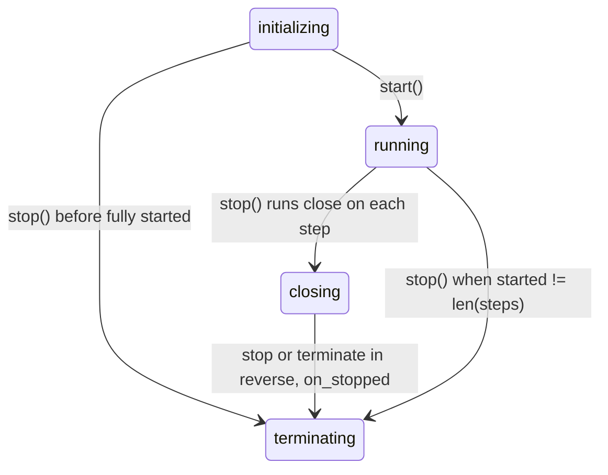
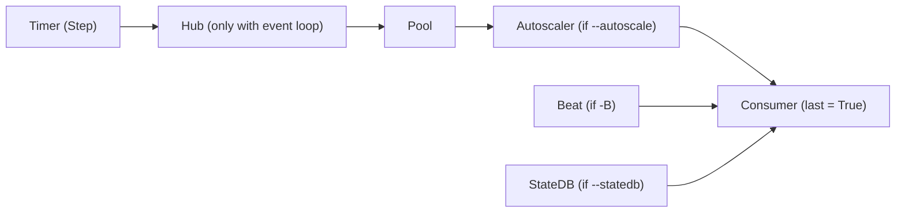
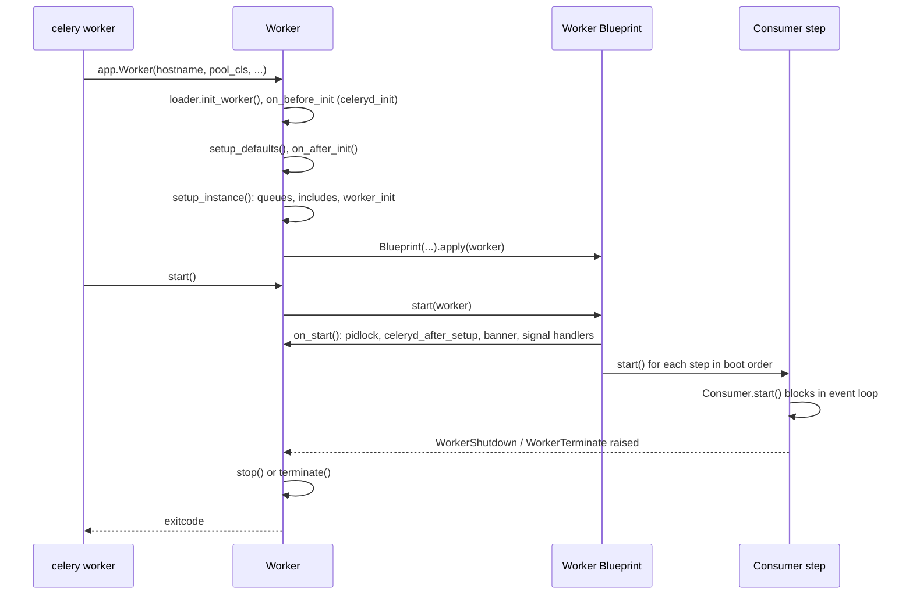

## Overview

A Celery worker is not one monolithic loop: it is a `WorkController` whose parts (timer, event loop hub, execution pool, embedded beat, state database and the message consumer) are each a *bootstep*. Bootsteps declare which other steps they need, and a `Blueprint` sorts them into a dependency graph, creates them in that order, starts them, and stops them in reverse. This keeps the worker embeddable without global side effects and lets users add or replace components through `app.steps`.

Sources: [celery/worker/worker.py:1-13](repo://celery/worker/worker.py#L1-L13), [celery/bootsteps.py:1-27](repo://celery/bootsteps.py#L1-L27)

There are two layers. `celery.worker.WorkController` is the bare, in-process worker. `celery.apps.worker.Worker` subclasses it to become the program that `celery worker` runs: it sets up logging, prints the banner, and installs the POSIX signal handlers that drive warm, cold and soft shutdown. The last worker step starts the consumer, which has its own blueprint of steps, described in [[Consumer and Task Requests]]; the pools behind the `Pool` step are covered in [[Concurrency Pools]].

Sources: [celery/apps/worker.py:1-8](repo://celery/apps/worker.py#L1-L8), [celery/apps/worker.py:91-104](repo://celery/apps/worker.py#L91-L104), [celery/worker/components.py:221-246](repo://celery/worker/components.py#L221-L246)

## Bootsteps

### Step classes and attributes

Every step class goes through the `StepType` metaclass, which gives it a default `name` equal to its qualified name (`module.ClassName`). That name is the key used in a blueprint's `steps` mapping and in `requires` references, so a step can name a dependency as a `'module:Class'` string without importing it.

Sources: [celery/bootsteps.py:266-285](repo://celery/bootsteps.py#L266-L285)

| Attribute | Default | Meaning |
| --- | --- | --- |
| `name` | qualified class name | Identity inside the blueprint. |
| `label` | `None` | Short name for logs and graphs (falls back to the class name). |
| `requires` | `()` | Steps that must be created and started before this one; all must live in the same blueprint. |
| `conditional` | `False` | Marks the step as enabled by a condition (drawn with a `∘` prefix in graphs). |
| `last` | `False` | Forces the step to run after every other step; reserved for the worker's `Consumer` and the consumer's `Evloop`. |
| `enabled` | `True` | Default answer of `include_if()`. |

Sources: [celery/bootsteps.py:288-353](repo://celery/bootsteps.py#L288-L353), [celery/bootsteps.py:39-62](repo://celery/bootsteps.py#L39-L62)

A step's `__init__(parent, **kwargs)` runs when the blueprint is applied and is the place to set default attributes on the parent (for example `w.pool = None`). `include(parent)` then calls `include_if(parent)`; only if it returns true does `create(parent)` run to build the actual component.

Sources: [celery/bootsteps.py:319-342](repo://celery/bootsteps.py#L319-L342)

### Step kinds

- `Step` is created but never started or stopped: `create()` runs once and nothing is added to `parent.steps`. `Timer` and `StateDB` are plain steps.
- `StartStopStep` keeps the object returned by `create()` in `self.obj` and appends itself to `parent.steps`, so the blueprint later calls its `start`, `stop`, `close` and `terminate`. By default these forward to `obj.start()`, `obj.stop()` and `obj.terminate()` (or `stop()` if the object has no `terminate`).
- `ConsumerStep` is a `StartStopStep` that requires the consumer's `Connection` step. On `start` it opens a channel on `c.connection`, calls `get_consumers(channel)` and starts consuming each; `stop` cancels the consumers and closes their channels, while `shutdown` only closes channels.

Sources: [celery/bootsteps.py:355-415](repo://celery/bootsteps.py#L355-L415)

### Building the dependency graph

`Blueprint.apply(parent, **kwargs)` resolves `self.types` (the class's `default_steps` plus any extra `steps` passed in) into step classes with `claim_steps()`, then `_finalize_steps()` orders them. `_firstpass()` turns every `requires` string into a class and walks the requirements transitively, so a dependency that was never listed is pulled in automatically. A `DependencyGraph` is built from `(step, step.requires)` pairs; if a step is marked `last`, an edge from it to every other node is added so the topological sort places it at the end. An unresolvable name surfaces as `KeyError('unknown bootstep: ...')`.

Sources: [celery/bootsteps.py:186-256](repo://celery/bootsteps.py#L186-L256), [celery/utils/graph.py:63-83](repo://celery/utils/graph.py#L63-L83)

Each class in the sorted order is instantiated with the parent and the keyword arguments passed to `apply`, recorded in `blueprint.order`, and then `include()` is called on each one. Because `include()` runs after every step has been constructed, a step's `create()` can rely on attributes that earlier steps' `__init__` methods set on the parent.

Sources: [celery/bootsteps.py:199-212](repo://celery/bootsteps.py#L199-L212)

### Starting and stopping a blueprint

`Blueprint.start(parent)` sets the state to `RUN`, calls the `on_start` callback, and then calls `start(parent)` on every entry of `parent.steps` in boot order, counting them in `self.started`. `send_all()` is the general broadcaster: it calls a named method on each step that has it, in reverse order by default, and either propagates or logs exceptions.

Sources: [celery/bootsteps.py:109-153](repo://celery/bootsteps.py#L109-L153)

`Blueprint.stop(parent, close=True, terminate=False)` is idempotent. If the blueprint never reached `RUN` or not every step was started, it only marks itself `TERMINATE` and sets `shutdown_complete`, because there is nothing safe to stop. Otherwise it runs `close()` (the `on_close` callback, then `close` on each step in forward order), moves to `CLOSE`, sends `stop` or `terminate` to every step in reverse order with errors logged instead of raised, calls `on_stopped`, and finally sets `TERMINATE` and `shutdown_complete`. `join()` waits on that event, which matters when running under green threads.

Sources: [celery/bootsteps.py:155-184](repo://celery/bootsteps.py#L155-L184)



Sources: [celery/bootsteps.py:92-97](repo://celery/bootsteps.py#L92-L97), [celery/bootsteps.py:155-176](repo://celery/bootsteps.py#L155-L176)

## The worker blueprint

### Default steps

`WorkController.Blueprint` names the seven worker-level steps. `setup_instance()` creates it with `steps=self.app.steps['worker']` (user additions) and the controller's `on_start`, `on_close` and `on_stopped` hooks, then calls `apply(self, **kwargs)` so every worker keyword argument (for example `beat=True` or `autoscale='10,3'`) reaches the step constructors.

Sources: [celery/worker/worker.py:76-88](repo://celery/worker/worker.py#L76-L88), [celery/worker/worker.py:129-139](repo://celery/worker/worker.py#L129-L139)

```python
    class Blueprint(bootsteps.Blueprint):
        """Worker bootstep blueprint."""

        name = 'Worker'
        default_steps = {
            'celery.worker.components:Hub',
            'celery.worker.components:Pool',
            'celery.worker.components:Beat',
            'celery.worker.components:Timer',
            'celery.worker.components:StateDB',
            'celery.worker.components:Consumer',
            'celery.worker.autoscale:WorkerComponent',
        }
```

Sources: [celery/worker/worker.py:76-88](repo://celery/worker/worker.py#L76-L88)



Sources: [celery/worker/components.py:32-99](repo://celery/worker/components.py#L32-L99), [celery/worker/components.py:101-178](repo://celery/worker/components.py#L101-L178), [celery/worker/components.py:181-246](repo://celery/worker/components.py#L181-L246), [celery/worker/autoscale.py:31-58](repo://celery/worker/autoscale.py#L31-L58)

### Component steps

| Step | Kind | Included when | What `create()` does |
| --- | --- | --- | --- |
| `Timer` | `Step` | always | With the event loop, a kombu `Timer(max_interval=10.0)` driven by the hub; otherwise `worker_timer` or the pool's own `Timer` class, ticking at `worker_timer_precision`. |
| `Hub` | `StartStopStep`, requires `Timer` | `w.use_eventloop` | Reuses or creates the kombu event loop (the transport's `requires_hub` if set) and replaces the app clock mutex and billiard's `pool.Lock` with `DummyLock`. |
| `Pool` | `StartStopStep`, requires `Hub` | always | Instantiates `w.pool_cls` with concurrency, time limits, max tasks/memory per child and scheduling strategy. |
| `Autoscaler` | `StartStopStep`, requires `Pool` | `--autoscale` given | Builds `worker_autoscaler`; with the event loop it is driven by `hub.call_repeatedly` instead of a thread. |
| `Beat` | `StartStopStep`, conditional | `beat=True` (`-B`) | Starts `celery.beat.EmbeddedService`; refuses eventlet/gevent pools with `ImproperlyConfigured`. |
| `StateDB` | `Step` | `worker_state_db` set | Opens `state.Persistent` and registers its `save` with `atexit`. |
| `Consumer` | `StartStopStep`, `last = True` | always | Instantiates `worker_consumer` with `w.process_task` as the task callback. |

Sources: [celery/worker/components.py:32-99](repo://celery/worker/components.py#L32-L99), [celery/worker/components.py:181-246](repo://celery/worker/components.py#L181-L246), [celery/worker/autoscale.py:31-58](repo://celery/worker/autoscale.py#L31-L58)

The `Hub` step's `start` only touches `w.hub.poller` so the poller exists before `asynloop` runs, since the loop no longer resets the hub on exit; `stop` and `terminate` close the hub. Because everything then runs on one thread, the locks it swaps for `DummyLock` would only add overhead.

Sources: [celery/worker/components.py:56-98](repo://celery/worker/components.py#L56-L98)

The `Pool` step parses `--autoscale` as `"max,min"` into `w.max_concurrency` and `w.min_concurrency`, and the pool starts with `min_concurrency` processes. When the event loop is used (and not on Windows) the pool is not threaded: a `LaxBoundedSemaphore` of the pool size is created, `max_restarts` is set to 100, and, if `worker_pool_putlocks` is on and the pool `uses_semaphore`, `w.process_task` becomes `_process_task_sem`, which acquires the semaphore before handing a request to the pool. `_process_task` itself calls `req.execute_using_pool(self.pool)` and releases the semaphore if the request turns out to be revoked.

Sources: [celery/worker/components.py:117-178](repo://celery/worker/components.py#L117-L178), [celery/worker/worker.py:220-231](repo://celery/worker/worker.py#L220-L231)

The `Consumer` step computes the initial prefetch count as `max_concurrency` (or `concurrency`) multiplied by `worker_prefetch_multiplier`, and passes the pool, timer, hub, `ready_callback` and the controller itself to the consumer. Its `start` calls `Consumer.start()`, which loops over the consumer blueprint and blocks for the life of the worker, which is why it must be last.

Sources: [celery/worker/components.py:221-246](repo://celery/worker/components.py#L221-L246), [celery/worker/consumer/consumer.py:366-383](repo://celery/worker/consumer/consumer.py#L366-L383)

When `asynloop` starts, it calls `controller.register_with_event_loop(hub)`, which uses `send_all` to call `register_with_event_loop` on every worker step that defines it: the `Pool` step registers the pool's file descriptors and the `Autoscaler` adds `maybe_scale` to `on_task_message` and to a repeating hub timer.

Sources: [celery/worker/loops.py:50-64](repo://celery/worker/loops.py#L50-L64), [celery/worker/worker.py:214-218](repo://celery/worker/worker.py#L214-L218), [celery/worker/autoscale.py:50-54](repo://celery/worker/autoscale.py#L50-L54)

## Creating a WorkController

`WorkController.__init__` resolves the node name with `default_nodename`, records `startup_time`, calls `app.loader.init_worker()`, and then runs four phases: `on_before_init`, `setup_defaults`, `on_after_init` and `setup_instance(**prepare_args(**kwargs))`. The `on_*` and `prepare_args` methods are empty hooks for subclasses such as the program `Worker`.

Sources: [celery/worker/worker.py:90-148](repo://celery/worker/worker.py#L90-L148), [celery/worker/worker.py:195-196](repo://celery/worker/worker.py#L195-L196)

`setup_defaults` merges each keyword argument with its setting through `app.either(setting, *values)`: an explicit argument wins, otherwise the configuration value applies. Deprecated argument names (`pool_cls`, `state_db`, `task_time_limit`, `scheduler_cls`) are still accepted as fallbacks.

Sources: [celery/worker/worker.py:351-410](repo://celery/worker/worker.py#L351-L410)

| Attribute | Setting | Default |
| --- | --- | --- |
| `concurrency` | `worker_concurrency` | `None`, then `cpu_count()` (or 2) |
| `pool_cls` | `worker_pool` | `'prefork'` |
| `consumer_cls` | `worker_consumer` | `'celery.worker.consumer:Consumer'` |
| `timer_cls`, `timer_precision` | `worker_timer`, `worker_timer_precision` | pool's timer, `1.0` |
| `autoscaler_cls` | `worker_autoscaler` | `'celery.worker.autoscale:Autoscaler'` |
| `pool_putlocks`, `pool_restarts` | `worker_pool_putlocks`, `worker_pool_restarts` | `True`, `False` |
| `statedb` | `worker_state_db` | unset |
| `prefetch_multiplier` | `worker_prefetch_multiplier` | `4` |
| `time_limit`, `soft_time_limit` | `task_time_limit`, `task_soft_time_limit` | unset |
| `max_tasks_per_child`, `max_memory_per_child` | `worker_max_tasks_per_child`, `worker_max_memory_per_child` | unset |
| `worker_lost_wait` | `worker_lost_wait` | `10.0` |
| `task_events` | `worker_send_task_events` | `False` |

Sources: [celery/worker/worker.py:372-410](repo://celery/worker/worker.py#L372-L410), [celery/worker/worker.py:108-113](repo://celery/worker/worker.py#L108-L113), [celery/app/defaults.py:325-374](repo://celery/app/defaults.py#L325-L374)

`setup_instance` then does the work that has side effects, in this order:

Sources: [celery/worker/worker.py:101-107](repo://celery/worker/worker.py#L101-L107)

1. `setup_queues` selects the `-Q` queues and deselects the `-X` queues in `app.amqp.queues`, raising `ImproperlyConfigured` for a name missing from `task_queues`, and adds the worker's direct queue when `worker_direct` is enabled.
2. `setup_includes` imports `--include` modules and rewrites `app.conf.include` to cover every module that defines a registered task, so the modules are re-imported if the process is exec'ed.
3. Concurrency falls back to `cpu_count()`, and `use_eventloop` is decided by `should_use_eventloop()`: true only when no green-thread library has patched the environment, the transport implements asynchronous I/O, and the platform is not Windows.
4. The `worker_init` signal is sent, `pool_cls` is resolved with `concurrency.get_implementation`, `on_init_blueprint()` runs, and the blueprint is created and applied.

Sources: [celery/worker/worker.py:101-139](repo://celery/worker/worker.py#L101-L139), [celery/worker/worker.py:167-193](repo://celery/worker/worker.py#L167-L193), [celery/worker/worker.py:239-242](repo://celery/worker/worker.py#L239-L242)

`app.WorkController` and `app.Worker` are subclasses bound to the app through `subclass_with_self`, so `app.WorkController()` builds an embedded worker with no signal handlers. The `celery graph bootsteps` command uses exactly that to draw the worker blueprint, optionally joined to the consumer blueprint with `Blueprint.connect_with`.

Sources: [celery/app/base.py:1430-1446](repo://celery/app/base.py#L1430-L1446), [celery/bin/graph.py:20-30](repo://celery/bin/graph.py#L20-L30), [celery/bootsteps.py:214-216](repo://celery/bootsteps.py#L214-L216)

## Startup through the worker program

The `celery worker` command handles `--detach`, drops privileges, builds `app.Worker(...)` with node-formatted `pidfile` and `statedb` paths, calls `worker.start()`, and exits with `worker.exitcode`. Command-line flags are covered in [[Command-Line Interface]].

Sources: [celery/bin/worker.py:307-371](repo://celery/bin/worker.py#L307-L371)

`Worker` fills in the hooks: `on_before_init` applies `trace.setup_worker_optimizations`, sends `celeryd_init` (useful for per-node configuration) and runs `check_privileges` against `accept_content`; `on_after_init` reads `worker_redirect_stdouts` and colour options; `on_init_blueprint` configures logging and finalizes the app before steps are created.

Sources: [celery/apps/worker.py:94-126](repo://celery/apps/worker.py#L94-L126)



Sources: [celery/bin/worker.py:358-368](repo://celery/bin/worker.py#L358-L368), [celery/worker/worker.py:90-139](repo://celery/worker/worker.py#L90-L139), [celery/worker/worker.py:201-212](repo://celery/worker/worker.py#L201-L212), [celery/apps/worker.py:128-147](repo://celery/apps/worker.py#L128-L147)

`Worker.on_start` first creates the pidfile lock through `WorkController.on_start`, sends `celeryd_after_setup` (where queues can still be changed after `-Q` was applied), purges queues if `--purge` was given, prints the banner unless `--quiet`, sets the process title to `-active-`, installs the signal handlers, and redirects stdout and stderr into the logger unless custom logging is in place. When the consumer becomes ready, `on_consumer_ready` sends `worker_ready` and logs `<hostname> ready.`.

Sources: [celery/apps/worker.py:128-182](repo://celery/apps/worker.py#L128-L182), [celery/worker/worker.py:150-152](repo://celery/worker/worker.py#L150-L152)

## Shutdown and signals

### Warm and cold shutdown

`WorkController.start()` wraps `blueprint.start()`. A `WorkerTerminate` leads to `terminate()` (cold shutdown); any other `SystemExit`, including `WorkerShutdown`, leads to `stop(exitcode=exc.code)` (warm shutdown); an unexpected exception is logged as `Unrecoverable error` and `KeyboardInterrupt` stops with `EX_FAILURE`.

Sources: [celery/worker/worker.py:201-212](repo://celery/worker/worker.py#L201-L212), [celery/exceptions.py:271-279](repo://celery/exceptions.py#L271-L279)

Both paths first call `signal_consumer_close()` so no further messages are taken, then `_shutdown(warm=...)`, which runs `blueprint.stop(self, terminate=not warm)` and `blueprint.join()` under a 5 second default socket timeout. When called from inside a signal handler, the blueprint is only stopped there if the pool is `signal_safe`. `stop()` also sends the `worker_shutdown` signal. The worker's blueprint callbacks then run in order: `on_close` calls `app.loader.shutdown_worker()`, and `on_stopped` stops the timer, shuts down the consumer blueprint and releases the pidfile lock.

Sources: [celery/worker/worker.py:244-267](repo://celery/worker/worker.py#L244-L267), [celery/worker/worker.py:157-165](repo://celery/worker/worker.py#L157-L165), [celery/worker/consumer/consumer.py:188-189](repo://celery/worker/consumer/consumer.py#L188-L189)

### From signal to exception

Signal handlers do not stop the worker directly. `_shutdown_handler` installs a function that, in the main process, runs an optional callback, prints `worker: Warm shutdown (MainProcess)` or `Cold`, and sends `worker_shutting_down`; in every process it then sets `state.should_stop` (warm) or `state.should_terminate` (cold) to the exit code. The event loops and `Consumer.start` call `state.maybe_shutdown()` on every iteration, which turns those flags into exceptions that unwind to `WorkController.start()`.

Sources: [celery/apps/worker.py:288-316](repo://celery/apps/worker.py#L288-L316), [celery/worker/loops.py:84-87](repo://celery/worker/loops.py#L84-L87), [celery/worker/consumer/consumer.py:366-369](repo://celery/worker/consumer/consumer.py#L366-L369)

```python
def maybe_shutdown():
    """Shutdown if flags have been set."""
    if should_terminate is not None and should_terminate is not False:
        raise WorkerTerminate(should_terminate)
    elif should_stop is not None and should_stop is not False:
        raise WorkerShutdown(should_stop)
```

Sources: [celery/worker/state.py:88-93](repo://celery/worker/state.py#L88-L93)

### Installed handlers

`install_platform_tweaks` installs the handlers from `Worker.on_start`. The SIGHUP restart handler is only installed when stdout is not a terminal, so closing a terminal window does not restart the worker into the background.

Sources: [celery/apps/worker.py:254-274](repo://celery/apps/worker.py#L254-L274)

| Signal | Handler | Effect |
| --- | --- | --- |
| `SIGTERM` | `install_worker_term_handler` | Warm shutdown with `EX_OK`; cold shutdown via `on_cold_shutdown` if billiard's `REMAP_SIGTERM` is `"SIGQUIT"`. |
| `SIGINT` | `install_worker_int_handler` | Warm shutdown with `EX_FAILURE`; `on_SIGINT` re-binds SIGINT to the cold handler so a second Ctrl+C is a cold shutdown. |
| `SIGQUIT` | `install_worker_term_hard_handler` | Cold shutdown via `on_cold_shutdown` with `EX_FAILURE`. |
| `SIGHUP` | `install_worker_restart_handler` | Registers an `atexit` re-exec of `sys.argv` and sets `should_stop = EX_OK`; on macOS only a warning is printed. |
| `SIGUSR1` | `install_cry_handler` | Dumps the stack of every thread (not on PyPy). |
| `SIGUSR2` | `install_rdb_handler` | Opens a remote debugger at the current frame, only if `CELERY_RDBSIG` is set. |

Sources: [celery/apps/worker.py:433-523](repo://celery/apps/worker.py#L433-L523)

### Cold and soft shutdown

`on_cold_shutdown` runs inside the cold handler. It re-binds SIGINT and SIGQUIT (and SIGTERM when remapped) to `during_soft_shutdown`, then calls `worker.wait_for_soft_shutdown()`, which sleeps `worker_soft_shutdown_timeout` seconds if it is positive and requests are active (or always, with `worker_enable_soft_shutdown_on_idle`). Afterwards it cancels the task consumer so requeued messages are not redelivered to this worker, calls `consumer.cancel_active_requests()`, sets `state.should_terminate`, and stops the pool so tasks that finished can still run `on_success()`.

Sources: [celery/apps/worker.py:369-430](repo://celery/apps/worker.py#L369-L430), [celery/worker/worker.py:412-435](repo://celery/worker/worker.py#L412-L435)

A signal that arrives during that soft-shutdown wait hits `during_soft_shutdown`, which installs `on_hard_shutdown` for SIGINT and SIGQUIT and cancels the unacknowledged requests, while still letting the wait finish. Any further signal raises `WorkerTerminate(EX_FAILURE)` from `on_hard_shutdown`.

Sources: [celery/apps/worker.py:319-366](repo://celery/apps/worker.py#L319-L366)

> [!NOTE]
> Soft shutdown is off by default (`worker_soft_shutdown_timeout` is `0.0`). Enabling it gives running tasks a bounded grace period before the cold shutdown cancels and requeues them, which is useful together with `acks_late`.

Sources: [celery/app/defaults.py:332-333](repo://celery/app/defaults.py#L332-L333), [celery/worker/worker.py:412-435](repo://celery/worker/worker.py#L412-L435)

## Extending the worker with custom bootsteps

`Celery.__init__` creates `app.steps` as a `defaultdict(set)`. Adding a step class to `app.steps['worker']` (or `app.steps['consumer']` for the consumer blueprint) makes `setup_instance` pass it into the blueprint next to the default steps, and its `requires` place it in the graph. A custom step can set `include_if()` to enable itself from worker arguments, attach state to the controller in `__init__`, and return a service object from `create()` whose `start`/`stop` the blueprint manages.

Sources: [celery/app/base.py:305-307](repo://celery/app/base.py#L305-L307), [celery/app/base.py:365-372](repo://celery/app/base.py#L365-L372), [celery/worker/worker.py:133-139](repo://celery/worker/worker.py#L133-L139), [celery/bootsteps.py:319-383](repo://celery/bootsteps.py#L319-L383)

```python
from celery import Celery, bootsteps

class InfoStep(bootsteps.StartStopStep):
    requires = {'celery.worker.components:Pool'}

    def start(self, worker):
        print('pool ready:', worker.pool)

app = Celery('proj')
app.steps['worker'].add(InfoStep)
```

Sources: [celery/bootsteps.py:355-383](repo://celery/bootsteps.py#L355-L383), [celery/worker/components.py:101-115](repo://celery/worker/components.py#L101-L115)

> [!WARNING]
> Only one step per blueprint may set `last = True`; the worker's `Consumer` already does. A step that also has to run after the consumer has started should be a consumer step instead, and the consumer's `Tasks`, `Control` and other steps are listed in [[Consumer and Task Requests]].

Sources: [celery/bootsteps.py:310-314](repo://celery/bootsteps.py#L310-L314), [celery/worker/consumer/consumer.py:171-186](repo://celery/worker/consumer/consumer.py#L171-L186)

`WorkController.stats()` merges `info()` (total task counts, pid, clock, uptime) with the `info()` of every worker and consumer step plus `rusage`, which is what the `stats` remote control command returns (see [[Remote Control and Inspection]]). `reload()` re-imports task modules, refreshes the consumer's strategies and rate limits, and restarts the pool where the pool supports it.

Sources: [celery/worker/worker.py:269-334](repo://celery/worker/worker.py#L269-L334)
