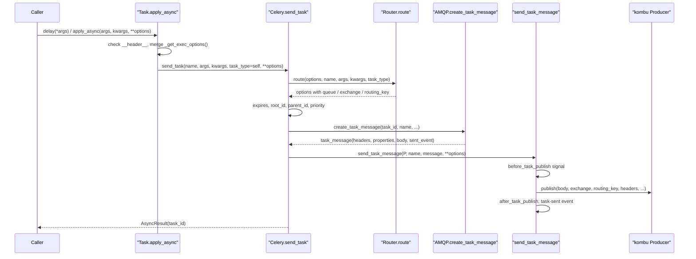

## Overview

Calling a task means publishing a message to the broker. A worker consumes the message and executes the task. The client side has three layers. `Task.apply_async` (and its shortcut `delay`) applies task defaults and argument checks. `Celery.send_task` resolves routing, ids and expiry. The `AMQP` class in `celery/app/amqp.py` builds the protocol message and publishes it through a Kombu producer. The `Router` in `celery/app/routes.py` turns the `task_routes` setting into a queue, exchange and routing key for each message. Task definitions are covered in [[Tasks]]; what happens after the worker receives the message is covered in [[Consumer and Task Execution]].

Sources: [celery/app/task.py:523-535](repo://celery/app/task.py#L523-L535), [celery/app/base.py:846-862](repo://celery/app/base.py#L846-L862), [celery/app/amqp.py:225-271](repo://celery/app/amqp.py#L225-L271), [celery/app/routes.py:56-76](repo://celery/app/routes.py#L56-L76)

## Publishing Flow

### End-to-end sequence



Sources: [celery/app/task.py:659-708](repo://celery/app/task.py#L659-L708), [celery/app/base.py:930-1041](repo://celery/app/base.py#L930-L1041), [celery/app/amqp.py:506-606](repo://celery/app/amqp.py#L506-L606)

### Task.apply_async and delay

`delay(*args, **kwargs)` is `apply_async(args, kwargs)` with no options. `apply_async` first raises `ValueError` if `soft_time_limit` exceeds `time_limit`. When `typing` is enabled it calls the generated `__header__` checker, so a wrong number of arguments fails on the client. It computes a `shadow` name through `shadow_name`, merges the cached execution options (queue, routing_key, exchange, priority, serializer and more) under the caller's options, and always sets `ignore_result`. With `task_always_eager` it runs the task locally through `apply`. Otherwise it calls `app.send_task` with `task_type=self` and `result_cls=self.AsyncResult`.

Sources: [celery/app/task.py:523-535](repo://celery/app/task.py#L523-L535), [celery/app/task.py:659-708](repo://celery/app/task.py#L659-L708)

### Celery.send_task

`send_task` sends by name, so it also works for tasks that are not registered locally. Its steps:

Sources: [celery/app/base.py:846-862](repo://celery/app/base.py#L846-L862)

1. Generate `task_id` with `uuid()` if none is given. Warn with `AlwaysEagerIgnored` when `task_always_eager` is set, because `send_task` never runs tasks eagerly.
2. If `task_type` is missing, look the name up in `self._tasks` without finalizing the app and merge that task's non-`None` exec options as defaults.
3. Pop `time_limit`, `soft_time_limit` and `expires` from `options` so they reach `create_task_message` only once. The sentinel `_OMITTED` tells "not given" apart from an explicit `None`.
4. Call `router.route(options, route_name or name, args, kwargs, task_type)`.
5. Convert `expires` to seconds for the AMQP `expiration` property. A date in the past is clamped to 0 with a warning.
6. Inherit `root_id` and `parent_id` from `current_worker_task`, and its priority when `task_inherit_parent_priority` is enabled.
7. Build the message with `amqp.create_task_message`, acquire a producer with `producer_or_acquire`, call `backend.on_task_call` unless results are ignored, then call `amqp.send_task_message`.
8. Return `result_cls(task_id)` with `ignored` set, and add it to the parent's trail when `add_to_parent` is true.

Sources: [celery/app/base.py:863-932](repo://celery/app/base.py#L863-L932), [celery/app/base.py:968-1041](repo://celery/app/base.py#L968-L1041)

### Native delayed delivery

When a call has an `eta` or `countdown` and `detect_quorum_queues` reports quorum queues on the transport, `send_task` rewrites the destination for native delayed delivery. For non-direct exchanges it converts the ETA to a countdown, computes a routing key with `calculate_routing_key`, and publishes to the `celery_delayed_27` topic exchange. For direct exchanges it logs a warning that the worker may block until the ETA.

Sources: [celery/app/base.py:934-966](repo://celery/app/base.py#L934-L966)

## Task Message Protocols

### Protocol selection

`AMQP.__init__` maps protocol numbers to builder methods, and the cached `create_task_message` property picks one from `task_protocol` (default 2). Each builder returns a `task_message` namedtuple of `headers`, `properties`, `body` and `sent_event`.

Sources: [celery/app/amqp.py:32-33](repo://celery/app/amqp.py#L32-L33), [celery/app/amqp.py:257-271](repo://celery/app/amqp.py#L257-L271), [celery/app/defaults.py:295-295](repo://celery/app/defaults.py#L295-L295)

### Protocol 2 (as_task_v2)

`as_task_v2` validates that `args` is a list or tuple and `kwargs` is a mapping. It converts `countdown` and numeric `expires` into timezone-aware datetimes using `app.now()` and `app.timezone`, then into ISO 8601 strings. It truncates `argsrepr`/`kwargsrepr` with `saferepr` and defaults `root_id` to the task id. Task metadata goes into message headers, so a worker can route, log and revoke without deserializing the body. The body is the tuple `(args, kwargs, embed)`, where `embed` carries the canvas links.

Sources: [celery/app/amqp.py:326-418](repo://celery/app/amqp.py#L326-L418)

```python
        headers = {
            'lang': 'py',
            'task': name,
            'id': task_id,
            'shadow': shadow,
            'eta': eta,
            'expires': expires,
            'group': group_id,
            'group_index': group_index,
            'retries': retries,
            'timelimit': [time_limit, soft_time_limit],
            'root_id': root_id,
            'parent_id': parent_id,
            'argsrepr': argsrepr,
            'kwargsrepr': kwargsrepr,
            'origin': origin or anon_nodename(),
            'ignore_result': ignore_result,
            'replaced_task_nesting': replaced_task_nesting,
            'stamped_headers': stamped_headers,
            'stamps': stamps,
        }
```

Sources: [celery/app/amqp.py:371-391](repo://celery/app/amqp.py#L371-L391)

| Part | Content |
| --- | --- |
| `headers` | Task name, id, eta/expires, group, retries, timelimit, root/parent ids, reprs, origin, stamps |
| `properties` | `correlation_id` (the task id) and `reply_to` |
| `body` | `(args, kwargs, embed)`, where `embed` holds `callbacks`, `errbacks`, `chain` and `chord` |
| `sent_event` | Fields for the `task-sent` event, only when `task_send_sent_event` is enabled |

Sources: [celery/app/amqp.py:393-418](repo://celery/app/amqp.py#L393-L418)

### Protocol 1 (as_task_v1)

`as_task_v1` is the legacy format. It sends empty headers and puts everything (task name, id, args, kwargs, eta, expires, `utc`, callbacks, errbacks, `timelimit`, `taskset`, chord) into a single body dictionary. It does not support root/parent ids, shadow names or stamping.

Sources: [celery/app/amqp.py:420-478](repo://celery/app/amqp.py#L420-L478)

## Queues and Exchanges

### The Queues mapping

`Queues` is a `dict` of queue name to `kombu.Queue`. Entries can be `Queue` objects or dicts, which `add_compat` converts with `Queue.from_dict`, using the name as routing key when none is given. `_add` fills in the default exchange and routing key and applies `x-max-priority` from `task_queue_max_priority`. Looking up an unknown name calls `__missing__`. When `create_missing` is on, `new_missing` creates a queue with an exchange of the same name; the exchange type comes from `task_create_missing_queue_exchange_type`, and `x-queue-type` is set for quorum queues. `select`, `deselect` and `select_add` maintain the subset a worker consumes from (the `-Q` option); the other queues are used only for routing.

Sources: [celery/app/amqp.py:41-143](repo://celery/app/amqp.py#L41-L143), [celery/app/amqp.py:144-222](repo://celery/app/amqp.py#L144-L222)

### AMQP.Queues and defaults

`AMQP.Queues` builds the mapping from configuration. When `task_queues` is empty it creates a single queue named by `task_default_queue` (default `celery`) on the default exchange, with quorum arguments when `task_default_queue_type` is `quorum`. `default_exchange` is `Exchange(task_default_exchange, task_default_exchange_type)`, and `queues`, `default_queue`, `router` and `producer_pool` are cached properties. The producer pool comes from `kombu.pools.producers` for `connection_for_write()`.

Sources: [celery/app/amqp.py:273-306](repo://celery/app/amqp.py#L273-L306), [celery/app/amqp.py:608-651](repo://celery/app/amqp.py#L608-L651)

| Setting | Default | Used by |
| --- | --- | --- |
| `task_default_queue` | `celery` | Default queue and the fallback route |
| `task_default_queue_type` | `classic` | Quorum arguments for the default queue |
| `task_default_exchange_type` | `direct` | `AMQP.default_exchange` |
| `task_create_missing_queues` | `True` | `Queues.__missing__` and `Router` |
| `task_create_missing_queue_type` | `classic` | `Queues.new_missing` |
| `task_default_delivery_mode` | `2` (persistent) | `send_task_message` |
| `task_protocol` | `2` | `create_task_message` |
| `task_publish_retry` / `task_publish_retry_policy` | `True` / policy dict | `producer.publish` retry |
| `task_send_sent_event` | `False` | `task-sent` event |

Sources: [celery/app/defaults.py:277-314](repo://celery/app/defaults.py#L277-L314)

## Routing

### Router.route

`Router.route` first expands a `queue` already present in the options: `expand_destination` replaces a queue name with the `Queue` object from `task_queues`, or raises `QueueNotFound`. It then asks each router in turn through `lookup_route` and uses the first non-`None` answer. The route is merged with `lpmerge(route, options)`, so explicit non-`None` call options override values from the route. If neither the route nor the options name a queue, `task_default_queue` is used.

Sources: [celery/app/routes.py:56-111](repo://celery/app/routes.py#L56-L111), [celery/utils/collections.py:47-55](repo://celery/utils/collections.py#L47-L55)

### Preparing task_routes

`prepare` normalizes `task_routes` into a list. Dicts and lists of pairs become `MapRoute` instances, strings become lazily imported routers via `expand_router_string`, and callables are used as they are. `MapRoute` matches exact names first, then glob patterns (translated with `fnmatch`) and compiled regexes in order. A plain string value means a queue name. `AMQP.flush_routes` re-runs `prepare` whenever `task_routes` changes in the configuration.

Sources: [celery/app/routes.py:26-53](repo://celery/app/routes.py#L26-L53), [celery/app/routes.py:114-136](repo://celery/app/routes.py#L114-L136), [celery/app/amqp.py:308-315](repo://celery/app/amqp.py#L308-L315), [celery/app/amqp.py:659-663](repo://celery/app/amqp.py#L659-L663)

```python
    task_routes = ([
        ('feed.tasks.*', {'queue': 'feeds'}),
        ('web.tasks.*', {'queue': 'web'}),
        (re.compile(r'(video|image)\.tasks\..*'), {'queue': 'media'}),
    ],)
```

Sources: [docs/userguide/routing.rst:56-60](repo://docs/userguide/routing.rst#L56-L60)

### Router functions

A router is any callable with the signature `(name, args, kwargs, options, task=None)` that returns a route dict or `None`. `query_router` also supports pre-4.0 router objects with a `route_for_task` method. A returned `queue` key is expanded with that queue's declaration, so a router can override only the routing key of a topic exchange.

Sources: [celery/app/routes.py:106-111](repo://celery/app/routes.py#L106-L111), [docs/userguide/routing.rst:673-677](repo://docs/userguide/routing.rst#L673-L677)

```python
    def route_task(name, args, kwargs, options, task=None, **kw):
            if name == 'myapp.tasks.compress_video':
                return {'exchange': 'video',
                        'exchange_type': 'topic',
                        'routing_key': 'video.compress'}
```

Sources: [docs/userguide/routing.rst:673-677](repo://docs/userguide/routing.rst#L673-L677)

## Producers and send_task_message

### Building the sender

`_create_task_sender` runs once, when `send_task_message` is first accessed. It captures configuration defaults (publish retry and policy, delivery mode, default exchange and routing key, serializer, compression) and the receiver lists of `before_task_publish`, `after_task_publish` and the deprecated `task_sent`. The returned closure merges extra `headers` into the message headers and remaining keyword arguments into the properties.

Sources: [celery/app/amqp.py:485-519](repo://celery/app/amqp.py#L485-L519)

### Resolving the destination

With no `queue` and no `exchange` the sender uses `amqp.default_queue`, and a queue name is looked up in `queues`. The delivery mode comes from the queue's exchange, else from `task_default_delivery_mode`. For a direct exchange without both an exchange and a routing key, it publishes to the anonymous exchange `''` with the queue name as routing key, which bypasses bindings. Otherwise the queue's exchange name and routing key are used. The target queue is declared on publish unless it is a `Broadcast` queue.

Sources: [celery/app/amqp.py:521-556](repo://celery/app/amqp.py#L521-L556)

### Publishing and notifications

The sender sends `before_task_publish` (only if it has receivers), calls `producer.publish` with the serializer, compression, retry policy, delivery mode and headers, then sends `after_task_publish` and the legacy `task_sent`. When the message carries a `sent_event`, it adds queue, exchange and routing key and publishes a `task-sent` event through the app's event dispatcher on the same producer (see [[Events and Monitoring]] and [[Signals]]).

Sources: [celery/app/amqp.py:558-606](repo://celery/app/amqp.py#L558-L606)

### Producer acquisition

`producer_or_acquire` returns a `FallbackContext`: it uses the caller's producer if one is given, otherwise it acquires one from the pool with `broker_pool_acquire_timeout`. When the pool is exhausted, `_acquire_producer` turns Kombu's `LimitExceeded` into an `OperationalError` that suggests raising `broker_pool_limit`. Passing `connection=` to `send_task` creates a one-off `amqp.Producer(connection, auto_declare=False)` instead.

Sources: [celery/app/base.py:1162-1190](repo://celery/app/base.py#L1162-L1190), [celery/app/base.py:1022-1029](repo://celery/app/base.py#L1022-L1029)

> [!WARNING]
> Broker connection failures surface from `apply_async` as `kombu.exceptions.OperationalError`, because `send_task` publishes inside `P.connection._reraise_as_library_errors()`.

Sources: [celery/app/base.py:1025-1029](repo://celery/app/base.py#L1025-L1029), [celery/app/task.py:652-653](repo://celery/app/task.py#L652-L653)
