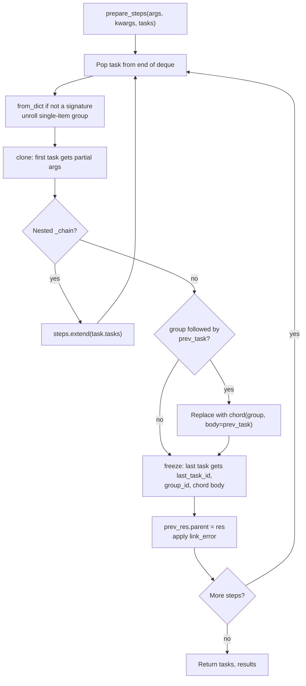

## Overview

The canvas module (`celery/canvas.py`) describes task invocations as data so they can be passed around, serialized into messages and combined into workflows. A `Signature` is a `dict` holding a task name, arguments and execution options. `_chain` (exposed as `chain`), `group`, `_chord` (exposed as `chord`), `chunks`, `xmap` and `xstarmap` are `Signature` subclasses that build on it. Workflows are carried out by message options (`link`, `link_error`, `chain`, `chord`, `group_id`) that the worker's tracer reads after each task, plus a few built-in tasks in `celery/app/builtins.py`. The Stamping API attaches custom headers to every signature in a workflow. Task execution itself is covered in [[Tasks]], and how chord results are tracked is covered in [[Result Backends]].

Sources: [celery/canvas.py:233-294](repo://celery/canvas.py#L233-L294), [celery/app/builtins.py:1-9](repo://celery/app/builtins.py#L1-L9)

## Signatures

### Structure

`Signature.__init__` accepts a task object or a task name. With a task object it stores the name and keeps the object in `_type`. The dict keys are `task`, `args` (a tuple), `kwargs`, `options` (extra keyword arguments are merged in), `subtask_type` and `immutable`. A dict argument is copied as-is, which is how a signature is rebuilt after deserialization. Properties such as `id`, `parent_id`, `root_id`, `args`, `kwargs` and `options` are `getitem_property` views into that dict, and `type` resolves the task from `app.tasks` on demand.

Sources: [celery/canvas.py:323-345](repo://celery/canvas.py#L323-L345), [celery/canvas.py:838-874](repo://celery/canvas.py#L838-L874)

### Creating signatures

`Task.signature`, `Task.s` and `Task.si` create signatures from a task; `si` sets `immutable=True`. The module-level `signature()` clones an existing signature or rebuilds one from a dict with `Signature.from_dict`, which uses `subtask_type` to pick the registered subclass from `Signature.TYPES`. Subclasses register with `@Signature.register_type()`. `maybe_signature` converts a dict to a signature, optionally clones it, and binds it to an app. The tracer uses it to turn serialized callbacks back into objects.

Sources: [celery/app/task.py:962-986](repo://celery/app/task.py#L962-L986), [celery/canvas.py:296-321](repo://celery/canvas.py#L296-L321), [celery/canvas.py:2395-2439](repo://celery/canvas.py#L2395-L2439)

### Calling and merging

`delay` and `apply_async` take partial arguments: positional args are prepended to the stored ones, kwargs are merged, and options override the stored options. `_merge` implements this. An immutable signature keeps its args and kwargs and only merges options, and keys in `_IMMUTABLE_OPTIONS` (`group_id`, `stamped_headers`) and stamped headers are never overwritten once set. `apply_async` calls `type.apply_async`, or falls back to `app.send_task` by name when the task is not registered locally. `apply` runs the task eagerly through `Task.apply`, and `__call__` calls the task in-process.

Sources: [celery/canvas.py:347-443](repo://celery/canvas.py#L347-L443), [celery/canvas.py:858-863](repo://celery/canvas.py#L858-L863)

### Cloning, setting options and freezing

`clone` builds a new signature with deep-copied options, so links on the original are not modified. `set` updates options in place and returns `self` for chaining. `freeze` fixes the task id before sending: it keeps an existing `options['task_id']` or assigns `_id`/`uuid()`, sets `root_id`, `parent_id`, `reply_to` (the app's `thread_oid`), `group_id` (only if not already set), `chord` and `group_index`, and returns an `AsyncResult`. Workflows freeze every member up front so result objects and parent links exist before any message is sent.

Sources: [celery/canvas.py:445-552](repo://celery/canvas.py#L445-L552)

## Callbacks and Errbacks

### link and link_error

`link(callback)` and `link_error(errback)` append to the `link` and `link_error` options through `append_to_list_option`, which skips duplicates. Both return the argument, not the signature. `on_error` is the chainable variant that returns `self`. The options become the message's `callbacks` and `errbacks`.

Sources: [celery/canvas.py:685-746](repo://celery/canvas.py#L685-L746), [celery/app/amqp.py:399-406](repo://celery/app/amqp.py#L399-L406)

### How the worker runs links

After a successful run the tracer calls `_dispatch_callbacks_and_chain`, which applies each callback with the return value prepended to its arguments. Several callbacks are published together as a `group`. Errbacks run from the backend's `mark_as_failure` path when `call_errbacks` is true, and are skipped for retries.

Sources: [celery/app/trace.py:426-473](repo://celery/app/trace.py#L426-L473), [celery/app/trace.py:242-262](repo://celery/app/trace.py#L242-L262), [celery/app/trace.py:599-601](repo://celery/app/trace.py#L599-L601)

## Chains

### Composition with the pipe operator

`Signature.__or__` builds a `_chain`: `task | task`, `task | chain` (flattened with `unchain_tasks`) and `task | group`, where a group with one member is unrolled by `maybe_unroll_group`. `_chain.__or__` has the upgrade rules. A chain ending in a group followed by a signature turns that group into a `chord` whose body is the signature. A chain ending in a chord pipes the new signature into the chord body. Two chains are joined by folding with `operator.or_`. `chain(...)` uses `__new__` to reduce its arguments with `|`, so `chain(a, b, c)` behaves exactly like `a | b | c`.

Sources: [celery/canvas.py:759-786](repo://celery/canvas.py#L759-L786), [celery/canvas.py:960-1006](repo://celery/canvas.py#L960-L1006), [celery/canvas.py:1371-1382](repo://celery/canvas.py#L1371-L1382)

### Running a chain

`_chain.apply_async` runs eagerly with `apply` when `task_always_eager` is set, and otherwise calls `run`. `run` calls `prepare_steps`, then publishes only the first task, passing the rest of the chain in the `chain` option. `_prepare_chain_from_options` builds that option with a `ChainMap`, so the shared options dict of a group is never mutated. With protocol 1 (`use_link`) tasks are linked with `link` instead.

Sources: [celery/canvas.py:1036-1094](repo://celery/canvas.py#L1036-L1094), [celery/canvas.py:877-931](repo://celery/canvas.py#L877-L931)

### prepare_steps



Sources: [celery/canvas.py:1120-1200](repo://celery/canvas.py#L1120-L1200), [celery/canvas.py:1201-1292](repo://celery/canvas.py#L1201-L1292)

`prepare_steps` walks the tasks from last to first, so the final task is frozen first and inherits `last_task_id`, `group_id` and the chord body. Each earlier result becomes the `parent` of the following one, which is how `res.parent.get()` reaches earlier steps. Nested chains are flattened into the deque. A group followed by another step is upgraded to a chord with that step as the body, and `app.backend.ensure_chords_allowed()` is checked. A chain-level `link_error` is added to every task and to chord bodies. The returned `tasks` list is in reverse order, so `run` pops the first task from the end, and the `chain` message option lists the remaining steps with the next step last.

Sources: [celery/canvas.py:1181-1292](repo://celery/canvas.py#L1181-L1292), [celery/app/trace.py:467-473](repo://celery/app/trace.py#L467-L473)

## Groups and Chords

### group

`group` stores its members in `kwargs['tasks']`. A generator is wrapped in `regen`, so it is consumed lazily. `apply_async` rejects `link` and `link_error` with `TypeError`, because a group has no single completion point; use a chord or link individual tasks. It fixes the group id with `_freeze_gid` (from `task_id` or a new UUID). `_prepared` recursively flattens nested groups and freezes each member with `group_id`, `root_id` and `group_index`. `_apply_tasks` publishes every member on one shared producer, counts the chord size with `_chord._descend`, calls `backend.set_chord_size` before the last member when the group is a chord header, and wires each result into a `barrier`. The return value is a `GroupResult`. `group | sig` creates a chord, and `skew` staggers countdowns across members.

Sources: [celery/canvas.py:1580-1650](repo://celery/canvas.py#L1580-L1650), [celery/canvas.py:1714-1833](repo://celery/canvas.py#L1714-L1833)

### chord

`_chord(header, body)` stores the header (normalized with `_maybe_group`) and body in kwargs under the task name `celery.chord`. `chord(header)(body)` passes the body at call time. `apply_async` clones the body with the call options and runs eagerly when `task_always_eager` is set; otherwise it calls `run`. `run` freezes the body with the header's group id, freezes the header tasks with `chord=body` via `_freeze_group_tasks`, registers the chord with `app.backend.apply_chord`, and then applies the header group. An empty header calls `body.delay([])` immediately. The body result's `parent` is the header `GroupResult`.

Sources: [celery/canvas.py:2064-2075](repo://celery/canvas.py#L2064-L2075), [celery/canvas.py:2153-2177](repo://celery/canvas.py#L2153-L2177), [celery/canvas.py:2226-2286](repo://celery/canvas.py#L2226-L2286)

### Chord links and freezing

`_chord.freeze` turns the header into a group, freezes it with `chord=self.body`, freezes the body, and attaches the header result as the root parent of the body's result chain. It raises `RuntimeError('Recursive result parents')` if it finds a cycle. `link` attaches callbacks to the body only. `link_error` always links the body. It links header tasks only when `task_allow_error_cb_on_chord_header` is enabled, and otherwise emits a `CPendingDeprecationWarning`. `chord | sig` pipes the new signature into the body.

Sources: [celery/canvas.py:2077-2125](repo://celery/canvas.py#L2077-L2125), [celery/canvas.py:2298-2341](repo://celery/canvas.py#L2298-L2341)

> [!NOTE]
> Chords need a result backend. Backends without native chord support fall back to `fallback_chord_unlock`, which schedules the `celery.chord_unlock` task.

Sources: [celery/backends/base.py:838-867](repo://celery/backends/base.py#L838-L867)

## Map and Chunk Primitives

### xmap and xstarmap

`_basemap` stores `task` and `it` in kwargs as an immutable signature. `xmap` targets `celery.map` and `xstarmap` targets `celery.starmap`. `apply_async` materializes the iterable with `list(it)` and routes by the wrapped task's name. The work runs sequentially inside one worker task, not in parallel. `Task.map` and `Task.starmap` are shortcuts.

Sources: [celery/canvas.py:1385-1433](repo://celery/canvas.py#L1385-L1433), [celery/app/task.py:993-1001](repo://celery/app/task.py#L993-L1001)

### chunks

`chunks(task, it, n)` splits an iterable into parts of size `n`. `group()` builds a `group` of `xstarmap` signatures, one per chunk produced by `_chunks`, and `apply_async` applies that group, so chunks run in parallel while each chunk runs sequentially. `Task.chunks(it, n)` is the shortcut.

Sources: [celery/canvas.py:1436-1472](repo://celery/canvas.py#L1436-L1472), [celery/app/task.py:988-991](repo://celery/app/task.py#L988-L991)

## Built-in Canvas Tasks

### Registered tasks

`celery/app/builtins.py` registers its tasks with `connect_on_app_finalize`, so every app gets them when it finalizes. They are created with `shared=False, lazy=False`.

Sources: [celery/app/builtins.py:12-98](repo://celery/app/builtins.py#L12-L98), [celery/app/builtins.py:101-186](repo://celery/app/builtins.py#L101-L186)

| Task | Role |
| --- | --- |
| `celery.backend_cleanup` | Calls `app.backend.cleanup()` to purge expired results |
| `celery.accumulate` | Returns its args (or one by `index`); used by `Task.replace` when replacing with a group |
| `celery.chord_unlock` | Polls a chord header for backends without native chords |
| `celery.map` / `celery.starmap` | Run a task over every item (`task(item)` / `task(*item)`) |
| `celery.chunks` | Calls `chunks.apply_chunks` |
| `celery.group` / `celery.chain` / `celery.chord` | Kept for backwards compatibility; `celery.chain` raises `NotImplementedError` |

Sources: [celery/app/builtins.py:12-98](repo://celery/app/builtins.py#L12-L98), [celery/app/builtins.py:101-186](repo://celery/app/builtins.py#L101-L186)

### chord_unlock

`unlock_chord` is bound, never stops retrying (`max_retries=None`), and retries every `result_chord_retry_interval`. It rebuilds the header `GroupResult` from serialized result tuples and retries while `deps.ready()` is false. Once the header is ready it joins the results, natively when supported, with `result_chord_join_timeout`, and calls `callback.delay(ret)`. A failed dependency or a failing callback is reported with `backend.chord_error_from_stack`, using a `ChordError` that names the culprit task.

Sources: [celery/app/builtins.py:36-98](repo://celery/app/builtins.py#L36-L98)

## Stamping

### StampingVisitor

`StampingVisitor` is an abstract visitor. Only `on_signature` must be implemented. The optional hooks are `on_group_start`/`on_group_end`, `on_chain_start`/`on_chain_end`, `on_chord_header_start`/`on_chord_header_end` (which delegate to the group hooks), `on_chord_body`, `on_callback` and `on_errback`. Each `on_*` start hook returns a dict of headers to apply.

Sources: [celery/canvas.py:119-229](repo://celery/canvas.py#L119-L229)

```python
class MyStampingVisitor(StampingVisitor):
    def on_signature(self, sig: Signature, **headers) -> dict:
        logger.critical(f"Visitor: Sig '{sig}' is stamped with: mystamp")
        return {"mystamp": "I am a stamp!"}
```

Sources: [examples/stamping/visitors.py:9-12](repo://examples/stamping/visitors.py#L9-L12)

### How stamps are applied

`Signature.stamp(visitor, append_stamps, **headers)` stamps links first via `stamp_links`, which calls `on_callback`/`on_errback` for each link and stamps it without copying the parent's own stamps. It then asks `on_signature` for headers and merges them with `_stamp_headers`. The result is written into options with `set`, including a `stamped_headers` list of stamp keys. With `append_stamps=True`, duplicate keys are collected into lists by `_merge_dictionaries`; otherwise the visitor's value wins. `group.stamp`, `_chain.stamp` and `_chord.stamp` call their start hook, stamp every member (lazily for `regen` generators via `_stamp_regen_task`), call their end hook, and for chords stamp the body using `on_chord_body`.

Sources: [celery/canvas.py:554-634](repo://celery/canvas.py#L554-L634), [celery/canvas.py:636-683](repo://celery/canvas.py#L636-L683), [celery/canvas.py:1107-1118](repo://celery/canvas.py#L1107-L1118), [celery/canvas.py:1668-1689](repo://celery/canvas.py#L1668-L1689), [celery/canvas.py:2127-2151](repo://celery/canvas.py#L2127-L2151)

### Stamps in messages and requests

`as_task_v2` copies each header listed in `stamped_headers` from the options into a `stamps` header. On the worker, `Context.as_execution_options` puts them back into options, so retries keep their stamps. A task can read them from `self.request.stamps` and `self.request.stamped_headers`. Stamping fits well in `on_replace`, where the replacement signature can be stamped before it is sent.

Sources: [celery/app/amqp.py:370-391](repo://celery/app/amqp.py#L370-L391), [celery/app/task.py:190-195](repo://celery/app/task.py#L190-L195), [examples/stamping/tasks.py:13-23](repo://examples/stamping/tasks.py#L13-L23)

```python
class MonitoredTask(Task):
    def on_replace(self, sig: Signature):
        logger.warning(f"MonitoredTask: {sig}.stamp(MonitoringIdStampingVisitor())")
        sig.stamp(MonitoringIdStampingVisitor(), append_stamps=False)
        return super().on_replace(sig)
```

Sources: [examples/stamping/tasks.py:50-54](repo://examples/stamping/tasks.py#L50-L54)
