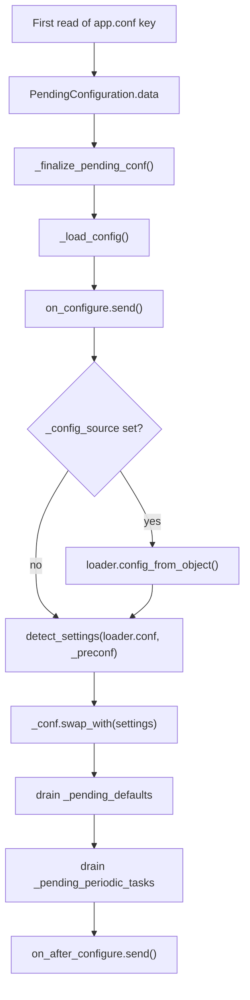
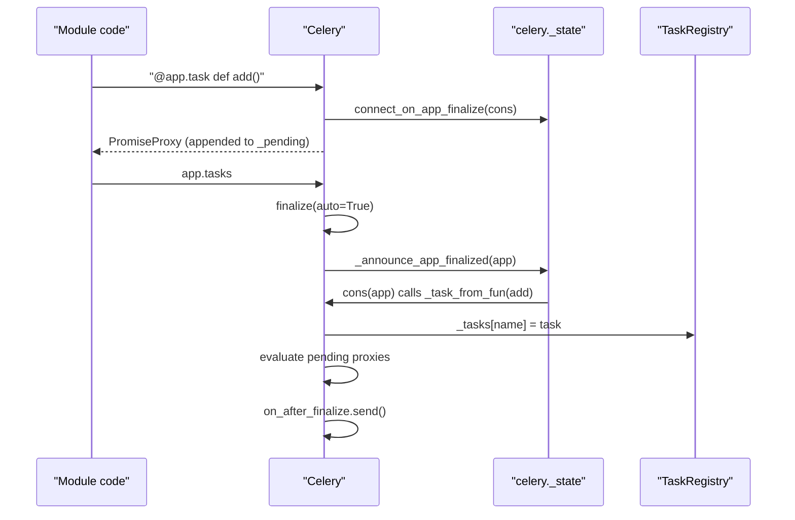

## Overview

Every Celery program, whether a client, a worker or beat, works through an instance of `celery.app.base.Celery`, usually called `app`. The app is the root object. It holds the configuration, the task registry and the loader, and it builds the messaging, result, events, control and logging helpers on demand. Celery keeps no global configuration: two apps in one process can use different brokers and different tasks.

Sources: [celery/app/base.py:252-287](repo://celery/app/base.py#L252-L287)

The class tries hard to be lazy. Creating an app does not read configuration, import task modules or open connections. Configuration is loaded the first time a setting is read, and task classes are created when the app is *finalized*. This page traces those two lazy phases, and also covers the task registry, the "current app" thread state, loaders and fix-ups.

Sources: [celery/app/base.py:343-434](repo://celery/app/base.py#L343-L434)

## Constructing an App

### Constructor arguments

`Celery.__init__` accepts the following arguments. All of them are optional.

Sources: [celery/app/base.py:343-348](repo://celery/app/base.py#L343-L348)

| Argument | Purpose |
|---|---|
| `main` | Name of the main module. Used as the task-name prefix for tasks defined in `__main__`. |
| `broker` | Stored as the `broker_url` setting. |
| `backend` | Stored as the `result_backend` setting. |
| `include` | Stored as the `include` setting: modules the worker imports at startup. |
| `loader` | Loader class or alias. Defaults to `$CELERY_LOADER` or `celery.loaders.app:AppLoader`. |
| `amqp`, `events`, `log`, `control` | Override the helper classes (`celery.app.amqp:AMQP`, `celery.app.events:Events`, `celery.app.log:Logging`, `celery.app.control:Control`). |
| `tasks` | A `TaskRegistry` instance, or a mapping used to build one with `registry_cls`. |
| `task_cls` | Base task class for `@app.task`, default `celery.app.task:Task`. |
| `changes` | Initial pre-configuration dict. |
| `config_source` | Object or module name to read configuration from (same as `config_from_object`). |
| `fixups` | List of fix-up plug-ins. Defaults to `builtin_fixups` (the Django fix-up). |
| `set_as_current` | Make this the current app for the thread (default `True`). |
| `autofinalize` | If `False`, using the registry before calling `finalize()` raises `RuntimeError`. |
| `namespace` | Prefix for setting names, for example `CELERY` for Django. |
| `strict_typing` | Stored as `app.strict_typing`. |
| `**kwargs` | Any other keyword is stored as a setting of the same name. |

Sources: [celery/app/base.py:255-287](repo://celery/app/base.py#L255-L287), [celery/app/base.py:309-318](repo://celery/app/base.py#L309-L318), [celery/app/base.py:343-413](repo://celery/app/base.py#L343-L413), [celery/app/base.py:436-442](repo://celery/app/base.py#L436-L442)

### What `__init__` does

1. It creates thread-local storage, a `LamportClock`, and resolves the helper class names. The loader class comes from `_get_default_loader`, which checks the `CELERY_LOADER` environment variable before falling back to `celery.loaders.app:AppLoader`.
2. It records whether a custom task class is in use (`_custom_task_cls_used`). The Django fix-up uses this flag to decide whether to replace the task class.
3. It builds the task registry (`self._tasks`) and empty deques for pending tasks, pending defaults and pending periodic tasks.
4. `__autoset` copies `broker`, `backend`, `include` and every extra keyword into `self._preconf`, and remembers them in `_preconf_set_by_auto`.
5. It wraps `_preconf` in a `PendingConfiguration` inside a `Settings` view that has the namespace prefix and old/new key converters.
6. It instantiates every fix-up, calls `set_current()` if requested, creates the `on_configure`, `on_after_configure`, `on_after_finalize` and `on_after_fork` signals, calls the `on_init()` hook and registers the app in the global weak set.

Sources: [celery/app/base.py:350-434](repo://celery/app/base.py#L350-L434), [celery/app/base.py:447-450](repo://celery/app/base.py#L447-L450)

### Lazily created helpers

Most app attributes are `cached_property` objects that instantiate a class on first access, passing `app=self`.

Sources: [celery/app/base.py:1534-1609](repo://celery/app/base.py#L1534-L1609)

| Attribute | Built from |
|---|---|
| `app.amqp` | `amqp_cls` (kombu integration, queues, routing, producer pool) |
| `app.backend` | `_get_backend()` resolving `result_backend`. Cached per thread unless the backend is thread-safe. |
| `app.control` | `control_cls` |
| `app.events` | `events_cls` |
| `app.loader` | `get_loader_cls(loader_cls)` |
| `app.log` | `log_cls` |
| `app.tasks` | `self._tasks`, after auto-finalizing |
| `app.Task` | `create_task_cls()`: `task_cls` subclassed with `_app` bound to this app |
| `app.AsyncResult`, `app.GroupResult`, `app.ResultSet` | Result classes bound to this app |
| `app.Worker`, `app.WorkController`, `app.Beat` | Program classes bound to this app |

Sources: [celery/app/base.py:1430-1486](repo://celery/app/base.py#L1430-L1486), [celery/app/base.py:1539-1609](repo://celery/app/base.py#L1539-L1609), [celery/app/base.py:1335-1340](repo://celery/app/base.py#L1335-L1340)

The bound classes come from `subclass_with_self`. It creates `type(name, (Class,), {attribute: self, ...})`, so `app.AsyncResult(task_id)` already knows its app. Unless `keep_reduce` is set, it adds a `__reduce__` that pickles a reverse path such as `"AsyncResult"` and resolves it again against the current app.

Sources: [celery/app/base.py:1342-1375](repo://celery/app/base.py#L1342-L1375), [celery/app/base.py:111-115](repo://celery/app/base.py#L111-L115)

## Configuration Loading

### Pending configuration

Before configuration is loaded, `app.conf` is a `Settings` view over a `PendingConfiguration`. Writes such as `app.conf.update(...)`, `app.conf['x'] = 1` and `setdefault` go straight into the pre-configuration dict. `key in conf` also checks only that dict, so it does not trigger loading. Reading any value goes through the `data` cached property, which calls the callback `_finalize_pending_conf`.

Sources: [celery/app/base.py:208-249](repo://celery/app/base.py#L208-L249)

`_finalize_pending_conf` calls `_load_config`. It re-raises an `AttributeError` as `ModuleNotFoundError`, because `PendingConfiguration`'s attribute mixin would otherwise swallow it and turn it into a confusing `RecursionError`.

Sources: [celery/app/base.py:1230-1245](repo://celery/app/base.py#L1230-L1245)

### The loading sequence

`_load_config` runs once per configuration. In order:

Sources: [celery/app/base.py:1247-1255](repo://celery/app/base.py#L1247-L1255)

1. It sends `on_configure`.
2. If a config source was set, it calls `loader.config_from_object(source)`.
3. It marks the app `configured`.
4. `detect_settings` merges the loader's configuration (after `prepare_config`, which warns about deprecated settings) with the pre-configuration. It ignores the auto-set keys when it detects old-style versus new-style names.
5. It swaps the result into the existing `Settings` object, so that references to `app.conf` taken earlier stay valid.
6. It drains `_pending_defaults` into `add_defaults` and `_pending_periodic_tasks` into `beat_schedule`.
7. It sends `on_after_configure` with the finished configuration.

Sources: [celery/app/base.py:1247-1280](repo://celery/app/base.py#L1247-L1280), [celery/app/base.py:1193-1195](repo://celery/app/base.py#L1193-L1195)



Sources: [celery/app/base.py:247-249](repo://celery/app/base.py#L247-L249), [celery/app/base.py:1230-1280](repo://celery/app/base.py#L1230-L1280)

### Configuration sources

| Method | Behaviour |
|---|---|
| `config_from_object(obj, silent=False, force=False, namespace=None)` | Records `obj` (an object or a module path) as the config source and optionally sets the namespace. It reads immediately only if `force` is set or the app is already configured. Otherwise reading waits until the first setting access. |
| `config_from_envvar(variable_name, silent=False, force=False)` | Reads a module name from the environment variable and delegates to `config_from_object`. Raises `ImproperlyConfigured` if the variable is unset, unless `silent`. |
| `config_from_cmdline(argv, namespace='celery')` | Parses `key=value` pairs with the loader's `cmdline_config_parser` and updates `app.conf`. |
| `add_defaults(fun)` | Adds a dict, or a callable returning one, as a lower-priority defaults layer. It is deferred until configuration loads. |

Sources: [celery/app/base.py:679-748](repo://celery/app/base.py#L679-L748)

```python
    def config_from_object(self, obj,
                           silent=False, force=False, namespace=None):
        """Read configuration from object.

        Object is either an actual object or the name of a module to import.

        Example:
            >>> celery.config_from_object('myapp.celeryconfig')

            >>> from myapp import celeryconfig
            >>> celery.config_from_object(celeryconfig)

        Arguments:
            silent (bool): If true then import errors will be ignored.
            force (bool): Force reading configuration immediately.
                By default the configuration will be read only when required.
        """
        self._config_source = obj
        self.namespace = namespace or self.namespace
        if force or self.configured:
            self._conf = None
            if self.loader.config_from_object(obj, silent=silent):
                return self.conf
```

Sources: [celery/app/base.py:703-725](repo://celery/app/base.py#L703-L725)

Settings names, defaults and the namespace prefix are covered in [[Configuration]].

Sources: [celery/app/utils.py:232-286](repo://celery/app/utils.py#L232-L286)

## Tasks, Finalization and the Registry

### The task decorator

`app.task` works both as `@app.task` and as `@app.task(**options)`. Called with a single callable, it decorates that callable directly. Positional arguments other than one callable raise `TypeError`. The inner factory takes the extra options `shared`, `filter` and `lazy`:

Sources: [celery/app/base.py:577-585](repo://celery/app/base.py#L577-L585), [celery/app/base.py:554-556](repo://celery/app/base.py#L554-L556)

- With `shared=True` (the default), it registers a `cons(app)` callback through `connect_on_app_finalize`, so every app that finalizes later also gets the task.
- If `lazy=False` or the app is already finalized, it creates the task immediately with `_task_from_fun`.
- Otherwise it returns a `PromiseProxy` around `_task_from_fun` and appends it to `self._pending`.
- If `filter` is given, the result is passed through it.

Sources: [celery/app/base.py:515-585](repo://celery/app/base.py#L515-L585)

When the worker re-executes the module through execv (`FORKED_BY_MULTIPROCESSING` is set), the decorator switches to `shared_task(..., lazy=False)`. This makes the module-level name point to the task of the current app.

Sources: [celery/app/base.py:85-85](repo://celery/app/base.py#L85-L85), [celery/app/base.py:545-552](repo://celery/app/base.py#L545-L552)

### Building the task class

`_task_from_fun` turns a function into a task instance:

Sources: [celery/app/base.py:590-601](repo://celery/app/base.py#L590-L601)

1. It raises `RuntimeError('Contract breach: app not finalized')` if the app is unfinalized and `autofinalize=False`.
2. It computes the name with `gen_task_name(fun.__name__, fun.__module__)` unless `name` was given, and uses `self.Task` as the base unless `base` was given.
3. If the name is new, it optionally wraps the function with `pydantic_wrapper`, then builds a class with `type()`. That class has `run` (a `staticmethod` unless `bind=True`), `name`, `app`, the docstring, the annotations and `__header__` from `type_checker`, plus every extra option as a class attribute.
4. It instantiates the class, stores it in `self._tasks`, binds it to the app and applies `add_autoretry_behaviour`.
5. If the name already exists, it returns the existing task.

Sources: [celery/app/base.py:587-633](repo://celery/app/base.py#L587-L633)

`register_task` is the equivalent for class-based tasks. It instantiates the class if needed, generates a name, binds the task and stores it in `app.tasks`.

Sources: [celery/app/base.py:635-652](repo://celery/app/base.py#L635-L652)

### Finalization

`finalize(auto=False)` runs under `_finalize_mutex` and only once. It sets `finalized`, calls every global finalizer callback (shared tasks and built-in tasks) through `_announce_app_finalized`, evaluates every pending `PromiseProxy`, re-binds all registered tasks, and sends `on_after_finalize`. Reading `app.tasks` calls `finalize(auto=True)`, which raises if the app was created with `autofinalize=False`.

Sources: [celery/app/base.py:657-677](repo://celery/app/base.py#L657-L677), [celery/app/base.py:1601-1609](repo://celery/app/base.py#L1601-L1609), [celery/_state.py:36-52](repo://celery/_state.py#L36-L52)



Sources: [celery/app/base.py:554-575](repo://celery/app/base.py#L554-L575), [celery/app/base.py:657-677](repo://celery/app/base.py#L657-L677), [celery/_state.py:43-52](repo://celery/_state.py#L43-L52)

### shared_task

`celery.shared_task` is for reusable libraries that do not know which app they will run in. It registers a finalizer callback for future apps, adds the task right away to every already-finalized app, and returns a `Proxy` that looks up the task by name in the registry of whichever app is current.

Sources: [celery/app/__init__.py:24-76](repo://celery/app/__init__.py#L24-L76)

### TaskRegistry

`TaskRegistry` is a `dict` subclass that maps task names to task instances. A missing key raises `celery.exceptions.NotRegistered` from `__missing__`. `register()` requires a `name` (otherwise it raises `InvalidTaskError`), instantiates classes and applies autoretry. `unregister()` accepts a name or a task. Tasks are pickled by name and resolved again against `get_current_app().tasks`.

Sources: [celery/app/registry.py:12-68](repo://celery/app/registry.py#L12-L68)

Task classes and options are covered in [[Tasks]].

Sources: [celery/app/base.py:1457-1460](repo://celery/app/base.py#L1457-L1460)

## Current App and Thread State

### current_app and the default app

`celery._state` tracks which app is "current". `_tls.current_app` is thread-local and is set by `Celery.set_current()`, which the constructor calls by default. `default_app` is process-wide and is set with `set_default()`. `get_current_app()` returns the thread's current app, else the default app. If neither exists, it creates a fallback app named `'default'` that uses the `default` loader and no fix-ups.

Sources: [celery/_state.py:64-118](repo://celery/_state.py#L64-L118), [celery/app/base.py:452-458](repo://celery/app/base.py#L452-L458)

`current_app` and `current_task` are `Proxy` objects around `get_current_app` and `get_current_task`. `current_task` is the top of the thread-local `_task_stack`. `get_current_worker_task` walks the stack from the top and skips tasks that were called directly, so it returns the task that the worker actually executed.

Sources: [celery/_state.py:73-142](repo://celery/_state.py#L73-L142), [celery/app/base.py:1502-1514](repo://celery/app/base.py#L1502-L1514)

### Debugging app leaks

| Environment variable | Effect |
|---|---|
| `C_STRICT_APP` | `get_current_app()` raises `RuntimeError('USES CURRENT APP')`. |
| `C_WARN_APP` | Prints a stack trace every time the current app is used. |
| `CELERY_TRACE_APP` | `app_or_default()` raises when it falls back to the default app in the main process. |

Sources: [celery/_state.py:107-118](repo://celery/_state.py#L107-L118), [celery/_state.py:163-197](repo://celery/_state.py#L163-L197)

## Loaders

### Role of the loader

A loader reads configuration and handles the worker lifecycle hooks. `BaseLoader` defines `on_task_init`, `on_process_cleanup`, `on_worker_init`, `on_worker_shutdown` and `on_worker_process_init`. Loader names are resolved by `get_loader_cls` through `LOADER_ALIASES`: `app` maps to `celery.loaders.app:AppLoader`, and `default` maps to `celery.loaders.default:Loader`.

Sources: [celery/loaders/base.py:33-81](repo://celery/loaders/base.py#L33-L81), [celery/loaders/__init__.py:10-18](repo://celery/loaders/__init__.py#L10-L18)

`AppLoader`, the loader for user-created apps, is an empty subclass of `BaseLoader`. The `default` loader used by the fallback app reads `celeryconfig.py`, or the module named by `CELERY_CONFIG_MODULE`, and returns empty settings if it is missing.

Sources: [celery/loaders/app.py:1-8](repo://celery/loaders/app.py#L1-L8), [celery/loaders/default.py:13-44](repo://celery/loaders/default.py#L13-L44)

### Reading configuration

`BaseLoader.config_from_object` accepts an object or a string. For a string, `_smart_import` handles `module:attr`, plain module paths, and `module.attr` paths. The object is turned into a mapping with `force_mapping`, and an `override_backends` key, if present, extends the backend aliases. If no object was given, the loader's `conf` property falls back to `read_configuration()`, which imports the module named in `CELERY_CONFIG_MODULE`, if set.

Sources: [celery/loaders/base.py:119-156](repo://celery/loaders/base.py#L119-L156), [celery/loaders/base.py:208-236](repo://celery/loaders/base.py#L208-L236)

### Importing task modules

When the worker starts, `WorkController.__init__` calls `loader.init_worker()`. That runs `import_default_modules()` once: it sends the `import_modules` signal (re-raising any exception a receiver returned) and imports `builtin_modules`, the `imports` setting and the `include` setting.

Sources: [celery/worker/worker.py:90-94](repo://celery/worker/worker.py#L90-L94), [celery/loaders/base.py:97-111](repo://celery/loaders/base.py#L97-L111), [celery/loaders/base.py:223-229](repo://celery/loaders/base.py#L223-L229)

`app.autodiscover_tasks(packages, related_name='tasks', force=False)` connects a promise to that same `import_modules` signal, so discovery happens lazily at worker start. With `force=True` it runs immediately. If `packages` is empty, the package list comes from fix-ups that implement `autodiscover_tasks`. `find_related_module` imports `<package>.tasks` and returns `None` only when that exact module is missing. Errors from nested imports are re-raised.

Sources: [celery/app/base.py:782-844](repo://celery/app/base.py#L782-L844), [celery/loaders/base.py:239-278](repo://celery/loaders/base.py#L239-L278)

## Fix-ups and Django Integration

### Fix-up mechanism

A fix-up is a callable named by a string in `app.fixups`. Each one is called with the app during `__init__`. The built-in set is `{'celery.fixups.django:fixup'}`. Passing `fixups=[]` disables it.

Sources: [celery/app/base.py:82-84](repo://celery/app/base.py#L82-L84), [celery/app/base.py:410-413](repo://celery/app/base.py#L410-L413)

### The Django fix-up

`fixup()` activates only when `DJANGO_SETTINGS_MODULE` is set and the loader is not already a Django loader. If Django cannot be imported it emits a `FixupWarning`. It also requires Django 1.11 or newer.

Sources: [celery/fixups/django.py:47-63](repo://celery/fixups/django.py#L47-L63)

`DjangoFixup.install()` does the following:

Sources: [celery/fixups/django.py:75-89](repo://celery/fixups/django.py#L75-L89)

- prepends the current directory to `sys.path`
- replaces `loader.now` with Django's timezone-aware `now`
- switches `task_cls` to `celery.contrib.django.task:DjangoTask` unless a custom task class was given
- connects `import_modules` (which runs `django.setup()` and the system checks, unless `CELERY_SKIP_CHECKS` is set) and `worker_init`

Sources: [celery/fixups/django.py:75-89](repo://celery/fixups/django.py#L75-L89), [celery/fixups/django.py:146-154](repo://celery/fixups/django.py#L146-L154)

Its `autodiscover_tasks()` returns the names of all installed Django app configs.

Sources: [celery/fixups/django.py:121-123](repo://celery/fixups/django.py#L121-L123)

At worker start, `DjangoWorkerFixup.install()` connects to `task_prerun`, `task_postrun`, `worker_process_init` and `beat_embedded_init` so it can close stale database connections and caches around each task and after fork. The `CELERY_DB_REUSE_MAX` setting lets connections be reused for several tasks before they are closed.

Sources: [celery/fixups/django.py:130-246](repo://celery/fixups/django.py#L130-L246)

The repository's Django example combines these pieces:

Sources: [examples/django/proj/celery.py:1-22](repo://examples/django/proj/celery.py#L1-L22)

```python
# Set the default Django settings module for the 'celery' program.
os.environ.setdefault('DJANGO_SETTINGS_MODULE', 'proj.settings')

app = Celery('proj')

# Using a string here means the worker doesn't have to serialize
# the configuration object to child processes.
# - namespace='CELERY' means all celery-related configuration keys
#   should have a `CELERY_` prefix.
app.config_from_object('django.conf:settings', namespace='CELERY')

# Load task modules from all registered Django apps.
app.autodiscover_tasks()
```

Sources: [examples/django/proj/celery.py:5-17](repo://examples/django/proj/celery.py#L5-L17)

## Lifecycle, Pickling and Errors

### Fork handling and cleanup

The broker connection pool (`app.pool`) is created on first use. At that point the app registers an after-fork handler, `_after_fork_cleanup_app`, which resets the connection pool and the AMQP producer pool in the child and sends `on_after_fork`. `close()` drops the pool and removes the app from the registry of active apps. Using the app as a context manager calls `close()` on exit.

Sources: [celery/app/base.py:118-124](repo://celery/app/base.py#L118-L124), [celery/app/base.py:460-478](repo://celery/app/base.py#L460-L478), [celery/app/base.py:1282-1288](repo://celery/app/base.py#L1282-L1288), [celery/app/base.py:1488-1500](repo://celery/app/base.py#L1488-L1500), [celery/app/base.py:1382-1386](repo://celery/app/base.py#L1382-L1386)

### Pickling

Apps are pickled as constructor keywords, not as full state. `__reduce_keys__` captures `main`, the configuration *changes* (not the defaults), the helper class names, the fix-ups, the config source, `task_cls` and `namespace`. `_unpickle_app_v2` rebuilds the app with `set_as_current=False`. Subclasses that override `__reduce_args__` fall back to the old positional protocol.

Sources: [celery/app/base.py:1391-1428](repo://celery/app/base.py#L1391-L1428), [celery/app/utils.py:316-324](repo://celery/app/utils.py#L316-L324)

### Common errors

| Error | Raised when |
|---|---|
| `RuntimeError('Contract breach: app not finalized')` | A task is created or the registry is used before `finalize()` on an app with `autofinalize=False`. |
| `ImproperlyConfigured` | `config_from_envvar` finds no variable, settings mix old and new names, or Django is too old. |
| `ModuleNotFoundError` | The config source fails with an `AttributeError` while loading. |
| `NotRegistered` | A task name is looked up that is not in `app.tasks`. |
| `OperationalError` | No broker connection or producer is free within `broker_pool_acquire_timeout`. |

Sources: [celery/app/base.py:602-603](repo://celery/app/base.py#L602-L603), [celery/app/base.py:663-666](repo://celery/app/base.py#L663-L666), [celery/app/base.py:737-742](repo://celery/app/base.py#L737-L742), [celery/app/base.py:1237-1243](repo://celery/app/base.py#L1237-L1243), [celery/app/base.py:1131-1174](repo://celery/app/base.py#L1131-L1174), [celery/app/utils.py:268-277](repo://celery/app/utils.py#L268-L277), [celery/app/registry.py:17-18](repo://celery/app/registry.py#L17-L18), [celery/fixups/django.py:47-49](repo://celery/fixups/django.py#L47-L49)
