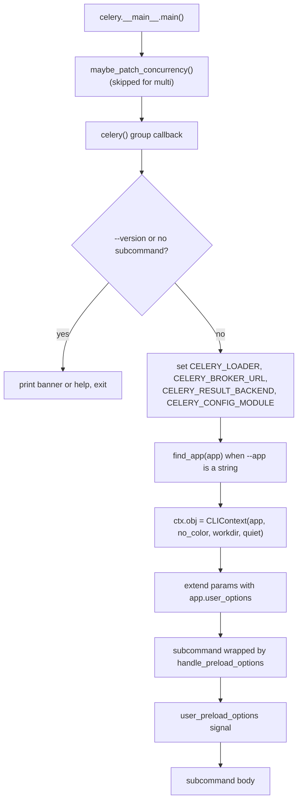

## Overview

The `celery` program is one click group that loads your application once and then dispatches to a subcommand. It starts workers and beat, runs monitors, sends remote control commands and handles admin chores. `setup.py` installs it as the `celery = celery.__main__:main` console script. Every subcommand is an ordinary click command registered on the group, and each one reaches the application through a shared `CLIContext` object stored in `ctx.obj`.

Sources: [setup.py:156-157](repo://setup.py#L156-L157), [celery/bin/celery.py:166-191](repo://celery/bin/celery.py#L166-L191)

`celery.__main__.main` calls `maybe_patch_concurrency()` unless `multi` is among the arguments, so eventlet or gevent monkey patching happens before click or the app is imported. It then calls `celery.bin.celery.main`, which invokes the group with `auto_envvar_prefix="CELERY"`. Because of that prefix, any option can also be supplied through a `CELERY_<OPTION>` environment variable.

Sources: [celery/__main__.py:10-15](repo://celery/__main__.py#L10-L15), [celery/bin/celery.py:220-227](repo://celery/bin/celery.py#L220-L227)

## Startup Flow

The group callback `celery()` runs before any subcommand. It translates global options into environment variables that the app's configuration reads, resolves `--app`, and builds the context.

Sources: [celery/bin/celery.py:112-163](repo://celery/bin/celery.py#L112-L163)



Sources: [celery/__main__.py:10-15](repo://celery/__main__.py#L10-L15), [celery/bin/celery.py:113-163](repo://celery/bin/celery.py#L113-L163), [celery/bin/base.py:143-160](repo://celery/bin/base.py#L143-L160)

## Global Options

### Option reference

Global options must come before the subcommand name. They are declared on the group with the `"Global Options"` help group.

Sources: [celery/bin/celery.py:55-111](repo://celery/bin/celery.py#L55-L111)

| Option | Env var | Effect |
|---|---|---|
| `-A`, `--app` | `APP` | application to load, passed to `find_app` (type `click.UNPROCESSED` so a `Celery` object also works) |
| `-b`, `--broker` | `BROKER_URL` | exported as `CELERY_BROKER_URL` |
| `--result-backend` | `RESULT_BACKEND` | exported as `CELERY_RESULT_BACKEND` |
| `--loader` | `LOADER` | exported as `CELERY_LOADER` |
| `--config` | `CONFIG_MODULE` | exported as `CELERY_CONFIG_MODULE` |
| `--workdir` | none | eager callback that runs `os.chdir(wd)` before other processing |
| `-C`, `--no-color` | `NO_COLOR` | disables styling in `CLIContext` |
| `-q`, `--quiet` | none | suppresses non-essential output |
| `--version` | none | prints `VERSION_BANNER` and exits |
| `--skip-checks` | `SKIP_CHECKS` | sets `CELERY_SKIP_CHECKS=true` to skip Django checks |

Sources: [celery/bin/celery.py:55-133](repo://celery/bin/celery.py#L55-L133)

### Resolving the application

`find_app` imports the given name with `symbol_by_name`. If the result is a module and the name had no `:`, it looks for a `.app` attribute, then a `.celery` attribute. For a package it retries with `<name>.celery`. As a last resort it scans the module for any `Celery` instance. In the group callback, a `ModuleNotFoundError` for the requested module produces "The module ... was not found", while an import error inside that module shows its traceback. An `AttributeError` reports the missing attribute.

Sources: [celery/app/utils.py:378-415](repo://celery/app/utils.py#L378-L415), [celery/bin/celery.py:32-43](repo://celery/bin/celery.py#L32-L43), [celery/bin/celery.py:135-152](repo://celery/bin/celery.py#L135-L152)

> [!IMPORTANT]
> Since Celery 5.0, `-A` is only accepted as a global option. The module patches `click.exceptions.NoSuchOption.show` so `celery worker -A proj` prints a message telling you to write `celery -A proj worker` instead.

Sources: [celery/bin/celery.py:193-217](repo://celery/bin/celery.py#L193-L217)

## CLIContext and Click Customizations

### CLIContext

`CLIContext` holds `app` (falling back to `get_current_app()`), `no_color`, `quiet` and `workdir`. Its `style`, `echo`, `secho` and `error` methods respect `no_color`. `pretty()` formats remote-control replies: lists become bullet lists, dicts holding `ok` or `error` are unwrapped and labelled `OK`/`ERROR`, and other dicts become JSON highlighted with pygments when it is installed. `say_chat` prints the `->` lines used by `inspect` and `control`.

Sources: [celery/bin/base.py:22-120](repo://celery/bin/base.py#L22-L120)

### Option and command classes

`CeleryOption` adds a `help_group` keyword, and `CeleryCommand.format_options` uses it to group `--help` output into sections. `CeleryOption` also accepts `default_value_from_context`. `CeleryDaemonCommand` appends daemonization options (`--logfile/-f`, `--pidfile`, `--uid`, `--gid`, `--umask`, `--executable`). Each one is a `DaemonOption` whose callback falls back to the `<command>_<option>` setting, for example `worker_pidfile` or `beat_logfile`.

Sources: [celery/bin/base.py:163-227](repo://celery/bin/base.py#L163-L227)

Parameter types shared by subcommands include `COMMA_SEPARATED_LIST`, `JSON_ARRAY`, `JSON_OBJECT`, `ISO8601`, `ISO8601_OR_FLOAT` and `LOG_LEVEL`. `LOG_LEVEL` upper-cases the name and converts it with `mlevel`.

Sources: [celery/bin/base.py:230-329](repo://celery/bin/base.py#L230-L329)

### Preload and user options

Applications can add click options to commands through `app.user_options`, a `defaultdict(set)` keyed by command. In the group callback, entries under `worker`, `beat` and `events` are appended to those commands, and entries under `preload` are appended to every command. `handle_preload_options` wraps each subcommand: it collects the values of the preload options and sends the `user_preload_options` signal with `app` and `options` before running the command body.

Sources: [celery/app/base.py:369-369](repo://celery/app/base.py#L369-L369), [celery/bin/celery.py:157-163](repo://celery/bin/celery.py#L157-L163), [celery/bin/base.py:143-160](repo://celery/bin/base.py#L143-L160)

```python
from celery import Celery, signals
from click import Option

app = Celery('proj')
app.user_options['preload'].add(Option(['--monitoring'], is_flag=True,
                                       help='Enable custom monitoring.'))

@signals.user_preload_options.connect
def on_preload_parsed(options, **kwargs):
    if options['monitoring']:
        ...
```

Sources: [celery/bin/base.py:143-160](repo://celery/bin/base.py#L143-L160), [celery/signals.py:151-152](repo://celery/signals.py#L151-L152)

Third-party packages can also register whole subcommands through the `celery.commands` entry-point group, which `click_plugins.with_plugins` loads onto the group.

Sources: [celery/bin/celery.py:46-56](repo://celery/bin/celery.py#L46-L56)

## Subcommands

### Subcommand reference

All built-in subcommands are added with `celery.add_command` and use `DYMGroup`, so mistyped names get a "did you mean" suggestion.

Sources: [celery/bin/celery.py:55-56](repo://celery/bin/celery.py#L55-L56), [celery/bin/celery.py:175-191](repo://celery/bin/celery.py#L175-L191)

| Command | Module | What it does |
|---|---|---|
| `worker` | `celery/bin/worker.py` | start a worker (`app.Worker(...).start()`) |
| `beat` | `celery/bin/beat.py` | run the periodic task scheduler `app.Beat(...).run()` |
| `events` | `celery/bin/events.py` | curses monitor, `--dump`, or `--camera` snapshots |
| `multi` | `celery/bin/multi.py` | start, stop and restart several detached workers |
| `status` | `celery/bin/control.py` | ping all workers and count replies |
| `inspect <cmd>` | `celery/bin/control.py` | run an inspect command (see `--list`) |
| `control <cmd>` | `celery/bin/control.py` | broadcast a control command (see `--list`) |
| `call <name>` | `celery/bin/call.py` | `app.send_task` with `--args`/`--kwargs` JSON, `--eta`, `--countdown`, `--expires`, routing |
| `result <task_id>` | `celery/bin/result.py` | print `AsyncResult.get()` or `--traceback` |
| `purge` | `celery/bin/purge.py` | delete messages from known queues (`-Q`, `-X`, `-f`) |
| `shell` | `celery/bin/shell.py` | interactive shell with app, canvas primitives and tasks in locals |
| `migrate <src> <dst>` | `celery/bin/migrate.py` | move task messages between brokers (experimental) |
| `list bindings` | `celery/bin/list.py` | print queue/exchange/routing-key bindings |
| `graph bootsteps` / `graph workers` | `celery/bin/graph.py` | emit dot graphs |
| `logtool stats/traces/errors/incomplete/debug` | `celery/bin/logtool.py` | audit worker log files |
| `upgrade settings <file>` | `celery/bin/upgrade.py` | rewrite 3.x setting names to 4.x |
| `amqp` | `celery/bin/amqp.py` | AMQP admin shell (`queue.declare`, `basic.publish`, and so on) |
| `report` | `celery/bin/celery.py` | print `app.bugreport()` |

Sources: [celery/bin/celery.py:166-191](repo://celery/bin/celery.py#L166-L191), [celery/bin/call.py:56-71](repo://celery/bin/call.py#L56-L71), [celery/bin/result.py:19-30](repo://celery/bin/result.py#L19-L30), [celery/bin/purge.py:29-70](repo://celery/bin/purge.py#L29-L70), [celery/bin/list.py:7-38](repo://celery/bin/list.py#L7-L38), [celery/bin/graph.py:11-36](repo://celery/bin/graph.py#L11-L36), [celery/bin/logtool.py:113-157](repo://celery/bin/logtool.py#L113-L157), [celery/bin/migrate.py:9-63](repo://celery/bin/migrate.py#L9-L63), [celery/bin/amqp.py:61-71](repo://celery/bin/amqp.py#L61-L71)

### inspect, control and status

`inspect` and `control` accept a command name plus extra positional arguments. `_verify_command_name` checks the name against visible entries of `Panel.meta` of the right type. `_compile_arguments` then converts positional strings using the command's declared `args` types and collects the rest under its `variadic` name. `inspect` calls `Inspect._request`, while `control` calls `app.control.broadcast(..., reply=True)`. All three commands take `-t/--timeout` (default 1.0), `-d/--destination` (comma separated) and `-j/--json`. They raise `CeleryCommandException` with `EX_UNAVAILABLE` when no node replies. Broker connection failures are turned into a readable "Could not connect to the message broker" error. The underlying commands are described in [[Remote Control and Inspection]].

Sources: [celery/bin/control.py:26-104](repo://celery/bin/control.py#L26-L104), [celery/bin/control.py:178-262](repo://celery/bin/control.py#L178-L262), [celery/bin/base.py:123-140](repo://celery/bin/base.py#L123-L140)

```console
$ celery -A proj inspect --list
$ celery -A proj inspect active -d celery@node1 -t 5
$ celery -A proj control rate_limit proj.tasks.add 10/m
$ celery -A proj control add_consumer images
```

Sources: [celery/bin/control.py:69-96](repo://celery/bin/control.py#L69-L96), [celery/worker/control.py:255-258](repo://celery/worker/control.py#L255-L258), [celery/worker/control.py:601-609](repo://celery/worker/control.py#L601-L609)

### beat and events

`beat` is a `CeleryDaemonCommand` with `--detach`, `-s/--schedule` (default `beat_schedule_filename`), `-S/--scheduler` (default `beat_scheduler`), `--max-interval` and `-l/--loglevel`. Extra `key=value` arguments go to `app.config_from_cmdline`. It drops privileges only when not detaching, because `detached()` handles the uid/gid change itself. See [[Periodic Tasks with Beat]].

Sources: [celery/bin/beat.py:10-72](repo://celery/bin/beat.py#L10-L72)

`events` runs `evdump` with `--dump`, `evcam` with `-c/--camera` (plus `--frequency`, `--maxrate`, `--detach`), and otherwise the curses `evtop`. A missing `_curses` module becomes a usage error. See [[Events and Monitoring]].

Sources: [celery/bin/events.py:18-98](repo://celery/bin/events.py#L18-L98)

> [!WARNING]
> In `celery events`, both `--dump` and `--detach` declare the short flag `-d`. Use the long forms to make your intent unambiguous.

Sources: [celery/bin/events.py:51-65](repo://celery/bin/events.py#L51-L65)

## The worker Command

### Worker options

`worker` is a `CeleryDaemonCommand` with `allow_extra_args`, so it has the daemon options described above plus these groups.

Sources: [celery/bin/worker.py:136-220](repo://celery/bin/worker.py#L136-L220), [celery/bin/worker.py:221-304](repo://celery/bin/worker.py#L221-L304)

| Group | Options |
|---|---|
| Worker Options | `-n/--hostname` (expands `%h`, `%n`, `%d`), `-D/--detach`, `-S/--statedb` (default `worker_state_db`), `-l/--loglevel` (default `WARNING`), `-O/--optimization` (`default`/`fair`), `--prefetch-multiplier`, `--disable-prefetch` |
| Pool Options | `-c/--concurrency` (default `worker_concurrency`), `-P/--pool` (default `prefork`), `-E/--task-events/--events`, `--time-limit`, `--soft-time-limit`, `--max-tasks-per-child`, `--max-memory-per-child` |
| Queue Options | `--purge/--discard`, `-Q/--queues`, `-X/--exclude-queues`, `-I/--include` |
| Features | `--without-gossip`, `--without-mingle`, `--without-heartbeat`, `--heartbeat-interval`, `--autoscale` |
| Embedded Beat Options | `-B/--beat`, `-s/--schedule-filename/--schedule`, `--scheduler` |

Sources: [celery/bin/worker.py:136-220](repo://celery/bin/worker.py#L136-L220), [celery/bin/worker.py:221-304](repo://celery/bin/worker.py#L221-L304)

### Option parsing details

Custom parameter types do some of the work. `WorkersPool` resolves the pool name with `concurrency.get_implementation`, and if the CLI default `prefork` is in effect but `worker_pool` is configured, the configured pool wins. `Autoscale` accepts `max,min` or a single integer and returns `(max, min)` sorted descending. `CeleryBeat` rejects `-B` on Windows. `Hostname` applies `default_nodename` and `host_format`.

Sources: [celery/bin/worker.py:22-103](repo://celery/bin/worker.py#L22-L103)

### Execution

The command body first applies `--disable-prefetch` to `worker_disable_prefetch` and passes any extra `key=value` arguments to `app.config_from_cmdline(ctx.args, namespace='worker')`. With `--detach`, it re-executes `python -m celery ...` without the detach flags inside `platforms.detached()`. Otherwise it calls `maybe_drop_privileges(uid, gid)`, builds `app.Worker(...)` with node-formatted pidfile and statedb paths, starts it and exits with `worker.exitcode`. A `SecurityError`, such as the one raised for running as root with pickle enabled, is printed and the command exits with status 1 (see [[Message Signing and Security]]).

Sources: [celery/bin/worker.py:305-371](repo://celery/bin/worker.py#L305-L371), [celery/bin/worker.py:108-133](repo://celery/bin/worker.py#L108-L133)

```console
$ celery -A proj worker -l INFO -Q hipri,lopri -c 4
$ celery -A proj worker --autoscale=10,3 -E
$ celery -A proj worker -P eventlet -c 1000
```

Sources: [celery/bin/worker.py:310-323](repo://celery/bin/worker.py#L310-L323)

## celery multi

### Argument handling

`multi` disables click's option parsing (`ignore_unknown_options`) and hands `sys.argv` to `MultiTool`. It first rotates the arguments so that `multi` comes first, because global options such as `-A` were written before it. `MultiTool` strips reserved options (`--nosplash`, `--quiet/-q`, `--verbose`, `--no-color`) and dispatches the first word to `start`, `stop`, `stopwait`, `restart`, `kill`, `show`, `names`, `get`, `expand` or `help`.

Sources: [celery/bin/multi.py:463-480](repo://celery/bin/multi.py#L463-L480), [celery/bin/multi.py:226-287](repo://celery/bin/multi.py#L226-L287)

`NamespacedOptionParser` splits arguments into positional node names, plain options, and per-node namespaces written as `-c:1 10` or `-Q:image images`. Everything after `--` is kept as passthrough. `MultiParser.parse` turns a single numeric name into a range (`celery1..celeryN`, prefix set by `--range-prefix`). It maps numeric namespaces to node indexes starting at 1, expands `1-3` and `a,b` namespace ranges, and builds one `Node` per name with `optmerge` so per-node values override the shared ones.

Sources: [celery/apps/multi.py:70-120](repo://celery/apps/multi.py#L70-L120), [celery/apps/multi.py:285-364](repo://celery/apps/multi.py#L285-L364)

### Nodes and the cluster

`Node` defaults its command to `-m celery worker --detach`, sets `-n` to the node name, and defaults `--pidfile` to `/var/run/celery/%n.pid`, `--logfile` to `/var/log/celery/%n%I.log` and `--executable` to `sys.executable`, creating missing directories. `_prepare_argv` moves global options (`-A`, `-b`, `--result-backend`, `--loader`, `--config`, `--workdir`, `-C`, `-q`) in front of the subcommand so the generated command line is valid for Celery 5. The node's pid is read from its pidfile.

Sources: [celery/apps/multi.py:122-191](repo://celery/apps/multi.py#L122-L191), [celery/apps/multi.py:246-265](repo://celery/apps/multi.py#L246-L265)

`Cluster.start` runs each node with `Popen` and waits for the detaching parent to exit. `stop` sends the signal (default `SIGTERM`, or the trailing `-SIG` argument found by `_find_sig_argument`) to every node that has a pid. `stopwait` and `restart` also poll `node.alive()` (signal 0) with `retry=2` second sleeps until the processes exit, and `restart` starts each node again as soon as it goes down. `kill` sends `SIGKILL`.

Sources: [celery/apps/multi.py:406-483](repo://celery/apps/multi.py#L406-L483), [celery/bin/multi.py:289-357](repo://celery/bin/multi.py#L289-L357)

```console
$ celery -A proj multi start 3 -c 3 -c:1 10 --pidfile=/var/run/celery/%n.pid
$ celery multi show 10 -l INFO -Q:1-3 images,video -Q:4,5 data -Q default -L:4,5 DEBUG
$ celery multi stopwait 3 --pidfile=/var/run/celery/%n.pid
```

Sources: [celery/bin/multi.py:58-77](repo://celery/bin/multi.py#L58-L77)

> [!NOTE]
> `multi` does not persist node options. `restart` and `stop` must be given the same pidfile arguments as `start`, or they cannot find the running processes.

Sources: [celery/bin/multi.py:21-27](repo://celery/bin/multi.py#L21-L27)
