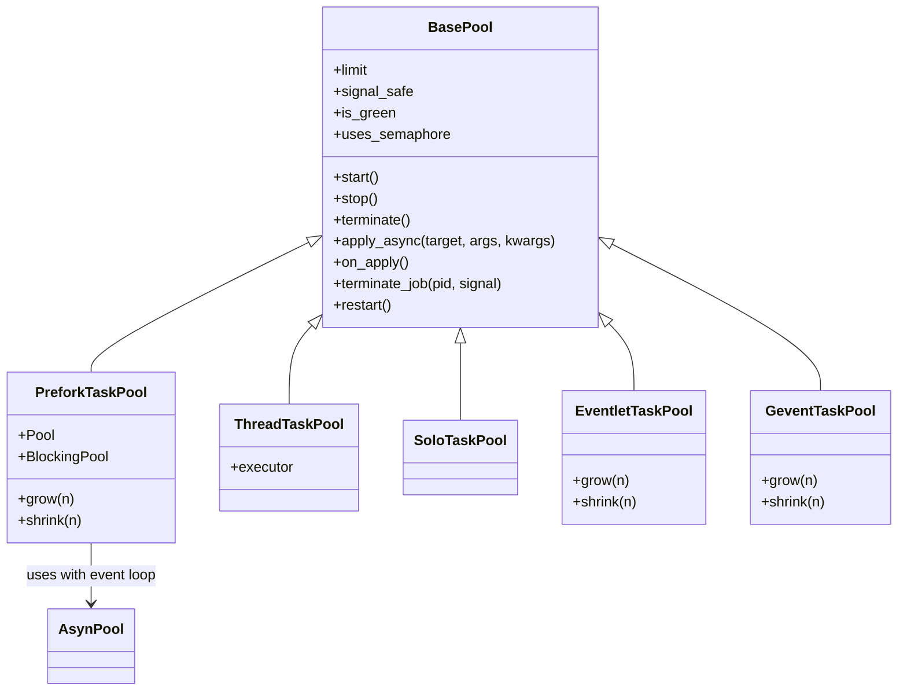
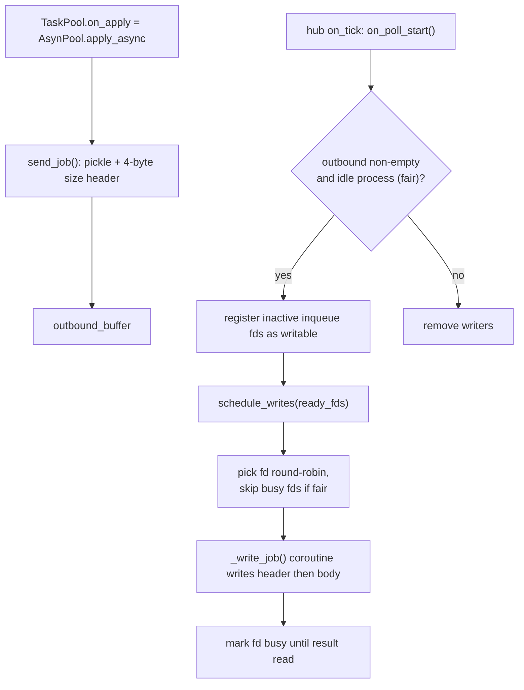

## Overview

The execution pool is where task code actually runs. The worker's consumer receives messages and builds `Request` objects (see [[Consumer and Task Execution]]); each request is passed to `pool.apply_async`, and the pool reports back through callbacks when the job is accepted, finishes, fails or times out. `celery.concurrency` provides five implementations behind one `BasePool` interface: `prefork` (child processes via billiard, the default), `threads`, `solo`, `eventlet` and `gevent`. The worker's `Pool` bootstep creates the pool, and an optional autoscaler grows and shrinks it (see [[Worker Architecture and Bootsteps]]).

Sources: [celery/concurrency/__init__.py:1-48](repo://celery/concurrency/__init__.py#L1-L48), [celery/concurrency/base.py:47-80](repo://celery/concurrency/base.py#L47-L80), [celery/concurrency/base.py:140-180](repo://celery/concurrency/base.py#L140-L180), [celery/worker/request.py:341-372](repo://celery/worker/request.py#L341-L372), [celery/worker/components.py:101-178](repo://celery/worker/components.py#L101-L178)



Sources: [celery/concurrency/base.py:47-156](repo://celery/concurrency/base.py#L47-L156), [celery/concurrency/prefork.py:95-126](repo://celery/concurrency/prefork.py#L95-L126), [celery/concurrency/thread.py:30-56](repo://celery/concurrency/thread.py#L30-L56), [celery/concurrency/solo.py:11-20](repo://celery/concurrency/solo.py#L11-L20), [celery/concurrency/eventlet.py:88-151](repo://celery/concurrency/eventlet.py#L88-L151), [celery/concurrency/gevent.py:85-141](repo://celery/concurrency/gevent.py#L85-L141)

## Selecting a Pool

### Pool aliases

`ALIASES` maps short names to implementation classes. `threads` is only registered if `concurrent.futures` can be imported, and `custom` is registered from the `CELERY_CUSTOM_WORKER_POOL` environment variable, so an out-of-tree `BasePool` subclass can be selected with `--pool custom`.

Sources: [celery/concurrency/__init__.py:11-38](repo://celery/concurrency/__init__.py#L11-L38)

| Alias | Implementation |
|---|---|
| `prefork` | `celery.concurrency.prefork:TaskPool` |
| `processes` | `celery.concurrency.prefork:TaskPool` (compatibility alias) |
| `threads` | `celery.concurrency.thread:TaskPool` |
| `solo` | `celery.concurrency.solo:TaskPool` |
| `eventlet` | `celery.concurrency.eventlet:TaskPool` |
| `gevent` | `celery.concurrency.gevent:TaskPool` |
| `custom` | value of `CELERY_CUSTOM_WORKER_POOL`, in `package:Class` form |

Sources: [celery/concurrency/__init__.py:11-38](repo://celery/concurrency/__init__.py#L11-L38)

### Resolving the implementation

`get_implementation(cls)` is `symbol_by_name(cls, ALIASES)`, so it accepts an alias, a dotted `module:Class` path, or a class. `get_available_pool_names()` returns the alias keys, which the `-P/--pool` option uses as its choices. `WorkController.setup_instance` calls `get_implementation` on the `worker_pool` setting (default `prefork`) or the `pool` argument before the bootsteps are built.

Sources: [celery/concurrency/__init__.py:41-48](repo://celery/concurrency/__init__.py#L41-L48), [celery/worker/worker.py:129-130](repo://celery/worker/worker.py#L129-L130), [celery/app/defaults.py:352-352](repo://celery/app/defaults.py#L352-L352)

The CLI's `WorkersPool` type passes classes through unchanged. When the CLI value is the default `prefork` but `worker_pool` is configured, the configured pool wins.

Sources: [celery/bin/worker.py:35-63](repo://celery/bin/worker.py#L35-L63), [celery/bin/worker.py:205-211](repo://celery/bin/worker.py#L205-L211)

### Early monkey patching for green pools

eventlet and gevent must patch the standard library before anything opens sockets or threads. `celery.maybe_patch_concurrency` looks for `-P`/`--pool` in `sys.argv` and runs `eventlet.monkey_patch()` (with optional block detection from `EVENTLET_NOBLOCK`) or `gevent.monkey.patch_all()`, then imports the pool module immediately. The eventlet module warns with `W_RACE` if billiard, celery or kombu modules that use threads or sockets were imported first.

Sources: [celery/__init__.py:107-152](repo://celery/__init__.py#L107-L152), [celery/concurrency/eventlet.py:14-26](repo://celery/concurrency/eventlet.py#L14-L26)

> [!WARNING]
> Select eventlet or gevent with `-P`, not with the `worker_pool` setting. Configuration is read too late for monkey patching, and `Pool.create` emits `W_POOL_SETTING` when it sees a green pool there.

Sources: [celery/worker/components.py:18-29](repo://celery/worker/components.py#L18-L29), [celery/worker/components.py:138-142](repo://celery/worker/components.py#L138-L142)

## The BasePool Interface

### Lifecycle

`BasePool` tracks `_state` with the constants `RUN`, `CLOSE` and `TERMINATE`, and implements the public lifecycle methods as thin wrappers over overridable hooks. `start()` sets the debug flag, calls `on_start()` and sets `RUN`. `stop()` calls `on_stop()` and sets `TERMINATE`. `terminate()` sets `TERMINATE` and calls `on_terminate()`. `close()` sets `CLOSE` and calls `on_close()`. The worker's `Pool` bootstep maps blueprint phases onto these: `close` on close, `stop` on warm shutdown, and `terminate` on cold shutdown.

Sources: [celery/concurrency/base.py:47-138](repo://celery/concurrency/base.py#L47-L138), [celery/worker/components.py:130-136](repo://celery/worker/components.py#L130-L136), [celery/bootsteps.py:363-376](repo://celery/bootsteps.py#L363-L376)

### Applying work

`apply_async(target, args, kwargs, **options)` logs the call at debug level and forwards everything to `on_apply`, adding `waitforslot=self.putlocks` and `callbacks_propagate`. The options passed by `Request.execute_using_pool` are `accept_callback`, `timeout_callback`, `callback`, `error_callback`, `soft_timeout`, `timeout` and `correlation_id`.

Sources: [celery/concurrency/base.py:140-156](repo://celery/concurrency/base.py#L140-L156), [celery/worker/request.py:358-369](repo://celery/worker/request.py#L358-L369)

The in-process pools all execute jobs through `apply_target`. It calls `accept_callback(pid, monotonic())`, runs the target, and passes the return value to `callback`. Ordinary exceptions propagate; any other `BaseException` (except `WorkerShutdown`/`WorkerTerminate`) is converted into a `WorkerLostError` and delivered to `callback` as an `ExceptionInfo`.

Sources: [celery/concurrency/base.py:22-44](repo://celery/concurrency/base.py#L22-L44)

```python
def apply_target(target, args=(), kwargs=None, callback=None,
                 accept_callback=None, pid=None, getpid=os.getpid,
                 propagate=(), monotonic=time.monotonic, **_):
    """Apply function within pool context."""
    kwargs = {} if not kwargs else kwargs
    if accept_callback:
        accept_callback(pid or getpid(), monotonic())
    try:
        ret = target(*args, **kwargs)
    except propagate:
        raise
    except Exception:
        raise
    except (WorkerShutdown, WorkerTerminate):
        raise
    except BaseException as exc:
        try:
            reraise(WorkerLostError, WorkerLostError(repr(exc)),
                    sys.exc_info()[2])
        except WorkerLostError:
            callback(ExceptionInfo())
    else:
        callback(ret)
```

Sources: [celery/concurrency/base.py:22-44](repo://celery/concurrency/base.py#L22-L44)

### Capability flags

The worker reads several class attributes to adapt to the pool.

Sources: [celery/concurrency/base.py:54-71](repo://celery/concurrency/base.py#L54-L71)

| Attribute | Default | Used for |
|---|---|---|
| `Timer` | `timer2.Timer` | Timer class the `Timer` bootstep uses when there is no event loop; green pools supply greenlet-based timers |
| `signal_safe` | `True` | Whether `WorkController.stop`/`terminate` may shut the pool down from inside a signal handler; `False` for threads, eventlet and gevent |
| `is_green` | `False` | Selects `gPidbox` for remote control and enables AMQP heartbeats in `synloop` |
| `uses_semaphore` | `False` | `True` for prefork; with `worker_pool_putlocks` the worker routes tasks through a `LaxBoundedSemaphore` |
| `task_join_will_block` | `True` | Sets the global flag behind `assert_will_not_block`, which makes `result.get()` inside a task raise; `False` for green pools |
| `body_can_be_buffer` | `False` | Declared `True` by solo and threads; not read elsewhere in the worker |

Sources: [celery/worker/components.py:32-47](repo://celery/worker/components.py#L32-L47), [celery/worker/worker.py:244-259](repo://celery/worker/worker.py#L244-L259), [celery/worker/consumer/control.py:23-25](repo://celery/worker/consumer/control.py#L23-L25), [celery/worker/loops.py:139-141](repo://celery/worker/loops.py#L139-L141), [celery/worker/components.py:146-152](repo://celery/worker/components.py#L146-L152), [celery/worker/components.py:171-171](repo://celery/worker/components.py#L171-L171), [celery/result.py:37-39](repo://celery/result.py#L37-L39)

### Optional operations

`terminate_job(pid, signal)` and `restart()` raise `NotImplementedError` in the base class; `Request.terminate` and the `pool_restart` remote control command depend on them. `grow(n)`/`shrink(n)` are not defined on `BasePool` at all and are provided only by prefork, eventlet and gevent. `did_start_ok`, `flush`, `register_with_event_loop`, `maintain_pool`, `on_soft_timeout` and `on_hard_timeout` are no-op hooks. `info` returns `_get_info()` (implementation path and `max-concurrency`, extended by each pool), and `num_processes` returns `limit`.

Sources: [celery/concurrency/base.py:82-118](repo://celery/concurrency/base.py#L82-L118), [celery/concurrency/base.py:158-180](repo://celery/concurrency/base.py#L158-L180), [celery/worker/request.py:416-426](repo://celery/worker/request.py#L416-L426), [celery/worker/worker.py:269-279](repo://celery/worker/worker.py#L269-L279)

## Prefork Pool

### Child process initialization

`prefork.TaskPool.on_start` creates the billiard pool with `initializer=process_initializer`, `on_process_exit=process_destructor`, timeouts enabled and `proc_alive_timeout` from `worker_proc_alive_timeout` (default 4 seconds). Every child then runs `process_initializer(app, hostname)` before accepting work.

Sources: [celery/concurrency/prefork.py:104-118](repo://celery/concurrency/prefork.py#L104-L118), [celery/concurrency/prefork.py:41-46](repo://celery/concurrency/prefork.py#L41-L46)

- requests `SIGKILL` on parent death, resets `SIGTERM`, `SIGHUP`, `SIGTTIN`, `SIGTTOU` and `SIGUSR1`, and ignores `SIGINT` (and `SIGTERM` too when `REMAP_SIGTERM` is set);
- sets the process title, runs `init_worker` and `init_worker_process` on the loader, and configures logging from the `CELERY_LOG_*` environment variables;
- makes the app current and finalizes it (or re-applies worker optimizations after an `execv`), rebuilds `task.__trace__` for every task, calls `worker_state.reset_state()`, and sends `worker_process_init`.

Sources: [celery/concurrency/prefork.py:26-82](repo://celery/concurrency/prefork.py#L26-L82), [celery/concurrency/prefork.py:104-118](repo://celery/concurrency/prefork.py#L104-L118), [celery/app/defaults.py:355-355](repo://celery/app/defaults.py#L355-L355)

`process_destructor` sends `worker_process_shutdown` with the child's pid and exit code. See [[Signals]] for both signals.

Sources: [celery/concurrency/prefork.py:85-92](repo://celery/concurrency/prefork.py#L85-L92)

After creating the pool, `on_start` binds `on_apply`, `maintain_pool`, `terminate_job`, `grow`, `shrink` and `flush` directly to the billiard pool's methods, so the hot path skips an extra call layer.

Sources: [celery/concurrency/prefork.py:120-126](repo://celery/concurrency/prefork.py#L120-L126)

### AsynPool versus the blocking pool

`on_start` uses `AsynPool` when the worker runs the event loop and the threaded billiard `Pool` otherwise. The worker's `Pool` bootstep passes `threads=not w.use_eventloop or IS_WINDOWS`, so the async pool is used on non-Windows hosts with an asynchronous transport such as AMQP or Redis.

Sources: [celery/concurrency/prefork.py:104-118](repo://celery/concurrency/prefork.py#L104-L118), [celery/worker/components.py:143-170](repo://celery/worker/components.py#L143-L170)

`AsynPool` replaces billiard's result-handler and task-handler threads with non-blocking pipes registered on the worker's `Hub`. It pre-creates one `(inq, outq, synq)` pipe triple per process with `create_process_queues`, and keeps maps from file descriptor to process (`_fileno_to_inq`, `_fileno_to_outq`, `_fileno_to_synq`), the set of busy inqueues, and an `outbound_buffer` of jobs waiting to be written.

Sources: [celery/concurrency/asynpool.py:1-14](repo://celery/concurrency/asynpool.py#L1-L14), [celery/concurrency/asynpool.py:414-488](repo://celery/concurrency/asynpool.py#L414-L488), [celery/concurrency/asynpool.py:1153-1169](repo://celery/concurrency/asynpool.py#L1153-L1169)

`register_with_event_loop(hub)` installs the result reader, time-limit handlers, process up/down handlers and write handlers; registers each child's sentinel so that a process exit triggers `maintain_pool`; adds `maintain_pool` as a 5 second repeating timer; and adds `on_poll_start` to the hub's `on_tick` exactly once, even across consumer restarts.

Sources: [celery/concurrency/asynpool.py:522-547](repo://celery/concurrency/asynpool.py#L522-L547), [celery/concurrency/asynpool.py:1415-1417](repo://celery/concurrency/asynpool.py#L1415-L1417)

### Writing jobs to child processes



Sources: [celery/concurrency/asynpool.py:770-788](repo://celery/concurrency/asynpool.py#L770-L788), [celery/concurrency/asynpool.py:804-887](repo://celery/concurrency/asynpool.py#L804-L887), [celery/concurrency/asynpool.py:897-946](repo://celery/concurrency/asynpool.py#L897-L946)

`send_job` pickles the job tuple, prefixes it with a `>I` length header and appends it to `outbound_buffer`. On each loop tick `on_poll_start` registers idle inqueue descriptors with the hub, and the hub calls `schedule_writes` with the batch of writable descriptors. `schedule_writes` cycles through them with a running counter, pops a job, records `job._scheduled_for`, and starts the `_write_job` generator. The generator yields whenever the pipe would block (`EAGAIN`/`EINTR`) and gives up after 100 consecutive failures through `on_not_recovering`, which terminates the process and puts the job back.

Sources: [celery/concurrency/asynpool.py:877-946](repo://celery/concurrency/asynpool.py#L877-L946), [celery/concurrency/asynpool.py:69-69](repo://celery/concurrency/asynpool.py#L69-L69)

The scheduling strategy comes from the worker's `-O` option through `sched_strategy`.

Sources: [celery/worker/components.py:121-121](repo://celery/worker/components.py#L121-L121), [celery/concurrency/asynpool.py:428-432](repo://celery/concurrency/asynpool.py#L428-L432)

| Value | Strategy | Behaviour |
|---|---|---|
| `None`, `default`, `fair` | `SCHED_STRATEGY_FAIR` | Write only to processes that are not already busy with a job |
| `fast`, `fcfs` | `SCHED_STRATEGY_FCFS` | Write to any writable inqueue, so several jobs can queue in one child's pipe |

Sources: [celery/concurrency/asynpool.py:77-87](repo://celery/concurrency/asynpool.py#L77-L87), [celery/concurrency/asynpool.py:775-779](repo://celery/concurrency/asynpool.py#L775-L779), [celery/concurrency/asynpool.py:829-831](repo://celery/concurrency/asynpool.py#L829-L831), [celery/bin/worker.py:169-175](repo://celery/bin/worker.py#L169-L175)

> [!NOTE]
> The command-line `-O` option only accepts `default` and `fair`, and both map to the fair strategy. The first-come-first-served strategy is reachable only by passing `optimization='fast'` or `'fcfs'` programmatically.

Sources: [celery/bin/worker.py:169-175](repo://celery/bin/worker.py#L169-L175), [celery/worker/components.py:121-121](repo://celery/worker/components.py#L121-L121), [celery/worker/components.py:168-168](repo://celery/worker/components.py#L168-L168)

### Process lifecycle

A freshly started child sends a `WORKER_UP` message on its outqueue from `Worker.on_loop_start`. `on_process_up` registers the child's outqueue reader and adds it to `_waiting_to_start`; when the `WORKER_UP` message arrives, `on_process_alive` adds its inqueue to `_all_inqueues`, which makes it eligible for jobs. If no `WORKER_UP` arrives within the proc-alive timeout, `verify_process_alive` logs `Timed out waiting for UP message` and kills the process with signal 9.

Sources: [celery/concurrency/asynpool.py:71-75](repo://celery/concurrency/asynpool.py#L71-L75), [celery/concurrency/asynpool.py:243-261](repo://celery/concurrency/asynpool.py#L243-L261), [celery/concurrency/asynpool.py:625-663](repo://celery/concurrency/asynpool.py#L625-L663), [celery/concurrency/asynpool.py:1171-1185](repo://celery/concurrency/asynpool.py#L1171-L1185)

When a child exits, `on_process_down` flushes its queues and removes its descriptors from every index, but only if the descriptor has not been reused by a newer process. Jobs that were partially written to the dead process go through `on_partial_read`; jobs only scheduled for it are put back in the buffer; jobs it was executing are marked lost through `mark_as_worker_lost`, and the request's `on_failure` then sees a `WorkerLostError` (which `reject_on_worker_lost` can turn into a requeue).

Sources: [celery/concurrency/asynpool.py:665-714](repo://celery/concurrency/asynpool.py#L665-L714), [celery/concurrency/asynpool.py:1187-1204](repo://celery/concurrency/asynpool.py#L1187-L1204), [celery/worker/request.py:677-690](repo://celery/worker/request.py#L677-L690)

`AsynPool.flush`, called from the consumer's `on_close` after a connection loss, cancels (with synack) or discards every job not yet accepted by a child, because the broker will redeliver those messages.

Sources: [celery/concurrency/asynpool.py:999-1010](repo://celery/concurrency/asynpool.py#L999-L1010), [celery/worker/consumer/consumer.py:546-547](repo://celery/worker/consumer/consumer.py#L546-L547)

### Time limits

`Pool.create` passes `timeout=w.time_limit` and `soft_timeout=w.soft_time_limit`, and each request can override them per call. `AsynPool._create_timelimit_handlers` schedules the soft limit (or the hard limit if there is no soft one) with `hub.call_later`. When the soft limit fires, `_on_soft_timeout` arms the hard limit for the remaining `hard - soft` seconds and calls billiard's `on_soft_timeout`; the hard handler calls `on_hard_timeout`. Both look the job up in `_cache` first, so jobs that already finished are ignored.

Sources: [celery/worker/components.py:154-161](repo://celery/worker/components.py#L154-L161), [celery/concurrency/asynpool.py:549-605](repo://celery/concurrency/asynpool.py#L549-L605)

### Graceful stop

`on_stop` closes the billiard pool and joins it. If a kombu hub exists, it first starts a daemon thread named `prefork-timer-shutdown` that calls `hub.fire_timers()` every 0.5 seconds, so broker heartbeats keep flowing while long tasks finish during a warm shutdown. `on_terminate` calls the billiard pool's `terminate()`. `restart()` restarts all children and submits a `noop` job.

Sources: [celery/concurrency/prefork.py:128-198](repo://celery/concurrency/prefork.py#L128-L198)

## Thread, Solo and Green Pools

### Thread pool

`thread.TaskPool` wraps a `ThreadPoolExecutor(max_workers=self.limit)`. `on_apply` submits `apply_target` and returns an `ApplyResult` wrapper around the `Future`; `on_stop` calls `executor.shutdown(cancel_futures=True)`. It sets `signal_safe = False` and does not implement `terminate_job`, `restart`, `grow` or `shrink`, and `on_apply` ignores the timeout arguments, so time limits are not enforced.

Sources: [celery/concurrency/thread.py:21-64](repo://celery/concurrency/thread.py#L21-L64)

### Solo pool

`solo.TaskPool` sets `on_apply = apply_target`, so every task runs inline in the worker's main thread and blocks consumption until it finishes. `limit` is forced to `1`, and `worker_process_init` is sent from the constructor because there is no child process to send it.

Sources: [celery/concurrency/solo.py:11-31](repo://celery/concurrency/solo.py#L11-L31)

### Eventlet and gevent pools

Both green pools spawn one greenlet per task from a size-limited green pool (`eventlet.greenpool.GreenPool` or `gevent.pool.Pool`), keep a `_pool_map` from `id(greenlet)` to greenlet for `terminate_job`, and wrap targets so that `GreenletExit` returns `(False, None, None)` instead of failing. They set `is_green = True`, `signal_safe = False` and `task_join_will_block = False`, and ship `Timer` classes that schedule entries as greenlets.

Sources: [celery/concurrency/eventlet.py:36-57](repo://celery/concurrency/eventlet.py#L36-L57), [celery/concurrency/eventlet.py:88-181](repo://celery/concurrency/eventlet.py#L88-L181), [celery/concurrency/gevent.py:42-64](repo://celery/concurrency/gevent.py#L42-L64), [celery/concurrency/gevent.py:85-166](repo://celery/concurrency/gevent.py#L85-L166)

| | eventlet | gevent |
|---|---|---|
| `grow`/`shrink` | `GreenPool.resize(limit)` | Adjust `_semaphore.counter` and `size` |
| `terminate_job` | `greenlet.kill()` then `wait()` | `gevent.kill(greenlet)` |
| Hard time limit | not enforced | `apply_timeout` wraps the job in `gevent.Timeout` and calls `timeout_callback(False, timeout)` |
| Soft time limit | not enforced | not enforced |
| Stop | `waitall()`, with `eventlet_pool_preshutdown` and `eventlet_pool_postshutdown` signals | `join()` |

Sources: [celery/concurrency/eventlet.py:110-151](repo://celery/concurrency/eventlet.py#L110-L151), [celery/concurrency/gevent.py:28-39](repo://celery/concurrency/gevent.py#L28-L39), [celery/concurrency/gevent.py:107-141](repo://celery/concurrency/gevent.py#L107-L141)

Because `detect_environment()` reports a green environment, a worker running a green pool never sets `use_eventloop`, so it runs without a `Hub` and consumes with `synloop`. Embedding beat with `-B` is rejected for these pools.

Sources: [celery/worker/worker.py:239-242](repo://celery/worker/worker.py#L239-L242), [celery/worker/consumer/consumer.py:239-240](repo://celery/worker/consumer/consumer.py#L239-L240), [celery/worker/components.py:195-201](repo://celery/worker/components.py#L195-L201)

## Autoscaling

### Scaling algorithm

`--autoscale=max,min` enables `celery.worker.autoscale:WorkerComponent`, which instantiates `worker_autoscaler` (default `celery.worker.autoscale:Autoscaler`). The pool starts at `min` processes, and the consumer's prefetch count is based on `max`.

Sources: [celery/worker/components.py:117-128](repo://celery/worker/components.py#L117-L128), [celery/worker/components.py:226-230](repo://celery/worker/components.py#L226-L230), [celery/worker/autoscale.py:31-48](repo://celery/worker/autoscale.py#L31-L48), [celery/app/defaults.py:328-328](repo://celery/app/defaults.py#L328-L328)

`_maybe_scale` compares `qty` (the number of reserved requests, `len(state.reserved_requests)`) with `processes` (`pool.num_processes`) and acts in one direction per call.

Sources: [celery/worker/autoscale.py:148-154](repo://celery/worker/autoscale.py#L148-L154)

- if `min(qty, max_concurrency)` exceeds the current size, it calls `scale_up` for the difference and records the time;
- else if `max(qty, min_concurrency)` is below the current size, it calls `scale_down`, which only shrinks if more than `keepalive` seconds (`AUTOSCALE_KEEPALIVE`, default 30) have passed since the last scale-up.

Sources: [celery/worker/autoscale.py:28-28](repo://celery/worker/autoscale.py#L28-L28), [celery/worker/autoscale.py:83-118](repo://celery/worker/autoscale.py#L83-L118)

After any change, `maybe_scale` calls `pool.maintain_pool()`. A `ValueError` from `shrink` (all processes busy) is logged at debug level and ignored.

Sources: [celery/worker/autoscale.py:94-96](repo://celery/worker/autoscale.py#L94-L96), [celery/worker/autoscale.py:124-131](repo://celery/worker/autoscale.py#L124-L131)

Without the event loop the autoscaler is a `bgThread` whose `body` runs `maybe_scale` under a lock and sleeps one second. With the event loop it runs on the hub instead: `maybe_scale` is added to `consumer.on_task_message` (run for every accepted task message) and scheduled with `hub.call_repeatedly(keepalive, ...)`.

Sources: [celery/worker/autoscale.py:50-81](repo://celery/worker/autoscale.py#L50-L81), [celery/worker/strategy.py:205-208](repo://celery/worker/strategy.py#L205-L208)

### Runtime control

The `autoscale` remote control command calls `Autoscaler.update(max, min)`, which shrinks or grows immediately if the current size is outside the new bounds and adjusts the consumer's prefetch count by the change in `max`. `pool_grow` and `pool_shrink` resize the pool and its prefetch count directly, but refuse to run while the autoscaler is active. See [[Remote Control and Inspection]].

Sources: [celery/worker/autoscale.py:98-138](repo://celery/worker/autoscale.py#L98-L138), [celery/worker/control.py:545-589](repo://celery/worker/control.py#L545-L589)

## Choosing a Pool

### Comparison

| Pool | Unit of concurrency | Time limits | Revoke with terminate | Resize | Typical use |
|---|---|---|---|---|---|
| `prefork` | Child process | Soft and hard | Yes | Yes | CPU-bound or general work; isolates crashes and memory leaks (`max_tasks_per_child`, `max_memory_per_child`) |
| `threads` | Thread | None | No | No | I/O-bound code that releases the GIL, without monkey patching |
| `gevent` | Greenlet | Hard only | Yes | Yes | Many concurrent I/O-bound tasks |
| `eventlet` | Greenlet | None | Yes | Yes | Many concurrent I/O-bound tasks |
| `solo` | Main thread, one task | None | No | No | Debugging, or platforms where forking is not available |

Sources: [celery/concurrency/prefork.py:95-126](repo://celery/concurrency/prefork.py#L95-L126), [celery/concurrency/thread.py:30-56](repo://celery/concurrency/thread.py#L30-L56), [celery/concurrency/gevent.py:116-141](repo://celery/concurrency/gevent.py#L116-L141), [celery/concurrency/eventlet.py:123-151](repo://celery/concurrency/eventlet.py#L123-L151), [celery/concurrency/solo.py:11-31](repo://celery/concurrency/solo.py#L11-L31), [celery/worker/components.py:154-170](repo://celery/worker/components.py#L154-L170)

### Guidelines

- Concurrency defaults to the number of CPUs (`billiard.cpu_count()`), which suits prefork. Green pools are usually run with much higher values, as in the CLI help example `celery -A proj worker --concurrency=1000 -P eventlet`.
- Prefork is the only pool that enforces both soft and hard time limits, and it can kill a stuck task by terminating its child process.
- On Windows the prefork child processes are spawned rather than forked, so the fast tracer has no task registry; the error raised by `fast_trace_task` recommends `--pool=solo` or `--pool=threads` in that case.
- Calling `result.get()` inside a task raises `RuntimeError` (`E_WOULDBLOCK`) under prefork, threads and solo unless `disable_sync_subtasks=False` is passed, because joining would block a worker slot; green pools allow it because `task_join_will_block` is `False`.

Sources: [celery/worker/worker.py:108-113](repo://celery/worker/worker.py#L108-L113), [celery/bin/worker.py:319-321](repo://celery/bin/worker.py#L319-L321), [celery/app/trace.py:757-774](repo://celery/app/trace.py#L757-L774), [celery/result.py:30-39](repo://celery/result.py#L30-L39), [celery/result.py:243-247](repo://celery/result.py#L243-L247), [celery/concurrency/gevent.py:85-92](repo://celery/concurrency/gevent.py#L85-L92)

> [!TIP]
> Check what a running worker is using with `celery inspect stats`: the `pool` entry comes from the pool's `_get_info()` and includes the implementation, `max-concurrency`, and for prefork the child pids, `max-tasks-per-child`, timeouts and per-process write counts.

Sources: [celery/worker/components.py:174-175](repo://celery/worker/components.py#L174-L175), [celery/concurrency/prefork.py:200-212](repo://celery/concurrency/prefork.py#L200-L212), [celery/worker/worker.py:326-334](repo://celery/worker/worker.py#L326-L334)
