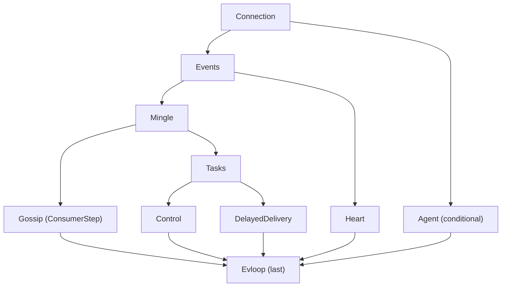

## Overview

The consumer is the part of the worker that talks to the broker. `celery.worker.consumer.Consumer` is created by the worker's `Consumer` bootstep and owns a second blueprint whose steps open the broker connection, start event dispatching, sync with other workers, consume task messages, serve remote-control commands, and finally run the event loop. Each task message is turned into a `Request` by a per-task strategy, then handed back to the `WorkController` that sends it to the execution pool. The bootsteps machinery is described in [[Worker Architecture and Bootsteps]]; the pools are covered in [[Concurrency Pools]].

Sources: [celery/worker/consumer/consumer.py:1-6](repo://celery/worker/consumer/consumer.py#L1-L6), [celery/worker/consumer/consumer.py:171-186](repo://celery/worker/consumer/consumer.py#L171-L186), [celery/worker/components.py:221-246](repo://celery/worker/components.py#L221-L246)

The constructor stores the pool, timer and hub; builds the `task_buckets` token buckets used for rate limits; picks `loops.asynloop` when a hub exists and `loops.synloop` otherwise; and applies `Consumer.Blueprint` with the extra steps from `app.steps['consumer']`. AMQP heartbeats (`broker_heartbeat`) are only enabled when there is a hub or the pool is green, since nothing else would service them.

Sources: [celery/worker/consumer/consumer.py:191-255](repo://celery/worker/consumer/consumer.py#L191-L255)

## End-to-End Flow

### From message to result

The sequence below follows one task message through the default code path with the event loop and the prefork pool.

Sources: [celery/worker/loops.py:50-65](repo://celery/worker/loops.py#L50-L65), [celery/worker/strategy.py:132-208](repo://celery/worker/strategy.py#L132-L208)

```mermaid
sequenceDiagram
  participant Broker
  participant Loop as asynloop
  participant Handler as on_task_received
  participant Strategy as strategy.default handler
  participant Req as Request
  participant WC as WorkController
  participant Pool as TaskPool
  participant Child as Pool child process
  Broker->>Loop: deliver message (up to prefetch count)
  Loop->>Handler: consumer.on_message(message)
  Handler->>Handler: look up strategies[headers.task]
  Handler->>Strategy: strategy(message, payload, ack, reject, callbacks)
  Strategy->>Req: Req(message, on_ack, on_reject, ...)
  Strategy->>Strategy: revoked or expired? ETA? rate limit?
  Strategy->>WC: task_reserved(req), handle(req)
  WC->>Req: execute_using_pool(pool)
  Req->>Pool: apply_async(trace, callbacks, time limits)
  Pool->>Child: write job
  Child-->>Req: on_accepted(pid, time)
  Child->>Child: fast_trace_task runs the task and stores the result
  Child-->>Req: on_success((failed, retval, runtime))
  Req->>Broker: ack (late ack or failure handling)
```

Sources: [celery/worker/consumer/consumer.py:723-786](repo://celery/worker/consumer/consumer.py#L723-L786), [celery/worker/worker.py:220-231](repo://celery/worker/worker.py#L220-L231), [celery/worker/request.py:341-372](repo://celery/worker/request.py#L341-L372), [celery/worker/request.py:515-527](repo://celery/worker/request.py#L515-L527), [celery/worker/request.py:596-611](repo://celery/worker/request.py#L596-L611), [celery/app/trace.py:757-788](repo://celery/app/trace.py#L757-L788)

## Consumer Blueprint Steps

### Step graph

The consumer blueprint lists ten default steps; their `requires` attributes produce the following boot order, with `Evloop` forced last because it sets `last = True`.

Sources: [celery/worker/consumer/consumer.py:171-186](repo://celery/worker/consumer/consumer.py#L171-L186), [celery/worker/consumer/consumer.py:857-865](repo://celery/worker/consumer/consumer.py#L857-L865)



Sources: [celery/worker/consumer/events.py:15-18](repo://celery/worker/consumer/events.py#L15-L18), [celery/worker/consumer/mingle.py:13-24](repo://celery/worker/consumer/mingle.py#L13-L24), [celery/worker/consumer/gossip.py:23-30](repo://celery/worker/consumer/gossip.py#L23-L30), [celery/worker/consumer/heart.py:10-19](repo://celery/worker/consumer/heart.py#L10-L19), [celery/worker/consumer/tasks.py:20-23](repo://celery/worker/consumer/tasks.py#L20-L23), [celery/worker/consumer/control.py:18-21](repo://celery/worker/consumer/control.py#L18-L21), [celery/worker/consumer/agent.py:9-13](repo://celery/worker/consumer/agent.py#L9-L13), [celery/worker/consumer/delayed_delivery.py:39-53](repo://celery/worker/consumer/delayed_delivery.py#L39-L53)

### Step reference

| Step | What `start` does | Enabled when |
|---|---|---|
| `Connection` | `c.connection = c.connect()`, logs `Connected to ...`; `shutdown` closes it | always |
| `Events` | Creates `app.events.Dispatcher` on a write connection, re-sending events buffered while disconnected | `task_events` or gossip or heartbeat is on |
| `Mingle` | Sends `hello` via `inspect` to neighbours, merges their logical clock and revoked ids | not `--without-mingle` and transport is `amqp`, `redis` or `gcpubsub` |
| `Gossip` | `ConsumerStep` consuming `worker.#` events to track other workers and elections | not `--without-gossip` and transport is `amqp` or `redis` |
| `Heart` | Starts `heartbeat.Heart`, sending `worker-heartbeat` events on the timer | not `--without-heartbeat` |
| `Tasks` | Builds strategies, sets `basic_qos`, creates `task_consumer` and `c.qos` | always |
| `Control` | Starts the pidbox (`Pidbox`, or `gPidbox` for green pools) for remote control | `worker_enable_remote_control` and the transport supports `fanout` |
| `DelayedDelivery` | Declares native delayed-delivery exchanges and binds queues | quorum queues are detected |
| `Agent` | Instantiates the `worker_agent` class (cell actors) | `worker_agent` is set |
| `Evloop` | Runs `c.loop(*c.loop_args())` | always, last |

Sources: [celery/worker/consumer/connection.py:13-45](repo://celery/worker/consumer/connection.py#L13-L45), [celery/worker/consumer/events.py:20-71](repo://celery/worker/consumer/events.py#L20-L71), [celery/worker/consumer/mingle.py:25-76](repo://celery/worker/consumer/mingle.py#L25-L76), [celery/worker/consumer/gossip.py:34-79](repo://celery/worker/consumer/gossip.py#L34-L79), [celery/worker/consumer/heart.py:21-36](repo://celery/worker/consumer/heart.py#L21-L36), [celery/worker/consumer/control.py:23-33](repo://celery/worker/consumer/control.py#L23-L33), [celery/worker/consumer/delayed_delivery.py:55-64](repo://celery/worker/consumer/delayed_delivery.py#L55-L64), [celery/worker/consumer/agent.py:15-21](repo://celery/worker/consumer/agent.py#L15-L21)

Remote control commands served by the `Control` step are documented in [[Remote Control and Inspection]], and the event types sent through `Events` and `Heart` in [[Events and Monitoring]].

Sources: [celery/worker/consumer/control.py:1-6](repo://celery/worker/consumer/control.py#L1-L6), [celery/worker/consumer/heart.py:10-17](repo://celery/worker/consumer/heart.py#L10-L17)

### Connection loss and restarts

`Consumer.start` loops until the blueprint reaches `CLOSE` or `TERMINATE`. Each pass calls `maybe_shutdown()`, steps the `restart_state` limiter (more than five restarts in one second logs `Frequent restarts detected` and sleeps one second), and calls `blueprint.start(self)`. Connection errors (plus channel errors when `broker_channel_error_retry` is set) are caught there and handled in one of three ways.

Sources: [celery/worker/consumer/consumer.py:366-382](repo://celery/worker/consumer/consumer.py#L366-L382)

- If retries are disabled (`broker_connection_retry_on_startup` for the first connection, otherwise `broker_connection_retry`), it raises `WorkerShutdown(1)`.
- `EMFILE` (too many open files) raises `WorkerTerminate(1)`.
- Otherwise it runs `on_connection_error_after_connected` (or the before-connected variant), then `on_close()` and `blueprint.restart(self)`, which calls `stop` on every step before the next pass starts them again.

Sources: [celery/worker/consumer/consumer.py:366-413](repo://celery/worker/consumer/consumer.py#L366-L413)

`on_connection_error_after_connected` collects and closes the broken connection with a 5 second `COLLECT_SOCKET_TIMEOUT`. If `worker_cancel_long_running_tasks_on_connection_loss` is enabled it cancels active `acks_late` requests that were not yet acknowledged, because their delivery tags died with the channel; otherwise it emits a pending-deprecation warning. `on_close` clears the semaphore, rate-limit buckets and reserved-but-not-active requests, and flushes the pool.

Sources: [celery/worker/consumer/consumer.py:65-68](repo://celery/worker/consumer/consumer.py#L65-L68), [celery/worker/consumer/consumer.py:419-451](repo://celery/worker/consumer/consumer.py#L419-L451), [celery/worker/consumer/consumer.py:532-547](repo://celery/worker/consumer/consumer.py#L532-L547)

`ensure_connected` wraps `Connection.ensure_connection` with an error callback that logs each retry as `Trying again in ... (n/max)` and uses `maybe_shutdown` as the per-retry callback, so a shutdown signal interrupts reconnection.

Sources: [celery/worker/consumer/consumer.py:568-622](repo://celery/worker/consumer/consumer.py#L568-L622)

## Event Loops

### asynloop

`asynloop` is used when the worker has a kombu `Hub`. It builds the message handler with `create_task_handler()`, schedules AMQP heartbeat checks on the hub timer, assigns `consumer.on_message`, calls `register_with_event_loop(hub)` on both the worker and consumer blueprints (this is where the pool, autoscaler and pidbox attach their file descriptors and timers), starts consuming and calls `on_ready()` (which fires the worker's `init_callback`). On the first start it raises `WorkerLostError('Could not start worker processes')` if `pool.did_start_ok()` is false.

Sources: [celery/worker/loops.py:50-77](repo://celery/worker/loops.py#L50-L77), [celery/worker/consumer/consumer.py:506-509](repo://celery/worker/consumer/consumer.py#L506-L509)

The loop itself runs while the blueprint is `RUN` and a connection exists: it calls `state.maybe_shutdown()`, re-raises any heartbeat error, applies pending QoS changes only when `qos.prev != qos.value` (batching `basic_qos` calls), and advances the hub generator. On an `Exception` it resets the hub and clears its timer so stale callbacks from the dead connection do not fire after reconnecting; `WorkerShutdown` and `WorkerTerminate` derive from `SystemExit` and skip this cleanup, which keeps heartbeat timers alive while the pool drains.

Sources: [celery/worker/loops.py:79-130](repo://celery/worker/loops.py#L79-L130)

### synloop

`synloop` is the blocking fallback for transports without async I/O support and for gevent and eventlet. Each cycle runs `perform_pending_operations()` and then `connection.drain_events(timeout=2.0)`; socket timeouts are ignored and `OSError` is only re-raised while still running. AMQP heartbeats are scheduled on the worker timer only for green pools.

Sources: [celery/worker/loops.py:133-183](repo://celery/worker/loops.py#L133-L183)

### Deferred callbacks

`call_soon` schedules a callback on the hub, or appends it to `_pending_operations` for `synloop`. Acks and rejects use `call_soon_ack` instead, which executes immediately when there is no hub: deferring them until the next `drain_events` return would hold up the next delivery when `acks_late` and a prefetch multiplier of 1 are combined.

Sources: [celery/worker/consumer/consumer.py:257-294](repo://celery/worker/consumer/consumer.py#L257-L294)

## Prefetch and QoS

### Initial prefetch count

The worker passes `initial_prefetch_count = concurrency * worker_prefetch_multiplier` (using `max_concurrency` when autoscaling). `Tasks.start` applies it with `basic_qos(0, initial_prefetch_count, qos_global)` and wraps the consumer in a `kombu.common.QoS` object whose ceiling is `worker_eta_task_limit`. `qos_global` is true when the broker's QoS semantics differ from the AMQP spec (RabbitMQ 3.3 and later), but is forced to false when quorum queues are detected, because they only support per-consumer prefetch.

Sources: [celery/worker/components.py:226-236](repo://celery/worker/components.py#L226-L236), [celery/worker/consumer/tasks.py:29-57](repo://celery/worker/consumer/tasks.py#L29-L57), [celery/worker/consumer/tasks.py:103-124](repo://celery/worker/consumer/tasks.py#L103-L124)

| Setting | Default | Effect |
|---|---|---|
| `worker_prefetch_multiplier` | `4` | Messages reserved per pool process |
| `worker_eta_task_limit` | `None` | Upper bound for the QoS value as ETA tasks raise it |
| `worker_enable_prefetch_count_reduction` | `True` | Lower prefetch after reconnect while old tasks still run |
| `worker_disable_prefetch` | `False` | Redis only: fetch only when a process slot is free |
| `worker_detect_quorum_queues` | `True` | Switch to per-consumer QoS for quorum queues |

Sources: [celery/app/defaults.py:356-359](repo://celery/app/defaults.py#L356-L359), [celery/app/defaults.py:373-373](repo://celery/app/defaults.py#L373-L373)

### Dynamic adjustments

ETA and countdown tasks stay in worker memory until due, so the strategy calls `consumer.qos.increment_eventually()` when it schedules one, and `apply_eta_task` calls `decrement_eventually()` when the timer fires. Pool resizes go through `_update_prefetch_count`, which recomputes `initial_prefetch_count` from `pool.num_processes` and changes the QoS value by `abs(index) * prefetch_multiplier`. All changes are applied lazily by the event loop.

Sources: [celery/worker/strategy.py:193-201](repo://celery/worker/strategy.py#L193-L201), [celery/worker/consumer/consumer.py:305-327](repo://celery/worker/consumer/consumer.py#L305-L327), [celery/worker/consumer/consumer.py:659-663](repo://celery/worker/consumer/consumer.py#L659-L663)

### Prefetch reduction after reconnect

After a reconnect, tasks still running from the old connection would otherwise be added on top of a full new prefetch window. With `worker_enable_prefetch_count_reduction`, the consumer starts again at `max(prefetch_multiplier, max_prefetch_count - active * prefetch_multiplier)`. Every later ack or reject promise then calls `_restore_prefetch_count_after_connection_restart`, raising the QoS by one multiplier until `max_prefetch_count` (`pool.num_processes * prefetch_multiplier`) is reached. The reduction is skipped for per-consumer QoS (`qos_global is False`), where broker-side updates would never reach the running consumer.

Sources: [celery/worker/consumer/consumer.py:452-491](repo://celery/worker/consumer/consumer.py#L452-L491), [celery/worker/consumer/consumer.py:788-815](repo://celery/worker/consumer/consumer.py#L788-L815)

### Disabling prefetch

When `worker_disable_prefetch` is set and the broker is Redis, `Tasks.start` patches the channel's `qos.can_consume` so that no new message is fetched while `len(state.reserved_requests)` has reached the autoscaler's `max_concurrency` or the pool size. On other transports it logs a warning and ignores the setting.

Sources: [celery/worker/consumer/tasks.py:59-83](repo://celery/worker/consumer/tasks.py#L59-L83)

## Message Dispatch

### The task message handler

`Tasks.start` calls `update_strategies()`, which stores `task.start_strategy(app, consumer)` for every registered task and rebuilds each task's `__trace__`. `create_task_handler()` returns the closure `on_task_received(message)`, which works in four steps.

Sources: [celery/worker/consumer/tasks.py:29-31](repo://celery/worker/consumer/tasks.py#L29-L31), [celery/worker/consumer/consumer.py:716-731](repo://celery/worker/consumer/consumer.py#L716-L731)

1. reads the task name from `message.headers['task']` (protocol 2), or decodes the body and reads `payload['task']` (protocol 1);
2. looks up the strategy, calling `on_unknown_task` if the name is not registered;
3. wraps `message.ack_log_error` and `message.reject_log_error` in `promise` objects executed through `call_soon_ack`, chaining the prefetch-restore callback while a reconnect reduction is active;
4. calls `strategy(message, payload, ack, reject, callbacks)`, mapping `InvalidTaskError`/`ContentDisallowed` to `on_invalid_task` and `DecodeError` to `on_decode_error`.

Sources: [celery/worker/consumer/consumer.py:716-786](repo://celery/worker/consumer/consumer.py#L716-L786), [celery/app/task.py:520-521](repo://celery/app/task.py#L520-L521)

### Default strategy

`Task.Strategy` defaults to `celery.worker.strategy:default` and `Task.Request` to `celery.worker.request:Request`. `default()` runs once per task type and pre-binds everything the hot path needs: the event dispatcher, timer, rate-limit bucket lookup, `consumer.on_task_request`, the revoked set, and a task-specialised request class from `create_request_cls`. The returned `task_message_handler` then processes each message as follows.

Sources: [celery/app/task.py:222-225](repo://celery/app/task.py#L222-L225), [celery/worker/strategy.py:99-131](repo://celery/worker/strategy.py#L99-L131)

- converts protocol 1 or hybrid bodies to the protocol 2 `(args, kwargs, embed)` shape (`proto1_to_proto2`, `hybrid_to_proto2`); protocol 2 bodies stay undecoded so the pool child deserializes them;
- builds the `Req`, logs `Received task` at INFO, and returns early if the task is expired or revoked;
- sends `task_received` and, when enabled, a `task-received` event;
- schedules ETA tasks on the timer with `call_at` (through the rate-limit bucket if one exists), or puts rate-limited tasks into their bucket;
- otherwise calls `task_reserved(req)`, runs the `on_task_message` callbacks (the autoscaler hooks in here), and calls `handle(req)`.

Sources: [celery/app/task.py:222-225](repo://celery/app/task.py#L222-L225), [celery/worker/strategy.py:99-208](repo://celery/worker/strategy.py#L99-L208)

> [!NOTE]
> The strategy and request class are specialised per task for speed; the `default` docstring itself notes that strategies "are here as an optimization, so sadly it's not very easy to override."

Sources: [celery/worker/strategy.py:103-108](repo://celery/worker/strategy.py#L103-L108)

### Rate limits

`bucket_for_task` creates a `TokenBucket(limit, capacity=1)` for tasks with a `rate_limit`, unless `worker_disable_rate_limits` is set. `_schedule_bucket_request` pops requests while tokens are available and moves them to the pool through `_limit_move_to_pool`; when empty it pushes the request back to the head and re-arms itself on the timer after `bucket.expected_time(tokens)`, with rotating priorities to keep ordering fair across buckets.

Sources: [celery/worker/consumer/consumer.py:296-364](repo://celery/worker/consumer/consumer.py#L296-L364)

### Handing off to the pool

`consumer.on_task_request` is the worker's `process_task`. `_process_task` calls `req.execute_using_pool(self.pool)` and, if the request turns out to be revoked, releases the semaphore slot. When put-locks are active, `_process_task_sem` first acquires the `LaxBoundedSemaphore` so that requests queue in the worker rather than in the pool.

Sources: [celery/worker/worker.py:220-231](repo://celery/worker/worker.py#L220-L231), [celery/worker/components.py:145-152](repo://celery/worker/components.py#L145-L152)

### Malformed and unknown messages

| Situation | Handler | Outcome |
|---|---|---|
| No `task` header or field | `on_unknown_message` | Warn, reject, send `task_rejected` |
| Unregistered task name | `on_unknown_task` | Log with headers, reject, `mark_as_failure` with `NotRegistered`, send `task-failed` event and `task_unknown` signal |
| Invalid message or disallowed content | `on_invalid_task` | Log, reject, send `task_rejected` |
| Body cannot be decoded | `on_decode_error` | Log critical, ack so it is not redelivered forever |

Sources: [celery/worker/consumer/consumer.py:516-530](repo://celery/worker/consumer/consumer.py#L516-L530), [celery/worker/consumer/consumer.py:672-714](repo://celery/worker/consumer/consumer.py#L672-L714)

## The Request Object

### Construction

`Request.__init__` copies the message headers into `_request_dict`, reads `id`, `task` (or `shadow` for the display name), `root_id`, `parent_id`, `timelimit`, `argsrepr` and `kwargsrepr`, and parses `eta` and `expires` with `maybe_iso8601`, raising `InvalidTaskError` on bad values. It records a compact `delivery_info` (exchange, routing key, priority, redelivered) and adds `reply_to`, `correlation_id` and `hostname` to the request dict. `ignore_result` from the message overrides the task attribute.

Sources: [celery/worker/request.py:90-175](repo://celery/worker/request.py#L90-L175)

### Sending work to the pool

`execute_using_pool` checks `revoked()` (raising `TaskRevokedError` if so), picks `fast_trace_task` or `trace_task_ret`, and calls `pool.apply_async` with the serialized body and five hooks: `accept_callback=on_accepted`, `timeout_callback=on_timeout`, `callback=on_success`, `error_callback=on_failure`, and the soft/hard time limits from the message, falling back to the task's `soft_time_limit`/`time_limit`. The `Request` subclass built by `create_request_cls` does the same with task defaults bound in a closure.

Sources: [celery/worker/request.py:341-372](repo://celery/worker/request.py#L341-L372), [celery/worker/request.py:818-874](repo://celery/worker/request.py#L818-L874)

In the pool child, `fast_trace_task` decodes the body, merges `args`, `kwargs` and the embedded callbacks/chord into the request, and runs the task's prebuilt tracer, which executes the task and stores its result in the backend. It returns `(1, exception_info, runtime)` on failure or `(0, result_repr, runtime)` on success.

Sources: [celery/app/trace.py:735-788](repo://celery/app/trace.py#L735-L788)

`Request.execute` is the in-process variant: it runs `trace_task` directly and acks or rejects based on the outcome.

Sources: [celery/worker/request.py:374-406](repo://celery/worker/request.py#L374-L406)

### Pool callbacks

- `on_accepted(pid, time_accepted)` records `worker_pid` and an absolute `time_start`, calls `task_accepted`, acks early unless `acks_late`, sends `task-started`, and applies any termination requested before the task started.
- `on_success` unpacks the `(failed, retval, runtime)` tuple. A failed result is routed to `on_failure(retval, return_ok=True)`, re-raising `SystemExit`/`KeyboardInterrupt`; otherwise it calls `task_ready(successful=True)`, acks when `acks_late`, and sends `task-succeeded`.
- `on_failure` handles `Terminated`, `MemoryError`, `Reject`, `Ignore` and `Retry` specially, then applies the late-ack rules, stores the failure (only if the child could not have stored it, or the worker was lost), sends `task_failure` and `task-failed`, and logs `Task handler raised error` unless the failure was already reported.
- `on_timeout(soft, timeout)` only logs for a soft limit. For a hard limit it marks `TimeLimitExceeded` in the backend and runs the task's own `on_failure` handler, `after_return`, the `task_failure` signal and the `task-failed` event, unless a cold shutdown is in progress.

Sources: [celery/worker/request.py:515-529](repo://celery/worker/request.py#L515-L529), [celery/worker/request.py:529-595](repo://celery/worker/request.py#L529-L595), [celery/worker/request.py:596-621](repo://celery/worker/request.py#L596-L621), [celery/worker/request.py:622-728](repo://celery/worker/request.py#L622-L728)

### Acknowledgement rules

`acknowledge()` and `reject()` are idempotent through the `acknowledged` flag; `reject` also sends a `task-rejected` event. Without `acks_late`, the message is acked as soon as the pool accepts the job. With `acks_late`, the outcome decides.

Sources: [celery/worker/request.py:730-740](repo://celery/worker/request.py#L730-L740), [celery/worker/request.py:515-522](repo://celery/worker/request.py#L515-L522)

| Outcome (`acks_late=True`) | Action |
|---|---|
| Success | ack |
| `Retry` | ack (the retry is a new message) |
| `Ignore` | ack |
| `Reject(requeue=...)` | reject with that `requeue`; without requeue also store `FAILURE` |
| `WorkerLostError` and `reject_on_worker_lost` | reject with requeue, no failed event |
| Hard time limit | ack if `acks_on_timeout`, else reject with requeue |
| Other exception | ack if `acks_on_failure`, else reject without requeue |

Sources: [celery/worker/request.py:590-595](repo://celery/worker/request.py#L590-L595), [celery/worker/request.py:608-620](repo://celery/worker/request.py#L608-L620), [celery/worker/request.py:649-696](repo://celery/worker/request.py#L649-L696)

> [!CAUTION]
> With `acks_late` and `reject_on_worker_lost`, a task that crashes its process is requeued and may crash the next worker too. Make such tasks idempotent and bounded.

Sources: [celery/worker/request.py:677-690](repo://celery/worker/request.py#L677-L690)

### Revocation, termination and cancellation

`revoked()` returns true if the request was already revoked, has passed `expires` (`maybe_expire` adds it to `state.revoked`), its id is in `state.revoked`, or one of its stamped headers matches `state.revoked_stamps`. It then calls `_announce_revoked`, which marks the request ready, sends `task-revoked`, stores `REVOKED` in the backend, acks the message and sends the `task_revoked` signal. Revocation is checked both in the strategy and again in `execute_using_pool`.

Sources: [celery/worker/request.py:408-414](repo://celery/worker/request.py#L408-L414), [celery/worker/request.py:457-509](repo://celery/worker/request.py#L457-L509), [celery/worker/strategy.py:162-163](repo://celery/worker/strategy.py#L162-L163)

`terminate(pool, signal)` kills a running job with `pool.terminate_job(worker_pid, signal)`; if the job has not started yet it stores `_terminate_on_ack` so `on_accepted` finishes the job. `cancel()` is used at shutdown and on connection loss: it kills the job and calls `_announce_cancelled`, which sends `task-cancelled` and, when `emit_retry` is true, marks the task as `RETRY` and fires `on_retry` and the `task_retry` signal.

Sources: [celery/worker/request.py:416-455](repo://celery/worker/request.py#L416-L455)
