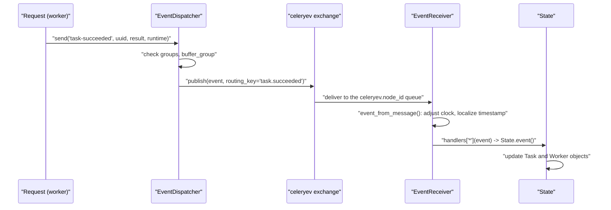

## Overview

Celery events are small messages that workers (and optionally clients) publish whenever something happens: a task is received, starts, succeeds, a worker comes online or sends a heartbeat. Monitors such as `celery events`, Flower or custom scripts consume this stream to build a live picture of the cluster without querying workers directly. The package docstring describes it as a stream of messages sent for actions in the worker, and in clients when `task_send_sent_event` is enabled.

Sources: [celery/events/__init__.py:1-15](repo://celery/events/__init__.py#L1-L15)

The subsystem has four parts. `EventDispatcher` publishes events, and `EventReceiver` consumes them. `State` folds the stream into in-memory `Worker` and `Task` objects. `Polaroid` takes periodic snapshots of that state. `app.events` exposes app-bound versions of the dispatcher, receiver and state classes.

Sources: [celery/app/events.py:7-40](repo://celery/app/events.py#L7-L40)

## Event Structure

### Event dictionaries

An event is a plain dict whose only required field is `type`. `Event()` adds a `timestamp` (from `time.time`) if one is not given. The dispatcher also adds `hostname`, `utcoffset`, `pid` and `clock` (the Lamport clock value). `group_from(type)` returns the part before the first dash, so `task-sent` belongs to group `task` and `worker-heartbeat` to group `worker`.

Sources: [celery/events/event.py:18-43](repo://celery/events/event.py#L18-L43), [celery/events/dispatcher.py:135-140](repo://celery/events/dispatcher.py#L135-L140)

### Exchange and routing

Events are published to a topic exchange named by `event_exchange` (default `celeryev`). `get_exchange` copies it and switches the type to `fanout` for the `redis` and `gcpubsub` transports. The routing key is the event type with dashes turned into dots, for example `task.succeeded`. Grouped buffers are flushed under `<group>.multi`.

Sources: [celery/events/event.py:11-15](repo://celery/events/event.py#L11-L15), [celery/events/event.py:46-63](repo://celery/events/event.py#L46-L63), [celery/events/dispatcher.py:138-140](repo://celery/events/dispatcher.py#L138-L140), [celery/events/dispatcher.py:209-213](repo://celery/events/dispatcher.py#L209-L213)

### Event types

The tables list the built-in event types, who sends each one and the main extra fields.

Sources: [celery/worker/strategy.py:167-176](repo://celery/worker/strategy.py#L167-L176), [celery/worker/heartbeat.py:39-61](repo://celery/worker/heartbeat.py#L39-L61)

| Event | Sent by | Notable fields |
|---|---|---|
| `task-sent` | client publishing the task (opt-in) | `uuid`, `name`, `args`, `kwargs`, `queue`, `exchange`, `routing_key` |
| `task-received` | worker strategy on message arrival | `uuid`, `name`, `args`, `kwargs`, `root_id`, `parent_id`, `retries`, `eta`, `expires` |
| `task-started` | `Request.on_accepted` | `uuid` |
| `task-succeeded` | `Request.on_success` | `result`, `runtime` |
| `task-failed` | `Request.on_failure` | `exception`, `traceback` |
| `task-retried` | `Request.on_retry` | `exception`, `traceback` |
| `task-revoked` | `Request._announce_revoked` | `terminated`, `signum`, `expired` |
| `task-rejected` | `Request.reject` | `requeue` |

Sources: [celery/app/amqp.py:593-605](repo://celery/app/amqp.py#L593-L605), [celery/worker/strategy.py:167-176](repo://celery/worker/strategy.py#L167-L176), [celery/worker/request.py:457-460](repo://celery/worker/request.py#L457-L460), [celery/worker/request.py:515-523](repo://celery/worker/request.py#L515-L523), [celery/worker/request.py:606-669](repo://celery/worker/request.py#L606-L669), [celery/worker/request.py:736-741](repo://celery/worker/request.py#L736-L741)

| Event | Sent by | Notable fields |
|---|---|---|
| `worker-online` | `Heart.start` | `freq`, `active`, `processed`, `loadavg`, `sw_ident`, `sw_ver`, `sw_sys` |
| `worker-heartbeat` | `Heart` timer every `interval` seconds, or the `heartbeat` control command | same as above |
| `worker-offline` | `Heart.stop` | same as above |

Sources: [celery/worker/heartbeat.py:39-61](repo://celery/worker/heartbeat.py#L39-L61), [celery/worker/control.py:370-376](repo://celery/worker/control.py#L370-L376)

A worker sends task events only when its dispatcher is enabled and the task class has `send_events = True` (the default). Tasks can emit custom events with `Task.send_event(type_, **fields)`, which opens `app.events.default_dispatcher` and sends with the current request's id.

Sources: [celery/worker/request.py:511-513](repo://celery/worker/request.py#L511-L513), [celery/app/task.py:264-268](repo://celery/app/task.py#L264-L268), [celery/app/task.py:1003-1027](repo://celery/app/task.py#L1003-L1027)

## End-to-End Flow

The diagram shows how one task event travels from the worker to a monitor's `State`.

Sources: [celery/events/dispatcher.py:164-199](repo://celery/events/dispatcher.py#L164-L199), [celery/events/receiver.py:113-145](repo://celery/events/receiver.py#L113-L145), [celery/events/state.py:501-503](repo://celery/events/state.py#L501-L503)



Sources: [celery/events/dispatcher.py:116-199](repo://celery/events/dispatcher.py#L116-L199), [celery/events/receiver.py:63-72](repo://celery/events/receiver.py#L63-L72), [celery/events/receiver.py:80-145](repo://celery/events/receiver.py#L80-L145), [celery/events/state.py:540-634](repo://celery/events/state.py#L540-L634)

## EventDispatcher

### Construction

`EventDispatcher` takes a connection or channel, a `hostname` (defaulting to `anon_nodename()`), `groups`, `enabled`, `buffer_while_offline`, `buffer_group` and `buffer_limit` (default 24). It serializes with `event_serializer` unless overridden. Transports in `DISABLED_TRANSPORTS` (`sql`) force `enabled=False`. `enable()` creates a kombu `Producer` with `auto_declare=False` and runs the `on_enabled` callbacks. `disable()` closes the producer and runs `on_disabled`. Use it as a context manager or call `close()` when done.

Sources: [celery/events/dispatcher.py:19-114](repo://celery/events/dispatcher.py#L19-L114)

### send() and publish()

`send()` drops the event if the dispatcher is disabled, or if `groups` is non-empty and the event's group is not in it. Events whose group is in `buffer_group` are built immediately (so the clock value reflects send time) and appended to a per-group list. `flush()` is called when the list reaches `buffer_limit`, otherwise `on_send_buffered` is invoked. Everything else goes to `publish()`, which forwards the clock unless `blind=True` and publishes under `mutex`.

Sources: [celery/events/dispatcher.py:116-199](repo://celery/events/dispatcher.py#L116-L199)

When publishing fails and `buffer_while_offline` is true, `_publish` appends the event to `_outbound_buffer` instead of raising. `flush(errors=True, groups=True)` resends that buffer and then publishes each group buffer as a single list-valued message. `extend_buffer(other)` copies another dispatcher's outbound buffer, which the worker uses after reconnecting.

Sources: [celery/events/dispatcher.py:142-217](repo://celery/events/dispatcher.py#L142-L217)

```python
with app.events.default_dispatcher(hostname='monitor@example') as d:
    d.send('custom-deploy', version='1.2.3')
```

Sources: [celery/app/events.py:32-40](repo://celery/app/events.py#L32-L40), [celery/events/dispatcher.py:164-199](repo://celery/events/dispatcher.py#L164-L199)

## EventReceiver

### Queue declaration

`EventReceiver` is a kombu `ConsumerMixin`. It declares a queue named `<event_queue_prefix>.<node_id>` (default prefix `celeryev`, `node_id` a fresh uuid) bound to the event exchange with `routing_key='#'`. The queue uses `event_queue_ttl`, `event_queue_expires`, `event_queue_exclusive` and `event_queue_durable`, and raises `ImproperlyConfigured` if both exclusive and durable are set. It accepts `event_serializer` and `json` by default.

Sources: [celery/events/receiver.py:23-78](repo://celery/events/receiver.py#L23-L78)

### Dispatching to handlers

`handlers` maps event types to callables, and the special key `'*'` catches any type without its own handler. Once consuming starts, `on_consume_ready` broadcasts the `heartbeat` control command (`wakeup_workers`) so workers announce themselves immediately instead of waiting for the next interval. `capture(limit, timeout, wakeup)` consumes until stopped, and `itercapture` yields as it goes.

Sources: [celery/events/receiver.py:80-111](repo://celery/events/receiver.py#L80-L111)

`event_from_message` keeps clocks consistent. For `task-sent` it ignores the client's clock (clients never sync) and substitutes the local value minus one. For other events it adjusts the local clock to the received value, or forwards it if none was sent. It then localizes `timestamp` using `utcoffset` and records `local_received`. `_receive` accepts either a single event or a list, which is what grouped buffers produce.

Sources: [celery/events/receiver.py:113-145](repo://celery/events/receiver.py#L113-L145)

```python
def on_failed(event):
    state.event(event)
    task = state.tasks.get(event['uuid'])
    print(f'{task.name}[{task.uuid}] failed: {task.exception}')

state = app.events.State()
with app.connection() as conn:
    recv = app.events.Receiver(conn, handlers={
        'task-failed': on_failed,
        '*': state.event,
    })
    recv.capture(limit=None, timeout=None, wakeup=True)
```

Sources: [celery/events/receiver.py:36-45](repo://celery/events/receiver.py#L36-L45), [celery/events/receiver.py:80-106](repo://celery/events/receiver.py#L80-L106), [celery/events/state.py:501-503](repo://celery/events/state.py#L501-L503)

## In-Memory State

### State

`State` keeps `workers` and `tasks` in `LRUCache` objects bounded by `max_workers_in_memory` (5000) and `max_tasks_in_memory` (10000). It also keeps a time-ordered `_taskheap` and the indexes `tasks_by_type` and `tasks_by_worker`. Those indexes are `CallableDefaultdict` objects: index them for a `WeakSet` of tasks, or call them for a time-ordered generator. `event(event)` takes the mutex and runs a dispatcher closure built once by `_create_dispatcher`.

Sources: [celery/events/state.py:79-103](repo://celery/events/state.py#L79-L103), [celery/events/state.py:398-511](repo://celery/events/state.py#L398-L511)

The closure counts the event, calls the optional `callback`, and splits the type into group and subject. A custom handler registered in `state.handlers[group]` takes precedence. For `worker-*` events it creates or updates the `Worker` and fires `on_node_join` / `on_node_leave`, and an `offline` event removes the worker. For `task-*` events it creates the `Task` if needed and records `client` for `task-sent` or `worker` otherwise. It pushes a `timetuple(clock, timestamp, origin, ref(task))` onto the heap, trimming it at `max_tasks_in_memory * heap_multiplier`. It then applies the event to the task and links parent and child tasks, even when they arrive out of order.

Sources: [celery/events/state.py:513-575](repo://celery/events/state.py#L513-L575), [celery/events/state.py:576-641](repo://celery/events/state.py#L576-L641)

### Worker

`Worker` stores `hostname`, `pid`, `freq`, `clock`, `active`, `processed`, `loadavg` and software info, plus a sorted list of up to `heartbeat_max` (4) received timestamps. Each event copies its fields onto the object. The handler warns once per host when the drift between sent and received time exceeds `HEARTBEAT_DRIFT_MAX` (16 s), and `offline` clears the heartbeats. `alive` is true while now is before `heartbeat_expires`, meaning the last heartbeat plus `freq * HEARTBEAT_EXPIRE_WINDOW / 100` (200 % of the interval).

Sources: [celery/events/state.py:45-57](repo://celery/events/state.py#L45-L57), [celery/events/state.py:106-123](repo://celery/events/state.py#L106-L123), [celery/events/state.py:149-239](repo://celery/events/state.py#L149-L239)

### Task

`Task.event` maps the subject to a state through `TASK_EVENT_TO_STATE` (for example `received` maps to `RECEIVED` and `succeeded` to `SUCCESS`) and stores the timestamp in an attribute of the same name, such as `task.succeeded`. Unknown subjects become custom upper-cased states. Events can arrive out of order. If the incoming state logically happens before the current one (by `states.precedence`, ignoring `RETRY`), the task does not move back. Only the fields listed in `merge_rules` are merged, so `name`, `args` and `kwargs` from `task-received` still fill in after `task-succeeded`.

Sources: [celery/events/state.py:66-76](repo://celery/events/state.py#L66-L76), [celery/events/state.py:242-332](repo://celery/events/state.py#L242-L332)

Query helpers include `tasks_by_time(limit, reverse)`, `task_types()`, `alive_workers()`, `clear_tasks(ready=True)` (keeps unfinished tasks), and `freeze_while(fun, clear_after)`, which runs `fun` while holding the mutex.

Sources: [celery/events/state.py:442-475](repo://celery/events/state.py#L442-L475), [celery/events/state.py:650-708](repo://celery/events/state.py#L650-L708)

## Snapshots and Cameras

### Polaroid

`Polaroid` records the state at a fixed rate. `install()` schedules `capture` every `freq` seconds and `cleanup` every `cleanup_freq` (3600 s) on a timer. `capture` calls `state.freeze_while(self.shutter, clear_after=self.clear_after)`. `shutter` respects an optional `maxrate` token bucket, sends `shutter_signal` and calls `on_shutter(state)`. Subclasses override `on_shutter` and `on_cleanup` to persist data, and setting `clear_after = True` empties the state after each snapshot.

Sources: [celery/events/snapshot.py:24-83](repo://celery/events/snapshot.py#L24-L83)

```python
from celery.events.snapshot import Polaroid

class DumpCam(Polaroid):
    clear_after = True

    def on_shutter(self, state):
        if not state.event_count:
            return
        print(f'Workers: {state.workers}')
        print(f'Total: {state.event_count} events, {state.task_count} tasks')
```

Sources: [celery/events/snapshot.py:24-69](repo://celery/events/snapshot.py#L24-L69)

### evcam

`evcam(camera, freq, maxrate, ...)` creates a pidlock when `pidfile` is set, configures logging, and instantiates the camera class by its dotted name with a new `app.events.State()`. It installs the camera and captures events with a receiver whose `'*'` handler is `state.event`. On exit it cancels the timers, which also flushes one final snapshot.

Sources: [celery/events/snapshot.py:86-111](repo://celery/events/snapshot.py#L86-L111)

## The celery events Command

### Modes

`celery events` picks one of three modes: `--dump` runs `evdump`, `-c/--camera <class>` runs `evcam` with `--frequency`, `--maxrate`, `--loglevel` and optional `--detach`, and the default runs the curses monitor `evtop`. See [[Command Line Interface]] for global options.

Sources: [celery/bin/events.py:18-98](repo://celery/bin/events.py#L18-L98)

```console
$ celery -A proj events
$ celery -A proj events --dump
$ celery -A proj events --camera=myapp.DumpCam --frequency=2.0
```

Sources: [celery/bin/events.py:51-96](repo://celery/bin/events.py#L51-L96)

### Dumper and curses monitor

`Dumper.on_event` prints one line per event, remembering task names from `task-received`/`task-sent` in an LRU cache so later events for the same uuid can show the name. `evdump` reconnects in a loop on connection or channel errors.

Sources: [celery/events/dumper.py:15-99](repo://celery/events/dumper.py#L15-L99)

`evtop` builds a `State`, starts a `DisplayThread` that redraws the `CursesMonitor`, and runs `capture_events`, which reconnects on errors. The monitor's keymap uses `J`/`K` to move the selection, `C` to revoke the task (`app.control.revoke`), `L` to set a rate limit, and `I`, `T` and `R` to show info, traceback and result.

Sources: [celery/events/cursesmon.py:51-66](repo://celery/events/cursesmon.py#L51-L66), [celery/events/cursesmon.py:239-243](repo://celery/events/cursesmon.py#L239-L243), [celery/events/cursesmon.py:479-530](repo://celery/events/cursesmon.py#L479-L530)

## Enabling Events in Workers

### Worker events bootstep

The consumer `Events` bootstep creates `c.event_dispatcher` after the connection step. With task events disabled it sets `groups=['worker']`, so only worker events go out. The dispatcher is still enabled when gossip or heartbeats are on, because those rely on worker events. On event-loop workers, task events are buffered with `buffer_group=['task']`. On reconnect, the step carries over the old dispatcher's buffer and group changes made by remote control, then flushes them.

Sources: [celery/worker/consumer/events.py:15-71](repo://celery/worker/consumer/events.py#L15-L71)

The `Heart` bootstep requires `Events`. It starts `celery.worker.heartbeat.Heart` with the `--heartbeat-interval` value (default 2.0 s). `Heart` hooks into the dispatcher's `on_enabled` and `on_disabled` callbacks, sends `worker-online`, schedules `worker-heartbeat` with active and processed counts and the load average, and sends `worker-offline` when it stops. It also fires the `heartbeat_sent` signal if there are receivers.

Sources: [celery/worker/consumer/heart.py:10-36](repo://celery/worker/consumer/heart.py#L10-L36), [celery/worker/heartbeat.py:14-61](repo://celery/worker/heartbeat.py#L14-L61)

### Settings

Task events are off by default. Enable them with `worker_send_task_events` or `celery worker -E`, or at runtime with `app.control.enable_events()`, which adds the `task` group to running dispatchers (see [[Remote Control and Inspection]]). `task-sent` is opt-in on the client side through `task_send_sent_event`, which `send_task` passes into `create_task_message` as `create_sent_event`.

Sources: [celery/worker/worker.py:376-377](repo://celery/worker/worker.py#L376-L377), [celery/apps/worker.py:228-230](repo://celery/apps/worker.py#L228-L230), [celery/worker/control.py:344-354](repo://celery/worker/control.py#L344-L354), [celery/app/base.py:1007-1016](repo://celery/app/base.py#L1007-L1016)

| Setting | Default | Purpose |
|---|---|---|
| `worker_send_task_events` | `False` | send `task-*` events from workers |
| `task_send_sent_event` | `False` | send `task-sent` from clients |
| `event_exchange` | `'celeryev'` | exchange name |
| `event_serializer` | `'json'` | event serializer |
| `event_queue_prefix` | `'celeryev'` | receiver queue name prefix |
| `event_queue_ttl` | `5.0` | message TTL for receiver queues |
| `event_queue_expires` | `60.0` | receiver queue expiry |
| `event_queue_exclusive` / `event_queue_durable` | `True` / `False` | receiver queue flags (mutually exclusive) |

Sources: [celery/app/defaults.py:179-189](repo://celery/app/defaults.py#L179-L189), [celery/app/defaults.py:311-313](repo://celery/app/defaults.py#L311-L313), [celery/app/defaults.py:366-368](repo://celery/app/defaults.py#L366-L368)

> [!NOTE]
> The `sql` transport cannot carry events. `EventDispatcher` silently disables itself for it, so monitors will see nothing.

Sources: [celery/events/dispatcher.py:48-48](repo://celery/events/dispatcher.py#L48-L48), [celery/events/dispatcher.py:84-88](repo://celery/events/dispatcher.py#L84-L88)
