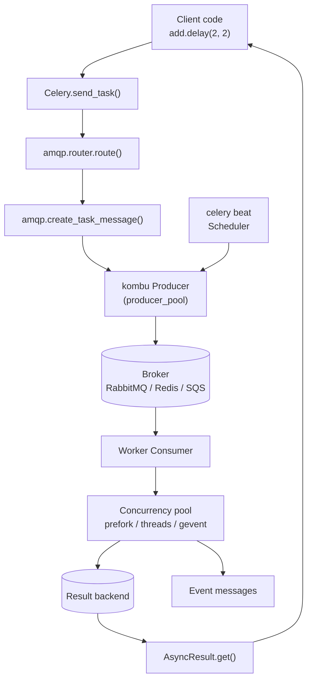

## Overview

Celery is a distributed task queue. A client process turns a function call into a message, a broker delivers that message, and dedicated worker processes pick it up and run the function. Because the work travels as messages, a deployment can have many clients, many workers and several brokers, which gives horizontal scaling and high availability.

Sources: [README.rst:91-109](repo://README.rst#L91-L109)

The package itself describes its purpose as "Distributed Task Queue" and exposes a small top-level API: the `Celery` application class, the `Task` base class, `shared_task`, the `current_app`/`current_task` proxies and the canvas primitives (`signature`, `chain`, `group`, `chord`, `chunks`, `xmap`, `xstarmap`).

Sources: [celery/__init__.py:1-41](repo://celery/__init__.py#L1-L41)

This page describes the main components, how a task moves through them, and where each one lives in the `celery` package. For a hands-on walk-through see [[Quickstart]]. The central object is described in [[The Celery Application]].

Sources: [celery/app/base.py:252-287](repo://celery/app/base.py#L252-L287)

## Main Components

### The application object

Everything starts from an instance of `celery.app.base.Celery`. The app owns the configuration (`app.conf`), the task registry (`app.tasks`), the loader, and lazily created helpers for messaging (`app.amqp`), results (`app.backend`), events (`app.events`), remote control (`app.control`) and logging (`app.log`). Each helper is a `cached_property` that instantiates a class named by a string attribute such as `amqp_cls = 'celery.app.amqp:AMQP'`, so a subclass or a constructor argument can swap any of them out.

Sources: [celery/app/base.py:311-318](repo://celery/app/base.py#L311-L318), [celery/app/base.py:1534-1609](repo://celery/app/base.py#L1534-L1609)

The app is also the factory for the long-running programs. `app.Worker`, `app.WorkController` and `app.Beat` return subclasses of `celery.apps.worker:Worker`, `celery.worker:WorkController` and `celery.apps.beat:Beat` that are bound to this app through `subclass_with_self`.

Sources: [celery/app/base.py:1430-1455](repo://celery/app/base.py#L1430-L1455), [celery/app/base.py:1342-1375](repo://celery/app/base.py#L1342-L1375)

### Broker messaging through kombu

Celery does not talk to RabbitMQ, Redis or SQS directly. The `AMQP` class in `celery/app/amqp.py` ("Kombu integration") wraps kombu's `Connection`, `Consumer` and `Producer` and picks a message builder according to `task_protocol` (protocol 1 or 2). `Celery.send_task` routes the options, asks `amqp.create_task_message` to build the message, and publishes it with `amqp.send_task_message` on a producer taken from the pool.

Sources: [celery/app/amqp.py:225-271](repo://celery/app/amqp.py#L225-L271), [celery/app/base.py:1007-1041](repo://celery/app/base.py#L1007-L1041)

Broker connections are kombu connections built by `Celery._connection` from settings such as `broker_url`, `broker_transport_options` and `broker_connection_timeout`. Pooled connections and producers are acquired with `connection_or_acquire` and `producer_or_acquire`, limited by `broker_pool_limit`. See [[Calling Tasks and Message Routing]] for routing.

Sources: [celery/app/base.py:1102-1189](repo://celery/app/base.py#L1102-L1189)

### Worker

The worker consumes task messages and executes them. `WorkController` is assembled from bootsteps: its blueprint's `default_steps` include the event loop `Hub`, the execution `Pool`, an embedded `Beat`, a `Timer`, the `StateDB`, the `Consumer` and the autoscaler. The pool implementation is chosen by name from `celery.concurrency.ALIASES` (`prefork`, `eventlet`, `gevent`, `solo`, `threads`, or a custom pool). See [[Worker Architecture and Bootsteps]] and [[Concurrency Pools]].

Sources: [celery/worker/worker.py:63-99](repo://celery/worker/worker.py#L63-L99), [celery/concurrency/__init__.py:11-48](repo://celery/concurrency/__init__.py#L11-L48)

### Beat

`celery beat` is the periodic task scheduler. `celery.beat.Scheduler` holds a schedule of `ScheduleEntry` objects and sends each due entry as an ordinary task message. The default scheduler class is `celery.beat:PersistentScheduler`, and the schedule comes from the `beat_schedule` setting, which `app.add_periodic_task` writes to. See [[Periodic Tasks with Beat]].

Sources: [celery/beat.py:219-240](repo://celery/beat.py#L219-L240), [celery/app/defaults.py:73-82](repo://celery/app/defaults.py#L73-L82), [celery/app/base.py:1295-1333](repo://celery/app/base.py#L1295-L1333)

### Result backends

When a task's return value has to be retrieved, the worker writes it to a result backend and the caller reads it through an `AsyncResult`. `app.backend` is built by `_get_backend`, which resolves the `result_backend` setting through `BACKEND_ALIASES` (`rpc`, `redis`, `database`, `mongodb`, `s3`, `disabled` and others). See [[Result Backends]] and [[Task Results]].

Sources: [celery/app/base.py:1224-1228](repo://celery/app/base.py#L1224-L1228), [celery/app/backends.py:15-38](repo://celery/app/backends.py#L15-L38)

### Canvas

The canvas lets you describe work instead of running it. A `Signature` wraps a task name, its arguments and its options. Signatures combine into `chain`, `group`, `chord` and `chunks`, and `app.signature` makes a signature bound to the current app. See [[Canvas: Signatures and Workflows]].

Sources: [celery/canvas.py:1-6](repo://celery/canvas.py#L1-L6), [celery/app/base.py:1290-1293](repo://celery/app/base.py#L1290-L1293)

### Events and remote control

Workers, and clients when `task_send_sent_event` is enabled, can publish a stream of event messages for monitoring. `celery.events` provides `EventDispatcher` and `EventReceiver`. `app.control` broadcasts commands to workers and collects their replies. See [[Events and Monitoring]] and [[Remote Control and Inspection]].

Sources: [celery/events/__init__.py:1-15](repo://celery/events/__init__.py#L1-L15), [celery/app/base.py:1576-1584](repo://celery/app/base.py#L1576-L1584)

## How the Pieces Fit Together

The diagram follows one task from the caller to the worker and back.

Sources: [celery/app/base.py:846-960](repo://celery/app/base.py#L846-L960), [celery/app/base.py:961-1041](repo://celery/app/base.py#L961-L1041)

Sources: [celery/app/base.py:931-1041](repo://celery/app/base.py#L931-L1041), [celery/worker/worker.py:76-88](repo://celery/worker/worker.py#L76-L88), [celery/beat.py:219-240](repo://celery/beat.py#L219-L240)

The flow, step by step:

Sources: [celery/app/base.py:863-868](repo://celery/app/base.py#L863-L868)

1. Calling `task.delay(*args)` is shorthand for `apply_async(args, kwargs)`. Unless `task_always_eager` is set, `apply_async` ends up in `Celery.send_task`.
2. `send_task` merges the task's execution options, routes them with `router.route`, converts `expires` into a message `expiration`, and inherits `root_id`/`parent_id` from the task currently running in the worker, if any.
3. The message is built and published on a producer from the pool. If the result is not ignored, `backend.on_task_call` runs first so that backends like RPC can prepare to receive the reply.
4. The method returns `self.AsyncResult(task_id)` right away. The caller can later block on `.get()`.

Sources: [celery/app/task.py:523-534](repo://celery/app/task.py#L523-L534), [celery/app/task.py:682-708](repo://celery/app/task.py#L682-L708), [celery/app/base.py:930-1041](repo://celery/app/base.py#L930-L1041)

## Package Map

### Subpackages

| Subpackage | Role |
|---|---|
| `celery.app` | The `Celery` application class, `Task`, configuration defaults, AMQP integration, control and events shortcuts, registry and builtin tasks. |
| `celery.apps` | Command-line program classes for the worker, beat and `multi`. |
| `celery.backends` | Result backend implementations (Redis, RPC, database, cache, cloud stores and more). |
| `celery.bin` | The click-based `celery` umbrella command and its subcommands. |
| `celery.concurrency` | Pool implementations: prefork, eventlet, gevent, solo, threads. |
| `celery.contrib` | Extras: abortable tasks, migration tools, pytest fixtures, remote debugger, Sphinx plugin, testing helpers, Django task class. |
| `celery.events` | Event dispatcher, receiver, cluster state, snapshots and the curses monitor. |
| `celery.fixups` | Framework fix-ups applied at app creation (Django). |
| `celery.loaders` | Loaders that read configuration and import task modules. |
| `celery.security` | Message signing serializer and certificate handling. |
| `celery.utils` | Shared helpers (collections, imports, logging, time, text, dispatch signals). |
| `celery.worker` | `WorkController`, consumer, request handling, strategy, worker-side remote control. |

Sources: [celery/app/__init__.py:1-13](repo://celery/app/__init__.py#L1-L13), [celery/apps/worker.py:1-3](repo://celery/apps/worker.py#L1-L3), [celery/apps/multi.py:1-1](repo://celery/apps/multi.py#L1-L1), [celery/backends/__init__.py:1-1](repo://celery/backends/__init__.py#L1-L1), [celery/bin/celery.py:1-1](repo://celery/bin/celery.py#L1-L1), [celery/concurrency/__init__.py:1-17](repo://celery/concurrency/__init__.py#L1-L17), [celery/events/__init__.py:1-6](repo://celery/events/__init__.py#L1-L6), [celery/fixups/django.py:1-1](repo://celery/fixups/django.py#L1-L1), [celery/loaders/__init__.py:1-13](repo://celery/loaders/__init__.py#L1-L13), [celery/security/__init__.py:1-1](repo://celery/security/__init__.py#L1-L1), [celery/worker/__init__.py:1-4](repo://celery/worker/__init__.py#L1-L4)

### Top-level modules

| Module | Role |
|---|---|
| `celery/__init__.py` | Version metadata, lazy top-level exports, and `maybe_patch_concurrency` for early eventlet/gevent patching. |
| `celery/__main__.py` | Entry point of the `celery` console script. |
| `celery/_state.py` | Thread-local current app, default app, and the current task stack. |
| `celery/canvas.py` | Signatures and workflow primitives. |
| `celery/result.py` | `AsyncResult`, `ResultSet`, `GroupResult`. |
| `celery/beat.py` | The periodic task scheduler. |
| `celery/schedules.py` | `schedule`, `crontab` and `solar` schedule types. |
| `celery/bootsteps.py` | The dependency graph of reusable worker components. |
| `celery/signals.py` | Signal definitions. |
| `celery/states.py` | Built-in task states. |
| `celery/local.py` | `Proxy` and `PromiseProxy` used for lazy objects. |
| `celery/platforms.py` | OS integration: daemonization, pidfiles, signals, privileges. |

Sources: [celery/__init__.py:123-180](repo://celery/__init__.py#L123-L180), [celery/__main__.py:1-15](repo://celery/__main__.py#L1-L15), [celery/_state.py:1-7](repo://celery/_state.py#L1-L7), [celery/result.py:1-1](repo://celery/result.py#L1-L1), [celery/beat.py:1-1](repo://celery/beat.py#L1-L1), [celery/schedules.py:1-1](repo://celery/schedules.py#L1-L1), [celery/bootsteps.py:1-1](repo://celery/bootsteps.py#L1-L1), [celery/signals.py:1-1](repo://celery/signals.py#L1-L1), [celery/states.py:1-1](repo://celery/states.py#L1-L1), [celery/local.py:1-1](repo://celery/local.py#L1-L1), [celery/platforms.py:1-1](repo://celery/platforms.py#L1-L1)

## Lazy Top-Level Imports

`import celery` stays cheap because the package module replaces itself with a lazy module. `local.recreate_module` maps each public name to the submodule that defines it (`Celery` comes from `celery.app`, `chain` from `celery.canvas`, and so on), and that submodule is imported only on first attribute access. The `STATICA_HACK` block exists only so static analysers can see those names. It never runs.

Sources: [celery/__init__.py:69-82](repo://celery/__init__.py#L69-L82), [celery/__init__.py:155-180](repo://celery/__init__.py#L155-L180)

The `celery` console script points at `celery.__main__:main`. Before it imports the CLI, `main` calls `maybe_patch_concurrency`, which looks for `-P`/`--pool` in `argv` and applies eventlet or gevent monkey patches as early as possible. The `multi` command skips this step.

Sources: [setup.py:155-159](repo://setup.py#L155-L159), [celery/__main__.py:10-15](repo://celery/__main__.py#L10-L15), [celery/__init__.py:107-152](repo://celery/__init__.py#L107-L152)

## Dependencies and Distribution

The core runtime dependencies are `billiard` (the multiprocessing fork behind the prefork pool), `kombu` (messaging), `vine` (promises), `click` and its plugins (the CLI), `python-dateutil` and `tzlocal`.

Sources: [requirements/default.txt:1-10](repo://requirements/default.txt#L1-L10)

Optional features ship as setuptools extras. Each name in `EXTENSIONS` maps to `requirements/extras/<name>.txt`, so `pip install "celery[redis,msgpack]"` pulls in that feature's dependencies. Version metadata is parsed from `celery/__init__.py` up to the `# -eof meta-` marker.

Sources: [setup.py:12-47](repo://setup.py#L12-L47), [setup.py:64-77](repo://setup.py#L64-L77), [setup.py:113-125](repo://setup.py#L113-L125), [README.rst:316-333](repo://README.rst#L316-L333)

> [!NOTE]
> `setup.py` declares `python_requires=">=3.10"` with classifiers for Python 3.10 to 3.14, while the README text for 5.6.x still lists Python 3.9. The packaging metadata is what `pip` enforces.

Sources: [setup.py:150-152](repo://setup.py#L150-L152), [setup.py:172-178](repo://setup.py#L172-L178), [README.rst:123-129](repo://README.rst#L123-L129)

The test suite is configured in `pyproject.toml`: pytest runs `t/unit/` with strict markers. See [[Testing Celery Applications]] for the fixtures Celery provides to its users.

Sources: [pyproject.toml:1-6](repo://pyproject.toml#L1-L6)
