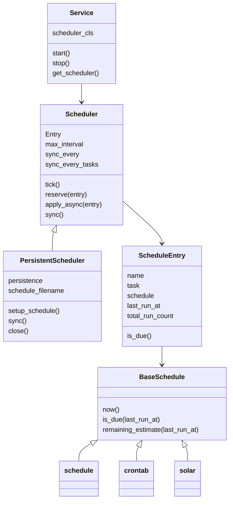
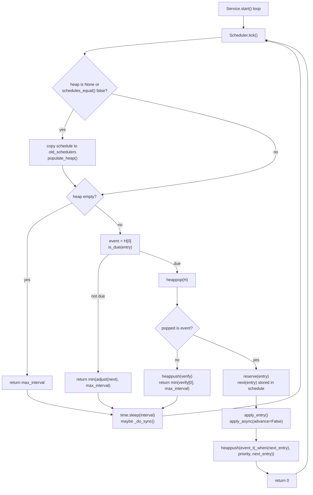
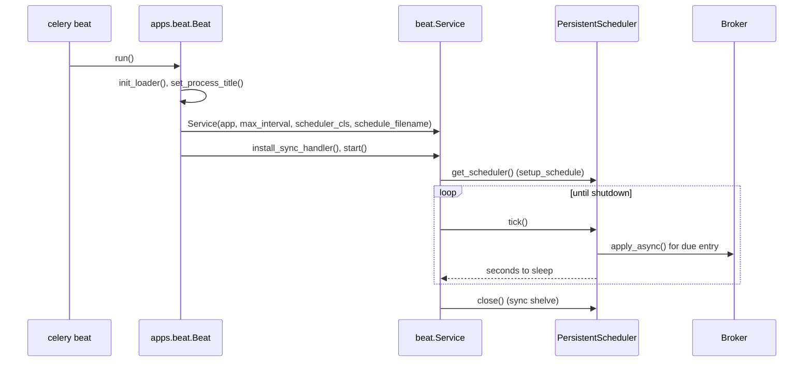

## Overview

`celery beat` is a single clock process that sends tasks to the broker on a schedule. It does not execute tasks itself; when an entry becomes due it calls `apply_async` (or `app.send_task` for tasks not registered locally) so ordinary workers pick the message up. The scheduler lives in `celery.beat`, the schedule types (`schedule`, `crontab`, `solar`) live in `celery.schedules`, and `celery.apps.beat.Beat` wraps the service as a runnable program with logging, a banner and signal handlers. Only one beat process should run per schedule, otherwise every due entry is sent once per process.

Sources: [celery/beat.py:1-43](repo://celery/beat.py#L1-L43), [celery/beat.py:393-421](repo://celery/beat.py#L393-L421), [celery/schedules.py:1-24](repo://celery/schedules.py#L1-L24), [celery/apps/beat.py:1-44](repo://celery/apps/beat.py#L1-L44)

Entries are normally declared through the `beat_schedule` setting (see [[Configuration]]); the tasks they reference are ordinary tasks defined as described in [[Tasks]], and the messages are routed like any other call from [[Calling Tasks and Message Routing]].

Sources: [celery/app/defaults.py:73-82](repo://celery/app/defaults.py#L73-L82), [celery/beat.py:423-425](repo://celery/beat.py#L423-L425)

## Components

### Classes and responsibilities

| Class | Module | Role |
|---|---|---|
| `ScheduleEntry` | `celery.beat` | One named periodic task: `task`, `schedule`, `args`, `kwargs`, `options`, `last_run_at`, `total_run_count`. |
| `Scheduler` | `celery.beat` | Holds the entries in an in-memory dict, keeps a heap of next run times and implements `tick()`. |
| `PersistentScheduler` | `celery.beat` | Default scheduler; stores entries in a `shelve` database so `last_run_at` survives restarts. |
| `Service` | `celery.beat` | Runs the tick loop, resolves the scheduler class, handles shutdown. |
| `EmbeddedService` | `celery.beat` | Factory returning a `_Process` or `_Threaded` wrapper so a worker can run beat inside it (`-B`). |
| `Beat` | `celery.apps.beat` | Program wrapper used by the `celery beat` command: loader init, logging, banner, pidfile, signals. |
| `schedule`, `crontab`, `solar` | `celery.schedules` | Schedule types implementing `is_due(last_run_at)`. |

Sources: [celery/beat.py:81-128](repo://celery/beat.py#L81-L128), [celery/beat.py:219-266](repo://celery/beat.py#L219-L266), [celery/beat.py:505-523](repo://celery/beat.py#L505-L523), [celery/beat.py:612-627](repo://celery/beat.py#L612-L627), [celery/beat.py:727-738](repo://celery/beat.py#L727-L738), [celery/apps/beat.py:40-76](repo://celery/apps/beat.py#L40-L76), [celery/schedules.py:65-130](repo://celery/schedules.py#L65-L130)



Sources: [celery/beat.py:219-264](repo://celery/beat.py#L219-L264), [celery/beat.py:505-609](repo://celery/beat.py#L505-L609), [celery/beat.py:612-679](repo://celery/beat.py#L612-L679), [celery/schedules.py:65-111](repo://celery/schedules.py#L65-L111), [celery/schedules.py:323-323](repo://celery/schedules.py#L323-L323), [celery/schedules.py:717-717](repo://celery/schedules.py#L717-L717)

## Schedule Entries

### Building entries

`ScheduleEntry.__init__` passes the raw `schedule` value through `maybe_schedule`, so a number of seconds or a `timedelta` becomes a `schedule` instance, while an existing `crontab` or `solar` object just has its `app` attached. A missing `last_run_at` defaults to `default_now()`, which asks the schedule (or the app) for the current time.

Sources: [celery/beat.py:117-131](repo://celery/beat.py#L117-L131), [celery/schedules.py:703-714](repo://celery/schedules.py#L703-L714)

### Advancing and comparing entries

`_next_instance` (exposed as `next`) returns a fresh copy of the entry with `last_run_at` set to now and `total_run_count` incremented; the scheduler always replaces entries rather than mutating them. Equality and `update()` only consider the "editable" fields `task`, `schedule`, `args`, `kwargs` and `options`, which is how the scheduler decides whether the configured schedule changed. `__lt__` orders by `id()` because heap order is fully decided by the time and priority members of `event_t`.

Sources: [celery/beat.py:134-198](repo://celery/beat.py#L134-L198), [celery/beat.py:37-37](repo://celery/beat.py#L37-L37)

### Lazy arguments

Values wrapped in `BeatLazyFunc` inside `args` or `kwargs` are called at send time by `_evaluate_entry_args` and `_evaluate_entry_kwargs`, so an entry can pass a value computed when the task is sent instead of when the schedule was loaded.

Sources: [celery/beat.py:50-78](repo://celery/beat.py#L50-L78), [celery/beat.py:201-216](repo://celery/beat.py#L201-L216)

### Loading the configured schedule

`Scheduler.setup_schedule` installs default entries and then calls `merge_inplace(app.conf.beat_schedule)`. `merge_inplace` drops keys present in only one of the two sides, then for every configured key either updates the existing entry (keeping its `last_run_at` and run count) or inserts a new one. `install_default_entries` adds a `celery.backend_cleanup` entry, run by `crontab('0', '4', '*')` with a 12 hour expiry, when `result_expires` is set and the result backend does not support automatic expiry.

Sources: [celery/beat.py:268-277](repo://celery/beat.py#L268-L277), [celery/beat.py:423-472](repo://celery/beat.py#L423-L472)

## The Tick Loop

### Heap of next run times

`populate_heap` builds a list of `event_t(time, priority, entry)` tuples, one per entry, and heapifies it. The time is a UTC timestamp computed by `_when`: the entry's current time converted with `maybe_make_aware` plus the seconds until it is next due (or `0` when already due). `adjust` subtracts a 10 ms drift from positive delays so the scheduler wakes slightly early rather than late.

Sources: [celery/beat.py:292-323](repo://celery/beat.py#L292-L323)

### One iteration of tick()

`tick()` handles at most one due entry per call and returns how long the caller should sleep, in seconds.

Sources: [celery/beat.py:326-334](repo://celery/beat.py#L326-L334)

1. If no heap exists yet, or `schedules_equal(old_schedulers, schedule)` reports that entries were added, removed or edited, it snapshots the schedule into `old_schedulers` and rebuilds the heap.
2. An empty heap returns `max_interval`.
3. It peeks at `H[0]` and asks `is_due(entry)` for `(is_due, next_time_to_run)`.
4. If due, it pops the heap and checks that the popped event is the same object it peeked at. If so it calls `reserve(entry)` to store the advanced entry in the schedule, sends the task with `apply_entry`, pushes the new entry back with its next time, and returns `0` so the loop immediately checks the next entry.
5. If the popped event is a different one, it is pushed back and the sleep is `min(verify[0], max_interval)`.
6. If not due, it returns the adjusted `next_time_to_run`, capped at `max_interval` (non-numeric values fall back to `max_interval`).

Sources: [celery/beat.py:326-379](repo://celery/beat.py#L326-L379), [celery/beat.py:389-391](repo://celery/beat.py#L389-L391)



Sources: [celery/beat.py:326-364](repo://celery/beat.py#L326-L364), [celery/beat.py:279-323](repo://celery/beat.py#L279-L323), [celery/beat.py:633-655](repo://celery/beat.py#L633-L655)

### Sending a due entry

`apply_entry` logs the send and calls `apply_async(entry, producer=self.producer, advance=False)`; `advance=False` because `tick()` already reserved the entry. `apply_async` looks the task up in `app.tasks`, evaluates lazy arguments and calls `task.apply_async(args, kwargs, producer=producer, **entry.options)`, or `send_task` by name when the task is not registered in the beat process. The producer is a cached `Producer` over `app.connection_for_write()`, created through `_ensure_connected`, which retries up to `broker_connection_max_retries` and logs each connection error.

Sources: [celery/beat.py:279-290](repo://celery/beat.py#L279-L290), [celery/beat.py:393-421](repo://celery/beat.py#L393-L421), [celery/beat.py:474-498](repo://celery/beat.py#L474-L498)

> [!NOTE]
> `reserve()` runs before the message is sent. If publishing fails the entry has already been advanced, so a broken task does not get re-sent on every tick; the comment in `apply_async` states this intent.

Sources: [celery/beat.py:389-399](repo://celery/beat.py#L389-L399)

### Syncing state

Every send increments `_tasks_since_sync`, and `should_sync()` is true when more than `sync_every` seconds (3 minutes) have passed since the last sync or when `sync_every_tasks` (from `beat_sync_every`) sends have accumulated. `_do_sync` calls `sync()` and resets both counters even if `sync()` raises. The base `Scheduler.sync` is a no-op; `close()` just syncs.

Sources: [celery/beat.py:241-264](repo://celery/beat.py#L241-L264), [celery/beat.py:381-387](repo://celery/beat.py#L381-L387), [celery/beat.py:415-439](repo://celery/beat.py#L415-L439)

## Persistent Scheduler and the Shelve Store

### Opening the store

`PersistentScheduler` keeps entries in a `shelve` database at `schedule_filename`, opened with `writeback=True`. `setup_schedule` opens it and immediately calls `keys()` because some dbm backends only report corruption on first access; any exception triggers `_destroy_open_corrupted_schedule`, which removes every file with the known suffixes (`''`, `.db`, `.dat`, `.bak`, `.dir`) and reopens a fresh store.

Sources: [celery/beat.py:505-541](repo://celery/beat.py#L505-L541)

### Version, timezone and UTC checks

`_create_schedule` makes sure an `entries` key exists, recreating the file if writing it fails, and clears stores written by old versions that lack `__version__`, `tz` or `utc_enabled`. `setup_schedule` then compares the stored `tz` and `utc_enabled` against `app.conf.timezone` and `app.conf.enable_utc`; if either changed it logs a warning and clears the store, because stored `last_run_at` values would be interpreted in the wrong zone. Finally it merges `beat_schedule`, installs default entries, writes the current version, timezone and UTC flag, and syncs.

Sources: [celery/beat.py:543-590](repo://celery/beat.py#L543-L590)

### Schedule property and sync

`PersistentScheduler` overrides the `schedule` property to read and write `_store['entries']`, so every `reserve()` lands in the shelf. `sync()` flushes the shelf, and `close()` syncs then closes it. `info` reports the database path in the startup banner.

Sources: [celery/beat.py:592-609](repo://celery/beat.py#L592-L609)

> [!TIP]
> Because the schedule property is just a mapping, custom schedulers (for example database-backed ones) usually override `setup_schedule`, `get_schedule`/`set_schedule` and `sync`, and must stay idempotent when constructed with `lazy=True`, which `celery beat` uses for introspection.

Sources: [celery/beat.py:219-231](repo://celery/beat.py#L219-L231), [celery/beat.py:485-490](repo://celery/beat.py#L485-L490), [celery/beat.py:666-675](repo://celery/beat.py#L666-L675)

## Schedule Types

### Common base

`BaseSchedule` provides `now()` (a custom `nowfun` or `app.now`), the app's timezone as `tz`, `maybe_make_aware` bound to that timezone, and `to_local`, which falls back to the system zone when `enable_utc` is off. Subclasses implement `remaining_estimate(last_run_at)` and `is_due(last_run_at)`, which returns a `schedstate(is_due, next)` named tuple where `next` is the number of seconds until the scheduler should check again.

Sources: [celery/schedules.py:24-24](repo://celery/schedules.py#L24-L24), [celery/schedules.py:65-108](repo://celery/schedules.py#L65-L108)

### schedule (fixed interval)

`schedule` wraps a `run_every` timedelta. `remaining_estimate` uses `celery.utils.time.remaining`, which adds the interval to `last_run_at`, optionally rounds it with `delta_resolution` when `relative=True`, and subtracts now in UTC so DST transitions do not distort the result. `is_due` returns `(True, seconds)` when nothing remains, else `(False, remaining_seconds)`.

Sources: [celery/schedules.py:111-193](repo://celery/schedules.py#L111-L193), [celery/utils/time.py:191-250](repo://celery/utils/time.py#L191-L250)

### crontab

`crontab(minute, hour, day_of_week, day_of_month, month_of_year)` expands each field once with `_expand_cronspec`: integers become one-element sets, strings go through `crontab_parser`, other iterables become sets, and any value outside the field's range raises `ValueError`. `crontab.from_string('m h dom mon dow')` splits a five-field cron string into those arguments.

Sources: [celery/schedules.py:401-478](repo://celery/schedules.py#L401-L478)

`crontab_parser` accepts comma-separated groups of `*`, `*/step`, `a-b`, `a-b/step` or single values. `_expand_number` accepts integers and month or weekday names, rejects negative numbers, and ranges where the end is below the start wrap around the field maximum.

Sources: [celery/schedules.py:244-320](repo://celery/schedules.py#L244-L320)

```python
>>> minutes = crontab_parser(60).parse('*/15')
[0, 15, 30, 45]
>>> hours = crontab_parser(24).parse('*/4')
[0, 4, 8, 12, 16, 20]
>>> day_of_week = crontab_parser(7).parse('*')
[0, 1, 2, 3, 4, 5, 6]
```

Sources: [celery/schedules.py:220-225](repo://celery/schedules.py#L220-L225)

`remaining_delta` computes the next fire time from `last_run_at` as an `ffwd` (a forward-only relative delta): the next minute in the same hour if still possible, otherwise the next hour today, otherwise the next matching weekday, or `_delta_to_next` when `day_of_month` or `month_of_year` is restricted. `_delta_to_next` walks month and day candidates with `bisect`, rolling over years, and gives up with `RuntimeError` after 2000 attempts when the specification can never match.

Sources: [celery/schedules.py:572-639](repo://celery/schedules.py#L572-L639), [celery/schedules.py:480-555](repo://celery/schedules.py#L480-L555), [celery/utils/time.py:404-445](repo://celery/utils/time.py#L404-L445)

`crontab.is_due` is due when the remaining time is zero or negative. When `beat_cron_starting_deadline` is set it walks forward to the latest missed run time and, if that is older than the deadline, reports the entry as not due, so a beat process that was down does not fire stale cron runs. In both the due and the deadline-passed cases the next check time is recomputed from now.

Sources: [celery/schedules.py:641-688](repo://celery/schedules.py#L641-L688)

> [!WARNING]
> `day_of_week='*/2'` means days whose number is divisible by two, not every second day, and a day only fires if it matches all of `day_of_week`, `day_of_month` and `month_of_year`.

Sources: [celery/schedules.py:354-398](repo://celery/schedules.py#L354-L398)

### solar

`solar(event, lat, lon)` imports the optional `ephem` package, validates the event name and coordinates, and configures an `ephem.Observer` with the event's horizon. `remaining_estimate` calls `next_rising`, `next_transit` or `next_setting` from `last_run_at` in UTC, and when the sun never rises or sets that day (`CircumpolarError`) checks again one minute after the next anti-transit.

Sources: [celery/schedules.py:792-861](repo://celery/schedules.py#L792-L861)

| Event | Horizon | ephem method | use_center |
|---|---|---|---|
| `dawn_astronomical` | `-18` | `next_rising` | True |
| `dawn_nautical` | `-12` | `next_rising` | True |
| `dawn_civil` | `-6` | `next_rising` | True |
| `sunrise` | `-0:34` | `next_rising` | False |
| `solar_noon` | `0` | `next_transit` | False |
| `sunset` | `-0:34` | `next_setting` | False |
| `dusk_civil` | `-6` | `next_setting` | True |
| `dusk_nautical` | `-12` | `next_setting` | True |
| `dusk_astronomical` | `-18` | `next_setting` | True |

Sources: [celery/schedules.py:747-790](repo://celery/schedules.py#L747-L790)

## Timezones

### How beat interprets time

`app.now()` returns the current UTC time converted to `app.timezone`. `app.timezone` is the `timezone` setting if given, otherwise UTC when `enable_utc` is true and the local system zone when it is false. Schedules use this through `BaseSchedule.now` and `tz`.

Sources: [celery/app/base.py:1197-1200](repo://celery/app/base.py#L1197-L1200), [celery/app/base.py:1619-1632](repo://celery/app/base.py#L1619-L1632), [celery/schedules.py:71-98](repo://celery/schedules.py#L71-L98)

### Conversion helpers

`maybe_make_aware` treats naive datetimes as UTC by default and localizes them into the target zone; `localize` converts UTC-aware values with `astimezone`. The `timezone` singleton (`_Zone`) supplies `utc`, `local` (via `get_localzone`, falling back to `LocalTimezone`) and `to_local_fallback`. The scheduler's `_when` turns the aware datetime into a UTC epoch with `timegm(utctimetuple())`, so heap ordering is independent of the configured zone.

Sources: [celery/utils/time.py:121-181](repo://celery/utils/time.py#L121-L181), [celery/utils/time.py:375-401](repo://celery/utils/time.py#L375-L401), [celery/beat.py:300-308](repo://celery/beat.py#L300-L308)

## Running Beat

### Service

`Service.start()` sends the `beat_init` signal (plus `beat_embedded_init` and a process title when embedded), then loops until `_is_shutdown` is set: call `scheduler.tick()`, sleep for the returned interval when positive, and sync if `should_sync()` says so. `KeyboardInterrupt` and `SystemExit` end the loop, and the `finally` block calls `sync()`, which closes the scheduler and sets `_is_stopped`. `stop(wait=True)` sets the shutdown flag and waits for that event. The scheduler class is resolved lazily by `get_scheduler` with `symbol_by_name`, accepting aliases registered under the `celery.beat_schedulers` entry-point namespace.

Sources: [celery/beat.py:612-679](repo://celery/beat.py#L612-L679), [celery/signals.py:138-139](repo://celery/signals.py#L138-L139)

### The Beat program

The `celery beat` command resolves `--schedule` and `--scheduler` against `beat_schedule_filename` and `beat_scheduler`, applies extra command-line configuration, optionally daemonizes with `detached`, and runs `app.Beat(...).run()` (see [[Command Line Interface]]). `Beat.run` prints the version line, calls `init_loader` (which runs `loader.init_worker()` and `app.finalize()` so task modules are imported), sets the process title and calls `start_scheduler`.

Sources: [celery/bin/beat.py:10-72](repo://celery/bin/beat.py#L10-L72), [celery/app/base.py:1449-1455](repo://celery/app/base.py#L1449-L1455), [celery/apps/beat.py:78-84](repo://celery/apps/beat.py#L78-L84), [celery/apps/beat.py:129-133](repo://celery/apps/beat.py#L129-L133)

`start_scheduler` creates the pidfile lock, builds the `Service`, prints the banner (which instantiates a lazy scheduler to show its class, `info` and max interval), sets up logging and the default socket timeout, installs a `SIGTERM`/`SIGINT` handler that syncs the schedule and raises `SystemExit`, and then calls `service.start()`. Exceptions escaping the service are logged as critical and re-raised.

Sources: [celery/apps/beat.py:93-160](repo://celery/apps/beat.py#L93-L160)



Sources: [celery/apps/beat.py:78-118](repo://celery/apps/beat.py#L78-L118), [celery/beat.py:633-679](repo://celery/beat.py#L633-L679), [celery/beat.py:326-364](repo://celery/beat.py#L326-L364)

### Embedded beat in a worker

The worker's `Beat` bootstep is enabled by the `-B` flag and creates an `EmbeddedService` with the worker's schedule filename and scheduler class; it refuses gevent and eventlet pools with `ImproperlyConfigured` (see [[Worker Architecture and Bootsteps]]). `EmbeddedService` returns a `_Process` child that resets signals, closes inherited file descriptors and starts the service, or a daemon `_Threaded` thread when `thread=True` or multiprocessing is unavailable; the threaded variant forces `max_interval=1` so it can be stopped promptly.

Sources: [celery/worker/components.py:18-23](repo://celery/worker/components.py#L18-L23), [celery/worker/components.py:181-205](repo://celery/worker/components.py#L181-L205), [celery/beat.py:682-738](repo://celery/beat.py#L682-L738)

## Configuration

### Beat settings

| Setting | Default | Used by |
|---|---|---|
| `beat_schedule` | `{}` | `Scheduler.setup_schedule` / `merge_inplace` |
| `beat_scheduler` | `celery.beat:PersistentScheduler` | `Beat` and `celery beat -S` |
| `beat_schedule_filename` | `celerybeat-schedule` | `Service`, `PersistentScheduler` shelve path |
| `beat_max_loop_interval` | `0` (falls back to 300 s, `DEFAULT_MAX_INTERVAL`) | `Scheduler.max_interval` cap on sleep |
| `beat_sync_every` | `0` | `Scheduler.sync_every_tasks` |
| `beat_cron_starting_deadline` | `None` | `crontab.is_due` |
| `timezone` / `enable_utc` | unset / `True` | `app.timezone`, stored-schedule reset |

Sources: [celery/app/defaults.py:69-82](repo://celery/app/defaults.py#L69-L82), [celery/beat.py:43-43](repo://celery/beat.py#L43-L43), [celery/beat.py:252-264](repo://celery/beat.py#L252-L264), [celery/beat.py:617-624](repo://celery/beat.py#L617-L624)
