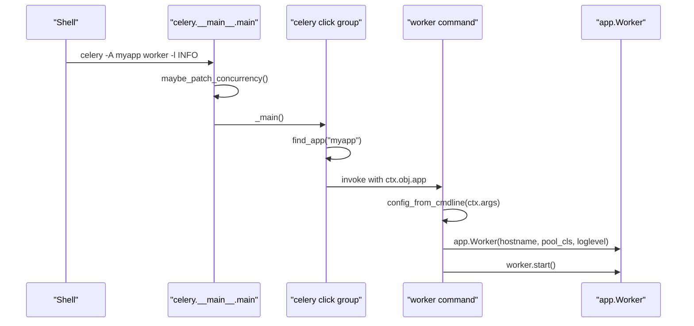

## Overview

This page takes you from installing Celery to getting a task result back, using the example applications that ship in the repository's `examples/` directory. You need three things: the `celery` package, a running message broker (RabbitMQ or Redis), and optionally a result backend so the caller can read return values.

Sources: [README.rst:147-153](repo://README.rst#L147-L153), [examples/app/myapp.py:1-24](repo://examples/app/myapp.py#L1-L24)

For what each component does, see [[Overview]]. For the full application API, see [[The Celery Application]].

Sources: [celery/app/base.py:252-287](repo://celery/app/base.py#L252-L287)

## Install Celery

### Base package

Install from PyPI with pip:

Sources: [README.rst:301-312](repo://README.rst#L301-L312)

```bash
pip install -U Celery
```

Sources: [README.rst:312-312](repo://README.rst#L312-L312)

pip resolves the install requirements from `requirements/default.txt`. The most important ones are `kombu` (broker messaging), `billiard` (the process pool), `vine` and `click`.

Sources: [setup.py:118-120](repo://setup.py#L118-L120), [requirements/default.txt:1-10](repo://requirements/default.txt#L1-L10)

### Feature bundles

Transports, result stores, serializers and pools that need extra libraries are installed as extras, in brackets. Separate several with commas:

Sources: [README.rst:316-331](repo://README.rst#L316-L331)

```bash
pip install "celery[redis]"
pip install "celery[redis,auth,msgpack]"
```

Sources: [README.rst:329-331](repo://README.rst#L329-L331)

Each extra name in `setup.py`'s `EXTENSIONS` tuple maps to `requirements/extras/<name>.txt`. For example, `celery[redis]` installs `kombu[redis]`.

Sources: [setup.py:12-47](repo://setup.py#L12-L47), [setup.py:113-125](repo://setup.py#L113-L125), [requirements/extras/redis.txt:1-1](repo://requirements/extras/redis.txt#L1-L1)

> [!NOTE]
> The packaging metadata requires Python 3.10 or newer (`python_requires=">=3.10"`). Older interpreters need an older Celery series, as listed in the README.

Sources: [setup.py:150-152](repo://setup.py#L150-L152), [README.rst:131-141](repo://README.rst#L131-L141)

## Define an App and a Task

### The example application

`examples/app/myapp.py` is a complete, single-file application. It creates a `Celery` instance named `myapp` that points at a local RabbitMQ broker, passes an extra setting (`task_acks_late=True`) as a keyword argument, and registers one task with the `@app.task` decorator:

Sources: [examples/app/myapp.py:25-45](repo://examples/app/myapp.py#L25-L45)

```python
from time import sleep

from celery import Celery

app = Celery(
    'myapp',
    broker='amqp://guest@localhost//',
    # ## add result backend here if needed.
    # backend='rpc'
    task_acks_late=True
)


@app.task
def add(x, y):
    sleep(10)
    return x + y


if __name__ == '__main__':
    app.start()
```

Sources: [examples/app/myapp.py:25-45](repo://examples/app/myapp.py#L25-L45)

### What the constructor does with these arguments

`Celery.__init__` does not connect to anything. It stores `broker` as `broker_url` and `backend` as `result_backend` in a pre-configuration dict. Any other keyword argument, such as `task_acks_late`, is stored under its own name. The real configuration is read lazily, the first time a setting is accessed.

Sources: [celery/app/base.py:392-408](repo://celery/app/base.py#L392-L408)

The first positional argument, `main`, becomes the prefix for auto-generated task names when the module runs as `__main__`. Otherwise the task name is `<module>.<function>`, so `add` defined in `myapp.py` is registered as `myapp.add`.

Sources: [celery/app/base.py:255-257](repo://celery/app/base.py#L255-L257), [celery/utils/imports.py:122-141](repo://celery/utils/imports.py#L122-L141)

### What the decorator returns

`@app.task` does not build the task class right away. For a lazy app that is not yet finalized, it returns a `PromiseProxy` and appends it to `app._pending`. The task class is built when the proxy is first used or when the app is finalized.

Sources: [celery/app/base.py:554-585](repo://celery/app/base.py#L554-L585)

### A multi-module project layout

`examples/next-steps/proj` shows the layout used for larger projects. `proj/celery.py` creates the app with a result backend and an `include` list of task modules, and `proj/tasks.py` imports that app to register tasks:

Sources: [examples/next-steps/proj/celery.py:1-14](repo://examples/next-steps/proj/celery.py#L1-L14)

```python
from celery import Celery

app = Celery('proj',
             broker='amqp://',
             backend='rpc://',
             include=['proj.tasks'])

# Optional configuration, see the application user guide.
app.conf.update(
    result_expires=3600,
)

if __name__ == '__main__':
    app.start()
```

Sources: [examples/next-steps/proj/celery.py:1-14](repo://examples/next-steps/proj/celery.py#L1-L14)

```python
from .celery import app


@app.task
def add(x, y):
    return x + y
```

Sources: [examples/next-steps/proj/tasks.py:1-6](repo://examples/next-steps/proj/tasks.py#L1-L6)

The modules in `include` (and in the `imports` setting) are imported by the worker at startup through the loader's `default_modules`.

Sources: [celery/loaders/base.py:223-229](repo://celery/loaders/base.py#L223-L229)

## Start a Worker

### Command line

Start a worker from the directory that contains the module. `-A`/`--app` names the module (or `module:attribute`) that holds the app, and `-l` sets the log level:

Sources: [examples/app/myapp.py:13-22](repo://examples/app/myapp.py#L13-L22)

```bash
celery -A myapp worker -l INFO
celery -A myapp:app worker -l INFO
```

Sources: [examples/app/myapp.py:16-22](repo://examples/app/myapp.py#L16-L22)

Because `myapp.py` ends with `app.start()`, you can also run `python myapp.py worker -l INFO`. `Celery.start` runs the `celery` click group with this app as the default for `--app`.

Sources: [examples/app/myapp.py:3-5](repo://examples/app/myapp.py#L3-L5), [celery/app/base.py:480-497](repo://celery/app/base.py#L480-L497)

### How the app is found

The umbrella command passes the `-A` value to `find_app`. For a bare module name it looks for an attribute named `app`, then `celery`, then a `celery` submodule if the target is a package, and finally any `Celery` instance among the module's globals.

Sources: [celery/bin/celery.py:135-155](repo://celery/bin/celery.py#L135-L155), [celery/app/utils.py:378-415](repo://celery/app/utils.py#L378-L415)

The global options `-b/--broker`, `--result-backend`, `--loader` and `--config` are written to the environment variables `CELERY_BROKER_URL`, `CELERY_RESULT_BACKEND`, `CELERY_LOADER` and `CELERY_CONFIG_MODULE`. That is how they override the app's own configuration.

Sources: [celery/bin/celery.py:123-133](repo://celery/bin/celery.py#L123-L133), [celery/app/utils.py:100-112](repo://celery/app/utils.py#L100-L112)

### Common worker options

| Option | Effect | Default |
|---|---|---|
| `-l`, `--loglevel` | Logging level | `WARNING` |
| `-c`, `--concurrency` | Number of child processes | `worker_concurrency`, else the CPU count |
| `-P`, `--pool` | Pool implementation (`prefork`, `threads`, `solo`, `eventlet`, `gevent`) | `prefork` |
| `-Q`, `--queues` | Comma-separated queues to consume from | all configured queues |
| `-n`, `--hostname` | Node name, supports `%h`, `%n`, `%d` | derived from the host name |
| `-E`, `--task-events` | Send task events for monitors | off |
| `-B`, `--beat` | Run an embedded beat scheduler (not on Windows) | off |
| `-D`, `--detach` | Run in the background | off |

Sources: [celery/bin/worker.py:136-240](repo://celery/bin/worker.py#L136-L240), [celery/bin/worker.py:241-304](repo://celery/bin/worker.py#L241-L304), [celery/concurrency/__init__.py:11-24](repo://celery/concurrency/__init__.py#L11-L24)

Extra `key=value` arguments after the options are parsed as settings in the `worker` namespace through `config_from_cmdline`. The command then creates `app.Worker(...)` and calls `worker.start()`.

Sources: [celery/bin/worker.py:324-368](repo://celery/bin/worker.py#L324-L368)



Sources: [celery/__main__.py:10-15](repo://celery/__main__.py#L10-L15), [celery/bin/celery.py:113-155](repo://celery/bin/celery.py#L113-L155), [celery/bin/worker.py:324-368](repo://celery/bin/worker.py#L324-L368)

## Call the Task and Read the Result

### Calling from Python

With the worker running, open another shell and call the task. `delay` is the star-argument form of `apply_async` and returns an `AsyncResult` right away:

Sources: [examples/app/myapp.py:5-10](repo://examples/app/myapp.py#L5-L10), [celery/app/task.py:523-534](repo://celery/app/task.py#L523-L534)

```pycon
>>> from myapp import add
>>> add.delay(16, 16).get()
32
```

Sources: [examples/app/myapp.py:8-10](repo://examples/app/myapp.py#L8-L10)

`apply_async` either runs the task in-process (when `task_always_eager` is enabled) or calls `app.send_task`, which publishes the message to the broker and returns `AsyncResult(task_id)`.

Sources: [celery/app/task.py:682-708](repo://celery/app/task.py#L682-L708), [celery/app/base.py:1025-1041](repo://celery/app/base.py#L1025-L1041)

### Reading the result

`AsyncResult.get(timeout=None, propagate=True, ...)` waits until the task is ready and returns its value. If the task failed and `propagate` is true, it re-raises the task's exception. If the task has `ignore_result=True`, it returns `None` without waiting.

Sources: [celery/result.py:191-244](repo://celery/result.py#L191-L244)

> [!IMPORTANT]
> Reading results needs a result backend. With no `result_backend` configured, the app uses `DisabledBackend`, and `get()` raises `NotImplementedError("No result backend is configured.")`. In `examples/app/myapp.py` the backend line is commented out, so set `backend='rpc'` (or `redis://...`) before calling `.get()`.

Sources: [celery/backends/base.py:48-51](repo://celery/backends/base.py#L48-L51), [celery/backends/base.py:900-910](repo://celery/backends/base.py#L900-L910), [celery/result.py:260-269](repo://celery/result.py#L260-L269), [celery/backends/base.py:1263-1281](repo://celery/backends/base.py#L1263-L1281), [celery/app/backends.py:41-46](repo://celery/app/backends.py#L41-L46), [examples/app/myapp.py:29-35](repo://examples/app/myapp.py#L29-L35)

> [!WARNING]
> Every `AsyncResult` holds backend resources until you call `get()` or `forget()` on it. Waiting on another task from inside a task can deadlock, which is why `disable_sync_subtasks` defaults to true.

Sources: [celery/result.py:198-228](repo://celery/result.py#L198-L228)

### Calling from the command line

`celery call` sends a task by name through `app.send_task` and prints the task id. `celery result` prints the return value for an id:

Sources: [celery/bin/call.py:8-71](repo://celery/bin/call.py#L8-L71), [celery/bin/result.py:7-30](repo://celery/bin/result.py#L7-L30)

```bash
celery -A proj call proj.tasks.add --args='[2, 2]'
celery -A proj result <task-id>
```

Sources: [celery/bin/call.py:9-23](repo://celery/bin/call.py#L9-L23), [celery/bin/result.py:7-27](repo://celery/bin/result.py#L7-L27)

## Next Steps

- Move settings into a module and load them with `app.config_from_object('proj.celeryconfig')`. See [[Configuration]].
- Learn the task options (`bind`, `name`, `base`, retries) in [[Tasks]] and the calling options in [[Calling Tasks and Message Routing]].
- Combine tasks into workflows with [[Canvas: Signatures and Workflows]].
- Schedule recurring work with [[Periodic Tasks with Beat]].
- For Django, `examples/django/proj/celery.py` calls `config_from_object('django.conf:settings', namespace='CELERY')` and `autodiscover_tasks()`. See [[The Celery Application]].

Sources: [celery/app/base.py:703-725](repo://celery/app/base.py#L703-L725), [examples/django/proj/celery.py:1-22](repo://examples/django/proj/celery.py#L1-L22)
