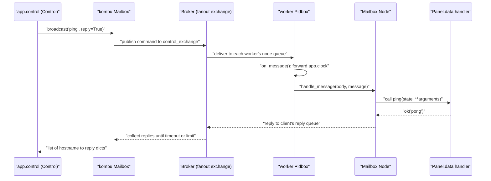

## Overview

Remote control lets a client talk to running workers through the broker instead of through signals or a separate admin port. The client side is `app.control`, an instance of `Control` from `celery/app/control.py`. The worker side is a registry of command handlers in `celery/worker/control.py`, consumed by a "pidbox" mailbox in `celery/worker/pidbox.py`. The module docstring splits commands into two families: inspect commands, which have no side effects and only return worker state (registered tasks, active tasks), and control commands, which change something (for example adding a queue to consume from).

Sources: [celery/app/control.py:1-27](repo://celery/app/control.py#L1-L27), [celery/worker/control.py:1-20](repo://celery/worker/control.py#L1-L20)

`app.control` is a cached property on the application that instantiates `control_cls` with the app. Both sides use a kombu `Mailbox`. The client publishes commands to a fanout exchange, every worker's pidbox node receives them, and replies go back to a per-client reply queue. The same machinery backs the `celery inspect`, `celery control` and `celery status` subcommands described in [[Command Line Interface]].

Sources: [celery/app/base.py:1576-1579](repo://celery/app/base.py#L1576-L1579), [celery/app/control.py:426-452](repo://celery/app/control.py#L426-L452)

## Message Flow

The diagram traces `app.control.ping()` from the client, through the broker, to a worker's `Pidbox` and back.

Sources: [celery/app/control.py:560-576](repo://celery/app/control.py#L560-L576), [celery/worker/pidbox.py:39-53](repo://celery/worker/pidbox.py#L39-L53)



Sources: [celery/app/control.py:755-790](repo://celery/app/control.py#L755-L790), [celery/worker/pidbox.py:25-53](repo://celery/worker/pidbox.py#L25-L53), [celery/worker/control.py:399-402](repo://celery/worker/control.py#L399-L402)

## Client API: Control

### Constructing the mailbox

`Control.__init__` refuses a configuration where `control_queue_durable` and `control_queue_exclusive` are both true and raises `ImproperlyConfigured`, because exclusive queues are deleted automatically and cannot be durable. It then builds a `Mailbox` named after `control_exchange` with `type='fanout'`, using `accept_content` and `task_serializer` for (de)serialization and a lazily resolved `app.amqp.producer_pool`. The queue TTL and expiry settings apply to both the node queues and the reply queues. `register_after_fork` drops the producer pool in child processes so a forked process never reuses its parent's connections.

Sources: [celery/app/control.py:426-455](repo://celery/app/control.py#L426-L455)

### broadcast()

Every command method on `Control` ends in `broadcast(command, arguments, destination, connection, reply, timeout, limit, callback, channel, pattern, matcher, **extra_kwargs)`. It acquires a connection with `app.connection_or_acquire`, merges any extra keyword arguments into `arguments`, and calls `self.mailbox(conn)._broadcast(...)`. `pattern` and `matcher` are passed through only when both are set. `reply=False` is the default, so most control commands are fire-and-forget unless the caller passes `reply=True`.

Sources: [celery/app/control.py:755-790](repo://celery/app/control.py#L755-L790)

### Command methods

Each convenience method packs its parameters into the `arguments` dict expected by the worker-side handler of the same name.

Sources: [celery/app/control.py:488-599](repo://celery/app/control.py#L488-L599), [celery/app/control.py:600-684](repo://celery/app/control.py#L600-L684), [celery/app/control.py:685-753](repo://celery/app/control.py#L685-L753)

| Method | Command sent | Arguments |
|---|---|---|
| `revoke(task_id, destination, terminate, signal)` | `revoke` | `task_id`, `terminate`, `signal` (default `TERM_SIGNAME`) |
| `revoke_by_stamped_headers(headers, ...)` | `revoke_by_stamped_headers` | `headers`, `terminate`, `signal` |
| `terminate(task_id, ...)` | `revoke` | shortcut for `revoke(..., terminate=True)` |
| `ping(destination, timeout=1.0)` | `ping` | always `reply=True` |
| `rate_limit(task_name, rate_limit)` | `rate_limit` | `task_name`, `rate_limit` |
| `time_limit(task_name, soft, hard)` | `time_limit` | `task_name`, `hard`, `soft` |
| `add_consumer(queue, exchange, exchange_type, routing_key, options)` | `add_consumer` | queue fields merged with `options` |
| `cancel_consumer(queue)` | `cancel_consumer` | `queue` |
| `enable_events()` / `disable_events()` | `enable_events` / `disable_events` | none |
| `pool_grow(n=1)` / `pool_shrink(n=1)` | `pool_grow` / `pool_shrink` | `n` |
| `autoscale(max, min)` | `autoscale` | `max`, `min` |
| `pool_restart(modules, reload, reloader)` | `pool_restart` | `modules`, `reload`, `reloader` |
| `shutdown()` | `shutdown` | none |
| `heartbeat()` | `heartbeat` | none |
| `election(id, topic, action)` | `election` | `id`, `topic`, `action` |

Sources: [celery/app/control.py:480-599](repo://celery/app/control.py#L480-L599), [celery/app/control.py:600-684](repo://celery/app/control.py#L600-L684), [celery/app/control.py:685-753](repo://celery/app/control.py#L685-L753)

`revoke_by_stamped_headers` makes two passes. It first broadcasts the header-based revoke, then collects any task ids that workers return as a `set` in their `ok` field, and if there are any it issues a regular `revoke` for those ids with the same `terminate` and `signal` values.

Sources: [celery/app/control.py:512-546](repo://celery/app/control.py#L512-L546)

`purge()` (alias `discard_all`) does not go through the mailbox at all. It opens a `TaskConsumer` on the configured task queues and purges them, returning the number of messages discarded.

Sources: [celery/app/control.py:462-478](repo://celery/app/control.py#L462-L478)

```python
from proj.celery import app

app.control.rate_limit('proj.tasks.add', '10/m', destination=['celery@node1'])
app.control.revoke('d9078da5-9915-40a0-bfa1-392c7bde42ed', terminate=True, signal='SIGKILL')
app.control.add_consumer('images', reply=True)
app.control.pool_grow(2)
```

Sources: [celery/app/control.py:488-510](repo://celery/app/control.py#L488-L510), [celery/app/control.py:578-635](repo://celery/app/control.py#L578-L635), [celery/app/control.py:685-702](repo://celery/app/control.py#L685-L702)

## Client API: Inspect

### Request and reply handling

`app.control.inspect` is a cached property that returns an app-bound subclass of `Inspect` (via `app.subclass_with_self`), so `app.control.inspect(timeout=..., destination=...)` creates a configured instance. Each `Inspect` method calls `_request(command, **kwargs)`, which always broadcasts with `reply=True` and passes the instance's `destination`, `callback`, `connection`, `limit`, `timeout`, `pattern` and `matcher`.

Sources: [celery/app/control.py:73-117](repo://celery/app/control.py#L73-L117), [celery/app/control.py:457-460](repo://celery/app/control.py#L457-L460)

`_prepare` reshapes the raw list of single-node dicts. `flatten_reply` merges them into one `hostname: reply` mapping and emits a `DuplicateNodenameWarning` when two replies share a node name, which means two workers were started without unique `-n` names. If `destination` is a single string, only that node's reply is returned. If a `pattern` is set, nodes are filtered with `kombu.matcher.match`.

Sources: [celery/app/control.py:31-63](repo://celery/app/control.py#L31-L63), [celery/app/control.py:94-105](repo://celery/app/control.py#L94-L105)

### Inspect methods

The public `Inspect` methods map one-to-one onto worker inspect commands of the same name, and all of them return the flattened per-node dict.

Sources: [celery/app/control.py:119-200](repo://celery/app/control.py#L119-L200), [celery/app/control.py:201-273](repo://celery/app/control.py#L201-L273), [celery/app/control.py:274-341](repo://celery/app/control.py#L274-L341), [celery/app/control.py:342-423](repo://celery/app/control.py#L342-L423)

| Method | Returns |
|---|---|
| `active(safe=None)` | tasks currently executing |
| `scheduled()` | ETA/countdown tasks with `eta`, `priority`, `request` |
| `reserved()` | prefetched tasks, excluding active and scheduled |
| `revoked()` | revoked task ids |
| `registered(*taskinfoitems)` | registered task names with selected attributes |
| `stats()` | broker, pool, rusage and counters for each worker |
| `active_queues()` | queues each worker consumes from |
| `query_task(*ids)` | state and info for specific task ids |
| `conf(with_defaults=False)` | the worker's effective configuration |
| `ping()`, `clock()`, `report()` | liveness, logical clock, bug-report text |
| `memsample()`, `memdump(samples)`, `objgraph(type, n, max_depth)` | memory debugging helpers |
| `hello(from_node, revoked)` | mingle synchronization data |

Sources: [celery/app/control.py:119-200](repo://celery/app/control.py#L119-L200), [celery/app/control.py:201-273](repo://celery/app/control.py#L201-L273), [celery/app/control.py:274-341](repo://celery/app/control.py#L274-L341), [celery/app/control.py:342-423](repo://celery/app/control.py#L342-L423)

```python
i = app.control.inspect(destination=['celery@node1'], timeout=2.0)
i.active()
i.registered('rate_limit')
i.query_task('d9078da5-9915-40a0-bfa1-392c7bde42ed')
```

Sources: [celery/app/control.py:82-117](repo://celery/app/control.py#L82-L117), [celery/app/control.py:258-273](repo://celery/app/control.py#L258-L273), [celery/app/control.py:342-372](repo://celery/app/control.py#L342-L372)

## Worker Side: the Panel Registry

### Registration decorators

`Panel` is a `UserDict` whose `data` and `meta` dicts are class attributes, so there is one global registry per process. `Panel._register` stores the handler function under `name or fun.__name__` and, if one is given, under its `alias` too. It stores a `controller_info_t` record in `meta` with the alias, type, visibility, default timeout, help (the first docstring line unless overridden), CLI signature, typed positional `args` and the name of a `variadic` argument. `control_command` and `inspect_command` are thin wrappers that fix `type` to `'control'` or `'inspect'`.

Sources: [celery/worker/control.py:22-74](repo://celery/worker/control.py#L22-L74)

```python
def control_command(**kwargs):
    return Panel.register(type='control', **kwargs)


def inspect_command(**kwargs):
    return Panel.register(type='inspect', **kwargs)
```

Sources: [celery/worker/control.py:69-74](repo://celery/worker/control.py#L69-L74)

Handlers receive a `state` object as their first argument, followed by the broadcast arguments as keyword arguments. They return `ok(value)` (`{'ok': value}`) or `nok(value)` (`{'error': value}`), or any other JSON-serializable value for inspect commands. Several inspect commands also register a legacy alias (`dump_conf`, `dump_schedule`, `dump_reserved`, `dump_active`, `dump_revoked`, `dump_tasks`). `hello` is registered with `visible=False`, which hides it from CLI listings.

Sources: [celery/worker/control.py:31-36](repo://celery/worker/control.py#L31-L36), [celery/worker/control.py:381-462](repo://celery/worker/control.py#L381-L462)

### Custom commands

Because the registry is global, a module imported by the worker can add its own commands with the same decorators. The `args` list tells the CLI how to convert positional strings, and `signature` is shown by `celery control --list`.

Sources: [celery/worker/control.py:45-66](repo://celery/worker/control.py#L45-L66), [celery/bin/control.py:26-53](repo://celery/bin/control.py#L26-L53)

```python
from celery.worker.control import control_command, inspect_command

@control_command(args=[('n', int)], signature='[N=1]')
def increase_prefetch_count(state, n=1):
    state.consumer.qos.increment_eventually(n)
    return {'ok': 'prefetch count incremented'}

@inspect_command()
def current_prefetch_count(state):
    return {'prefetch_count': state.consumer.qos.value}
```

Sources: [celery/worker/control.py:69-74](repo://celery/worker/control.py#L69-L74), [celery/worker/control.py:541-552](repo://celery/worker/control.py#L541-L552), [celery/worker/consumer/tasks.py:49-57](repo://celery/worker/consumer/tasks.py#L49-L57)

## Built-in Command Behavior

### Revocation

`revoke` normalizes `task_id` to a set and delegates to `_revoke`. That function adds the ids to `worker_state.revoked`, then tries to mark each id as revoked in the result backend with `app.backend.mark_as_revoked(task_id, reason='revoked', store_result=True)`, only logging a warning if the backend fails. With `terminate=True`, it converts the signal name with `signals.signum`, finds matching in-flight requests in `worker_state.requests`, and calls `request.terminate(state.consumer.pool, signal=signum)` once per id. `terminate` (the command) is `revoke` with `terminate=True` and a required signal argument.

Sources: [celery/worker/control.py:134-153](repo://celery/worker/control.py#L134-L153), [celery/worker/control.py:214-252](repo://celery/worker/control.py#L214-L252)

`revoke_by_stamped_headers` accepts either a dict or a list of `key=value` strings. It appends the stamps to `worker_state.revoked_stamps`. When terminating, it scans `worker_state.active_requests` for requests whose `stamps` intersect the given values and terminates them.

Sources: [celery/worker/control.py:156-211](repo://celery/worker/control.py#L156-L211)

### Limits, pool and queues

`rate_limit` validates the string with `celery.utils.time.rate`, returning `nok('Invalid rate limit string: ...')` on `ValueError`, sets `Task.rate_limit` on the registered task, and calls `consumer.reset_rate_limits()`. `time_limit` sets `soft_time_limit` and `time_limit` on the task class. Both return `nok('unknown task')` for names not in `app.tasks`.

Sources: [celery/worker/control.py:255-319](repo://celery/worker/control.py#L255-L319)

`pool_grow` and `pool_shrink` refuse to run when an autoscaler is active. Otherwise they call `pool.grow(n)` or `pool.shrink(n)` and adjust the prefetch count with `consumer._update_prefetch_count`. `autoscale` requires an autoscaler and raises `ValueError('Autoscale not enabled')` without one. `pool_restart` requires `worker_pool_restarts` and otherwise raises `ValueError('Pool restarts not enabled')`. `shutdown` logs a warning and raises `WorkerShutdown(EX_OK)`.

Sources: [celery/worker/control.py:541-596](repo://celery/worker/control.py#L541-L596)

`add_consumer` and `cancel_consumer` don't change the consumer directly. They schedule `consumer.add_task_queue` or `consumer.cancel_task_queue` with `consumer.call_soon`, so the change runs on the consumer's own loop. `active_queues` returns each queue of `task_consumer` serialized with `as_dict(recurse=True)`.

Sources: [celery/worker/control.py:599-637](repo://celery/worker/control.py#L599-L637)

### Events and state queries

`enable_events` and `disable_events` add or remove the `'task'` group on `consumer.event_dispatcher.groups`, and `heartbeat` sends a `worker-heartbeat` event immediately (see [[Events and Monitoring]]). `reserved` subtracts `active_requests` from `reserved_requests`. `scheduled` walks the timer's queue for entries whose first argument is a `Request`. `stats` delegates to `consumer.controller.stats()`.

Sources: [celery/worker/control.py:322-376](repo://celery/worker/control.py#L322-L376), [celery/worker/control.py:405-448](repo://celery/worker/control.py#L405-L448)

## Pidbox: the Worker Mailbox

### Node setup

The consumer bootstep `celery.worker.consumer.control:Control` requires the `Tasks` step. It picks `gPidbox` for green pools and `Pidbox` otherwise. It is included only when `worker_enable_remote_control` is true and the transport supports the `fanout` exchange type. See [[Worker Architecture and Bootsteps]] for how steps are ordered.

Sources: [celery/worker/consumer/control.py:18-33](repo://celery/worker/consumer/control.py#L18-L33)

`Pidbox.__init__` creates a `Mailbox.Node` named after the worker hostname, with `handlers=control.Panel.data` and a `state` `AttributeDict` that holds `app`, `hostname`, `consumer` and `tset`. `tset` is `pass1` when the worker uses the event loop and `set` otherwise, so handlers can snapshot the shared request sets safely when another thread might mutate them.

Sources: [celery/worker/pidbox.py:20-37](repo://celery/worker/pidbox.py#L20-L37)

### Message handling and recovery

`on_message` first forwards the Lamport clock (clients rarely carry a valid clock) and then calls `node.handle_message`. A `KeyError` is logged as "No such control command". Any other exception is logged and triggers `reset()`, which stops and restarts the consumer on a new channel. `start` opens a channel on the consumer connection and calls `node.listen(callback=self.on_message)`.

Sources: [celery/worker/pidbox.py:39-80](repo://celery/worker/pidbox.py#L39-L80)

`gPidbox` runs the mailbox in a separate greenlet started with `pool.spawn_n(self.loop, c)`. The loop opens its own read connection, drains events with a 1 second timeout until a shutdown `threading.Event` is set, and handles `reset()` lazily by incrementing a counter that the loop checks on each pass. `on_stop` sets the shutdown event and waits for the loop to signal that it has stopped.

Sources: [celery/worker/pidbox.py:83-126](repo://celery/worker/pidbox.py#L83-L126)

## Configuration

Remote control behavior is governed by the `control_*` namespace and two worker settings.

Sources: [celery/app/defaults.py:151-157](repo://celery/app/defaults.py#L151-L157), [celery/app/defaults.py:343-354](repo://celery/app/defaults.py#L343-L354)

| Setting | Default | Effect |
|---|---|---|
| `control_exchange` | `'celery'` | name of the fanout mailbox exchange |
| `control_queue_ttl` | `300.0` | message TTL for node and reply queues |
| `control_queue_expires` | `10.0` | idle expiry for node and reply queues |
| `control_queue_exclusive` | `True` | exclusive queues (cannot combine with durable) |
| `control_queue_durable` | `False` | durable queues |
| `worker_enable_remote_control` | `True` | include the pidbox bootstep |
| `worker_pool_restarts` | `False` | allow the `pool_restart` command |

Sources: [celery/app/defaults.py:151-157](repo://celery/app/defaults.py#L151-L157), [celery/app/defaults.py:343-354](repo://celery/app/defaults.py#L343-L354), [celery/app/control.py:433-438](repo://celery/app/control.py#L433-L438)

> [!WARNING]
> Replies are collected only until `timeout` expires (1 second by default). A slow or busy worker that answers late is simply missing from the result, and the CLI then reports "No nodes replied within time constraint".

Sources: [celery/app/control.py:755-775](repo://celery/app/control.py#L755-L775), [celery/bin/control.py:195-199](repo://celery/bin/control.py#L195-L199)
