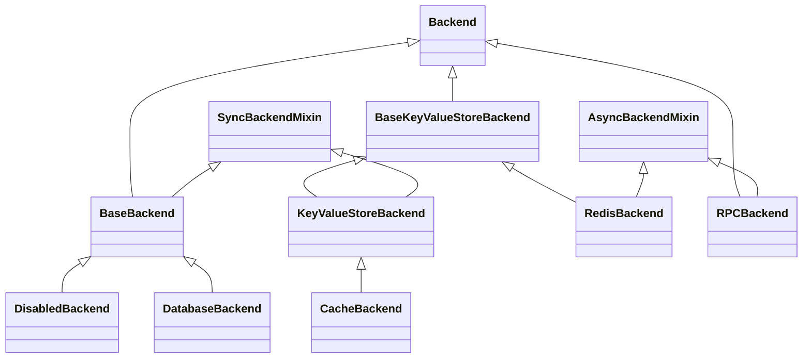
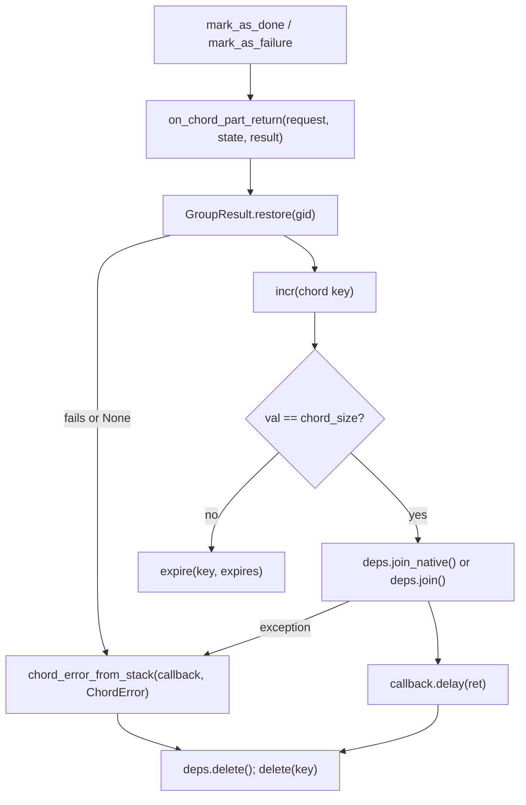

## Overview

A result backend stores the state and return value of each task so that a client holding an `AsyncResult` can fetch it later. It also keeps group metadata and counts finished chord members so the chord body runs once. Every Celery app has one backend instance, built lazily from the `result_backend` setting the first time `app.backend` is read. If no backend is configured, Celery uses `DisabledBackend`. Workers call the backend's `mark_as_*` methods as tasks change state, and result objects (see [[Task Results]]) call `get_task_meta`, `wait_for_pending` and `iter_native` to read state back.

Sources: [celery/app/base.py:1224-1228](repo://celery/app/base.py#L1224-L1228), [celery/app/base.py:1558-1563](repo://celery/app/base.py#L1558-L1563), [celery/backends/base.py:1-7](repo://celery/backends/base.py#L1-L7), [celery/app/backends.py:41-56](repo://celery/app/backends.py#L41-L56)

## Backend Selection by URL

### Resolving the URL to a class

`Celery._get_backend` passes `app.backend_cls` or `conf.result_backend` to `celery.app.backends.by_url`. That function returns a backend class plus the URL. The app then creates the backend as `backend(app=self, url=url)`. `by_url` looks at the URL scheme. If the scheme contains a `+`, as in `db+postgresql://...`, the part before the `+` names the backend and everything after it is kept as the URL that goes to the backend.

Sources: [celery/app/base.py:1224-1228](repo://celery/app/base.py#L1224-L1228), [celery/app/backends.py:59-69](repo://celery/app/backends.py#L59-L69)

```python
def by_url(backend=None, loader=None):
    """Get backend class by URL."""
    url = None
    if backend and '://' in backend:
        url = backend
        scheme, _, _ = url.partition('://')
        if '+' in scheme:
            backend, url = url.split('+', 1)
        else:
            backend = scheme
    return by_name(backend, loader), url
```

Sources: [celery/app/backends.py:59-69](repo://celery/app/backends.py#L59-L69)

`by_name` builds an alias map in three layers. It starts with `BACKEND_ALIASES`. Next come the loader's `override_backends`, which a loader can fill from its `override_backends` config key. Last come classes registered under the `celery.result_backends` entry-point namespace through `load_extension_class_names`. The name is then resolved with `symbol_by_name`, so a dotted path like `myproj.backends:MyBackend` also works. An unknown name raises `ImproperlyConfigured`, and so does a name that resolves to a module instead of a class. An empty name falls back to `'disabled'`.

Sources: [celery/app/backends.py:41-56](repo://celery/app/backends.py#L41-L56), [celery/loaders/base.py:54-54](repo://celery/loaders/base.py#L54-L54), [celery/loaders/base.py:128-129](repo://celery/loaders/base.py#L128-L129)

### Available backends

| Alias(es) | Class | Base class | Notable capabilities |
|---|---|---|---|
| `rpc` | `celery.backends.rpc.RPCBackend` | `Backend` + `AsyncBackendMixin` | Results sent as AMQP messages; `persistent = False`; no chords |
| `redis`, `rediss` | `celery.backends.redis:RedisBackend` | `BaseKeyValueStoreBackend` + `AsyncBackendMixin` | Pub/sub result consumer; native join; autoexpire; sorted-set chord counting |
| `sentinel` | `celery.backends.redis:SentinelBackend` | `RedisBackend` | Redis via Sentinel |
| `cache` | `celery.backends.cache:CacheBackend` | `KeyValueStoreBackend` | Memcached; `implements_incr = True`; native join; autoexpire |
| `db`, `database` | `celery.backends.database:DatabaseBackend` | `BaseBackend` | SQLAlchemy tables; `subpolling_interval = 0.5`; cleanup by `date_done` |
| `mongodb` | `celery.backends.mongodb:MongoBackend` | `BaseBackend` | `supports_autoexpire = False` |
| `elasticsearch` | `celery.backends.elasticsearch:ElasticsearchBackend` | `KeyValueStoreBackend` | |
| `cassandra` | `celery.backends.cassandra:CassandraBackend` | `BaseBackend` | Autoexpire via `entry_ttl` |
| `couchbase` | `celery.backends.couchbase:CouchbaseBackend` | `KeyValueStoreBackend` | Autoexpire |
| `couchdb` | `celery.backends.couchdb:CouchBackend` | `KeyValueStoreBackend` | |
| `cosmosdbsql` | `celery.backends.cosmosdbsql:CosmosDBSQLBackend` | `KeyValueStoreBackend` | |
| `file` | `celery.backends.filesystem:FilesystemBackend` | `KeyValueStoreBackend` | |
| `consul` | `celery.backends.consul:ConsulBackend` | `KeyValueStoreBackend` | Autoexpire |
| `dynamodb` | `celery.backends.dynamodb:DynamoDBBackend` | `KeyValueStoreBackend` | `implements_incr = True`; autoexpire |
| `azureblockblob` | `celery.backends.azureblockblob:AzureBlockBlobBackend` | `KeyValueStoreBackend` | |
| `arangodb` | `celery.backends.arangodb:ArangoDbBackend` | `KeyValueStoreBackend` | |
| `s3` | `celery.backends.s3:S3Backend` | `KeyValueStoreBackend` | |
| `gs` | `celery.backends.gcs:GCSBackend` | `GCSBackendBase` (`KeyValueStoreBackend`) | Firestore chord counter; `implements_incr = True`; native join |
| `disabled` | `celery.backends.base:DisabledBackend` | `BaseBackend` | Every read raises `NotImplementedError` |
| `riak` | `celery.backends.riak:RiakBackend` | | Alias still listed, but no `celery/backends/riak.py` exists in the tree |

Sources: [celery/app/backends.py:15-38](repo://celery/app/backends.py#L15-L38), [celery/backends/rpc.py:147-159](repo://celery/backends/rpc.py#L147-L159), [celery/backends/redis.py:204-221](repo://celery/backends/redis.py#L204-L221), [celery/backends/redis.py:727-727](repo://celery/backends/redis.py#L727-L727), [celery/backends/cache.py:90-96](repo://celery/backends/cache.py#L90-L96), [celery/backends/database/__init__.py:45-52](repo://celery/backends/database/__init__.py#L45-L52), [celery/backends/mongodb.py:36-55](repo://celery/backends/mongodb.py#L36-L55), [celery/backends/elasticsearch.py:30-30](repo://celery/backends/elasticsearch.py#L30-L30), [celery/backends/cassandra.py:71-86](repo://celery/backends/cassandra.py#L71-L86), [celery/backends/couchbase.py:23-37](repo://celery/backends/couchbase.py#L23-L37), [celery/backends/couchdb.py:21-21](repo://celery/backends/couchdb.py#L21-L21), [celery/backends/cosmosdbsql.py:30-30](repo://celery/backends/cosmosdbsql.py#L30-L30), [celery/backends/filesystem.py:25-25](repo://celery/backends/filesystem.py#L25-L25), [celery/backends/consul.py:27-32](repo://celery/backends/consul.py#L27-L32), [celery/backends/dynamodb.py:29-66](repo://celery/backends/dynamodb.py#L29-L66), [celery/backends/azureblockblob.py:24-24](repo://celery/backends/azureblockblob.py#L24-L24), [celery/backends/arangodb.py:23-23](repo://celery/backends/arangodb.py#L23-L23), [celery/backends/s3.py:20-20](repo://celery/backends/s3.py#L20-L20), [celery/backends/gcs.py:43-43](repo://celery/backends/gcs.py#L43-L43), [celery/backends/gcs.py:161-168](repo://celery/backends/gcs.py#L161-L168), [celery/backends/base.py:1263-1281](repo://celery/backends/base.py#L1263-L1281)

> [!WARNING]
> `DisabledBackend.store_result` silently does nothing. Its `get_state`, `get_result`, `wait_for` and `get_many` methods raise `NotImplementedError` with the "No result backend is configured" message. Calling `ensure_chords_allowed` raises the `E_CHORD_NO_BACKEND` message, so starting a chord (including a group chained with a task) needs a real backend.

Sources: [celery/backends/base.py:48-60](repo://celery/backends/base.py#L48-L60), [celery/backends/base.py:1263-1281](repo://celery/backends/base.py#L1263-L1281)

## Class Hierarchy

### Base classes and mixins

`Backend` holds the shared logic: serialization, the result cache, retry handling, the `mark_as_*` state transitions, group and chord hooks, and the `get_*` readers. It does not decide how a client waits for a result. A mixin adds that. `SyncBackendMixin` polls: `wait_for` calls `get_task_meta` in a loop, sleeping `interval` between calls. `AsyncBackendMixin` (from `celery/backends/asynchronous.py`) hands waiting to a `result_consumer` and its drainer. `BaseBackend` is `Backend` plus `SyncBackendMixin`. `BaseKeyValueStoreBackend` adds key/value semantics on top of `Backend` but no waiting strategy. `KeyValueStoreBackend` combines it with `SyncBackendMixin`, while `RedisBackend` combines it with `AsyncBackendMixin`.

Sources: [celery/backends/base.py:108-136](repo://celery/backends/base.py#L108-L136), [celery/backends/base.py:879-967](repo://celery/backends/base.py#L879-L967), [celery/backends/base.py:1259-1260](repo://celery/backends/base.py#L1259-L1260), [celery/backends/asynchronous.py:225-300](repo://celery/backends/asynchronous.py#L225-L300)



Sources: [celery/backends/base.py:957-967](repo://celery/backends/base.py#L957-L967), [celery/backends/base.py:1259-1263](repo://celery/backends/base.py#L1259-L1263), [celery/backends/redis.py:204-204](repo://celery/backends/redis.py#L204-L204), [celery/backends/rpc.py:147-147](repo://celery/backends/rpc.py#L147-L147), [celery/backends/database/__init__.py:45-45](repo://celery/backends/database/__init__.py#L45-L45), [celery/backends/cache.py:90-90](repo://celery/backends/cache.py#L90-L90)

### Capability flags

Each backend class sets a few attributes that the rest of Celery reads.

Sources: [celery/backends/base.py:116-129](repo://celery/backends/base.py#L116-L129), [celery/backends/base.py:969-969](repo://celery/backends/base.py#L969-L969)

| Attribute | Default | Effect |
|---|---|---|
| `supports_native_join` | `False` | When true, the backend must implement `get_many`. Result sets and the chord code then use `join_native`. |
| `supports_autoexpire` | `False` | When true, the backend expires results itself and beat does not install the daily `celery.backend_cleanup` entry. |
| `persistent` | `True` | Default for `prepare_persistent` when `result_persistent` is unset. |
| `subpolling_interval` | `None` | Sleep between items in `ResultSet.iterate`. `DatabaseBackend` sets it to `0.5`. |
| `implements_incr` | `False` (KV only) | When true, `apply_chord` becomes `_apply_chord_incr` and `on_chord_part_return` counts with `incr`. |

Sources: [celery/backends/base.py:108-136](repo://celery/backends/base.py#L108-L136), [celery/backends/base.py:964-978](repo://celery/backends/base.py#L964-L978), [celery/backends/base.py:567-571](repo://celery/backends/base.py#L567-L571), [celery/backends/database/__init__.py:48-50](repo://celery/backends/database/__init__.py#L48-L50)

If `result_expires` is set and the backend lacks `supports_autoexpire`, `Scheduler.install_default_entries` adds a `celery.backend_cleanup` entry that runs on `crontab('0', '4', '*')`. That task just calls `app.backend.cleanup()`. `DatabaseBackend` implements this hook by deleting rows whose `date_done` is older than `expires`.

Sources: [celery/beat.py:268-277](repo://celery/beat.py#L268-L277), [celery/app/builtins.py:13-23](repo://celery/app/builtins.py#L13-L23), [celery/backends/database/__init__.py:234-249](repo://celery/backends/database/__init__.py#L234-L249)

## Storing State

### The mark_as methods

The worker reports each state change through one of these methods, and each one ends up in `store_result`.

Sources: [celery/backends/base.py:176-190](repo://celery/backends/base.py#L176-L190)

- `mark_as_started` stores `STARTED` with the metadata it is given.
- `mark_as_done` stores the result unless `request.ignore_result` is set. If `request.chord` is set, it then calls `on_chord_part_return`.
- `mark_as_failure` stores the exception. It calls `on_chord_part_return` for chord members. Next it walks `request.chain` and stores the failure under the `task_id` of every later chain element whose state is in `PROPAGATE_STATES`. It calls `on_chord_part_return` for chain elements that carry a `chord` option, and descends into the chord body of `subtask_type == 'chord'` steps. Last, it fires the errbacks.
- `mark_as_revoked` stores a `TaskRevokedError(reason)` and also notifies the chord.
- `mark_as_retry` stores the current exception with state `RETRY`.

Sources: [celery/backends/base.py:176-252](repo://celery/backends/base.py#L176-L252), [celery/backends/base.py:306-323](repo://celery/backends/base.py#L306-L323)

`_call_task_errbacks` splits errbacks into two kinds. If the task's `__header__` takes more than one argument, it is a new-style errback and is called inline as `errback(request, exc, traceback)`. Any other errback, and any errback whose task is not registered in this worker, is sent as a `group` with the single argument `task_id`. That group runs eagerly when `task_always_eager` is on or the request is eager. Otherwise it is sent with `apply_async`.

Sources: [celery/backends/base.py:254-304](repo://celery/backends/base.py#L254-L304)

### store_result and retries

`store_result` first encodes the value with `encode_result`. It then calls the backend-specific `_store_result` through `_ensure_retryable`. That helper retries only when `result_backend_always_retry` is on and the backend's `exception_safe_to_retry(exc)` returns true. Between attempts it calls the `on_backend_retryable_error` hook and sleeps for `get_exponential_backoff_interval(base_sleep_between_retries_ms, retries, max_sleep_between_retries_ms, True) / 1000` seconds. When `max_retries` runs out, it raises the fallback exception: `BackendStoreError` for writes or `BackendGetMetaError` for reads.

Sources: [celery/backends/base.py:635-693](repo://celery/backends/base.py#L635-L693), [celery/backends/base.py:732-768](repo://celery/backends/base.py#L732-L768)

`_get_result_meta` builds the stored document. It always has `status`, `result`, `traceback`, `children` and `date_done`. `date_done` is set only for ready states. `group_id` and `parent_id` are copied from the request when present. When `result_extended` is on, the document also gets `name`, `args`, `kwargs`, `worker`, `retries`, `queue` and any stamps.

Sources: [celery/backends/base.py:581-630](repo://celery/backends/base.py#L581-L630)

### Key/value storage

`BaseKeyValueStoreBackend` builds keys from the prefixes `celery-task-meta-`, `celery-taskset-meta-` and `chord-unlock-`. If `result_backend_transport_options` contains `global_keyprefix`, that value is prepended to all three. Its `_store_result` first reads the current metadata and returns without writing if the stored status is already `SUCCESS`. This keeps a lost, duplicated task from overwriting a good result. Subclasses implement `get`, `mget`, `set`, `delete`, and optionally `incr` and `expire`.

Sources: [celery/backends/base.py:964-1052](repo://celery/backends/base.py#L964-L1052), [celery/backends/base.py:1113-1153](repo://celery/backends/base.py#L1113-L1153)

`get_many` is the native join used by `ResultSet.join_native`. It first yields any ready entries from the `_cache`. It then loops over `mget` for the remaining ids, decodes and filters to `READY_STATES`, and updates the cache. It sleeps `interval` between rounds and raises `TimeoutError` once `iterations * interval >= timeout`.

Sources: [celery/backends/base.py:1054-1111](repo://celery/backends/base.py#L1054-L1111)

## Result Encoding and Exception Serialization

### Encoding values

`Backend.__init__` looks up the content type and encoder for `result_serializer` in kombu's `serializer_registry`. For accepted content types, the first set value wins: the `accept` argument, then `result_accept_content`, then `accept_content`. `encode_result` turns exceptions into a serializable form when the state is in `EXCEPTION_STATES`. For other values it calls `prepare_value`, which converts `ResultBase` instances to tuples with `as_tuple()` unless the serializer is pickle. On the read side, `decode` calls kombu `loads` with the accept list, and `meta_from_decoded` turns stored exceptions back into Python exceptions.

Sources: [celery/backends/base.py:138-165](repo://celery/backends/base.py#L138-L165), [celery/backends/base.py:528-556](repo://celery/backends/base.py#L528-L556), [celery/backends/base.py:573-576](repo://celery/backends/base.py#L573-L576)

### Exceptions across the wire

With pickle (`EXCEPTION_ABLE_CODECS`), `prepare_exception` stores a pickleable copy of the exception. With any other serializer, it stores a dict:

Sources: [celery/backends/base.py:38-38](repo://celery/backends/base.py#L38-L38), [celery/backends/base.py:447-455](repo://celery/backends/base.py#L447-L455)

```python
        exctype = type(exc)
        return {'exc_type': getattr(exctype, '__qualname__', exctype.__name__),
                'exc_message': ensure_serializable(exc.args, self.encode),
                'exc_module': exctype.__module__}
```

Sources: [celery/backends/base.py:452-455](repo://celery/backends/base.py#L452-L455)

`exception_to_python` reverses this. It looks up `exc_module` in `sys.modules` and walks the dotted `exc_type`. If that lookup fails, it creates a stand-in class with `create_exception_cls` under `celery.exceptions`. Before creating an instance, it checks that the resolved object is a subclass of `BaseException`. Otherwise it raises `SecurityError`, because a tampered backend entry such as `exc_module="os"`, `exc_type="system"` would otherwise run arbitrary code. If the constructor itself fails, it falls back to `Exception(f'{cls}({exc_msg})')`.

Sources: [celery/backends/base.py:457-526](repo://celery/backends/base.py#L457-L526)

## Chord Counting

### Default unlock polling

The base `Backend.apply_chord` checks `ensure_chords_allowed` and then calls `fallback_chord_unlock`. That method sends the built-in `celery.chord_unlock` task with the header result tuples, a countdown, and the body's queue and priority. If neither is set on the body, it uses the router's default queue. `unlock_chord` checks `deps.ready()` and calls `self.retry(countdown=interval)` until the header is done. `interval` defaults to `result_chord_retry_interval`. Then it joins the header with `result_chord_join_timeout` and calls `callback.delay(ret)`. Backends without native chord support, such as `DatabaseBackend` and `MongoBackend`, use this path.

Sources: [celery/backends/base.py:838-867](repo://celery/backends/base.py#L838-L867), [celery/app/builtins.py:37-97](repo://celery/app/builtins.py#L37-L97)

### Counter-based chords (implements_incr)

When `implements_incr` is true, `BaseKeyValueStoreBackend.__init__` replaces `apply_chord` with `_apply_chord_incr`, which saves the header `GroupResult`. After that, every header task that finishes calls `on_chord_part_return`. It restores the group, increments the `chord-unlock-<gid>` key, and compares the counter to `request.chord["chord_size"]`, falling back to `len(deps)` if no size was given. When the two are equal, it joins the group and calls `callback.delay(ret)`. It then deletes the group and the counter in a `finally` block. Before that point, it only refreshes the key's expiry.

Sources: [celery/backends/base.py:971-978](repo://celery/backends/base.py#L971-L978), [celery/backends/base.py:1183-1256](repo://celery/backends/base.py#L1183-L1256)



Sources: [celery/backends/base.py:1188-1256](repo://celery/backends/base.py#L1188-L1256), [celery/backends/base.py:180-198](repo://celery/backends/base.py#L180-L198)

### Redis chord counting

`RedisBackend` replaces the counter with a pipeline. Each finished part is encoded as `[1, tid, state, result]` and added to the `<group>.j` key. By default this is a sorted set scored by `group_index` (`result_chord_ordered`). Otherwise it is a list. The same pipeline reads the ready count, the `<group>.t` key (extra parts added by `add_to_chord`) and `<group>.s` (the chord size stored by `set_chord_size`). When `readycount == chord_size + totaldiff`, the backend restores the `GroupResult`. That object exists only if `apply_chord` saved it because the header had nested groups. If found, it is joined. If not, the stashed tuples are read back and unpacked, and `_unpack_chord_result` raises `ChordError` for any part in `PROPAGATE_STATES`. All three keys are deleted afterwards.

Sources: [celery/backends/redis.py:554-591](repo://celery/backends/redis.py#L554-L591), [celery/backends/redis.py:593-686](repo://celery/backends/redis.py#L593-L686)

### Chord failures

`chord_error_from_stack` finds the backend of the callback's task, falling back to `self`. It builds a fake request with `_create_fake_task_request`, fires the callback's `link_error` errbacks, and marks the callback id as failed through `fail_from_current_stack`. If the body is a `group`, `_handle_group_chord_error` freezes it, revokes every member, calls errbacks and marks each member failed with the original exception (`ChordError.__cause__`). It also marks the group id failed. This is how a group body is kept from hanging after a failed header.

Sources: [celery/backends/base.py:325-439](repo://celery/backends/base.py#L325-L439), [celery/backends/base.py:68-92](repo://celery/backends/base.py#L68-L92)

## Built-in Backend Details

### Redis

`RedisBackend._set` writes the value with `SETEX` when `expires` is set, or with `SET` otherwise. It `PUBLISH`es the value on the same key in the same pipeline. The `ResultConsumer` subscribes to the task key with `_consume_from`. `on_task_call` registers the subscription before the task is sent, unless joining would block. `drain_events` reads pub/sub messages and passes them to `on_state_change`, which unsubscribes once the state is ready. When the connection is lost, `_reconnect_pubsub` resets the pool and runs `mget` over all subscribed keys, so state changes missed while disconnected are replayed. Connection errors count as safe to retry, and `set` refuses strings larger than 512 MB with `BackendStoreError`.

Sources: [celery/backends/redis.py:77-147](repo://celery/backends/redis.py#L77-L147), [celery/backends/redis.py:171-201](repo://celery/backends/redis.py#L171-L201), [celery/backends/redis.py:487-552](repo://celery/backends/redis.py#L487-L552)

### RPC

`RPCBackend` does not store anything. `store_result` publishes the state message to `request.reply_to` with `correlation_id`, using the anonymous direct exchange. If the request has no `reply_to`, nothing is sent. All results for a client go to one queue named after `app.thread_oid`. `get_task_meta` drains up to `backlog_limit` messages from that queue. It acks older states for each id, keeps messages for other tasks in `_out_of_band`, and requeues the latest one. If the backlog limit is reached, it raises `BacklogLimitExceeded`. The group methods (`save_group`, `restore_group`, `delete_group`) and `reload_task_result` all raise `NotImplementedError`, and `ensure_chords_allowed` raises `E_NO_CHORD_SUPPORT`. Messages are non-persistent (`delivery_mode` 1) unless `result_persistent` is set.

Sources: [celery/backends/rpc.py:23-30](repo://celery/backends/rpc.py#L23-L30), [celery/backends/rpc.py:178-271](repo://celery/backends/rpc.py#L178-L271), [celery/backends/rpc.py:291-374](repo://celery/backends/rpc.py#L291-L374), [celery/backends/rpc.py:389-401](repo://celery/backends/rpc.py#L389-L401)

### Database

`DatabaseBackend` uses SQLAlchemy through a `SessionManager`. It reads the URL from the part after `db+` or from `database_url`. Unlike the base class, it turns `result_backend_always_retry` on by default and sets `max_retries` to 3. It retries `DatabaseError`, `InterfaceError`, `InvalidRequestError` and `StaleDataError`, and invalidates the session on each retry. With `result_extended`, it uses the `TaskExtended` model. Table names and schemas come from `database_table_names` and `database_table_schemas`. Tables are created at setup only when `database_create_tables_at_setup` is true. `_store_result` upserts a row and copies every non-key column from `_get_result_meta(..., encode=True)`.

Sources: [celery/backends/database/__init__.py:26-31](repo://celery/backends/database/__init__.py#L26-L31), [celery/backends/database/__init__.py:55-169](repo://celery/backends/database/__init__.py#L55-L169)

## Configuration

### Result settings

| Setting | Default | Used by |
|---|---|---|
| `result_backend` | unset (`disabled`) | `Celery._get_backend` / `by_url` |
| `result_serializer` | `'json'` | `Backend.__init__`, `prepare_exception` |
| `result_accept_content` | `None` | Accept list precedence in `Backend.__init__` |
| `result_cache_max` | `-1` | `-1` gives a `_nulldict` (no caching). Otherwise an `LRUCache` of that size. |
| `result_expires` | `timedelta(days=1)` | `prepare_expires`; enables `celery.backend_cleanup` |
| `result_persistent` | `None` | `prepare_persistent` (RPC delivery mode) |
| `result_extended` | `False` | `_get_result_meta` extra fields |
| `result_backend_transport_options` | `{}` | `global_keyprefix`, Redis `retry_policy`, `result_chord_ordered` |
| `result_chord_retry_interval` | `1.0` | `celery.chord_unlock` retry delay |
| `result_chord_join_timeout` | `3.0` | Header join in chord unlock |
| `result_backend_always_retry` | `False` | `_ensure_retryable` |
| `result_backend_max_retries` | `inf` | `_ensure_retryable` |
| `result_backend_base_sleep_between_retries_ms` | `10` | Backoff base |
| `result_backend_max_sleep_between_retries_ms` | `10000` | Backoff cap |

Sources: [celery/app/defaults.py:205-230](repo://celery/app/defaults.py#L205-L230), [celery/backends/base.py:138-165](repo://celery/backends/base.py#L138-L165), [celery/backends/base.py:558-571](repo://celery/backends/base.py#L558-L571), [celery/backends/redis.py:586-591](repo://celery/backends/redis.py#L586-L591)

> [!NOTE]
> `get_task_meta` caches metadata only after a task reaches `SUCCESS`, so pending states are always fetched again. When `task_always_eager` is on and `task_store_eager_result` is off, `_ensure_not_eager` warns with a `RuntimeWarning`, because eager results are not stored in the backend.

Sources: [celery/backends/base.py:723-768](repo://celery/backends/base.py#L723-L768)

## Writing a Custom Backend

### Extension points

A synchronous custom backend usually subclasses `KeyValueStoreBackend` and implements `get`, `mget`, `set` and `delete`. It can also implement `incr` and set `implements_incr = True` to get counter-based chords, and implement `expire`. A non-KV backend subclasses `BaseBackend` and implements `_store_result`, `_get_task_meta_for`, `_save_group`, `_restore_group`, `_delete_group` and `_forget`. Override `exception_safe_to_retry` to make `result_backend_always_retry` work, and `on_backend_retryable_error` to reset connections between retries. Backends must survive pickling. `__reduce__` rebuilds them through `unpickle_backend` against `current_app`, and subclasses such as `RPCBackend` and `DatabaseBackend` add their constructor arguments to `kwargs`. To register the class, use a dotted path in `result_backend`, a loader `override_backends` entry, or a `celery.result_backends` entry point.

Sources: [celery/backends/base.py:63-65](repo://celery/backends/base.py#L63-L65), [celery/backends/base.py:695-700](repo://celery/backends/base.py#L695-L700), [celery/backends/base.py:874-876](repo://celery/backends/base.py#L874-L876), [celery/backends/base.py:1000-1019](repo://celery/backends/base.py#L1000-L1019), [celery/backends/rpc.py:376-387](repo://celery/backends/rpc.py#L376-L387), [celery/backends/database/__init__.py:251-258](repo://celery/backends/database/__init__.py#L251-L258), [celery/app/backends.py:41-49](repo://celery/app/backends.py#L41-L49)
