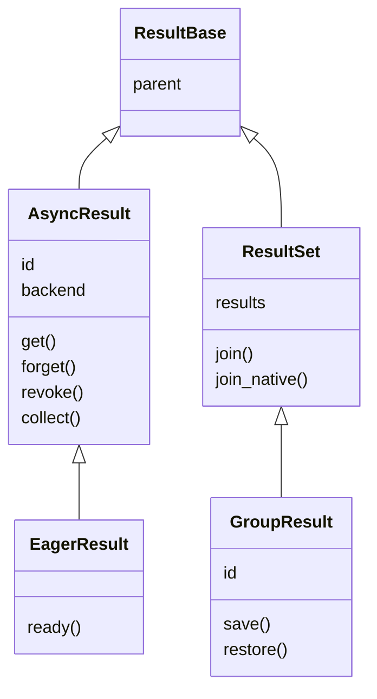
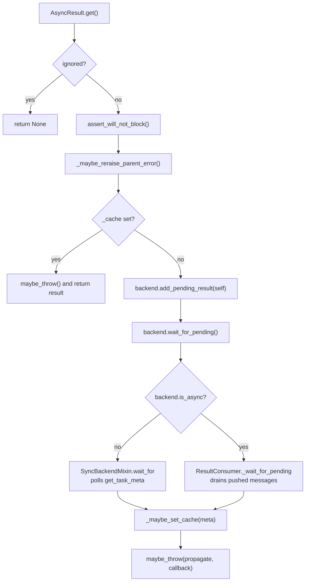
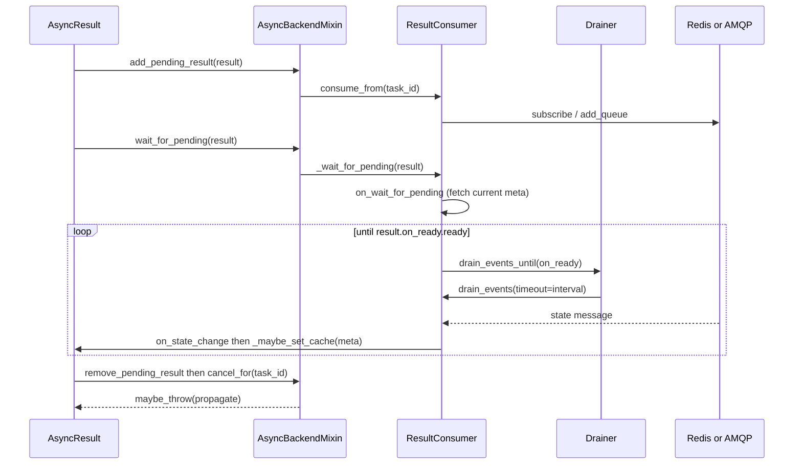

## Overview

Calling a task returns right away with a handle to work that has not happened yet. `celery.result` defines those handles. An `AsyncResult` stands for one task id. A `ResultSet` (and its subclass `GroupResult`) stands for many. An `EagerResult` wraps a task that already ran in-process. A handle stores no state itself: each property read (`state`, `result`, `traceback`, `children`) goes to the app's result backend through `_get_task_meta()`. Once the task reaches a ready state, the meta is cached on the instance. How the backend stores the data is covered in [[Result Backends]]. This page covers the client side: the result API, the state model in `celery.states`, and how `get()` waits, by polling or by consuming pushed messages.

Sources: [celery/result.py:62-101](repo://celery/result.py#L62-L101), [celery/result.py:461-496](repo://celery/result.py#L461-L496)

`Celery.send_task` builds the handle from `result_cls` or `app.AsyncResult` and sets `result.ignored` from the `ignore_result` option. `Task.apply_async` passes `result_cls=self.AsyncResult`. When `task_always_eager` is on, it calls `Task.apply` instead, which returns an `EagerResult`. `app.AsyncResult`, `app.ResultSet` and `app.GroupResult` are subclasses bound to the app through `subclass_with_self`.

Sources: [celery/app/base.py:1025-1036](repo://celery/app/base.py#L1025-L1036), [celery/app/task.py:682-705](repo://celery/app/task.py#L682-L705), [celery/app/base.py:1466-1486](repo://celery/app/base.py#L1466-L1486)

## Result Classes

### Class roles

| Class | Represents | Key behaviour |
|---|---|---|
| `ResultBase` | Common base | Only defines `parent` (the previous result in a chain). |
| `AsyncResult` | One task id | Asks the backend for meta and caches it once the task is ready. `then()` registers the handle with the backend as pending. |
| `ResultSet` | List of results | Fans `ready()`, `successful()`, `failed()`, `forget()` and `revoke()` out to its members. A `barrier` promise fires `on_ready` once all members are ready. |
| `GroupResult` | A `group` call | A `ResultSet` with an `id`, a `parent`, `save()`/`restore()`/`delete()` and `children == results`. |
| `EagerResult` | A task run locally by `apply()` | Always `ready()`. Stores the value, state and traceback in memory and never contacts a backend. |

Sources: [celery/result.py:62-66](repo://celery/result.py#L62-L66), [celery/result.py:89-121](repo://celery/result.py#L89-L121), [celery/result.py:579-611](repo://celery/result.py#L579-L611), [celery/result.py:929-1021](repo://celery/result.py#L929-L1021), [celery/result.py:1025-1109](repo://celery/result.py#L1025-L1109)



Sources: [celery/result.py:62-70](repo://celery/result.py#L62-L70), [celery/result.py:578-579](repo://celery/result.py#L578-L579), [celery/result.py:928-929](repo://celery/result.py#L928-L929), [celery/result.py:1024-1025](repo://celery/result.py#L1024-L1025)

### AsyncResult attributes

`AsyncResult.__init__` refuses `id=None`. It resolves the app with `app_or_default`, uses the app's backend when none is passed, and creates `on_ready` as a weak `promise` bound to `_on_fulfilled`. When that promise fires, it removes the result from the backend's pending set. Every metadata property is a lookup in the dict that `_get_task_meta()` returns: `state` (alias `status`), `result` (alias `info`), `traceback`, `children`, `name`, `args`, `kwargs`, `worker`, `retries`, `queue`, and `date_done`. `date_done` is parsed with `isoparse` when the backend stored it as a string. Two results are equal when their ids match, and a result also compares equal to its id string.

Sources: [celery/result.py:89-101](repo://celery/result.py#L89-L101), [celery/result.py:426-431](repo://celery/result.py#L426-L431), [celery/result.py:487-575](repo://celery/result.py#L487-L575)

`_maybe_set_cache` is the only place that writes the cache. It caches only when the meta's `status` is in `READY_STATES`. It first passes the meta through `backend.meta_from_decoded`, which turns stored exceptions back into exception instances, and then fires `on_ready`. `_set_cache` also turns any serialized `children` into result objects with `result_from_tuple`. While a task is still `PENDING`, `STARTED` or `RETRY`, every property read asks the backend again.

Sources: [celery/result.py:461-485](repo://celery/result.py#L461-L485), [celery/backends/base.py:541-544](repo://celery/backends/base.py#L541-L544)

### Serializing result trees

`as_tuple()` encodes a result and its parent chain as nested tuples. `GroupResult.as_tuple()` adds the list of member tuples. `result_from_tuple` reverses this: when the node list is not `None` it builds `app.GroupResult`, otherwise `app.AsyncResult`, and it rebuilds parents recursively. Pickling uses `__reduce_args__`, which keeps `id`, `backend` and `parent` but drops the app.

Sources: [celery/result.py:123-134](repo://celery/result.py#L123-L134), [celery/result.py:438-442](repo://celery/result.py#L438-L442), [celery/result.py:1004-1008](repo://celery/result.py#L1004-L1008), [celery/result.py:1112-1131](repo://celery/result.py#L1112-L1131)

## Task States

### Built-in states and sets

States are plain strings. `READY_STATES` decides when `ready()` returns true and when a result is cached. `PROPAGATE_STATES` decides when `get()` re-raises. `RETRY` counts as an exception state, but it is not ready and it does not propagate. `RECEIVED` and `REJECTED` are only used in events.

Sources: [celery/states.py:126-151](repo://celery/states.py#L126-L151)

| Set | Members |
|---|---|
| `READY_STATES` | `SUCCESS`, `FAILURE`, `REVOKED` |
| `UNREADY_STATES` | `PENDING`, `RECEIVED`, `STARTED`, `REJECTED`, `RETRY` |
| `EXCEPTION_STATES` | `RETRY`, `FAILURE`, `REVOKED` |
| `PROPAGATE_STATES` | `FAILURE`, `REVOKED` |
| `ALL_STATES` | `PENDING`, `RECEIVED`, `STARTED`, `SUCCESS`, `FAILURE`, `RETRY`, `REVOKED` |

Sources: [celery/states.py:144-151](repo://celery/states.py#L144-L151)

> [!NOTE]
> `PENDING` means "unknown". A backend returns it for any id it has no record of, so a task that was never sent looks the same as one that is still queued. `AsyncResult.exists()` tells the two apart by calling `backend.task_result_exists`, which checks whether the stored status is anything other than `PENDING`.

Sources: [celery/result.py:351-367](repo://celery/result.py#L351-L367), [celery/backends/base.py:774-783](repo://celery/backends/base.py#L774-L783)

### Precedence

`PRECEDENCE` orders states from most to least final. `precedence()` returns a state's index and gives unknown (custom) states the index of the `None` slot, so a custom state such as `PROGRESS` ranks below `SUCCESS` and `FAILURE` but above every other built-in state. The `state` class is a `str` subclass whose comparison operators invert the index, so `state(a) > state(b)` means `a` has higher precedence.

Sources: [celery/states.py:61-123](repo://celery/states.py#L61-L123)

```python
PRECEDENCE = [
    'SUCCESS',
    'FAILURE',
    None,
    'REVOKED',
    'STARTED',
    'RECEIVED',
    'REJECTED',
    'RETRY',
    'PENDING',
]
```

Sources: [celery/states.py:64-74](repo://celery/states.py#L64-L74)

## Waiting with get()

### Options

`AsyncResult.get()` (deprecated alias `wait`) blocks until the task is ready and returns its value. If the task failed and `propagate` is true, it raises the task's exception instead.

Sources: [celery/result.py:191-270](repo://celery/result.py#L191-L270)

| Argument | Default | Effect |
|---|---|---|
| `timeout` | `None` | Seconds to wait before raising `celery.exceptions.TimeoutError`. Applies only to the caller; the task keeps running. |
| `propagate` | `True` | Re-raise the task's exception when its state is in `PROPAGATE_STATES`. If false, the exception instance is returned. |
| `interval` | `0.5` | Sleep between polls. Has no effect on the RPC and Redis backends, which don't poll. |
| `no_ack` | `True` | Passed to the RPC consumer. If false, result messages are not acked. |
| `follow_parents` | `True` | Before waiting, re-raise any error from parents in the chain, and check again on every interval. |
| `callback` | `None` | Called as `callback(task_id, value)` through `maybe_throw`. |
| `on_message` | `None` | Called with every raw state-change meta (async backends only; polling backends raise `ImproperlyConfigured`). |
| `on_interval` | `None` | Chained onto the internal interval promise and called on every loop pass. |
| `disable_sync_subtasks` | `True` | Raise `RuntimeError` if called where a join would block a worker. |

Sources: [celery/result.py:191-242](repo://celery/result.py#L191-L242), [celery/backends/base.py:900-906](repo://celery/backends/base.py#L900-L906)

### Control flow

`get()` returns `None` at once if `ignored` is set. It then runs the synchronous-subtask guard, re-raises parent errors when `follow_parents` and `propagate` are both set, and returns straight from the cache if the result is already ready. Otherwise it registers itself with `backend.add_pending_result` and hands the rest of the wait to `backend.wait_for_pending`.

Sources: [celery/result.py:243-280](repo://celery/result.py#L243-L280)



Sources: [celery/result.py:243-269](repo://celery/result.py#L243-L269), [celery/backends/base.py:900-944](repo://celery/backends/base.py#L900-L944), [celery/backends/asynchronous.py:295-309](repo://celery/backends/asynchronous.py#L295-L309)

`maybe_throw` reads the cache (or fetches meta). When the state is in `PROPAGATE_STATES`, it raises through `on_ready.throw`, attaching a traceback rebuilt by `tblib` if `task_remote_tracebacks` is enabled and `tblib` is installed. It then calls `callback(id, value)` if one was given and returns the value.

Sources: [celery/result.py:385-401](repo://celery/result.py#L385-L401)

### The synchronous subtask guard

`assert_will_not_block()` raises `RuntimeError` with the message "Never call result.get() within a task!" when the process-wide `_task_join_will_block` flag is set. The worker sets the flag from the pool's `task_join_will_block` attribute when it creates the pool. Eager calls wrap `apply` in `denied_join_result()`, so code running eagerly sees the same restriction. `allow_join_result()` turns the flag off for a block and restores it afterwards. Passing `disable_sync_subtasks=False` skips the check for a single call.

Sources: [celery/result.py:30-59](repo://celery/result.py#L30-L59), [celery/_state.py:55-61](repo://celery/_state.py#L55-L61), [celery/worker/components.py:171-172](repo://celery/worker/components.py#L171-L172), [celery/app/task.py:699-701](repo://celery/app/task.py#L699-L701)

> [!WARNING]
> Waiting for one task inside another can deadlock the worker: every pool slot may end up blocked on children that cannot be scheduled. Use a chain or chord callback instead of `allow_join_result()` wherever you can.

Sources: [celery/result.py:196-200](repo://celery/result.py#L196-L200)

### Parent chains

A chain's final `AsyncResult` holds a `parent` link to the previous step, and so on back to the first step. `_parents()` walks that linked list. `_maybe_reraise_parent_error()` walks it from the first step forward and calls `maybe_throw()` on each, so the earliest failure in the chain is raised rather than the waiter blocking forever on a step that will never run. `forget()` also recurses through `parent`.

Sources: [celery/result.py:249-251](repo://celery/result.py#L249-L251), [celery/result.py:272-280](repo://celery/result.py#L272-L280), [celery/result.py:136-143](repo://celery/result.py#L136-L143)

## How Results Are Fetched

### Polling backends

`BaseBackend` and `KeyValueStoreBackend` mix in `SyncBackendMixin`. Its `add_pending_result` and `remove_pending_result` do nothing and `is_async` is false. `wait_for_pending` calls `wait_for`, which loops over `get_task_meta(task_id)` until the status is in `READY_STATES`. It sleeps `interval` between calls, adds `interval` to an elapsed counter, and raises `TimeoutError` when the counter reaches `timeout`. `get_task_meta` serves from the backend's LRU cache (sized by `result_cache_max`) and caches only `SUCCESS` meta.

Sources: [celery/backends/base.py:879-962](repo://celery/backends/base.py#L879-L962), [celery/backends/base.py:746-768](repo://celery/backends/base.py#L746-L768), [celery/backends/base.py:1259-1260](repo://celery/backends/base.py#L1259-L1260), [celery/backends/base.py:138-148](repo://celery/backends/base.py#L138-L148)

### Asynchronous backends and the result consumer

`RedisBackend` and `RPCBackend` mix in `AsyncBackendMixin` instead. Each backend keeps `_pending_results`, a pair of a concrete dict and a `WeakValueDictionary`, and `_pending_messages`, a `BufferMap` capped at `MESSAGE_BUFFER_MAX` (8192). `add_pending_result` starts the drainer and first tries to resolve the result from the buffer, which holds results that arrived before anyone asked for them. If the buffer has nothing, it stores the handle and calls `result_consumer.consume_from(task_id)`. For Redis that means subscribing to the task's key with pub/sub. For RPC it means adding the task's reply queue to a kombu `Consumer`.

Sources: [celery/backends/base.py:163-164](repo://celery/backends/base.py#L163-L164), [celery/backends/asynchronous.py:225-293](repo://celery/backends/asynchronous.py#L225-L293), [celery/backends/redis.py:184-201](repo://celery/backends/redis.py#L184-L201), [celery/backends/rpc.py:134-144](repo://celery/backends/rpc.py#L134-L144), [celery/backends/redis.py:204-204](repo://celery/backends/redis.py#L204-L204), [celery/backends/rpc.py:147-147](repo://celery/backends/rpc.py#L147-L147)

`BaseResultConsumer._wait_for_pending` first calls `on_wait_for_pending`. In the Redis consumer this fetches the current meta once, so a result that finished before the subscription started is not missed. It then installs `on_message` and loops over `drain_events_until(result.on_ready, ...)`. Each incoming message goes to `on_state_change`, which passes the meta to `on_message` and, for a ready status, finds the pending handle, calls `_maybe_set_cache` (which fires `on_ready` and so `remove_pending_result` and `cancel_for`), and appends the handle to any bucket that `iter_native` registered. Results with no waiter yet are put in `_pending_messages`. A `socket.timeout` from the drainer becomes `celery.exceptions.TimeoutError`.

Sources: [celery/backends/asynchronous.py:397-449](repo://celery/backends/asynchronous.py#L397-L449), [celery/backends/redis.py:139-169](repo://celery/backends/redis.py#L139-L169)



Sources: [celery/backends/asynchronous.py:260-309](repo://celery/backends/asynchronous.py#L260-L309), [celery/backends/asynchronous.py:393-449](repo://celery/backends/asynchronous.py#L393-L449), [celery/result.py:115-121](repo://celery/result.py#L115-L121)

### Drainers

The consumer picks its drainer from the `drainers` registry using kombu's `detect_environment()`, which returns `default`, `eventlet` or `gevent`. The default `Drainer.drain_events_until` calls `drain_events(timeout=interval)` inline, swallows `socket.timeout`, and logs and sleeps on `OSError`. It calls `on_interval` on every pass and stops once the promise is ready. It raises `socket.timeout` itself when the total `timeout` has passed.

Sources: [celery/backends/asynchronous.py:55-112](repo://celery/backends/asynchronous.py#L55-L112), [celery/backends/asynchronous.py:324-333](repo://celery/backends/asynchronous.py#L324-L333)

`greenletDrainer` (the base of `eventletDrainer` and `geventDrainer`) spawns one background greenlet running `run()`, which calls `drain_events(timeout=1)` in a loop and sets a fresh `_drain_complete_event` after each pass. A waiter's `wait_for` just waits on that event, so many greenlets can share one connection. If the background loop dies, `_shutdown` is set and the next `wait_for` re-raises the stored exception or raises "Celery must be restarted because a shutdown signal was detected." New drainer types are registered with the `register_drainer(name)` decorator.

Sources: [celery/backends/asynchronous.py:115-222](repo://celery/backends/asynchronous.py#L115-L222)

### Connection recovery

`reconnect_on_error()` wraps the consumer's I/O. It re-raises `socket.timeout` unchanged, because that is normal polling. On any of `_connection_errors` it calls `_reconnect()`, and if that also fails it logs and raises `RuntimeError(E_RETRY_LIMIT_EXCEEDED)`. Redis's `_reconnect` resets the pool, fetches the meta for every key it is subscribed to with `mget` (so updates missed while disconnected are applied), and subscribes again. RPC's `_reconnect` rebuilds the connection and a consumer on the same queues.

Sources: [celery/backends/asynchronous.py:338-370](repo://celery/backends/asynchronous.py#L338-L370), [celery/backends/redis.py:97-132](repo://celery/backends/redis.py#L97-L132), [celery/backends/rpc.py:73-120](repo://celery/backends/rpc.py#L73-L120)

## Joining Groups

### join and join_native

`ResultSet.get()` uses `join_native` when the first member's backend sets `supports_native_join`, and `join` otherwise. `join` calls `result.get()` on each member in turn and passes each the time left of the overall `timeout`. It raises `TimeoutError('join operation timed out')` when the time runs out and rejects `on_message`. With a `callback`, it calls `callback(id, value)` for each result and returns an empty list.

Sources: [celery/result.py:726-825](repo://celery/result.py#L726-L825), [celery/result.py:905-910](repo://celery/result.py#L905-L910)

`join_native` uses `backend.iter_native`, which returns `(task_id, meta)` pairs in whatever order they finish. It puts each value back in its member's position through an id-to-index map. It raises the first propagating exception it sees, and for nested sets (meta that is a list) it calls `get()` on each child. On polling key/value backends, `iter_native` calls `get_many`, which yields cached ready results first and then issues repeated `mget` calls for the rest. On async backends it registers a `deque` bucket per pending member and yields from the bucket as the consumer fills it.

Sources: [celery/result.py:830-882](repo://celery/result.py#L830-L882), [celery/backends/base.py:880-898](repo://celery/backends/base.py#L880-L898), [celery/backends/base.py:1075-1111](repo://celery/backends/base.py#L1075-L1111), [celery/backends/asynchronous.py:228-258](repo://celery/backends/asynchronous.py#L228-L258)

### Aggregate queries

`ready()` is true when every member is ready. `waiting()` is true when any member is not. `successful()` requires every member to have succeeded, and `failed()` is true when any member failed. `completed_count()` counts successful members only. `ResultSet` also behaves like a mutable sequence: `add`, `remove` (accepts an id string), `discard`, `update`, `clear`, iteration and indexing.

Sources: [celery/result.py:599-693](repo://celery/result.py#L599-L693), [celery/result.py:719-724](repo://celery/result.py#L719-L724)

### Saving and restoring a GroupResult

`GroupResult.save()` stores the group under its id with `backend.save_group`. `GroupResult.restore(id)` reads it back with `backend.restore_group`, and `delete()` removes it. This is how a group handle created in one process is fetched in another.

Sources: [celery/result.py:958-970](repo://celery/result.py#L958-L970), [celery/result.py:1014-1021](repo://celery/result.py#L1014-L1021), [celery/backends/base.py:802-818](repo://celery/backends/base.py#L802-L818)

## Traversing Result Graphs

`collect()` walks the tree of results that a task produced (tasks that returned groups or other results, recorded in `children` when `Task.trail` is on) and yields `(result, value)` for each node, calling `R.get(**kwargs)` on each. The walk is `iterdeps()`, a breadth-first search over a `deque`. It expands a node's `children` only once the node is ready. If it meets an unfinished node and `intermediate` is false, it raises `IncompleteStream`. `get_leaf()` returns the value of the last node visited, and `build_graph()` turns the same walk into a `DependencyGraph` (exposed as the `graph` cached property).

Sources: [celery/result.py:282-349](repo://celery/result.py#L282-L349), [celery/result.py:403-411](repo://celery/result.py#L403-L411), [celery/result.py:449-459](repo://celery/result.py#L449-L459)

```python
    def iterdeps(self, intermediate=False):
        stack = deque([(None, self)])

        is_incomplete_stream = not intermediate

        while stack:
            parent, node = stack.popleft()
            yield parent, node
            if node.ready():
                stack.extend((node, child) for child in node.children or [])
            else:
                if is_incomplete_stream:
                    raise IncompleteStream()
```

Sources: [celery/result.py:337-349](repo://celery/result.py#L337-L349)

## Forget, Revoke and Cleanup

### forget

`AsyncResult.forget()` clears the local cache, forgets the parent chain, removes the handle from the pending set, and calls `backend.forget(id)`. That call drops the id from the backend cache and calls `_forget` with retry handling. Key/value backends delete the key. The base `Backend._forget` raises `NotImplementedError`, so not every backend supports it. `ResultSet.forget()` forgets each member, and `EagerResult.forget()` does nothing.

Sources: [celery/result.py:136-143](repo://celery/result.py#L136-L143), [celery/backends/base.py:695-700](repo://celery/backends/base.py#L695-L700), [celery/backends/base.py:1113-1114](repo://celery/backends/base.py#L1113-L1114), [celery/result.py:695-698](repo://celery/result.py#L695-L698), [celery/result.py:1072-1073](repo://celery/result.py#L1072-L1073)

> [!IMPORTANT]
> Backends hold resources for each outstanding result: subscriptions, reply queues and cache entries. Call `get()` or `forget()` on every `AsyncResult` you keep. `__del__` also calls `remove_pending_result`, so dropping the last reference to a handle cancels its subscription.

Sources: [celery/result.py:202-207](repo://celery/result.py#L202-L207), [celery/result.py:444-447](repo://celery/result.py#L444-L447)

### revoke

`revoke()` does not touch the backend. It sends a broadcast through `app.control.revoke(id, terminate=..., signal=..., reply=wait, timeout=...)`, which tells workers to skip, or with `terminate=True` kill, the task. `revoke_by_stamped_headers(headers, ...)` targets tasks by matching stamp headers instead of ids. `ResultSet.revoke()` sends one broadcast with every member id. `EagerResult.revoke()` just sets its local state to `REVOKED`. The worker side is described in [[Remote Control and Inspection]].

Sources: [celery/result.py:145-189](repo://celery/result.py#L145-L189), [celery/result.py:700-717](repo://celery/result.py#L700-L717), [celery/result.py:1075-1076](repo://celery/result.py#L1075-L1076)

## Eager Results

`Task.apply()` runs the task through `build_tracer(..., eager=True)` in the calling process, unwraps any `ExceptionInfo`, follows a `Retry` that carries a signature by calling `sig.apply(retries=retries + 1)`, and wraps the outcome in `EagerResult(task_id, retval, state, traceback=tb, name=self.name)`. `EagerResult` fires `on_ready` in its constructor and builds `_cache` from its own fields. Its `get()` returns the value on success. On a propagating state it raises the stored exception, wrapping non-exception values in `Exception`, unless `propagate=False`.

Sources: [celery/app/task.py:937-951](repo://celery/app/task.py#L937-L951), [celery/result.py:1028-1069](repo://celery/result.py#L1028-L1069), [celery/result.py:1081-1089](repo://celery/result.py#L1081-L1089)

> [!TIP]
> If you create `AsyncResult(id)` for an eager task and read it, the backend's `_ensure_not_eager` emits a `RuntimeWarning`: with `task_always_eager` on, nothing is stored unless `task_store_eager_result` is also enabled. Use the `EagerResult` that `delay()` returned. More eager-mode patterns are in [[Testing Celery Applications]].

Sources: [celery/backends/base.py:723-730](repo://celery/backends/base.py#L723-L730)

## Configuration

| Setting | Default | Used by |
|---|---|---|
| `result_backend` | `None` | Picks the backend that `AsyncResult.backend` defaults to (see [[Result Backends]]). |
| `result_cache_max` | `-1` | Size of the backend LRU cache. `-1` disables caching (`_nulldict`). |
| `task_ignore_result` | `False` | Default `ignore_result`. Ignored handles return `None` from `get()`. |
| `task_remote_tracebacks` | `False` | Rebuild the remote traceback with `tblib` when re-raising. |
| `task_always_eager` | `False` | `apply_async` runs locally and returns `EagerResult`. |
| `task_eager_propagates` | `False` | Default `throw` for `Task.apply`. |
| `task_store_eager_result` | `False` | Store eager results in the backend. |

Sources: [celery/app/defaults.py:205-212](repo://celery/app/defaults.py#L205-L212), [celery/app/defaults.py:275-275](repo://celery/app/defaults.py#L275-L275), [celery/app/defaults.py:290-294](repo://celery/app/defaults.py#L290-L294), [celery/app/defaults.py:309-309](repo://celery/app/defaults.py#L309-L309), [celery/backends/base.py:147-148](repo://celery/backends/base.py#L147-L148)
