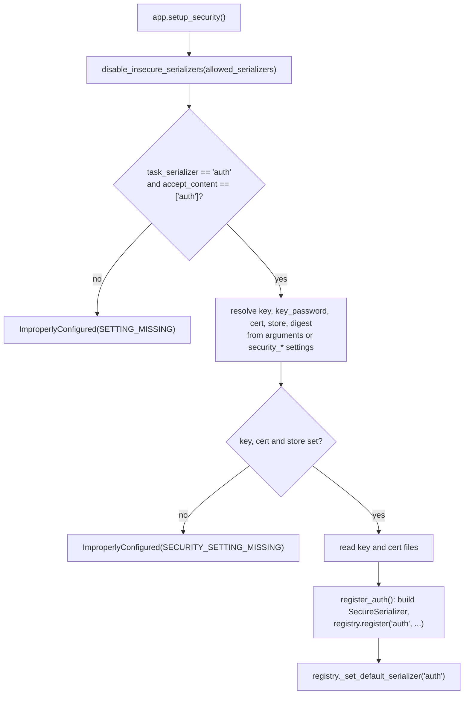
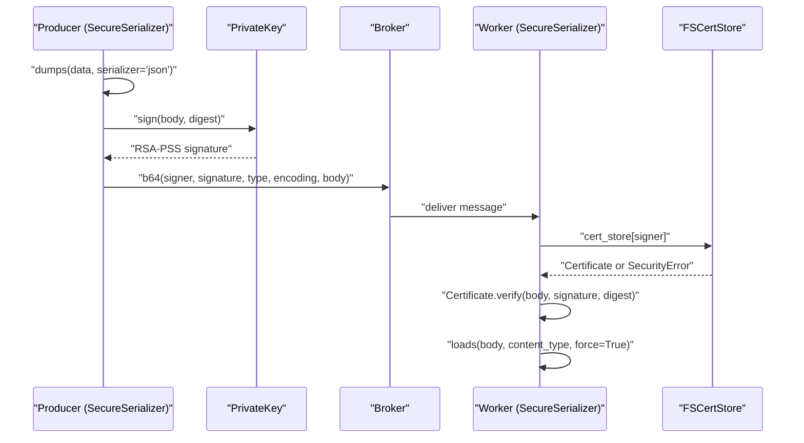

## Overview

Anyone who can publish to a Celery broker can make workers run code. Celery provides two layers of defense against this. The first is message signing: the `auth` serializer in `celery.security` signs every outgoing message with an RSA private key and verifies incoming messages against a store of trusted X.509 certificates, so workers reject messages from unknown producers. The second is process hardening in `celery.platforms`: dropping root privileges, refusing to run as root when pickle is accepted, and pidfile locks that stop duplicate daemons.

Sources: [celery/security/__init__.py:1-41](repo://celery/security/__init__.py#L1-L41), [celery/platforms.py:64-89](repo://celery/platforms.py#L64-L89)

Importing `celery.security` requires the `cryptography` package. If it is missing, the import raises `ImproperlyConfigured` with installation instructions. All signing errors are raised as `celery.exceptions.SecurityError`, a subclass of `CeleryError`.

Sources: [celery/security/__init__.py:9-14](repo://celery/security/__init__.py#L9-L14), [celery/security/__init__.py:38-41](repo://celery/security/__init__.py#L38-L41), [celery/exceptions.py:210-211](repo://celery/exceptions.py#L210-L211)

## Enabling Message Signing

### Required configuration

`setup_security` enforces a fixed configuration. `task_serializer` must be `'auth'` and `accept_content` must be exactly `['auth']`, since signing has no value unless workers also refuse unsigned messages. Otherwise it raises `ImproperlyConfigured(SETTING_MISSING)`. The key, certificate and certificate store must all be set, or it raises `ImproperlyConfigured(SECURITY_SETTING_MISSING)`.

Sources: [celery/security/__init__.py:16-34](repo://celery/security/__init__.py#L16-L34), [celery/security/__init__.py:53-65](repo://celery/security/__init__.py#L53-L65)

| Setting | Default | Meaning |
|---|---|---|
| `security_key` | none | path to the PEM-encoded RSA private key used to sign |
| `security_key_password` | none | password (bytes) for an encrypted private key |
| `security_certificate` | none | path to the PEM X.509 certificate matching the key |
| `security_cert_store` | none | directory or glob of trusted certificates used to verify |
| `security_digest` | `'sha256'` | name of a `cryptography.hazmat.primitives.hashes` class |

Sources: [celery/app/defaults.py:20-20](repo://celery/app/defaults.py#L20-L20), [celery/app/defaults.py:239-247](repo://celery/app/defaults.py#L239-L247)

```python
app.conf.update(
    security_key='/etc/ssl/private/worker.key',
    security_certificate='/etc/ssl/certs/worker.pem',
    security_cert_store='/etc/ssl/certs/*.pem',
    security_digest='sha256',
    task_serializer='auth',
    accept_content=['auth'],
)
app.setup_security()
```

Sources: [celery/app/base.py:750-780](repo://celery/app/base.py#L750-L780), [celery/security/__init__.py:44-70](repo://celery/security/__init__.py#L44-L70)

### setup_security step by step

`app.setup_security(allowed_serializers, key, key_password, cert, store, digest, serializer)` imports `celery.security.setup_security` lazily and passes `app=self`. The docstring notes that it is a global operation affecting all app instances, because it changes kombu's serializer registry.

Sources: [celery/app/base.py:750-780](repo://celery/app/base.py#L750-L780)



Sources: [celery/security/__init__.py:44-70](repo://celery/security/__init__.py#L44-L70), [celery/security/serialization.py:80-90](repo://celery/security/serialization.py#L80-L90)

Arguments win over settings, which act as fallbacks. The key and certificate are given as file paths and read as text. The store is passed as a path to `FSCertStore`. `register_auth` wraps each value in its class (`PrivateKey`, `Certificate`, `FSCertStore`) and registers the serializer's bound `serialize`/`deserialize` methods with kombu under the name `auth`, content type `application/data` and encoding `utf-8`.

Sources: [celery/security/__init__.py:58-70](repo://celery/security/__init__.py#L58-L70), [celery/security/serialization.py:80-90](repo://celery/security/serialization.py#L80-L90)

`disable_untrusted_serializers(whitelist)` is also exported. It calls kombu's `disable_insecure_serializers` without the rest of the setup.

Sources: [celery/security/__init__.py:73-74](repo://celery/security/__init__.py#L73-L74)

## The auth SecureSerializer

### Signing

`SecureSerializer.serialize` first encodes the data with the inner serializer (default `json`) using kombu's `dumps`. It signs the serialized bytes, not the Python object, so the receiver can verify the signature before decoding anything and avoids flaws in the decoder. It then packs the signer id, signature, content type, content encoding and body.

Sources: [celery/security/serialization.py:20-46](repo://celery/security/serialization.py#L20-L46)

`_pack` base64-encodes the signer and signature, joins all five fields with the separator `b"\x00\x01"`, and base64-encodes the whole result. `_unpack` reverses this, using `split(sep, maxsplit=4)` so the body (the last field) is never split even if it contains the separator.

Sources: [celery/security/serialization.py:14-17](repo://celery/security/serialization.py#L14-L17), [celery/security/serialization.py:60-77](repo://celery/security/serialization.py#L60-L77)

### Verification

`deserialize` unpacks the payload, looks up the signer in the certificate store, and calls `Certificate.verify(body, signature, digest)`. Only after that succeeds does it call kombu `loads(..., force=True)` with the original content type. `force=True` is what lets the inner content type load even though `accept_content` lists only `auth`. Any exception during unpacking or verification is turned into `SecurityError("Unable to deserialize: ...")` by `reraise_errors`.

Sources: [celery/security/serialization.py:48-58](repo://celery/security/serialization.py#L48-L58), [celery/security/utils.py:19-28](repo://celery/security/utils.py#L19-L28)



Sources: [celery/security/serialization.py:31-77](repo://celery/security/serialization.py#L31-L77), [celery/security/key.py:27-35](repo://celery/security/key.py#L27-L35), [celery/security/certificate.py:65-91](repo://celery/security/certificate.py#L65-L91)

## Keys, Certificates and Stores

### PrivateKey

`PrivateKey(key, password)` loads a PEM private key with `cryptography`'s `load_pem_private_key`. It accepts only RSA keys and raises `ValueError("Non-RSA keys are not supported.")` otherwise, which `reraise_errors` turns into `SecurityError("Invalid private key: ...")`. `sign(data, digest)` uses RSA-PSS padding with MGF1 over the same digest and the maximum salt length.

Sources: [celery/security/key.py:12-35](repo://celery/security/key.py#L12-L35)

### Certificate

`Certificate(cert)` loads a PEM X.509 certificate and also rejects non-RSA public keys. Its identity is `get_id()`, the issuer's attribute values joined by spaces followed by the serial number, and that string is what goes into the `signer` field of each message. `has_expired()` compares `not_valid_after_utc` with the current UTC time. `verify` checks an RSA-PSS signature with the same padding parameters that `PrivateKey.sign` uses.

Sources: [celery/security/certificate.py:31-73](repo://celery/security/certificate.py#L31-L73)

### CertStore and FSCertStore

`CertStore` is a dict of certificates keyed by id. Looking up an unknown id raises `SecurityError("Unknown certificate: ...")`, and `add_cert` refuses duplicate ids. `FSCertStore(path)` treats a directory as `path/*`, otherwise as a glob. It loads every matching file as a `Certificate` and raises `SecurityError("Expired certificate: ...")` if any of them has expired. One expired certificate in the store therefore prevents the serializer from being registered at all.

Sources: [celery/security/certificate.py:76-113](repo://celery/security/certificate.py#L76-L113)

> [!NOTE]
> The duplicate-certificate error message in `CertStore.add_cert` formats the built-in `id` function rather than the certificate id, so the message text does not show which certificate was duplicated.

Sources: [celery/security/certificate.py:93-97](repo://celery/security/certificate.py#L93-L97)

### Digest selection

`get_digest_algorithm(digest)` upper-cases the configured name and instantiates the matching class from `cryptography.hazmat.primitives.hashes`, so `'sha256'` becomes `hashes.SHA256()`. Producers and consumers must use the same digest, because it is used for both PSS padding and verification.

Sources: [celery/security/utils.py:13-16](repo://celery/security/utils.py#L13-L16)

## Root and Pickle Checks

### check_privileges

When a worker is constructed, `celery.apps.worker.Worker.on_before_init` calls `check_privileges(app.conf.accept_content)`. The check flags the process as risky if it runs as root (uid or euid 0), or if its group or effective group is named `sudo` or `wheel`. It also fails closed: if the gid or egid has no group database entry, it emits a `SecurityWarning(ASSUMING_ROOT)` and treats the process as risky. On platforms that have `os.fchown` but lack any of the uid/gid getters, it raises `SecurityError('suspicious platform, contact support')`.

Sources: [celery/apps/worker.py:98-104](repo://celery/apps/worker.py#L98-L104), [celery/platforms.py:788-830](repo://celery/platforms.py#L788-L830)

`_warn_or_raise_security_error` decides the outcome. If `accept_content` contains `pickle` or `application/group-python-serialize` and the `C_FORCE_ROOT` environment variable is not set, it raises `SecurityError(ROOT_DISALLOWED)`. Otherwise it only emits a `SecurityWarning(ROOT_DISCOURAGED)` asking you to pass `--uid`. `celery worker` catches the `SecurityError`, prints the message and exits with status 1.

Sources: [celery/platforms.py:67-84](repo://celery/platforms.py#L67-L84), [celery/platforms.py:833-845](repo://celery/platforms.py#L833-L845), [celery/bin/worker.py:369-371](repo://celery/bin/worker.py#L369-L371)

> [!CAUTION]
> `C_FORCE_ROOT` only silences the hard failure. A root worker that accepts pickle can be made to execute arbitrary code by anyone able to publish to the broker. Prefer `--uid`/`--gid` or a dedicated service account.

Sources: [celery/platforms.py:67-75](repo://celery/platforms.py#L67-L75), [celery/platforms.py:833-839](repo://celery/platforms.py#L833-L839)

## Dropping Privileges

### maybe_drop_privileges

`celery worker` calls `maybe_drop_privileges(uid=uid, gid=gid)` before creating the worker, and `celery beat` does the same when not detaching. When detaching, `platforms.detached()` calls it before daemonizing. The function is a no-op on Windows. If the effective uid is non-zero but the real uid is 0, it raises `SecurityError('contact support')`. User and group names are resolved with `parse_uid`/`parse_gid`, which accept numeric ids or names and raise `KeyError` for unknown ones.

Sources: [celery/bin/worker.py:358-358](repo://celery/bin/worker.py#L358-L358), [celery/bin/beat.py:61-62](repo://celery/bin/beat.py#L61-L62), [celery/platforms.py:412-417](repo://celery/platforms.py#L412-L417), [celery/platforms.py:432-463](repo://celery/platforms.py#L432-L463), [celery/platforms.py:528-545](repo://celery/platforms.py#L528-L545)

With a uid, `_setuid` picks the user's primary group when no gid is given. It calls `setgid` before `initgroups` and `setuid`, because changing the group after the uid could fail and leave the process in a privileged group. It then calls `setuid(0)` on purpose: success means privileges can be regained, so it raises `SecurityError('non-root user able to restore privileges after setuid.')`, while the expected `EPERM` is ignored. With only a gid, just the group changes. Finally the function raises `SecurityError` if the process is still root (`Still root uid/gid after drop privileges!`).

Sources: [celery/platforms.py:466-526](repo://celery/platforms.py#L466-L526), [celery/platforms.py:547-583](repo://celery/platforms.py#L547-L583)

## Pidfile Locking

### Pidfile and create_pidlock

`Pidfile.write_pid` opens the file with `O_CREAT | O_EXCL | O_WRONLY` and mode `0644`, so creating it is atomic and fails if the file already exists. It writes `"<pid>\n"`, flushes and fsyncs, then re-reads the file and raises `LockFailed` if the content differs. `acquire` wraps `OSError` in `LockFailed`. `read_pid` rejects partial files that lack a trailing newline.

Sources: [celery/platforms.py:59-62](repo://celery/platforms.py#L59-L62), [celery/platforms.py:121-238](repo://celery/platforms.py#L121-L238)

`create_pidlock(pidfile)` calls `_create_pidlock` and registers `pidlock.release` with `atexit`. `_create_pidlock` exits with `EX_CANTCREAT` and the `PIDLOCKED` message ("Pidfile ... already exists. Seems we're already running?") when the file exists and `remove_if_stale()` returns false. `remove_if_stale` removes broken or empty pidfiles, files holding the current pid (common for pid 1 in containers), and files whose process no longer exists (`os.kill(pid, 0)` fails with `ESRCH` or `EPERM`).

Sources: [celery/platforms.py:64-65](repo://celery/platforms.py#L64-L65), [celery/platforms.py:183-213](repo://celery/platforms.py#L183-L213), [celery/platforms.py:244-272](repo://celery/platforms.py#L244-L272)

The worker takes the lock in `WorkController.on_start` and beat takes it in `start_scheduler`, in both cases only when a pidfile is configured. `evcam` takes it as well. During daemonization, `detached()` only checks the lock (acquire then release) after changing directory and leaves the real lock to the child. See [[Command Line Interface]] for the `--pidfile`, `--uid`, `--gid` and `--umask` options and [[Worker Architecture and Bootsteps]] for worker startup.

Sources: [celery/worker/worker.py:150-152](repo://celery/worker/worker.py#L150-L152), [celery/apps/beat.py:93-95](repo://celery/apps/beat.py#L93-L95), [celery/events/snapshot.py:92-93](repo://celery/events/snapshot.py#L92-L93), [celery/platforms.py:419-429](repo://celery/platforms.py#L419-L429)
