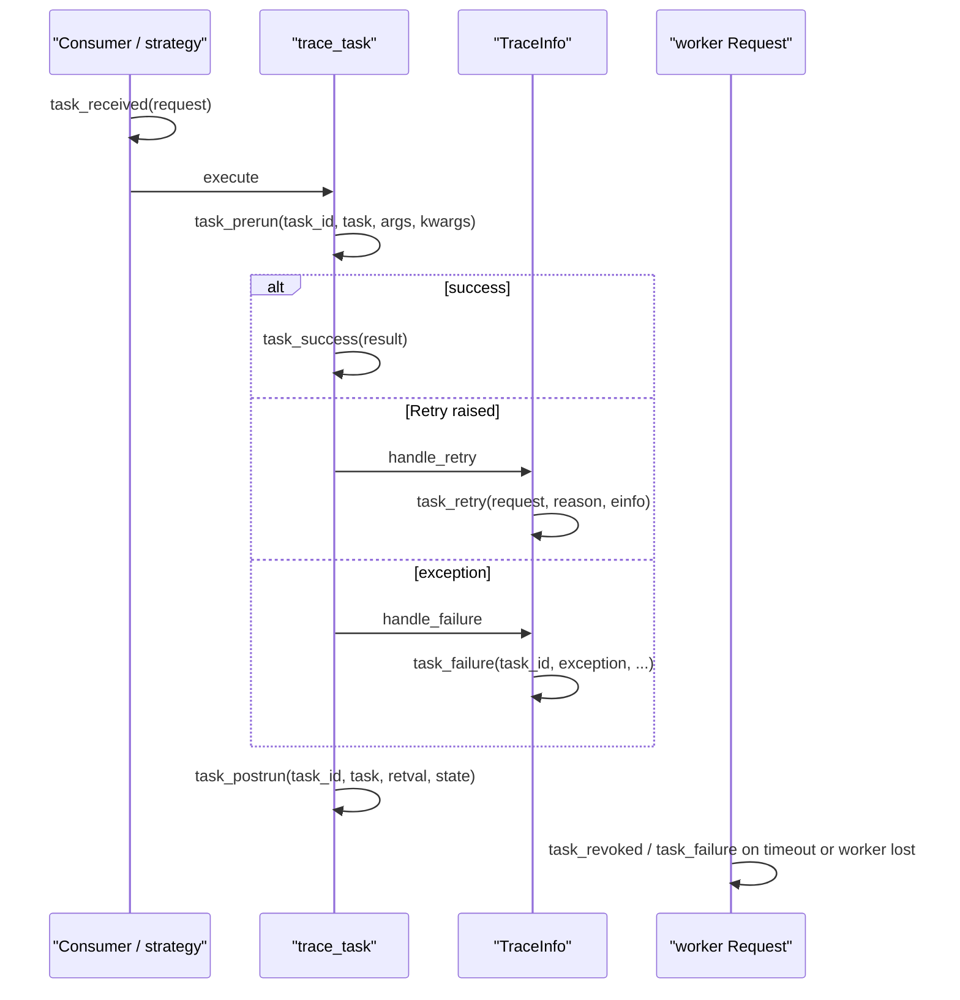

## Overview

Signals let application code hook into Celery's lifecycle without subclassing: a receiver function is connected to a named `Signal`, and Celery calls it whenever that point is reached, whether a task is published, a task starts or fails, a worker boots, or logging is configured. The dispatcher in `celery/utils/dispatch/signal.py` implements the observer pattern and is derived from Django's dispatcher. `celery/signals.py` declares the built-in signal instances. The places that send them are spread across the client (`celery/app/amqp.py`), the tracer (`celery/app/trace.py`), the worker, the pools, beat and the logging setup.

Sources: [celery/signals.py:1-28](repo://celery/signals.py#L1-L28), [celery/utils/dispatch/signal.py:73-102](repo://celery/utils/dispatch/signal.py#L73-L102)

## The Signal Class

### State held by a signal

A `Signal` keeps `receivers`, a list of `(lookup_key, receiver)` pairs, plus a `threading.Lock`, the documentation-only `providing_args` set, a `name`, and an optional per-sender cache (`sender_receivers_cache`) used when `use_caching` is enabled. The lookup key is `(receiver id, sender id)`, or `(dispatch_uid, sender id)` when a `dispatch_uid` is given. `_make_id` unwraps `Proxy` objects, uses strings as they are (so `sender='proj.tasks.add'` works), and uses `id(target.__func__)` for bound methods.

Sources: [celery/utils/dispatch/signal.py:21-66](repo://celery/utils/dispatch/signal.py#L21-L66), [celery/utils/dispatch/signal.py:83-102](repo://celery/utils/dispatch/signal.py#L83-L102)

### connect

`connect` works both as a plain decorator and as a decorator factory with options `sender`, `weak` (default `True`), `dispatch_uid` and `retry`. `_connect_signal` checks that the receiver is callable and accepts `**kwargs`, raising `ValueError` otherwise. If `sender` is a `PromiseProxy` (a lazily created task), connecting is deferred with `__then__` until the proxy is evaluated. Weak receivers are stored as `weakref.ref`, or `WeakMethod` for bound methods, with a `weakref.finalize` callback that marks dead receivers for cleanup. A receiver with an existing lookup key is not added twice, and every connect clears the sender cache.

Sources: [celery/utils/dispatch/signal.py:110-216](repo://celery/utils/dispatch/signal.py#L110-L216)

```python
    @after_task_publish.connect(sender='proj.tasks.add')
    def task_sent_handler(sender=None, headers=None, body=None, **kwargs):
        # information about task are located in headers for task messages
        # using the task protocol version 2.
        info = headers if 'task' in headers else body
        print('after_task_publish for task id {info[id]}'.format(
            info=info,
        ))
```

Sources: [docs/userguide/signals.rst:49-56](repo://docs/userguide/signals.rst#L49-L56)

### Retrying receivers

With `retry=True`, the receiver is wrapped in `_try_receiver_over_time`, which calls Kombu's `retry_over_time` and logs `RECEIVER_RETRY_ERROR` before each new attempt. The wrapper is held strongly (`weak` is forced to `False`). It gets a `_dispatch_uid` equal to the original function's id, so `disconnect(original_fun)` can still find it through `_make_lookup_key`.

Sources: [celery/utils/dispatch/signal.py:144-180](repo://celery/utils/dispatch/signal.py#L144-L180), [celery/utils/dispatch/signal.py:54-61](repo://celery/utils/dispatch/signal.py#L54-L61)

### send

`send(sender, **named)` returns immediately when there are no receivers or the cache records `NO_RECEIVERS` for the sender. Otherwise `_live_receivers` collects receivers registered for this sender or for any sender (`NONE_ID`) and dereferences weak references. Each receiver is called as `receiver(signal=self, sender=sender, **named)`. If a receiver raises, the exception is logged and stored in the response list instead of propagating, so a faulty handler never breaks the code that sent the signal. `send_robust` is an alias of `send`.

Sources: [celery/utils/dispatch/signal.py:258-340](repo://celery/utils/dispatch/signal.py#L258-L340)

> [!IMPORTANT]
> Because `send` catches every `Exception`, a receiver cannot abort the operation by raising. Callers that need to react inspect the returned `(receiver, response)` pairs, as `setup_logging` and `import_modules` do.

Sources: [celery/utils/dispatch/signal.py:278-289](repo://celery/utils/dispatch/signal.py#L278-L289), [celery/app/log.py:98-103](repo://celery/app/log.py#L98-L103), [celery/loaders/base.py:97-99](repo://celery/loaders/base.py#L97-L99)

### disconnect and cleanup

`disconnect(receiver=None, sender=None, dispatch_uid=None)` rebuilds the lookup key, removes the first match under the lock, clears the cache, and returns whether anything was removed. Passing `weak` only triggers a `CDeprecationWarning`. Dead weak references are pruned lazily by `_clear_dead_receivers`, because `_remove_receiver` runs during garbage collection and only sets the `_dead_receivers` flag.

Sources: [celery/utils/dispatch/signal.py:218-253](repo://celery/utils/dispatch/signal.py#L218-L253), [celery/utils/dispatch/signal.py:292-301](repo://celery/utils/dispatch/signal.py#L292-L301), [celery/utils/dispatch/signal.py:342-350](repo://celery/utils/dispatch/signal.py#L342-L350)

## Task Signals

### Publishing a task

The client-side task signals are sent from the `send_task_message` closure built by `AMQP._create_task_sender` (see [[Calling Tasks and Message Routing]]). The sender is the task name, a string, which is why connecting with `sender='proj.tasks.add'` works for these signals. Receiver lists are captured once and each signal is sent only if it has receivers.

Sources: [celery/app/amqp.py:485-497](repo://celery/app/amqp.py#L485-L497), [celery/app/amqp.py:558-592](repo://celery/app/amqp.py#L558-L592)

| Signal | Sent from | Arguments |
| --- | --- | --- |
| `before_task_publish` | `send_task_message`, before `producer.publish` | `body`, `exchange`, `routing_key`, `headers`, `properties`, `declare`, `retry_policy` |
| `after_task_publish` | `send_task_message`, after publish | `body`, `headers`, `exchange`, `routing_key` |
| `task_sent` (deprecated) | `send_task_message` | `task_id`, `task`, `args`, `kwargs`, `eta`, `taskset` |

Sources: [celery/signals.py:30-41](repo://celery/signals.py#L30-L41), [celery/signals.py:88-94](repo://celery/signals.py#L88-L94), [celery/app/amqp.py:558-592](repo://celery/app/amqp.py#L558-L592)

> [!TIP]
> `before_task_publish` receives the live `headers` and `properties` dicts that are passed to `producer.publish`, so a receiver can add custom headers to outgoing task messages.

Sources: [celery/app/amqp.py:558-576](repo://celery/app/amqp.py#L558-L576)

### Receiving and executing a task



Sources: [celery/worker/strategy.py:160-165](repo://celery/worker/strategy.py#L160-L165), [celery/app/trace.py:563-663](repo://celery/app/trace.py#L563-L663), [celery/app/trace.py:212-282](repo://celery/app/trace.py#L212-L282)

The tracer binds `task_prerun.send`, `task_postrun.send` and `task_success.send` at import time, and `build_tracer` reads their receiver lists once, so a signal without receivers costs nothing per task. For these signals the sender is the task instance.

Sources: [celery/app/trace.py:104-106](repo://celery/app/trace.py#L104-L106), [celery/app/trace.py:410-412](repo://celery/app/trace.py#L410-L412)

| Signal | Sent from | Sender and arguments |
| --- | --- | --- |
| `task_received` | `celery/worker/strategy.py` after the request passes the revoked check | consumer; `request` |
| `task_prerun` | `trace_task`, after pushing the request | task; `task_id`, `task`, `args`, `kwargs` |
| `task_success` | `trace_task`, after `mark_as_done` and `on_success` | task; `result` |
| `task_retry` | `TraceInfo.handle_retry` | task; `request`, `reason`, `einfo` |
| `task_failure` | `TraceInfo.handle_failure`; `Request.on_timeout`; `Request.on_failure` | task; `task_id`, `exception`, `args`, `kwargs`, `traceback`, `einfo` |
| `task_postrun` | `trace_task` `finally` block, always | task; `task_id`, `task`, `args`, `kwargs`, `retval`, `state` |
| `task_internal_error` | `_signal_internal_error` for errors outside the task body | task; `task_id`, `args`, `kwargs`, `request`, `exception`, `traceback`, `einfo` |
| `task_revoked` | `Request._announce_revoked` | task; `request`, `terminated`, `signum`, `expired` |
| `task_rejected` | consumer, for unknown message formats and invalid tasks | consumer; `message`, `exc` |
| `task_unknown` | consumer `on_unknown_task` | consumer; `message`, `exc`, `name`, `id` |

Sources: [celery/signals.py:42-87](repo://celery/signals.py#L42-L87), [celery/app/trace.py:563-663](repo://celery/app/trace.py#L563-L663), [celery/app/trace.py:703-721](repo://celery/app/trace.py#L703-L721), [celery/worker/request.py:457-468](repo://celery/worker/request.py#L457-L468), [celery/worker/request.py:529-566](repo://celery/worker/request.py#L529-L566), [celery/worker/request.py:650-662](repo://celery/worker/request.py#L650-L662), [celery/worker/request.py:704-714](repo://celery/worker/request.py#L704-L714), [celery/worker/consumer/consumer.py:672-714](repo://celery/worker/consumer/consumer.py#L672-L714)

> [!NOTE]
> `task_failure` from the tracer covers exceptions raised by the task body. The worker `Request` sends it separately for hard time limits, a `Reject` without requeue, and a lost worker process, since in those cases the tracer never finishes inside the pool process.

Sources: [celery/worker/request.py:529-566](repo://celery/worker/request.py#L529-L566), [celery/worker/request.py:648-662](repo://celery/worker/request.py#L648-L662), [celery/worker/request.py:704-714](repo://celery/worker/request.py#L704-L714)

## Worker Signals

### Startup and shutdown sequence

Worker signals follow the worker's lifecycle. `celeryd_init` and `celeryd_after_setup` use the worker hostname as sender, so a receiver can configure a single node by name. The worker internals are covered in [[Worker Architecture and Bootsteps]].

Sources: [celery/apps/worker.py:95-104](repo://celery/apps/worker.py#L95-L104), [celery/apps/worker.py:130-136](repo://celery/apps/worker.py#L130-L136)

| Signal | Sent from | Sender and arguments |
| --- | --- | --- |
| `celeryd_init` | `apps.worker.Worker.on_before_init`, after `setup_worker_optimizations` | hostname; `instance`, `conf`, `options` |
| `worker_init` | `WorkController.__init__`, before bootsteps are set up | WorkController |
| `celeryd_after_setup` | `apps.worker.Worker.on_start`, after queue options are applied | hostname; `instance`, `conf` |
| `import_modules` | `BaseLoader.import_default_modules` | app |
| `worker_before_create_process` | `AsynPool._create_worker_process` | pool |
| `worker_process_init` | prefork `process_initializer` (and the solo pool) in each child | `None` |
| `worker_ready` | `on_consumer_ready` | consumer |
| `heartbeat_sent` | worker `Heart`, only if it has receivers | heart |
| `worker_shutting_down` | `_handle_request`, the warm/cold shutdown signal handler | hostname; `sig`, `how`, `exitcode` |
| `worker_process_shutdown` | prefork `process_destructor` | `None`; `pid`, `exitcode` |
| `worker_shutdown` | `WorkController._send_worker_shutdown` | WorkController |

Sources: [celery/signals.py:96-115](repo://celery/signals.py#L96-L115), [celery/worker/worker.py:120-127](repo://celery/worker/worker.py#L120-L127), [celery/worker/worker.py:198-199](repo://celery/worker/worker.py#L198-L199), [celery/apps/worker.py:176-182](repo://celery/apps/worker.py#L176-L182), [celery/apps/worker.py:305-312](repo://celery/apps/worker.py#L305-L312), [celery/concurrency/prefork.py:76-92](repo://celery/concurrency/prefork.py#L76-L92), [celery/concurrency/asynpool.py:490-491](repo://celery/concurrency/asynpool.py#L490-L491), [celery/concurrency/solo.py:20-20](repo://celery/concurrency/solo.py#L20-L20), [celery/worker/heartbeat.py:35-37](repo://celery/worker/heartbeat.py#L35-L37), [celery/loaders/base.py:97-98](repo://celery/loaders/base.py#L97-L98)

### Per-process initialization

`worker_process_init` fires in every prefork child after the tracers are rebuilt with `build_tracer` and the worker state is reset. This is the place to open per-process resources such as database connections, which must not be shared across `fork()`.

Sources: [celery/concurrency/prefork.py:76-82](repo://celery/concurrency/prefork.py#L76-L82)

```python
    @celeryd_init.connect(sender='worker12@example.com')
    def configure_worker12(conf=None, **kwargs):
        conf.task_default_rate_limit = '10/m'
```

Sources: [docs/userguide/signals.rst:506-508](repo://docs/userguide/signals.rst#L506-L508)

## Logging, Beat, Pool and Program Signals

### Logging signals

`Logging.setup_logging_subsystem` sends `setup_logging` first. If any receiver is connected, Celery skips its own logging configuration entirely, which is how an application takes over logging. Otherwise Celery configures the root logger (clearing handlers when `worker_hijack_root_logger` is set) and then sends `after_setup_logger`. `setup_task_loggers` sends `after_setup_task_logger` with the task logger.

Sources: [celery/app/log.py:90-128](repo://celery/app/log.py#L90-L128), [celery/app/log.py:174-180](repo://celery/app/log.py#L174-L180), [celery/signals.py:117-135](repo://celery/signals.py#L117-L135)

### Beat, eventlet and command-line signals

| Signal | Sent from | Notes |
| --- | --- | --- |
| `beat_init` | `Service.start` in `celery/beat.py` | Every beat start |
| `beat_embedded_init` | `Service.start` | Only when beat runs embedded in a worker (`-B`) |
| `eventlet_pool_started` / `eventlet_pool_preshutdown` / `eventlet_pool_postshutdown` | eventlet `TaskPool` start and stop | Sender is the pool |
| `eventlet_pool_apply` | eventlet pool, as `_quick_apply_sig` | `target`, `args`, `kwargs` |
| `user_preload_options` | `celery/bin/base.py` after parsing user preload options | `app`, `options` |

Sources: [celery/beat.py:634-641](repo://celery/beat.py#L634-L641), [celery/concurrency/eventlet.py:113-121](repo://celery/concurrency/eventlet.py#L113-L121), [celery/bin/base.py:150-156](repo://celery/bin/base.py#L150-L156), [celery/signals.py:137-154](repo://celery/signals.py#L137-L154)

## App-Level Signals

### Signals on the Celery instance

Besides the module-level signals, every `Celery` app creates its own `Signal` instances in `__init__`: `on_configure`, `on_after_configure` (with a `source` argument), `on_after_finalize` and `on_after_fork`. They are sent when the configuration is first loaded (`_load_config`), when finalization completes (after all pending tasks are evaluated and bound), and in the child after a fork (`_after_fork`, which also drops the producer pool). See [[The Celery Application]].

Sources: [celery/app/base.py:418-427](repo://celery/app/base.py#L418-L427), [celery/app/base.py:1247-1250](repo://celery/app/base.py#L1247-L1250), [celery/app/base.py:1276-1288](repo://celery/app/base.py#L1276-L1288), [celery/app/base.py:670-677](repo://celery/app/base.py#L670-L677)
