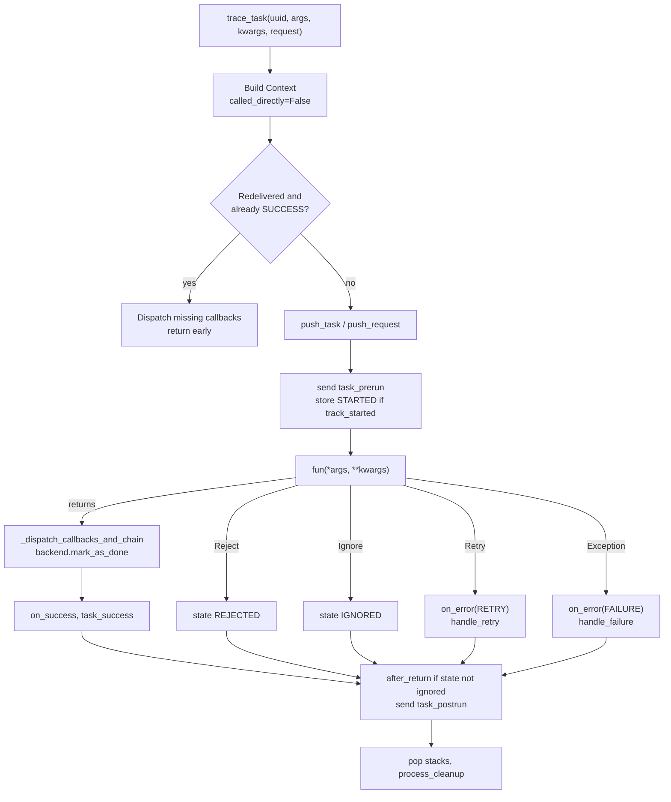

## Overview

A task is the unit of work in Celery: a Python callable wrapped in a `Task` subclass that knows how to serialize a call into a message, how a worker should execute it, and how its outcome should be recorded. The `Task` base class in `celery/app/task.py` carries the per-task options (retries, time limits, acknowledgement policy, result handling), the `Context` object that exposes the current request, and the client-side calling API (`delay`, `apply_async`, `apply`). On the worker side, `celery/app/trace.py` builds a tracer function per task that runs the body, maps outcomes to the states in `celery/states.py`, stores results, fires signals and dispatches callbacks. Sending messages is covered in [[Calling Tasks and Message Routing]]; composing tasks is covered in [[Canvas: Signatures and Workflows]].

Sources: [celery/app/task.py:206-260](repo://celery/app/task.py#L206-L260), [celery/app/trace.py:1-20](repo://celery/app/trace.py#L1-L20)

## Defining Tasks

### The task decorator

`Celery.task` turns a function into a task. With a single callable argument it creates the task immediately; with keyword options it returns a decorator. When `shared=True` (the default) a constructor is registered with `connect_on_app_finalize` so every app gets the task, and unless `lazy=False` or the app is already finalized, the decorator returns a `PromiseProxy` that is evaluated on first use and appended to `self._pending`.

Sources: [celery/app/base.py:515-585](repo://celery/app/base.py#L515-L585)

### Building the task class

`_task_from_fun` generates the name with `gen_task_name` when none is given, uses `base or self.Task`, and creates a new class with `type()`. The function becomes `run`; with `bind=True` it is stored as a plain function, so it receives the task instance as `self`, otherwise it is wrapped in `staticmethod`. The class also gets `__header__`, an argument checker produced by `type_checker` (`head_from_fun`) that `apply_async` uses when `typing` is enabled. All remaining decorator options become class attributes. The instance is stored in `self._tasks`, bound with `task.bind(self)`, and passed to `add_autoretry_behaviour`. If a task of that name already exists, the existing instance is returned.

Sources: [celery/app/base.py:587-633](repo://celery/app/base.py#L587-L633)

```python
            run = fun if bind else staticmethod(fun)
            task = type(fun.__name__, (base,), dict({
                'app': self,
                'name': name,
                'run': run,
                '_decorated': True,
                '__doc__': fun.__doc__,
                '__module__': fun.__module__,
                '__annotations__': _get_annotations(fun),
                '__header__': self.type_checker(fun, bound=bind),
                '__wrapped__': run}, **options))()
```

Sources: [celery/app/base.py:607-617](repo://celery/app/base.py#L607-L617)

### Binding to an app

`Task.bind` is a classmethod that runs lazily, the first time the `app` class property is accessed. It sets `typing` from `app.strict_typing`, then fills every attribute listed in `from_config` that is still `None` from the app configuration. `acks_on_failure` and `acks_on_timeout` fall back to the deprecated `acks_on_failure_or_timeout`, then to `True`. On the first bind it applies `task_annotations` via `annotate()`, where keys beginning with `@` wrap methods through `add_around`, and creates the thread-local `request_stack`. Finally it calls the `on_bound` hook.

Sources: [celery/app/task.py:396-492](repo://celery/app/task.py#L396-L492)

`register_task` handles class-based tasks: it instantiates the class if needed, generates a name, applies autoretry and binds the task to the app.

Sources: [celery/app/base.py:635-652](repo://celery/app/base.py#L635-L652)

## Task Attributes and Options

### Class attributes

Each attribute can be set on a custom base class, passed as a decorator option, or left as `None` to inherit the matching setting from [[Configuration]].

Sources: [celery/app/task.py:396-411](repo://celery/app/task.py#L396-L411)

| Attribute | Default | Meaning |
| --- | --- | --- |
| `name` | generated | Registered task name |
| `typing` | `app.strict_typing` | Check call arguments against the function signature |
| `max_retries` | `3` | Retry limit; `None` retries forever |
| `default_retry_delay` | `180` | Seconds before a retry when no `countdown`/`eta` is given |
| `rate_limit` | `task_default_rate_limit` | For example `'100/s'`, `'100/m'`, `'100/h'` |
| `ignore_result` | `task_ignore_result` | Do not store state or return value |
| `trail` | `True` | Record subtasks in `request.children` |
| `send_events` | `True` | Emit task monitoring events |
| `store_errors_even_if_ignored` | setting | Store failures even when results are ignored |
| `serializer` | `task_serializer` | Kombu serializer name |
| `time_limit` / `soft_time_limit` | settings | Hard and soft time limits |
| `track_started` | `task_track_started` | Report the `STARTED` state |
| `acks_late` | `task_acks_late` | Acknowledge after execution instead of before |
| `acks_on_failure` / `acks_on_timeout` | `True` | With late acks, still ack failed or timed-out tasks |
| `reject_on_worker_lost` | setting | Requeue the message if the worker process dies |
| `throws` | `()` | Expected exceptions, logged without a traceback |
| `expires` / `priority` | `None` | Default expiry and priority (0-9) |
| `resultrepr_maxsize` | `1024` | Maximum length of the result repr in logs |

Sources: [celery/app/task.py:228-310](repo://celery/app/task.py#L228-L310), [celery/app/task.py:311-392](repo://celery/app/task.py#L311-L392)

### Execution options

The attributes that affect publishing are read with `extract_exec_options` and cached by `_get_exec_options`. `apply_async` merges these defaults under the per-call options, so a decorator option such as `queue='feeds'` applies to every call unless overridden.

Sources: [celery/app/task.py:31-36](repo://celery/app/task.py#L31-L36), [celery/app/task.py:1256-1259](repo://celery/app/task.py#L1256-L1259)

```python
extract_exec_options = mattrgetter(
    'queue', 'routing_key', 'exchange', 'priority', 'expires',
    'serializer', 'delivery_mode', 'compression', 'time_limit',
    'soft_time_limit', 'immediate', 'mandatory',  # imm+man is deprecated
)
```

Sources: [celery/app/task.py:32-36](repo://celery/app/task.py#L32-L36)

## The Request Context

### Context fields

`Task.request` returns the top of `request_stack`, a `LocalStack` of `Context` objects. If nothing has been pushed it returns a lazily created default `Context`. `Context` declares class-level defaults for every request field: `id`, `args`, `kwargs`, `retries`, `is_eager`, `called_directly` (default `True`), `delivery_info`, `group`, `group_index`, `chord`, `chain`, `callbacks`, `errbacks`, `root_id`, `parent_id`, `reply_to`, `timelimit`, `stamps` and more. Instance attributes override them through `__dict__`.

Sources: [celery/app/task.py:75-114](repo://celery/app/task.py#L75-L114), [celery/app/task.py:1244-1254](repo://celery/app/task.py#L1244-L1254)

### How the context is populated

`Context.__init__` calls `update`, which detects a changed `timelimit` by identity and splits it into `time_limit` and `soft_time_limit`. If no `headers` were given, `_get_custom_headers` collects every key that is not a known Celery field, so custom message headers stay available. `as_execution_options` converts a request back into `apply_async` options (task id, root/parent ids, group, chord, chain, links, limits, retries and stamps). It strips RabbitMQ `x-death` headers so a retried message is not treated as a dead-letter loop. `retry` and `signature_from_request` rely on this method.

Sources: [celery/app/task.py:116-204](repo://celery/app/task.py#L116-L204)

### Direct calls and eager execution

Calling a task object directly runs `__call__`, which pushes the task onto `_task_stack`, pushes a `Context` with the arguments, calls `run` and pops both. `apply()` runs the task through the real tracer in-process. It builds a request dict with `is_eager: True`, derives `parent_id`/`root_id` from the current task, calls `build_tracer(..., eager=True, propagate=throw)`, follows a `Retry` signature by re-applying it, and returns an `EagerResult`. `apply_async` takes this path when `task_always_eager` is set, after round-tripping the arguments through the serializer.

Sources: [celery/app/task.py:495-502](repo://celery/app/task.py#L495-L502), [celery/app/task.py:869-951](repo://celery/app/task.py#L869-L951), [celery/app/task.py:683-708](repo://celery/app/task.py#L683-L708)

## Retrying

### Task.retry

`retry` builds a new signature from the current request and re-sends it. It increments `request.retries`. If the task was called directly (not through a worker or `apply`), it simply re-raises the original exception. Without `eta` or `countdown` it uses `default_retry_delay`. Once `retries` exceeds `max_retries` it raises `exc` if one was given, else `MaxRetriesExceededError`. Otherwise it creates a `Retry` exception carrying the signature, publishes the signature with `apply_async`, and raises the `Retry` so the tracer records the `RETRY` state. A publish failure becomes `Reject(exc, requeue=False)`.

Sources: [celery/app/task.py:756-867](repo://celery/app/task.py#L756-L867)

```python
@app.task(bind=True)
def tweet(self, auth, message):
    twitter = Twitter(oauth=auth)
    try:
        twitter.post_status_update(message)
    except twitter.FailWhale as exc:
        # Retry in 5 minutes.
        raise self.retry(countdown=60 * 5, exc=exc)
```

Sources: [celery/app/task.py:759-768](repo://celery/app/task.py#L759-L768)

### autoretry_for and backoff

`add_autoretry_behaviour` reads `autoretry_for`, `dont_autoretry_for`, `retry_kwargs`, `retry_backoff`, `retry_backoff_max` (default 600) and `retry_jitter` (default `True`) from the decorator options or task attributes. When `autoretry_for` is non-empty it replaces `task.run` with a wrapper and keeps the original as `_orig_run`. The wrapper re-raises `Ignore`, `Retry` and anything in `dont_autoretry_for`. For a matching exception it computes `countdown` with `get_exponential_backoff_interval` when backoff is enabled, honours a per-call `max_retries` override, and raises the result of `task.retry(exc=exc, **retry_kwargs)`.

Sources: [celery/app/autoretry.py:8-66](repo://celery/app/autoretry.py#L8-L66)

> [!NOTE]
> `retry_backoff=True` is converted with `float()` to `1.0`, and the factor passed on is `int(max(1.0, retry_backoff))`, so `True` gives a base of 1 second that doubles on each retry up to `retry_backoff_max`.

Sources: [celery/app/autoretry.py:21-54](repo://celery/app/autoretry.py#L21-L54)

## Replacing Tasks and Chord Membership

### replace and on_replace

`Task.replace(sig)` substitutes the running task with another signature that keeps the same task id. It rejects signatures that already carry a `chord` option and empty chains. It turns a group into a chord by appending `celery.accumulate`. It copies the request's callbacks and errbacks onto the new signature, and for chains pushes links down to the last task. It freezes the signature with `self.request.id` and sets `chord`, `group_id`, `group_index`, `root_id` and an incremented `replaced_task_nesting`. Remaining steps of the current chain are appended with `|=`. `on_replace` then runs the signature eagerly with `sig.apply().get()` or sends it with `sig.delay()` and raises `Ignore('Replaced by new task')`, so the original task stores no result.

Sources: [celery/app/task.py:1029-1095](repo://celery/app/task.py#L1029-L1095), [celery/app/task.py:1211-1227](repo://celery/app/task.py#L1211-L1227)

### add_to_chord and update_state

`add_to_chord` adds a signature to the chord the current task belongs to. It copies the group and chord ids from the request, freezes the signature, and calls `backend.add_to_chord`. `update_state` stores an arbitrary state and metadata for the current (or a given) task id via `backend.store_result`, which is how custom progress states are reported.

Sources: [celery/app/task.py:1097-1133](repo://celery/app/task.py#L1097-L1133)

## Handlers, Acknowledgement and Rate Limits

### Lifecycle handlers

Subclasses can override `before_start`, `on_success`, `on_retry`, `on_failure`, `after_return` and `on_replace`. The tracer only calls `before_start`, `on_success` and `after_return` when `task_has_custom` finds an override (an MRO lookup that stops at `BaseTask`), so tasks without them pay no cost.

Sources: [celery/app/task.py:1135-1209](repo://celery/app/task.py#L1135-L1209), [celery/app/trace.py:131-134](repo://celery/app/trace.py#L131-L134), [celery/app/trace.py:390-398](repo://celery/app/trace.py#L390-L398)

### ignore_result resolution

`get_actual_ignore_result` lets a per-call `ignore_result` override the task attribute. Because `Context` defines `ignore_result = False` at class level, the function only treats the request value as an override when it is in the instance `__dict__`. `apply_async` always sets `ignore_result` in the options, from the task attribute when not given.

Sources: [celery/app/trace.py:157-176](repo://celery/app/trace.py#L157-L176), [celery/app/task.py:677-681](repo://celery/app/task.py#L677-L681)

### Late acknowledgement and deduplication

`acks_late` moves the broker acknowledgement after execution, so a task can run twice if a worker crashes. When `task_acks_late` (or `task.acks_late`), `worker_deduplicate_successful_tasks` and a persistent backend are all enabled, the tracer checks redelivered messages. If the stored state is already `SUCCESS` it skips execution and only re-dispatches callbacks and chain steps that were never sent.

Sources: [celery/app/trace.py:380-382](repo://celery/app/trace.py#L380-L382), [celery/app/trace.py:508-561](repo://celery/app/trace.py#L508-L561)

### Rate limits

`rate_limit` is enforced by the worker, not by the client. The consumer creates a `TokenBucket` per task type from `rate(task.rate_limit)`. The execution strategy fetches the bucket for each incoming request unless rate limits are disabled. The `rate_limit` remote-control command changes the attribute at runtime and calls `reset_rate_limits`.

Sources: [celery/worker/consumer/consumer.py:296-303](repo://celery/worker/consumer/consumer.py#L296-L303), [celery/worker/strategy.py:190-200](repo://celery/worker/strategy.py#L190-L200), [celery/worker/control.py:259-284](repo://celery/worker/control.py#L259-L284)

## The Trace Module

### build_tracer

`build_tracer(name, task, ...)` runs once per task and returns a closure, `trace_task`. Everything the hot path needs is looked up up front: the callable (`task.run` unless `__call__` is overridden), loader hooks, overridden handlers, the request and task stacks, and the receiver lists of `task_prerun`, `task_postrun` and `task_success`. A signal with no receivers is not sent at all. The module-level `trace_task` caches the closure on `task.__trace__`. Workers that call `setup_worker_optimizations` use `fast_trace_task`, which reads the task registry from `_localized` and calls `__trace__` directly.

Sources: [celery/app/trace.py:344-416](repo://celery/app/trace.py#L344-L416), [celery/app/trace.py:689-700](repo://celery/app/trace.py#L689-L700), [celery/app/trace.py:757-788](repo://celery/app/trace.py#L757-L788), [celery/app/trace.py:804-831](repo://celery/app/trace.py#L804-L831)

### Execution flow



Sources: [celery/app/trace.py:475-590](repo://celery/app/trace.py#L475-L590), [celery/app/trace.py:591-686](repo://celery/app/trace.py#L591-L686)

### Success path

After a successful return the tracer dispatches callbacks before storing the result, so `result.children` is populated. `_dispatch_callbacks_and_chain` applies a single callback directly. With several callbacks it applies group callbacks individually and bundles the rest into one `group`. It then applies the last entry of `chain` with the remaining chain as its `chain` option, passing `parent_id`, `root_id` and, with `task_inherit_parent_priority`, the parent's priority. `backend.mark_as_done` follows. An `EncodeError` while storing the result is turned into a failure.

Sources: [celery/app/trace.py:426-473](repo://celery/app/trace.py#L426-L473), [celery/app/trace.py:610-647](repo://celery/app/trace.py#L610-L647)

### Error handling

`on_error` re-raises when `propagate` is set, as in eager mode with `task_eager_propagates`. Otherwise it wraps the exception in `TraceInfo` and calls `handle_error_state`, which picks `store_errors` from `ignore_result`, `store_errors_even_if_ignored` and `store_eager_result`. `handle_retry` calls `backend.mark_as_retry`, `task.on_retry` and the `task_retry` signal. `handle_failure` converts the exception into a pickleable one, calls `backend.mark_as_failure` (which also runs errbacks), `task.on_failure` and `task_failure`, and logs according to `get_log_policy`. Exceptions listed in `task.throws` use the "expected" policy. Errors raised outside the task body are reported through `_signal_internal_error` (the `task_internal_error` signal) and `report_internal_error`.

Sources: [celery/app/trace.py:137-147](repo://celery/app/trace.py#L137-L147), [celery/app/trace.py:179-282](repo://celery/app/trace.py#L179-L282), [celery/app/trace.py:417-424](repo://celery/app/trace.py#L417-L424), [celery/app/trace.py:673-684](repo://celery/app/trace.py#L673-L684), [celery/app/trace.py:703-732](repo://celery/app/trace.py#L703-L732)

### Stack protection

The worker calls `run` directly when `__call__` is not overridden. `_install_stack_protection` patches `BaseTask.__call__` so that a custom `__call__` that calls `super()` does not push a second request on top of the one the tracer already pushed.

Sources: [celery/app/trace.py:847-873](repo://celery/app/trace.py#L847-L873)

## States and Control-Flow Exceptions

### Task states

`celery/states.py` defines the state strings and their precedence. `state` is a `str` subclass whose comparisons follow `PRECEDENCE`, and custom states rank between `FAILURE` and `REVOKED`. `READY_STATES` (`SUCCESS`, `FAILURE`, `REVOKED`) mark finished tasks, and `PROPAGATE_STATES` are the states whose exception is re-raised by result `get()` (see [[Task Results]]).

Sources: [celery/states.py:61-151](repo://celery/states.py#L61-L151)

| State | Set by |
| --- | --- |
| `PENDING` | Default for unknown ids |
| `STARTED` | Tracer, when `track_started` is enabled |
| `SUCCESS` | `backend.mark_as_done` |
| `FAILURE` | `TraceInfo.handle_failure` |
| `RETRY` | `TraceInfo.handle_retry` |
| `IGNORED` / `REJECTED` | Tracer on `Ignore` / `Reject`; not stored |
| `REVOKED` | Revocation in the worker |

Sources: [celery/states.py:126-147](repo://celery/states.py#L126-L147), [celery/app/trace.py:107-114](repo://celery/app/trace.py#L107-L114)

### Semi-predicate exceptions

`TaskPredicate` subclasses are raised by task code to steer the tracer rather than to signal errors. `Retry` carries `exc`, `when` (countdown or ETA) and the retry signature `sig`. `Ignore` skips state updates. `Reject(reason, requeue)` asks the worker to reject the message and optionally requeue it. `MaxRetriesExceededError`, `InvalidTaskError`, `NotRegistered` and `TimeoutError` derive from `TaskError`.

Sources: [celery/exceptions.py:137-204](repo://celery/exceptions.py#L137-L204), [celery/exceptions.py:214-260](repo://celery/exceptions.py#L214-L260)
