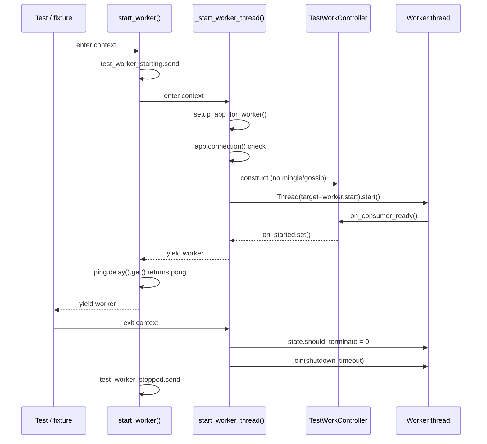

## Overview

Celery ships its own testing toolkit under `celery.contrib`. It has three layers. `celery.contrib.testing.app` builds isolated, in-memory app instances. `celery.contrib.testing.worker` runs a real `WorkController` in a background thread. `celery.contrib.pytest` wraps both as pytest fixtures. The repository uses the same toolkit for its own unit and integration suites. The smoke suite uses the Docker-based `pytest-celery` package instead. The user guide calls the `celery.contrib.pytest` layer "mock based" and warns that it is not compatible with the Docker-based `pytest-celery` API.

Sources: [celery/contrib/pytest.py:1-50](repo://celery/contrib/pytest.py#L1-L50), [docs/userguide/testing.rst:1-22](repo://docs/userguide/testing.rst#L1-L22)

For the app object these helpers create, see [[The Celery Application]]. For the worker they embed, see [[Worker Architecture and Bootsteps]].

Sources: [celery/contrib/testing/app.py:47-65](repo://celery/contrib/testing/app.py#L47-L65), [celery/contrib/testing/worker.py:30-43](repo://celery/contrib/testing/worker.py#L30-L43)

## Enabling the pytest Plugin

The plugin ships disabled. You enable it by installing the `celery[pytest]` extra, by setting `PYTEST_PLUGINS=celery.contrib.pytest`, or by declaring `pytest_plugins = ("celery.contrib.pytest", )` in the root `conftest.py`. The `pytest` extra pulls in `pytest-celery[all]`.

Sources: [docs/userguide/testing.rst:121-128](repo://docs/userguide/testing.rst#L121-L128), [requirements/extras/pytest.txt:1-1](repo://requirements/extras/pytest.txt#L1-L1), [setup.py:30-40](repo://setup.py#L30-L40)

When the plugin loads, `pytest_configure` registers the `celery(**overrides)` marker. Because of this, `--strict-markers` runs accept it, and `pytest --markers` lists it.

Sources: [celery/contrib/pytest.py:22-29](repo://celery/contrib/pytest.py#L22-L29)

The repository's own unit and integration `conftest.py` files import the fixtures directly. This keeps them working when the plugin has not been installed into the setuptools registry.

Sources: [t/unit/conftest.py:19-31](repo://t/unit/conftest.py#L19-L31), [t/integration/conftest.py:9-17](repo://t/integration/conftest.py#L9-L17)

## Fixture Reference

### Configuration hooks

Most fixtures are session-scoped hooks with trivial defaults. You override them in your own `conftest.py`. The app and worker fixtures consume them.

Sources: [celery/contrib/pytest.py:53-123](repo://celery/contrib/pytest.py#L53-L123), [celery/contrib/pytest.py:126-191](repo://celery/contrib/pytest.py#L126-L191)

| Fixture | Scope | Default | Consumed by |
|---|---|---|---|
| `celery_config` | session | `{}` | `celery_app`, `celery_session_app` (merged into app config) |
| `celery_parameters` | session | `{}` | keyword arguments to `TestApp` / `Celery()` |
| `celery_enable_logging` | session | `False` | `TestApp(enable_logging=...)` |
| `use_celery_app_trap` | session | `False` | `setup_default_app(use_trap=...)` |
| `celery_includes` | session | `()` | modules imported via `app.loader.import_task_module` before the worker starts |
| `celery_class_tasks` | session | `[]` | class-based tasks registered by `celery_session_worker` |
| `celery_worker_pool` | session | `'solo'` | `start_worker(pool=...)` |
| `celery_worker_parameters` | session | `{}` | extra `WorkController` keyword arguments (for example `queues`) |

Sources: [celery/contrib/pytest.py:53-123](repo://celery/contrib/pytest.py#L53-L123), [celery/contrib/pytest.py:126-191](repo://celery/contrib/pytest.py#L126-L191)

### App and worker fixtures

`celery_app` is function-scoped. It reads the closest `celery` marker on the test node and builds the config as `dict(celery_config, **mark.kwargs)`, so marker keyword arguments override `celery_config` for that test. It then yields the app from `_create_app`.

Sources: [celery/contrib/pytest.py:172-185](repo://celery/contrib/pytest.py#L172-L185)

`celery_session_app` builds its config the same way, but it lives for the whole session. Unless the trap is enabled, it also calls `app.set_default()` and `app.set_current()`.

Sources: [celery/contrib/pytest.py:64-81](repo://celery/contrib/pytest.py#L64-L81)

`celery_worker` and `celery_session_worker` work the same way. Each one imports every module in `celery_includes` and enters `worker.start_worker(app, pool=celery_worker_pool, **celery_worker_parameters)`. The session variant also registers each `celery_class_tasks` entry with `register_task`. If the `NO_WORKER` environment variable is set, both fixtures skip the worker and yield nothing. You can use that to point tests at an external worker.

Sources: [celery/contrib/pytest.py:16-16](repo://celery/contrib/pytest.py#L16-L16), [celery/contrib/pytest.py:84-105](repo://celery/contrib/pytest.py#L84-L105), [celery/contrib/pytest.py:194-210](repo://celery/contrib/pytest.py#L194-L210)

`depends_on_current_app` only calls `celery_app.set_current()`. Use it for code that reaches for `current_app` instead of taking an app argument.

Sources: [celery/contrib/pytest.py:213-216](repo://celery/contrib/pytest.py#L213-L216)

```python
@pytest.fixture()
def celery_app(request,
               celery_config,
               celery_parameters,
               celery_enable_logging,
               use_celery_app_trap):
    """Fixture creating a Celery application instance."""
    mark = request.node.get_closest_marker('celery')
    config = dict(celery_config, **mark.kwargs if mark else {})
    with _create_app(enable_logging=celery_enable_logging,
                     use_trap=use_celery_app_trap,
                     parameters=celery_parameters,
                     **config) as app:
        yield app
```

Sources: [celery/contrib/pytest.py:172-185](repo://celery/contrib/pytest.py#L172-L185)

## Test App Construction

### TestApp and default config

`_create_app` calls `TestApp(set_as_current=False, enable_logging=..., config=config, **parameters)` and wraps the result in `setup_default_app`. `TestApp` first imports `celery.contrib.testing.tasks`, which registers the `celery.ping` shared task. It then deep-copies `DEFAULT_TEST_CONFIG` and merges the caller's config over it.

Sources: [celery/contrib/pytest.py:32-50](repo://celery/contrib/pytest.py#L32-L50), [celery/contrib/testing/app.py:47-65](repo://celery/contrib/testing/app.py#L47-L65), [celery/contrib/testing/tasks.py:1-9](repo://celery/contrib/testing/tasks.py#L1-L9)

If you pass an explicit `broker` or `backend`, `TestApp` drops the matching `broker_url` or `result_backend` key so the argument wins. Unless `enable_logging` is true, the app gets `UnitLogging` as its log class. `UnitLogging` marks logging as `already_setup`, so tests do not reconfigure the root logger. The config is applied with `add_defaults`, so explicit `app.conf` assignments in a test still take precedence.

Sources: [celery/contrib/testing/app.py:39-65](repo://celery/contrib/testing/app.py#L39-L65)

```python
DEFAULT_TEST_CONFIG = {
    'worker_hijack_root_logger': False,
    'worker_log_color': False,
    'accept_content': {'json'},
    'enable_utc': True,
    'timezone': 'UTC',
    'broker_url': 'memory://',
    'result_backend': 'cache+memory://',
    'broker_heartbeat': 0,
}
```

Sources: [celery/contrib/testing/app.py:11-20](repo://celery/contrib/testing/app.py#L11-L20)

The in-memory kombu transport and the `cache+memory://` result backend let a test app send and fetch results with no external services. For how the backend URL is resolved, see [[Result Backends]].

Sources: [celery/contrib/testing/app.py:11-20](repo://celery/contrib/testing/app.py#L11-L20)

### State isolation and the app trap

`setup_default_app` snapshots the global app state in `celery._state` before the test runs: the current app, the default app, `_on_app_finalizers` and the `_apps` weak set. Its `finally` block restores all four. It also closes the test app unless the test app was already the current app.

Sources: [celery/contrib/testing/app.py:89-112](repo://celery/contrib/testing/app.py#L89-L112)

When `use_trap` is true, `set_trap` installs a `Trap` object as the default app. It also replaces `_state._tls` with an object whose `current_app` is the trap. Any attribute access on `Trap` raises `RuntimeError('Test depends on current_app')`. The exceptions are `_is_coroutine` and `__func__`, which return `None` so that `unittest.mock` can patch it. The trap exposes code that falls back to the implicit current app instead of using the app it was given.

Sources: [celery/contrib/testing/app.py:23-36](repo://celery/contrib/testing/app.py#L23-L36), [celery/contrib/testing/app.py:68-86](repo://celery/contrib/testing/app.py#L68-L86)

> [!TIP]
> The repository's unit suite overrides `use_celery_app_trap` to return `True`. Unit tests must therefore pass the `app` fixture explicitly. Override it the same way in your own project to catch hidden `current_app` dependencies.

Sources: [t/unit/conftest.py:90-92](repo://t/unit/conftest.py#L90-L92)

## Embedded Worker

### start_worker flow

`start_worker` is a context manager that brackets the worker's lifetime with the `test_worker_starting` and `test_worker_stopped` signals. It delegates to `_start_worker_thread`. When `perform_ping_check` is true (the default), it calls `ping.delay().get(timeout=ping_task_timeout)` inside `allow_join_result()` and asserts that the result is `'pong'`. It yields the worker only after that round trip succeeds.

Sources: [celery/contrib/testing/worker.py:16-27](repo://celery/contrib/testing/worker.py#L16-L27), [celery/contrib/testing/worker.py:99-136](repo://celery/contrib/testing/worker.py#L99-L136)

`_start_worker_thread` takes these steps:

Sources: [celery/contrib/testing/worker.py:139-154](repo://celery/contrib/testing/worker.py#L139-L154)

1. It calls `setup_app_for_worker`, which finalizes the app, makes it current and default, and resets `type(app.log)._setup` so that logging is set up again at the requested `loglevel`.
2. It asserts that `celery.ping` is registered.
3. It opens a broker connection (honouring `TEST_BROKER`) to fail fast if the broker is down.
4. It builds a `TestWorkController` with mingle and gossip disabled, heartbeat disabled by default, and an anonymous node name unless `hostname` is passed.

Sources: [celery/contrib/testing/worker.py:139-173](repo://celery/contrib/testing/worker.py#L139-L173), [celery/contrib/testing/worker.py:219-225](repo://celery/contrib/testing/worker.py#L219-L225)

`worker.start` then runs in a daemon thread. `ensure_started()` blocks on a `threading.Event`, which `on_consumer_ready` sets once the consumer blueprint is fully up. `on_consumer_ready` also sends `test_worker_started`. After startup, `_set_task_join_will_block(False)` re-allows `result.get()` in the test thread.

Sources: [celery/contrib/testing/worker.py:81-96](repo://celery/contrib/testing/worker.py#L81-L96), [celery/contrib/testing/worker.py:175-178](repo://celery/contrib/testing/worker.py#L175-L178)

On exit, `_start_worker_thread` sets `celery.worker.state.should_terminate = 0` to request a warm shutdown and joins the thread for `shutdown_timeout` seconds. If the thread is still alive after that, it raises `RuntimeError`.

Sources: [celery/contrib/testing/worker.py:180-192](repo://celery/contrib/testing/worker.py#L180-L192)



Sources: [celery/contrib/testing/worker.py:81-192](repo://celery/contrib/testing/worker.py#L81-L192)

### Pools and log forwarding

The default pool is `solo`, so tasks run inside the worker thread. When the pool is `prefork`, `TestWorkController.__init__` creates a billiard `Queue` and starts a `logging.handlers.QueueListener` that feeds the root logger. It also installs `tblib` pickling support if `tblib` is available. In `start()`, it adds a `QueueHandler` to the root logger, filtered to records from other processes. Log records from forked pool children then appear in the test's captured logs.

Sources: [celery/contrib/testing/worker.py:39-79](repo://celery/contrib/testing/worker.py#L39-L79)

The default log level comes from the `WORKER_LOGLEVEL` environment variable, which falls back to `error`. There is also a `_start_worker_process` helper, which starts a separate `celery multi` style `Cluster` with a single `testworker1@%h` node.

Sources: [celery/contrib/testing/worker.py:14-14](repo://celery/contrib/testing/worker.py#L14-L14), [celery/contrib/testing/worker.py:195-216](repo://celery/contrib/testing/worker.py#L195-L216)

## Eager Mode

### task_always_eager

With `task_always_eager` enabled, `Task.apply_async` never publishes a message. It first round-trips `(args, kwargs)` through the configured serializer with `serialization.dumps`/`loads`, so non-serializable arguments still fail as they would in production. It then calls `self.apply(...)` inside `denied_join_result()`. As a result, a task that calls `.get()` on another result raises instead of deadlocking. `app.send_task` ignores the setting and emits an `AlwaysEagerIgnored` warning.

Sources: [celery/app/task.py:682-706](repo://celery/app/task.py#L682-L706), [celery/app/base.py:869-872](repo://celery/app/base.py#L869-L872), [celery/result.py:37-59](repo://celery/result.py#L37-L59)

`Task.apply` builds a request dict with `is_eager: True`, inheriting `parent_id` and `root_id` from the task on top of `_task_stack`. It runs the task through `build_tracer(..., eager=True, propagate=throw)`. If the task raised `Retry` with a signature, `apply` re-applies that signature with `retries + 1`. Otherwise it wraps the outcome in an `EagerResult`.

Sources: [celery/app/task.py:869-951](repo://celery/app/task.py#L869-L951)

| Setting | Default | Effect |
|---|---|---|
| `task_always_eager` | `False` | `apply_async`/`delay` run locally via `apply()` |
| `task_eager_propagates` | `False` | default for `apply(throw=...)`; re-raises task exceptions immediately |
| `task_store_eager_result` | `False` | eager runs also write state and results to the result backend |

Sources: [celery/app/defaults.py:272-296](repo://celery/app/defaults.py#L272-L296), [celery/app/task.py:892-893](repo://celery/app/task.py#L892-L893)

Normally the tracer skips publishing results for eager tasks. If `task.store_eager_result` is set and the result is not ignored, it publishes successes, and `handle_error_state` stores errors.

Sources: [celery/app/trace.py:188-197](repo://celery/app/trace.py#L188-L197), [celery/app/trace.py:498-506](repo://celery/app/trace.py#L498-L506)

### EagerResult

`EagerResult` holds the return value, state and traceback directly. `ready()` always returns `True`. `get()` returns the value on success, or raises the stored exception for states in `PROPAGATE_STATES`. `forget()` does nothing, and `revoke()` only sets the local state to `REVOKED`. See [[Task Results]] for the full result API.

Sources: [celery/result.py:1025-1079](repo://celery/result.py#L1025-L1079)

> [!WARNING]
> Eager mode skips routing, serialization of the message envelope, the worker's request handling and acknowledgements. It suits fast logic tests. Use `celery_worker` when behaviour depends on the real execution path described in [[Consumer and Task Execution]].

Sources: [celery/app/task.py:682-706](repo://celery/app/task.py#L682-L706), [celery/contrib/pytest.py:194-210](repo://celery/contrib/pytest.py#L194-L210)

## Integration Helpers

### Manager

`celery.contrib.testing.manager.Manager` wraps an app with polling helpers built on `kombu.utils.functional.retry_over_time`:

Sources: [celery/contrib/testing/manager.py:1-20](repo://celery/contrib/testing/manager.py#L1-L20), [celery/contrib/testing/manager.py:234-239](repo://celery/contrib/testing/manager.py#L234-L239)

- `wait_for(fun, catch, ...)` retries `fun` while it raises one of `catch`, with configurable backoff.
- `ensure_not_for_a_while` asserts that something keeps failing.
- `join(r)` calls `ResultSet.get` repeatedly. On a timeout it prints the missing task ids, and after `max_retries` it raises `AssertionError('Test failed: Missing task results')`.

Sources: [celery/contrib/testing/manager.py:27-132](repo://celery/contrib/testing/manager.py#L27-L132), [celery/contrib/testing/manager.py:234-239](repo://celery/contrib/testing/manager.py#L234-L239)

The `assert_received` and `assert_accepted` helpers query workers through `app.control.inspect().query_task`. They raise a `Sentinel` exception until every id is in the expected worker state set: `reserved`/`active`/`ready` for received, and `active`/`ready` for accepted. `wait_until_idle` purges the queues until empty, then polls `inspect.active()` until no tasks are running.

Sources: [celery/contrib/testing/manager.py:134-231](repo://celery/contrib/testing/manager.py#L134-L231)

### Message mocks

`celery.contrib.testing.mocks` builds fake inbound messages for consumer-level unit tests. `TaskMessage` returns a `Mock` with protocol 2 `headers` and a JSON body of `(args, kwargs, embed)`. `task_message_from_sig` freezes a signature and converts its `link`, `link_error`, `countdown`/`eta` and `expires` options into the message fields. `ContextMock` is a `Mock` that can be used in a `with` statement.

Sources: [celery/contrib/testing/mocks.py:11-42](repo://celery/contrib/testing/mocks.py#L11-L42), [celery/contrib/testing/mocks.py:79-137](repo://celery/contrib/testing/mocks.py#L79-L137)

## Repository Test Suites

### Layout

The repository's tests live under `t/`. Each suite uses a different isolation strategy:

Sources: [pyproject.toml:1-6](repo://pyproject.toml#L1-L6), [t/unit/conftest.py:59-92](repo://t/unit/conftest.py#L59-L92), [t/integration/conftest.py:61-124](repo://t/integration/conftest.py#L61-L124), [t/smoke/conftest.py:1-59](repo://t/smoke/conftest.py#L1-L59)

| Suite | Path | Broker / backend | Worker |
|---|---|---|---|
| Unit | `t/unit/` (default `testpaths`) | `memory://` / `cache+memory://` | none; app trap enabled |
| Integration | `t/integration/` | `TEST_BROKER` / `TEST_BACKEND` env (defaults `pyamqp://`, `redis://`) | `celery_session_worker` with the `prefork` pool |
| Smoke | `t/smoke/` | Docker containers via `pytest-celery` | containerized workers (`t/smoke/workers/`) |

Sources: [pyproject.toml:1-6](repo://pyproject.toml#L1-L6), [t/unit/conftest.py:59-92](repo://t/unit/conftest.py#L59-L92), [t/integration/conftest.py:21-22](repo://t/integration/conftest.py#L21-L22), [t/integration/conftest.py:85-97](repo://t/integration/conftest.py#L85-L97), [t/smoke/conftest.py:6-17](repo://t/smoke/conftest.py#L6-L17)

### Unit suite conventions

`t/unit/conftest.py` overrides `celery_config` with a `testcelery` default queue and accepts both `json` and `pickle` content. Its autouse fixtures enforce hygiene:

Sources: [t/unit/conftest.py:59-71](repo://t/unit/conftest.py#L59-L71)

- `AAA_disable_multiprocessing` patches out `multiprocessing.Process` and billiard process classes, because pytest-cov breaks when they start.
- `task_join_will_not_block` forces `task_join_will_block` to return `False`.
- `threads_not_lingering` asserts that the set of live threads matches the set recorded at session start.
- `reset_cache_backend_state` clears the in-memory cache backend after each test.

Sources: [t/unit/conftest.py:59-105](repo://t/unit/conftest.py#L59-L105), [t/unit/conftest.py:128-185](repo://t/unit/conftest.py#L128-L185)

For class-based tests, `test_cases_shortcuts` injects `self.app`, an `add` task, `self.Celery = TestApp`, the `TaskMessage` helpers and `self.patching` into each test instance.

Sources: [t/unit/conftest.py:193-212](repo://t/unit/conftest.py#L193-L212)

### Integration and smoke conventions

The integration `celery_config` sets `result_extended` and the Cassandra options. You can override it with an `integration-tests-config.json` file in the repository root. The `manager` fixture pairs `Manager(app)` with `celery_session_worker` and calls `wait_until_idle()` on teardown. The `flaky` decorator combines up to 5 reruns on `OSError`, `ConnectionError` and `TimeoutError` with a 300-second timeout.

Sources: [t/integration/conftest.py:21-36](repo://t/integration/conftest.py#L21-L36), [t/integration/conftest.py:61-124](repo://t/integration/conftest.py#L61-L124)

The smoke suite subclasses `pytest_celery.CeleryTestSetup` as `SmokeTestSetup`, which checks only Docker readiness. It adds the integration and smoke task modules to every worker, starts a Redis container configured from `t/smoke/redis.conf`, and overrides the default Redis broker and backend containers to use the same config. The shared `SuiteOperations` mixin combines task termination, worker kill and worker restart operations.

Sources: [t/smoke/conftest.py:20-59](repo://t/smoke/conftest.py#L20-L59), [t/smoke/conftest.py:62-155](repo://t/smoke/conftest.py#L62-L155)

## Running the Tests

### tox environments

`tox.ini` defines unit, integration and smoke environments for each supported Python version. Integration environments are split by backend combination. The `setenv` block maps each factor to `TEST_BROKER`/`TEST_BACKEND`, for example `redis: TEST_BROKER=redis://` and `rabbitmq: TEST_BACKEND=rpc`. It also sets `WORKER_LOGLEVEL = INFO`.

Sources: [tox.ini:1-12](repo://tox.ini#L1-L12), [tox.ini:53-88](repo://tox.ini#L53-L88)

```ini
commands =
    unit: coverage run --source=celery -m pytest -vv --maxfail=10 --capture=no -v --junitxml=junit.xml -o junit_family=legacy {posargs}
    unit: coverage xml
    unit: coverage report
    integration: pytest -xsvv t/integration {posargs}
    smoke: pytest -xsvv t/smoke --reruns 5 --reruns-delay 10 {posargs}
```

Sources: [tox.ini:47-52](repo://tox.ini#L47-L52)

All environments install `requirements/test.txt`. Integration environments add `requirements/test-integration.txt`, and smoke environments add `pytest-xdist`. On GitHub Actions, `tox-gh-actions` maps each Python version to its `-unit` environment only.

Sources: [tox.ini:15-45](repo://tox.ini#L15-L45), [requirements/test.txt:1-7](repo://requirements/test.txt#L1-L7)

```bash
tox -e 3.12-unit
tox -e 3.12-integration-redis -- -k test_canvas
tox -e 3.12-smoke
```

Sources: [tox.ini:4-7](repo://tox.ini#L4-L7), [tox.ini:47-52](repo://tox.ini#L47-L52)

### Makefile targets

The `Makefile` provides shortcuts. `make test-all` runs `tox`, and `make cov` runs `pytest -x --cov=celery --cov-report=html`. `make docker-unit-tests` and `make docker-integration-tests` run `tox -e 3.12-unit` and `tox -e 3.12-integration-docker` inside the `docker/docker-compose.yml` container. The `docker` tox factor points at the `rabbit` and `redis` compose services.

Sources: [Makefile:1-14](repo://Makefile#L1-L14), [Makefile:141-148](repo://Makefile#L141-L148), [Makefile:169-186](repo://Makefile#L169-L186), [tox.ini:79-80](repo://tox.ini#L79-L80)

> [!NOTE]
> Unit tests use the in-memory broker and need no services. Integration tests need a running broker and backend that match `TEST_BROKER`/`TEST_BACKEND`. Smoke tests need a Docker daemon.

Sources: [t/unit/conftest.py:59-66](repo://t/unit/conftest.py#L59-L66), [t/integration/conftest.py:21-22](repo://t/integration/conftest.py#L21-L22), [t/smoke/conftest.py:62-84](repo://t/smoke/conftest.py#L62-L84)
