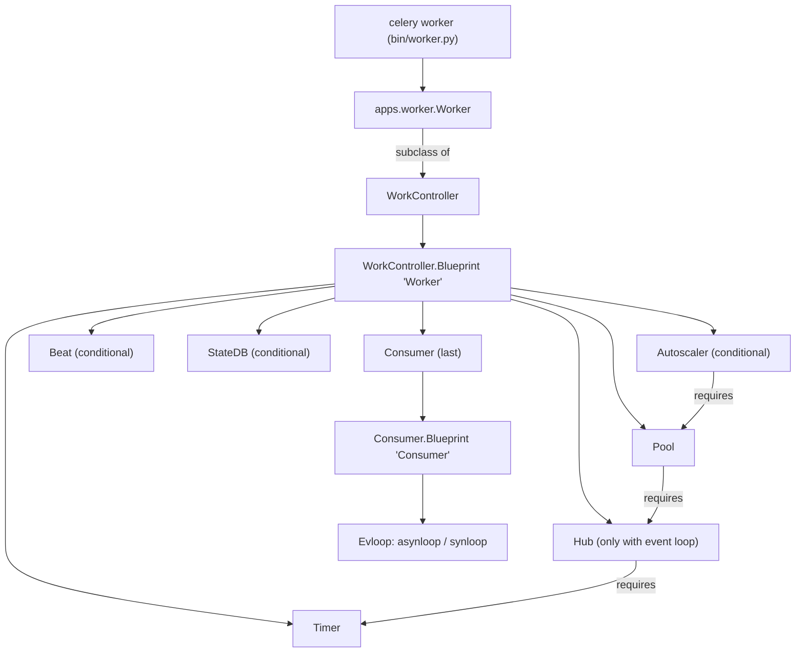
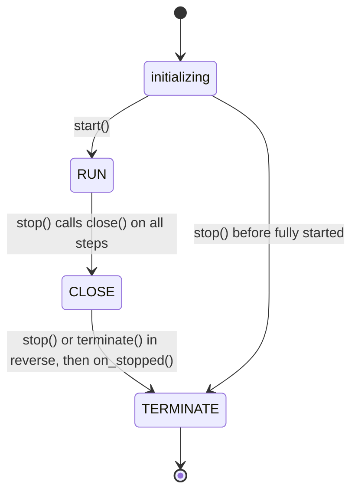

## Overview

A Celery worker is assembled from small, independently startable components called bootsteps. `WorkController` in `celery/worker/worker.py` is the bare-bones, side-effect-free worker: it resolves settings, builds a `Blueprint` of steps, and starts and stops them in dependency order. The `Worker` subclass in `celery/apps/worker.py` adds what a real program needs on top of that: logging setup, the startup banner, process title, and POSIX signal handlers that drive warm, cold, soft and hard shutdown.

Sources: [celery/worker/worker.py:1-13](repo://celery/worker/worker.py#L1-L13), [celery/apps/worker.py:1-8](repo://celery/apps/worker.py#L1-L8)

The worker blueprint owns the event loop (`Hub`), timer, execution pool, optional embedded beat, state database and autoscaler. Its last step, `Consumer`, starts a second blueprint that manages the broker connection and task consumption; that nested blueprint is covered in [[Consumer and Task Execution]], and the pool implementations are covered in [[Concurrency Pools]]. Process-wide bookkeeping such as reserved, active and revoked requests lives in the module-level globals of `celery/worker/state.py`.

Sources: [celery/worker/worker.py:76-88](repo://celery/worker/worker.py#L76-L88), [celery/worker/components.py:221-246](repo://celery/worker/components.py#L221-L246), [celery/worker/state.py:1-5](repo://celery/worker/state.py#L1-L5)



Sources: [celery/bin/worker.py:358-368](repo://celery/bin/worker.py#L358-L368), [celery/worker/worker.py:76-88](repo://celery/worker/worker.py#L76-L88), [celery/worker/components.py:56-115](repo://celery/worker/components.py#L56-L115), [celery/worker/autoscale.py:31-36](repo://celery/worker/autoscale.py#L31-L36), [celery/worker/consumer/consumer.py:171-186](repo://celery/worker/consumer/consumer.py#L171-L186)

## The Bootsteps Model

### Step classes

`celery/bootsteps.py` exports four building blocks. Every step class is created through the `StepType` metaclass, which sets `name` to the fully qualified `module.ClassName` unless the class sets one explicitly; this name is the key used for dependency resolution.

Sources: [celery/bootsteps.py:21-21](repo://celery/bootsteps.py#L21-L21), [celery/bootsteps.py:266-285](repo://celery/bootsteps.py#L266-L285)

| Class | Role | Key members |
|---|---|---|
| `Step` | Base bootstep; `__init__` runs when bound to the parent, `create` builds the service | `name`, `label`, `conditional`, `requires`, `last`, `enabled`, `include_if()`, `create()`, `info()` |
| `StartStopStep` | Step whose created object is started and stopped in order | `obj`, `start()`, `stop()`, `close()`, `terminate()`; `include()` appends itself to `parent.steps` |
| `ConsumerStep` | StartStopStep that opens a channel and starts kombu consumers | `requires = ('celery.worker.consumer:Connection',)`, `get_consumers(channel)`, `shutdown()` |
| `Blueprint` | Container that resolves, orders, starts and stops steps for one parent object | `default_steps`, `apply()`, `start()`, `stop()`, `send_all()`, `join()`, `state` |

Sources: [celery/bootsteps.py:74-107](repo://celery/bootsteps.py#L74-L107), [celery/bootsteps.py:288-353](repo://celery/bootsteps.py#L288-L353), [celery/bootsteps.py:355-415](repo://celery/bootsteps.py#L355-L415)

`StartStopStep.start` and `stop` simply forward to `self.obj.start()` / `self.obj.stop()`, and `terminate` prefers `obj.terminate` but falls back to `obj.stop`. A plain `Step` is never appended to `parent.steps`, so `Blueprint.start` never calls a `start` method on it; plain steps such as `Timer` and `StateDB` do all their work inside `create`.

Sources: [celery/bootsteps.py:355-383](repo://celery/bootsteps.py#L355-L383), [celery/bootsteps.py:109-117](repo://celery/bootsteps.py#L109-L117)

### Dependency graph and boot order

`Blueprint.apply(parent)` turns the set of step names into an ordered list of instances, in four stages.

Sources: [celery/bootsteps.py:186-212](repo://celery/bootsteps.py#L186-L212)

1. `claim_steps` loads every entry of `self.types` (the union of `default_steps` and the user steps from `app.steps['worker']` or `app.steps['consumer']`) with `symbol_by_name`.
2. `_firstpass` resolves each step's `requires` and walks them transitively, adding any dependency that was not explicitly listed.
3. `_finalize_steps` builds a `DependencyGraph`; if a step has `last = True`, an edge is added from it to every other node so it always sorts last. `topsort()` produces the boot order, and a missing dependency is reported as `KeyError('unknown bootstep: ...')`.
4. Each class is instantiated with `S(parent, **kwargs)`, and then `step.include(parent)` is called on every instance in order.

Sources: [celery/bootsteps.py:186-256](repo://celery/bootsteps.py#L186-L256), [celery/worker/worker.py:129-139](repo://celery/worker/worker.py#L129-L139)

Only one step per blueprint may set `last`. In the worker blueprint this is the `Consumer` step; in the consumer blueprint it is `Evloop`, which therefore runs the blocking event loop only after every other consumer step has started.

Sources: [celery/bootsteps.py:310-314](repo://celery/bootsteps.py#L310-L314), [celery/worker/components.py:221-224](repo://celery/worker/components.py#L221-L224), [celery/worker/consumer/consumer.py:857-869](repo://celery/worker/consumer/consumer.py#L857-L869)

### Conditional inclusion with include_if

`include()` calls `_should_include()`, which asks `include_if(parent)` and only then calls `create(parent)`. The default `include_if` returns the `enabled` attribute, so most components decide inclusion in `__init__` by setting `self.enabled` from a worker option, while others override `include_if` directly. Steps flagged `conditional = True` are drawn with a `∘` prefix by `StepFormatter` when the graph is rendered.

Sources: [celery/bootsteps.py:316-339](repo://celery/bootsteps.py#L316-L339), [celery/bootsteps.py:39-62](repo://celery/bootsteps.py#L39-L62)

| Step | Inclusion rule |
|---|---|
| `Hub` | `include_if` returns `w.use_eventloop` |
| `Beat` | `enabled = w.beat` (the `-B` option) |
| `StateDB` | `enabled = w.statedb` (`--statedb` / `worker_state_db`) |
| `WorkerComponent` (autoscaler) | `enabled = w.autoscale` (`--autoscale`) |
| `Timer`, `Pool`, `Consumer` | always included |

Sources: [celery/worker/components.py:56-66](repo://celery/worker/components.py#L56-L66), [celery/worker/components.py:181-193](repo://celery/worker/components.py#L181-L193), [celery/worker/components.py:208-214](repo://celery/worker/components.py#L208-L214), [celery/worker/autoscale.py:31-40](repo://celery/worker/autoscale.py#L31-L40)

### Blueprint state machine

`Blueprint.state` moves from `None` (reported as `initializing`) to `RUN`, `CLOSE` and `TERMINATE`. `start` sets `RUN`, calls `on_start`, then starts each step in `parent.steps`, recording progress in `self.started`. `stop` is a no-op if already closing; if the blueprint never fully started (`started != len(parent.steps)`) it jumps straight to `TERMINATE`. Otherwise it calls `close` on every step in forward order, then `stop` or `terminate` on every step in reverse order with `propagate=False` (errors are logged, not raised), runs `on_stopped`, and sets the `shutdown_complete` event that `join()` waits on.

Sources: [celery/bootsteps.py:23-26](repo://celery/bootsteps.py#L23-L26), [celery/bootsteps.py:109-184](repo://celery/bootsteps.py#L109-L184)



Sources: [celery/bootsteps.py:92-97](repo://celery/bootsteps.py#L92-L97), [celery/bootsteps.py:155-176](repo://celery/bootsteps.py#L155-L176)

`send_all(parent, method, ...)` is the generic broadcast used for these phases and for extra hooks such as `register_with_event_loop`; it silently skips steps that do not define the method.

Sources: [celery/bootsteps.py:137-153](repo://celery/bootsteps.py#L137-L153), [celery/worker/worker.py:214-218](repo://celery/worker/worker.py#L214-L218)

## WorkController

### Construction sequence

`WorkController.__init__` resolves the node name with `default_nodename`, records `startup_time`, calls `app.loader.init_worker()`, and then runs a fixed sequence of hooks: `on_before_init`, `setup_defaults`, `on_after_init`, and finally `setup_instance(**self.prepare_args(**kwargs))`. Subclasses customise the worker by overriding these hooks rather than `__init__`.

Sources: [celery/worker/worker.py:90-99](repo://celery/worker/worker.py#L90-L99), [celery/worker/worker.py:141-148](repo://celery/worker/worker.py#L141-L148)

`setup_instance` prepares everything the steps will read before the blueprint is applied.

Sources: [celery/worker/worker.py:101-139](repo://celery/worker/worker.py#L101-L139)

- selects and deselects queues (`setup_queues`) and imports `--include` modules (`setup_includes`);
- defaults `concurrency` to `billiard.cpu_count()` (or `2` if that is not implemented);
- decides `use_eventloop` via `should_use_eventloop()`: true only when no green environment is detected, the transport implements asynchronous I/O, and the platform is not Windows;
- sends the `worker_init` signal;
- converts `pool_cls` into a class with `celery.concurrency.get_implementation`;
- calls `on_init_blueprint`, builds `self.Blueprint` with `steps=self.app.steps['worker']`, and applies it.

Sources: [celery/worker/worker.py:101-139](repo://celery/worker/worker.py#L101-L139), [celery/worker/worker.py:239-242](repo://celery/worker/worker.py#L239-L242)

### Settings resolution

`setup_defaults` uses `app.either(setting, *explicit_values)` so that an explicit keyword argument (usually from the command line) wins over configuration. Several parameters keep legacy aliases, marked `XXX` in the signature.

Sources: [celery/worker/worker.py:351-410](repo://celery/worker/worker.py#L351-L410)

| Attribute | Setting | Keyword arguments |
|---|---|---|
| `concurrency` | `worker_concurrency` | `concurrency` |
| `pool_cls` | `worker_pool` (default `prefork`) | `pool`, `pool_cls` |
| `consumer_cls` | `worker_consumer` (default `celery.worker.consumer:Consumer`) | `consumer_cls` |
| `timer_cls`, `timer_precision` | `worker_timer`, `worker_timer_precision` (default `1.0`) | `timer_cls`, `timer_precision` |
| `autoscaler_cls` | `worker_autoscaler` | `autoscaler_cls` |
| `statedb` | `worker_state_db` | `statedb`, `state_db` |
| `time_limit`, `soft_time_limit` | `task_time_limit`, `task_soft_time_limit` | `time_limit`, `task_time_limit`, `soft_time_limit`, `task_soft_time_limit` |
| `prefetch_multiplier` | `worker_prefetch_multiplier` (default `4`) | `prefetch_multiplier` |
| `max_tasks_per_child`, `max_memory_per_child` | `worker_max_tasks_per_child`, `worker_max_memory_per_child` | same names |
| `worker_lost_wait` | `worker_lost_wait` (default `10.0`) | `worker_lost_wait` |

Sources: [celery/worker/worker.py:372-410](repo://celery/worker/worker.py#L372-L410), [celery/app/defaults.py:325-374](repo://celery/app/defaults.py#L325-L374)

### Queue selection

`setup_queues` calls `app.amqp.queues.select(include)` and `deselect(exclude)`; an unknown queue name raises `ImproperlyConfigured` with a hint about `task_create_missing_queues`. When `worker_direct` is enabled, the per-node direct queue from `worker_direct(hostname)` is added. `setup_includes` imports extra task modules and merges every registered task's module into `app.conf.include`, so the full list survives an `execv` restart.

Sources: [celery/worker/worker.py:49-60](repo://celery/worker/worker.py#L49-L60), [celery/worker/worker.py:167-193](repo://celery/worker/worker.py#L167-L193)

### Running and introspection

`start()` simply calls `self.blueprint.start(self)` and maps exceptions to shutdown modes: `WorkerTerminate` triggers `terminate()`; any other `Exception` is logged as `Unrecoverable error` and triggers `stop(exitcode=EX_FAILURE)`; `SystemExit` (which includes `WorkerShutdown`) triggers `stop(exitcode=exc.code)`; `KeyboardInterrupt` triggers `stop(exitcode=EX_FAILURE)`.

Sources: [celery/worker/worker.py:201-212](repo://celery/worker/worker.py#L201-L212), [celery/exceptions.py:271-279](repo://celery/exceptions.py#L271-L279)

`reload()` re-imports task modules, refreshes consumer strategies and rate limits, and calls `pool.restart()` if the pool supports it. `stats()` merges `info()` (total counts, pid, logical clock, uptime), every worker step's `info()`, every consumer step's `info()`, and `rusage()`; this is what the `stats` inspect command returns (see [[Remote Control and Inspection]]).

Sources: [celery/worker/worker.py:269-334](repo://celery/worker/worker.py#L269-L334)

## Worker Components

### Timer and Hub

`Timer` is a plain `Step`. With the event loop it creates a `kombu.asynchronous.timer.Timer(max_interval=10.0)` that the hub drives; otherwise it instantiates `w.timer_cls`, defaulting to the pool's own `Timer` class (green pools ship a custom one), running on a dedicated thread with `max_interval=w.timer_precision`.

Sources: [celery/worker/components.py:32-53](repo://celery/worker/components.py#L32-L53)

`Hub` requires `Timer` and is included only when `use_eventloop` is true. `create` reuses the current kombu event loop or creates one (using a transport's `requires_hub` class if it declares one), then replaces the app clock's mutex and billiard's pool `Lock` with `DummyLock`, because everything now runs in a single thread. `start` touches `w.hub.poller` so the poller exists before `asynloop` runs, and both `stop` and `terminate` close the hub.

Sources: [celery/worker/components.py:56-98](repo://celery/worker/components.py#L56-L98)

### Pool

`Pool` requires `Hub`. In `__init__` it parses `--autoscale` (a `"max,min"` string) into `w.max_concurrency` and `w.min_concurrency`. `create` decides whether the pool is threaded (`not w.use_eventloop or IS_WINDOWS`). In the non-threaded, event-loop case it creates a `LaxBoundedSemaphore(procs)` and, if `worker_pool_putlocks` is on and the pool class `uses_semaphore`, routes tasks through `_process_task_sem` so the consumer stops handing work to the pool when all processes are busy. It then instantiates `w.pool_cls` with concurrency, time limits, `maxtasksperchild`, `max_memory_per_child`, `lost_worker_timeout`, `sched_strategy` (from `-O`) and the app.

Sources: [celery/worker/components.py:101-178](repo://celery/worker/components.py#L101-L178), [celery/worker/worker.py:220-231](repo://celery/worker/worker.py#L220-L231)

> [!NOTE]
> `Pool.create` warns if `worker_pool` in configuration names `eventlet` or `gevent`: these pools must be chosen with `-P` so that monkey patching happens as early as possible.

Sources: [celery/worker/components.py:18-29](repo://celery/worker/components.py#L18-L29), [celery/worker/components.py:138-142](repo://celery/worker/components.py#L138-L142)

### Beat and StateDB

`Beat` embeds a `celery.beat.EmbeddedService` in the worker when `-B` is passed, using `beat_schedule_filename` and `beat_scheduler`. It raises `ImproperlyConfigured` for gevent or eventlet pools, which must run beat standalone (see [[Periodic Tasks with Beat]]).

Sources: [celery/worker/components.py:181-205](repo://celery/worker/components.py#L181-L205)

`StateDB` creates `w._persistence = w.state.Persistent(w.state, w.statedb, w.app.clock)` and registers `Persistent.save` with `atexit`, so revoked task ids and the logical clock survive restarts.

Sources: [celery/worker/components.py:208-218](repo://celery/worker/components.py#L208-L218)

### Autoscaler

`celery.worker.autoscale:WorkerComponent` requires `Pool` and is enabled by `--autoscale`. Without an event loop it returns the `Autoscaler` background thread as the step's `obj`, so the blueprint starts and stops it; with the event loop it returns `None` and instead registers `maybe_scale` both as a per-message callback and as a repeating hub timer every `keepalive` seconds. The scaling algorithm is described in [[Concurrency Pools]].

Sources: [celery/worker/autoscale.py:31-58](repo://celery/worker/autoscale.py#L31-L58)

### Consumer

`Consumer` is the `last` step. It computes the initial prefetch count as `max_concurrency * prefetch_multiplier` when autoscaling (or `concurrency * prefetch_multiplier` otherwise) and instantiates `w.consumer_cls` with `w.process_task` as the task callback, plus the pool, timer, hub and remaining worker options. Starting this step starts the consumer blueprint.

Sources: [celery/worker/components.py:221-246](repo://celery/worker/components.py#L221-L246)

## The Worker Program

### Initialization hooks

`celery.apps.worker.Worker` fills in the `WorkController` hooks that the base class leaves empty.

Sources: [celery/apps/worker.py:91-96](repo://celery/apps/worker.py#L91-L96), [celery/worker/worker.py:141-158](repo://celery/worker/worker.py#L141-L158)

- `on_before_init` applies `trace.setup_worker_optimizations`, sends `celeryd_init` (useful for per-node configuration), and runs `check_privileges` against `accept_content`.
- `on_after_init` resolves `worker_redirect_stdouts` / `worker_redirect_stdouts_level`, stores `purge` and `no_color`, and prepares colour output.
- `on_init_blueprint` sets up logging and re-applies trace optimizations, which finalizes the app.
- `on_start` creates the pidfile lock, sends `celeryd_after_setup` (where queues may still be changed after `-Q`), purges messages if `--purge` was given, prints the banner unless `--quiet`, sets the process title to `-active-`, installs signal handlers, and redirects stdout and stderr to the logger.
- `on_consumer_ready` sends `worker_ready` and logs `<hostname> ready.`

Sources: [celery/apps/worker.py:91-182](repo://celery/apps/worker.py#L91-L182)

These signals are listed in [[Signals]].

Sources: [celery/apps/worker.py:98-103](repo://celery/apps/worker.py#L98-L103), [celery/apps/worker.py:132-136](repo://celery/apps/worker.py#L132-L136)

### Startup banner

`emit_banner` prints `startup_info()` combined with ASCII art from `ARTLINES` (or an inline logo image if the terminal supports it), followed by `extra_info()`, which lists registered tasks when the log level is `INFO` or lower (built-in `celery.` tasks only at `DEBUG`). `startup_info` fills the `BANNER` template with the app, broker URI, result backend URI, concurrency (shown as `{min=..., max=...}` when autoscaling) with the pool module name, task-event status and the selected queues.

Sources: [celery/apps/worker.py:37-71](repo://celery/apps/worker.py#L37-L71), [celery/apps/worker.py:168-252](repo://celery/apps/worker.py#L168-L252)

### Signal handlers

`install_platform_tweaks` installs the handlers, all through `platforms.signals`.

Sources: [celery/apps/worker.py:254-274](repo://celery/apps/worker.py#L254-L274)

| Signal | Handler | Effect |
|---|---|---|
| `SIGTERM` | `install_worker_term_handler` | Warm shutdown (or cold if billiard's `REMAP_SIGTERM` is `"SIGQUIT"`) |
| `SIGQUIT` | `install_worker_term_hard_handler` | Cold shutdown through `on_cold_shutdown` |
| `SIGINT` | `install_worker_int_handler` | First Ctrl+C: warm shutdown, and re-registers `SIGINT` as cold |
| `SIGHUP` | `install_worker_restart_handler` | Only when detached from a TTY: re-exec the worker at exit (warns on macOS instead) |
| `SIGUSR1` | `install_cry_handler` | Dumps stack traces of all threads (not on PyPy) |
| `SIGUSR2` | `install_rdb_handler` | Remote debugger breakpoint, only if `CELERY_RDBSIG` is set |

Sources: [celery/apps/worker.py:254-274](repo://celery/apps/worker.py#L254-L274), [celery/apps/worker.py:433-523](repo://celery/apps/worker.py#L433-L523)

Every shutdown handler is built by `_shutdown_handler`. Inside the main process it runs the optional callback, prints `worker: Warm shutdown (MainProcess)` (or `Cold`), and sends `worker_shutting_down`. In every process it then sets `state.should_stop` (warm) or `state.should_terminate` (cold) to the exit code. The handler does not stop anything directly: the consumer loops call `state.maybe_shutdown()` on each iteration and raise `WorkerShutdown` or `WorkerTerminate` from there.

Sources: [celery/apps/worker.py:288-316](repo://celery/apps/worker.py#L288-L316), [celery/worker/state.py:88-93](repo://celery/worker/state.py#L88-L93), [celery/worker/loops.py:84-86](repo://celery/worker/loops.py#L84-L86)

## Shutdown Modes

### Shutdown flow

All shutdown modes share one mechanism: a signal handler only sets a flag, and the running consumer loop turns that flag into an exception that unwinds back to `WorkController.start`.

Sources: [celery/apps/worker.py:313-316](repo://celery/apps/worker.py#L313-L316), [celery/worker/loops.py:84-86](repo://celery/worker/loops.py#L84-L86), [celery/worker/worker.py:201-212](repo://celery/worker/worker.py#L201-L212)

```mermaid
sequenceDiagram
  participant OS as OS signal
  participant Handler as _shutdown_handler
  participant State as worker.state
  participant Loop as asynloop / synloop
  participant WC as WorkController
  participant BP as Blueprint
  OS->>Handler: SIGTERM / SIGINT / SIGQUIT
  Handler->>Handler: callback(worker), worker_shutting_down
  Handler->>State: should_stop or should_terminate = exitcode
  Loop->>State: maybe_shutdown()
  State-->>Loop: raise WorkerShutdown / WorkerTerminate
  Loop-->>WC: exception propagates out of blueprint.start()
  WC->>BP: stop(terminate=not warm), join()
  BP->>BP: close steps, stop/terminate in reverse, on_stopped()
```

Sources: [celery/apps/worker.py:301-316](repo://celery/apps/worker.py#L301-L316), [celery/worker/state.py:88-93](repo://celery/worker/state.py#L88-L93), [celery/worker/worker.py:201-267](repo://celery/worker/worker.py#L201-L267)

### Warm shutdown

`WorkController.stop()` is the warm path. If the blueprint is running it calls `signal_consumer_close()` and then `_shutdown(warm=True)`, which runs `blueprint.stop(self, terminate=False)` and `blueprint.join()` under a 5 second default socket timeout (`SHUTDOWN_SOCKET_TIMEOUT`). Steps receive `stop`, so the pool's `close`/`stop` waits for running tasks to finish. Finally `worker_shutdown` is sent. When called from a signal handler, the actual shutdown is skipped unless the pool is `signal_safe`.

Sources: [celery/worker/worker.py:46-47](repo://celery/worker/worker.py#L46-L47), [celery/worker/worker.py:244-267](repo://celery/worker/worker.py#L244-L267)

`on_stopped` stops the timer, calls `consumer.shutdown()` and releases the pidfile lock; `on_close` calls `app.loader.shutdown_worker()`.

Sources: [celery/worker/worker.py:150-165](repo://celery/worker/worker.py#L150-L165)

### Cold shutdown

`WorkController.terminate()` runs `_shutdown(warm=False)`, so steps receive `terminate` instead of `stop` and the pool kills its children. Before that happens, the `SIGQUIT` handler's `on_cold_shutdown` callback runs in the main process: it rebinds `SIGINT` and `SIGQUIT` to `during_soft_shutdown`, waits for the optional soft shutdown, cancels the task consumer so requeued messages are not redelivered to this worker, calls `consumer.cancel_active_requests()`, sets `state.should_terminate = True`, and stops the pool so already-finished tasks can still run `on_success`.

Sources: [celery/worker/worker.py:254-259](repo://celery/worker/worker.py#L254-L259), [celery/apps/worker.py:369-430](repo://celery/apps/worker.py#L369-L430)

`cancel_active_requests` cancels every active request that is not `acks_late`, plus `acks_late` requests that have not been acknowledged and did not already succeed. Non-`acks_late` requests are marked for retry; `acks_late` ones are left to broker redelivery.

Sources: [celery/worker/consumer/consumer.py:823-854](repo://celery/worker/consumer/consumer.py#L823-L854)

### Soft shutdown

Soft shutdown is a time-boxed warm phase at the start of a cold shutdown. `wait_for_soft_shutdown` sleeps for `worker_soft_shutdown_timeout` seconds if that setting is positive and there are active requests, or unconditionally if `worker_enable_soft_shutdown_on_idle` is true. Both settings default to off (`0.0` and `False`).

Sources: [celery/worker/worker.py:412-435](repo://celery/worker/worker.py#L412-L435), [celery/app/defaults.py:332-333](repo://celery/app/defaults.py#L332-L333)

### Hard shutdown

A signal received during the soft or cold phase calls `during_soft_shutdown`, which cancels unacknowledged requests and rebinds `SIGINT`/`SIGQUIT` to `on_hard_shutdown`. One more signal then raises `WorkerTerminate(EX_FAILURE)` directly in the main process.

Sources: [celery/apps/worker.py:319-366](repo://celery/apps/worker.py#L319-L366)

> [!TIP]
> The usual escalation is: one `SIGTERM` or Ctrl+C for a warm shutdown, a second Ctrl+C (or `SIGQUIT`) for a cold shutdown, and further signals for a hard shutdown. Set `worker_soft_shutdown_timeout` to give in-flight tasks a grace period before a cold shutdown cancels them.

Sources: [celery/apps/worker.py:453-463](repo://celery/apps/worker.py#L453-L463), [celery/apps/worker.py:406-416](repo://celery/apps/worker.py#L406-L416)

## Worker State

### Request tracking

`celery/worker/state.py` keeps global, per-process structures that the consumer, request objects, remote control and autoscaler share.

Sources: [celery/worker/state.py:48-71](repo://celery/worker/state.py#L48-L71)

| Name | Type | Updated by |
|---|---|---|
| `requests` | `dict` of task id to `Request` | `task_reserved`, `task_accepted`, `task_ready` |
| `reserved_requests` | `weakref.WeakSet` | `task_reserved` adds, `task_ready` discards |
| `active_requests` | `weakref.WeakSet` | `task_accepted` adds, `task_ready` discards |
| `successful_requests` | `LimitedSet` (max `CELERY_WORKER_SUCCESSFUL_MAX`, default 1000) | `task_ready(successful=True)` |
| `total_count` / `all_total_count` | `Counter` by task name / one-element list | `task_accepted` |
| `revoked` | `LimitedSet` (max `CELERY_WORKER_REVOKES_MAX`, default 50000, expiry 10800 s) | revoke commands, Mingle, `maybe_expire` |
| `revoked_stamps` | `dict` of stamped header to values | revoke-by-stamp commands |

Sources: [celery/worker/state.py:34-71](repo://celery/worker/state.py#L34-L71), [celery/worker/state.py:96-129](repo://celery/worker/state.py#L96-L129)

A request is reserved when the strategy accepts the message, becomes active when the pool reports `on_accepted`, and is removed in `task_ready` on success, failure, revoke or timeout. `reset_state()` clears everything; prefork child processes call it on startup.

Sources: [celery/worker/state.py:77-85](repo://celery/worker/state.py#L77-L85), [celery/concurrency/prefork.py:80-82](repo://celery/concurrency/prefork.py#L80-L82)

### Shutdown flags

`should_stop` and `should_terminate` start as `None`. `maybe_shutdown()` raises `WorkerTerminate(should_terminate)` if termination is requested, else `WorkerShutdown(should_stop)` if a stop is requested. It is called by both consumer loops, by `Consumer.start` between restarts, and as the `callback` of `ensure_connection` so a worker stuck reconnecting can still be shut down.

Sources: [celery/worker/state.py:73-93](repo://celery/worker/state.py#L73-L93), [celery/worker/consumer/consumer.py:366-369](repo://celery/worker/consumer/consumer.py#L366-L369), [celery/worker/consumer/consumer.py:616-619](repo://celery/worker/consumer/consumer.py#L616-L619)

### Persistent state database

`Persistent` stores worker state in a `shelve` file opened with `writeback=True`. Only revoked task ids and the logical clock are persisted: `_sync_with` writes a zlib-compressed pickle of the revoked `LimitedSet` under `zrevoked` and the forwarded clock under `clock`. On construction `merge()` loads them back, still reading the older `revoked` key formats (a `LimitedSet` or a pre-3.0.18 dict), and purges expired entries.

Sources: [celery/worker/state.py:192-288](repo://celery/worker/state.py#L192-L288)

> [!IMPORTANT]
> Without `--statedb`, revoked task ids live only in memory and are lost on restart, except for what the `Mingle` consumer step syncs from neighbouring workers at startup.

Sources: [celery/worker/state.py:67-68](repo://celery/worker/state.py#L67-L68), [celery/worker/consumer/mingle.py:13-76](repo://celery/worker/consumer/mingle.py#L13-L76)

## Extending the Worker with Bootsteps

### Registering custom steps

`Celery.steps` is a `defaultdict(set)`. Classes added to `app.steps['worker']` or `app.steps['consumer']` join the corresponding blueprint's `default_steps` and are sorted by their `requires`. The order of registration does not matter. Add the class, not an instance.

Sources: [celery/app/base.py:305-307](repo://celery/app/base.py#L305-L307), [celery/app/base.py:370-370](repo://celery/app/base.py#L370-L370), [celery/bootsteps.py:99-102](repo://celery/bootsteps.py#L99-L102), [docs/userguide/extending.rst:594-609](repo://docs/userguide/extending.rst#L594-L609)

### Example consumer step

The extension guide shows a `ConsumerStep` that consumes from a custom queue on the worker's broker connection. `ConsumerStep.start` opens a channel and calls `consume()` on each returned consumer; on every consumer restart (for example after a lost connection) `stop` cancels the consumers and closes their channels.

Sources: [celery/bootsteps.py:386-415](repo://celery/bootsteps.py#L386-L415)

```python
from celery import Celery
from celery import bootsteps
from kombu import Consumer, Exchange, Queue

my_queue = Queue('custom', Exchange('custom'), 'routing_key')

app = Celery(broker='amqp://')


class MyConsumerStep(bootsteps.ConsumerStep):

    def get_consumers(self, channel):
        return [Consumer(channel,
                         queues=[my_queue],
                         callbacks=[self.handle_message],
                         accept=['json'])]

    def handle_message(self, body, message):
        print('Received message: {0!r}'.format(body))
        message.ack()
app.steps['consumer'].add(MyConsumerStep)
```

Sources: [docs/userguide/extending.rst:25-45](repo://docs/userguide/extending.rst#L25-L45)

> [!WARNING]
> Subclass `StartStopStep` (or `ConsumerStep`) if your step needs `start`/`stop` calls. A plain `Step` is never added to `parent.steps`, so `Blueprint.start` and `Blueprint.stop` never reach its methods; only `__init__`, `include_if` and `create` run.

Sources: [celery/bootsteps.py:338-339](repo://celery/bootsteps.py#L338-L339), [celery/bootsteps.py:378-383](repo://celery/bootsteps.py#L378-L383), [celery/bootsteps.py:109-117](repo://celery/bootsteps.py#L109-L117)
