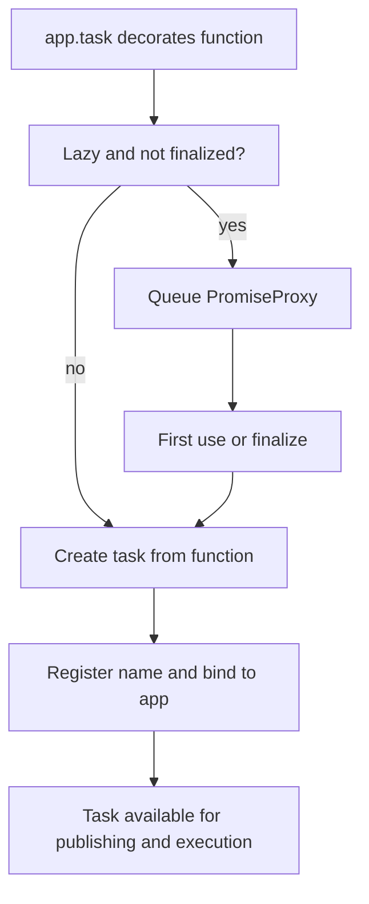

## Overview

A `Celery` application owns configuration, registered tasks and the component classes used for messaging, events, logging and control. Construction prepares these objects but leaves configuration loading and task finalization as separate deferred operations. Understanding those boundaries explains when imports happen, when decorators become task instances and why a producer can publish a name that a worker does not know. [[Task Publishing]] starts after these application-level choices become execution options.

Sources: [celery/app/base.py:343-434](repo://celery/app/base.py#L343-L434), [celery/app/base.py:554-573](repo://celery/app/base.py#L554-L573), [celery/app/base.py:874-909](repo://celery/app/base.py#L874-L909)

## Construct the application

The constructor accepts a main name, broker, backend, loader, included modules, task class, configuration source and namespace. It creates a task registry, queues for pending defaults and decorators, and an initially pending `Settings` object. Broker and backend arguments become configuration entries, which the code says simplifies application pickling. Unless `set_as_current=False`, construction also selects this application as current; component class arguments let an application supply implementations before those components are needed.

Sources: [celery/app/base.py:343-416](repo://celery/app/base.py#L343-L416)

Application lifecycle signals mark distinct boundaries. `on_configure` runs before settings are loaded, `on_after_configure` receives the resolved settings, and `on_after_finalize` runs after pending task decorators have been evaluated and tasks rebound. Code that needs final settings belongs after configuration; code that needs the finished registry needs finalization. These are distinct events even though normal use may trigger them close together.

Sources: [celery/app/base.py:418-427](repo://celery/app/base.py#L418-L427), [celery/app/base.py:657-677](repo://celery/app/base.py#L657-L677), [celery/app/base.py:1247-1279](repo://celery/app/base.py#L1247-L1279)

## Resolve settings

`config_from_object` accepts an object or importable module name. It stores the source and optional namespace; `force=True`, or an already configured app, causes immediate loading. `config_from_envvar` reads a module name from the named environment variable and delegates to the same method. An absent variable raises `ImproperlyConfigured` unless `silent=True`. At the loader boundary, silent mode also allows import or attribute errors to return `False` instead of raising.

Sources: [celery/app/base.py:703-743](repo://celery/app/base.py#L703-L743), [celery/loaders/base.py:119-130](repo://celery/loaders/base.py#L119-L130)

When `_load_config` runs, it emits the pre-configuration signal, asks the loader for the source, combines loader settings with preconfiguration and the namespace, then swaps the existing settings object's contents. The in-place swap deliberately preserves references held by callers that already accessed `app.conf`. It then consumes pending defaults and periodic entries before emitting `on_after_configure`. [[Periodic Scheduling]] covers how those entries become beat's schedule rather than ordinary task definitions.

Sources: [celery/app/base.py:1247-1280](repo://celery/app/base.py#L1247-L1280)

Connection settings also have explicit environment precedence. `CELERY_BROKER_URL` overrides the configured broker URL, while read and write URLs each have a dedicated environment override and fall back to that broker URL. `CELERY_RESULT_BACKEND` overrides the configured result backend. Consequently a command-line broker override can affect the application through the environment: the CLI writes these variables before resolving its application argument.

Sources: [celery/app/utils.py:85-112](repo://celery/app/utils.py#L85-L112), [celery/bin/celery.py:123-137](repo://celery/bin/celery.py#L123-L137)

## Register and finalize tasks

`app.task` normally returns a `PromiseProxy` when the app is not finalized. First use evaluates the proxy; finalization also drains all pending proxies. Actual creation happens in `_task_from_fun`: it derives a name, chooses a base task class, installs the function as `run`, creates an argument checker, records the task in `_tasks`, binds it and installs automatic retry behavior. `bind=True` makes the function an instance method rather than a static method, providing access to task state.

Sources: [celery/app/base.py:554-573](repo://celery/app/base.py#L554-L573), [celery/app/base.py:590-633](repo://celery/app/base.py#L590-L633), [celery/app/base.py:657-677](repo://celery/app/base.py#L657-L677)

Sources: [celery/app/base.py:554-573](repo://celery/app/base.py#L554-L573), [celery/app/base.py:602-633](repo://celery/app/base.py#L602-L633), [celery/app/base.py:657-677](repo://celery/app/base.py#L657-L677)

Names are registry keys: requesting creation of a name already present returns the existing task. `finalize` holds a mutex, sets the finalized flag once, announces finalization, evaluates pending decorators and binds every registered task. Disabling automatic finalization introduces an explicit contract: attempts to create a task before required finalization can raise `RuntimeError`. [[Task Execution]] relies on the resulting registry when selecting a strategy for an incoming name.

Sources: [celery/app/base.py:602-633](repo://celery/app/base.py#L602-L633), [celery/app/base.py:657-677](repo://celery/app/base.py#L657-L677), [celery/worker/consumer/consumer.py:716-751](repo://celery/worker/consumer/consumer.py#L716-L751)

`shared_task` serves libraries whose task definitions must work with different applications. It installs a finalization callback for future apps, creates copies for already finalized active apps and returns a proxy resolving the task from the current app's registry. The proxy therefore selects an application at access time; it is not permanently tied to whichever app happened to exist when the library module imported.

Sources: [celery/app/__init__.py:24-76](repo://celery/app/__init__.py#L24-L76)

## Import and discover task modules

Worker loader initialization imports built-in modules plus configured `imports` and `include` modules. Before importing them it sends `import_modules` and explicitly re-raises exception responses, because logging is not yet configured and otherwise those failures could be hidden. Initialization is guarded by `worker_initialized`, so repeated loader initialization does not repeatedly run the same import sequence.

Sources: [celery/loaders/base.py:97-111](repo://celery/loaders/base.py#L97-L111), [celery/loaders/base.py:223-229](repo://celery/loaders/base.py#L223-L229)

`autodiscover_tasks` searches each supplied package for a related module, normally `tasks`. Packages may come from a callable; omitting them delegates discovery to installed fixups. Discovery is deferred to the import signal unless `force=True`. A missing candidate module is allowed, but a missing dependency inside an existing task module is re-raised. That distinction prevents a broken nested import from being mistaken for a package that simply has no tasks.

Sources: [celery/app/base.py:782-844](repo://celery/app/base.py#L782-L844), [celery/loaders/base.py:251-278](repo://celery/loaders/base.py#L251-L278)

## Integrate Django lifecycle hooks

The Django fixup activates when `DJANGO_SETTINGS_MODULE` is set and the loader is not already Django-specific. It imports Django, verifies its version, adds the project directory to the import path and selects `DjangoTask` unless a custom task class was supplied. Its import hook calls Django setup before importing task modules; model checks run unless `CELERY_SKIP_CHECKS` is set. These hooks make framework initialization part of the application import boundary.

Sources: [celery/fixups/django.py:52-103](repo://celery/fixups/django.py#L52-L103), [celery/fixups/django.py:146-154](repo://celery/fixups/django.py#L146-L154)

The worker fixup connects database and cache cleanup to task and worker-process signals. Child initialization closes inherited database descriptors without triggering the network operations that could break the parent's connection, then closes database and cache state. For transactional publishing, `DjangoTask.delay_on_commit` and `apply_async_on_commit` register partial calls with Django's `transaction.on_commit`. Both methods return `None`; the eventual submission occurs through the transaction callback, so they do not immediately return the result handle described in [[Task Publishing]].

Sources: [celery/fixups/django.py:156-203](repo://celery/fixups/django.py#L156-L203), [celery/contrib/django/task.py:8-21](repo://celery/contrib/django/task.py#L8-L21)
