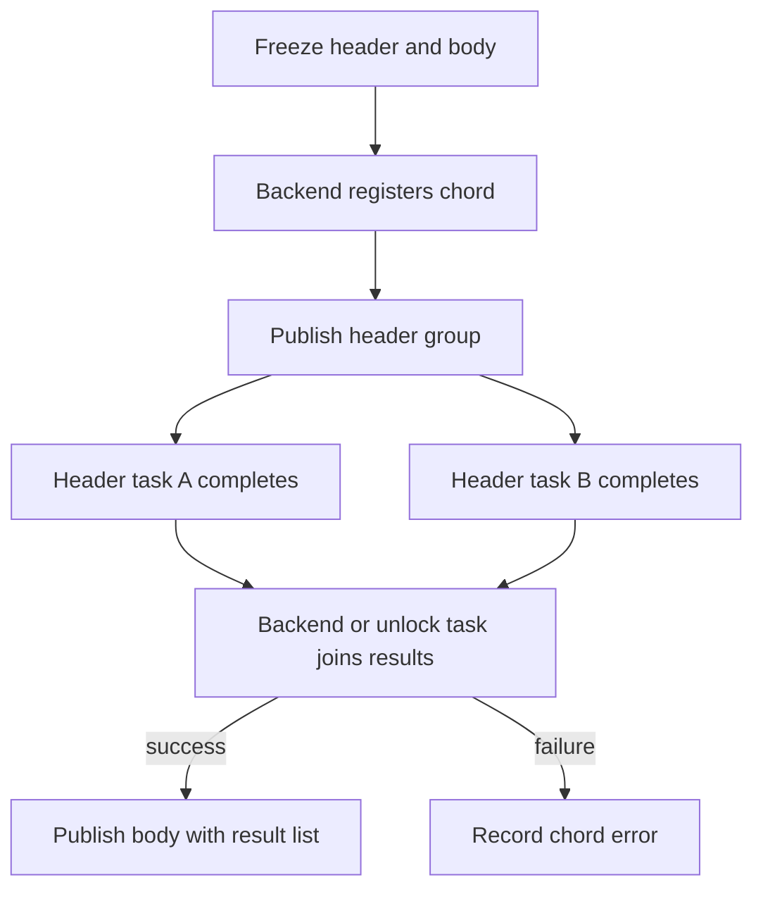

## Overview

Canvas represents task invocations as signatures and composes them into ordered or parallel work. A signature packages arguments and execution options in a dictionary-compatible object so it can travel through serializers and become a callback. Chains establish dependencies, groups submit collections and chords coordinate a group with a completion body. Each dispatched member ultimately uses the message path in [[Task Publishing]]; composition determines which members are sent and what continuation information accompanies them.

Sources: [celery/canvas.py:233-250](repo://celery/canvas.py#L233-L250), [celery/canvas.py:370-401](repo://celery/canvas.py#L370-L401), [celery/canvas.py:1048-1092](repo://celery/canvas.py#L1048-L1092), [celery/canvas.py:1616-1650](repo://celery/canvas.py#L1616-L1650), [celery/canvas.py:2267-2286](repo://celery/canvas.py#L2267-L2286)

## Preserve signature arguments

`Signature.apply_async` combines incoming partial arguments with its stored invocation. Positional arguments are prepended, incoming keyword arguments override stored keywords and options are merged. It first discards extra options whose value is `None`; this differs from the explicit omitted-value handling of direct `send_task` described in [[Task Publishing]]. An immutable signature keeps its existing arguments and keywords unless merging is forced, while still accepting allowed execution-option changes.

Sources: [celery/canvas.py:370-443](repo://celery/canvas.py#L370-L443)

Option immutability is separate from signature immutability. `_merge` protects its immutable option set and previously stamped headers even when other values are replaced. The comments explain that changing protected fields can stall tasks. This matters when a prepared workflow already has coordination metadata: applying new options is not an unrestricted rewrite of every stored field, and forcing argument merging does not remove stamp protection.

Sources: [celery/canvas.py:403-443](repo://celery/canvas.py#L403-L443)

## Chain dependent tasks

Chain preparation walks steps in reverse, clones signatures, gives initial partial arguments only to the first executable step and flattens nested chains. The reversed list becomes the protocol-v2 chain field so the worker can pop the next task. The code uses that representation to avoid deeply recursive linked structures during pickling. A group followed by another step is upgraded to a chord, because the next step depends on collective completion rather than one member's result.

Sources: [celery/canvas.py:1157-1235](repo://celery/canvas.py#L1157-L1235)

Preparation freezes task identifiers and builds parent links between result objects. The last task receives the chain's requested result identifier and any enclosing group/chord synchronization metadata. Chain-level error callbacks are attached to each task and propagated to chord bodies when necessary. `run` publishes the first prepared task with remaining steps embedded; a multi-step chain returns the prepared final result, while a one-step chain returns the actual result from its sole submission.

Sources: [celery/canvas.py:1048-1092](repo://celery/canvas.py#L1048-L1092), [celery/canvas.py:1243-1279](repo://celery/canvas.py#L1243-L1279)

The execution tracer advances a chain only after successful execution, prepending the previous return value to the next signature's arguments and carrying root and parent identifiers. Ordinary signatures therefore consume preceding results naturally; immutable argument handling allows a later step to retain its own arguments instead. [[Results and State]] explains how parent-linked result handles expose the resulting dependency structure to callers.

Sources: [celery/app/trace.py:467-473](repo://celery/app/trace.py#L467-L473), [celery/app/trace.py:610-624](repo://celery/app/trace.py#L610-L624), [celery/canvas.py:439-443](repo://celery/canvas.py#L439-L443), [celery/canvas.py:1264-1265](repo://celery/canvas.py#L1264-L1265)

## Group parallel submissions

`group.apply_async` freezes a group identity, prepares members and publishes them through `_apply_tasks`. It creates a `GroupResult` and readiness barrier from the member results, then adds that aggregate to a current parent task's trail when requested. An empty group freezes without publishing members. Eager mode delegates to local `apply`. Passing `link` directly to `group.apply_async` raises an error directing the caller to a chord; passing `link_error` there directs the caller to individual tasks.

Sources: [celery/canvas.py:1616-1650](repo://celery/canvas.py#L1616-L1650)

Map, starmap and chunks provide related collection forms. The built-in map task calls a task once per item inside one task body; starmap unpacks each item as positional arguments. Chunks partition an iterable into a group of starmap signatures, each responsible for one partition. The implementation therefore places distribution at the group-of-chunks boundary, while each map task iterates its own items locally. Choose the shape according to whether each item or each partition should be submitted as a separate unit.

Sources: [celery/app/builtins.py:101-120](repo://celery/app/builtins.py#L101-L120), [celery/canvas.py:1437-1472](repo://celery/canvas.py#L1437-L1472)

## Synchronize with a chord

A chord freezes the body identifier and header result structure, registers coordination with `backend.apply_chord`, then publishes the header group. It returns the body's result with the header aggregate as parent. An empty header immediately dispatches the body with an empty list because there will be no member completion to trigger it. Header options have inherited chain, chord and task identifiers removed where they would interfere with nested coordination.

Sources: [celery/canvas.py:2250-2286](repo://celery/canvas.py#L2250-L2286)

Sources: [celery/canvas.py:2258-2286](repo://celery/canvas.py#L2258-L2286), [celery/app/builtins.py:37-97](repo://celery/app/builtins.py#L37-L97)

Backends without native coordination can use `celery.chord_unlock`. It reconstructs a `GroupResult`, checks readiness and retries after the configured interval when members are unfinished or readiness checking fails. Once ready, it joins with propagation enabled and publishes the body with the joined values. Join or callback-publication failures become chord errors, preserving the original exception as cause. Backend support is therefore a requirement of composition, not simply a choice of where the final scalar value is stored; [[Result Backends]] describes that capability boundary.

Sources: [celery/app/builtins.py:37-97](repo://celery/app/builtins.py#L37-L97), [celery/canvas.py:1277-1279](repo://celery/canvas.py#L1277-L1279)

## Replace running work

`Task.replace` substitutes a new signature for the current task while retaining its identifier, callbacks, errbacks and enclosing workflow information. It rejects an empty replacement chain or a signature already carrying a chord option. A replacement group is upgraded with an accumulate body so callbacks can attach to completion. Freezing with the original task identifier deliberately preserves already constructed result objects; remaining original chain steps are appended with their identifiers retained. Use the documented `return self.replace(...)` form to make the end of the current body clear.

Sources: [celery/app/task.py:1029-1095](repo://celery/app/task.py#L1029-L1095)

## Stamp workflow metadata

`Signature.stamp` stamps linked callbacks, invokes an optional visitor for signature-specific headers, merges the resulting stamps and stores them as options. `append_stamps=True` accumulates duplicate values; otherwise the latest stamp replaces a duplicate. These labels become protocol headers through the publishing path, while signature merging protects existing stamped fields. [[Monitoring and Control]] covers the worker-side use of stamped headers for revocation rather than treating them as task arguments.

Sources: [celery/canvas.py:614-634](repo://celery/canvas.py#L614-L634), [celery/canvas.py:424-440](repo://celery/canvas.py#L424-L440), [celery/app/amqp.py:370-390](repo://celery/app/amqp.py#L370-L390)
