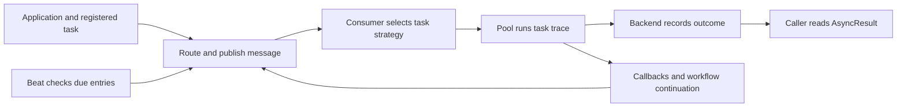

## Overview

Celery turns named Python tasks into messages that workers execute. A producer supplies a task name, arguments and execution options; the application publishes a message and returns an `AsyncResult`. The worker resolves the name against its own task registry, runs the task and records its outcome through a result backend. This separation lets the publishing process return before task execution finishes. Start with [[Quickstart]] to exercise that path using the repository's small addition task.

Sources: [celery/app/base.py:1006-1034](repo://celery/app/base.py#L1006-L1034), [celery/worker/consumer/consumer.py:716-751](repo://celery/worker/consumer/consumer.py#L716-L751), [celery/app/trace.py:580-627](repo://celery/app/trace.py#L580-L627), [examples/tutorial/tasks.py:1-12](repo://examples/tutorial/tasks.py#L1-L12)

## System map

| Area | What it does | Guide |
| --- | --- | --- |
| First application | Defines and submits a small registered task | [[Quickstart]] |
| Application | Loads configuration and binds task definitions to an app | [[Application and Configuration]] |
| Producer | Applies execution defaults, routes tasks and publishes messages | [[Task Publishing]] |
| Execution | Resolves incoming tasks and traces their outcomes | [[Task Execution]] |
| Composition | Dispatches collections of task signatures and tracks group results | [[Canvas Workflows]] |
| Result client | Waits for completion and propagates remote errors | [[Results and State]] |
| Storage | Resolves configured result backend implementations | [[Result Backends]] |
| Worker | Builds pools, timers and consumers through bootsteps | [[Worker Lifecycle and Concurrency]] |
| Scheduler | Checks due entries and publishes periodic tasks | [[Periodic Scheduling]] |
| Operations | Emits events and broadcasts commands to workers | [[Monitoring and Control]] |

Sources: [examples/tutorial/tasks.py:1-12](repo://examples/tutorial/tasks.py#L1-L12), [celery/app/base.py:657-725](repo://celery/app/base.py#L657-L725), [celery/app/base.py:897-932](repo://celery/app/base.py#L897-L932), [celery/app/base.py:1006-1034](repo://celery/app/base.py#L1006-L1034), [celery/worker/consumer/consumer.py:716-751](repo://celery/worker/consumer/consumer.py#L716-L751), [celery/canvas.py:1616-1650](repo://celery/canvas.py#L1616-L1650), [celery/result.py:191-258](repo://celery/result.py#L191-L258), [celery/app/backends.py:15-69](repo://celery/app/backends.py#L15-L69), [celery/worker/worker.py:76-139](repo://celery/worker/worker.py#L76-L139), [celery/beat.py:326-364](repo://celery/beat.py#L326-L364), [celery/events/dispatcher.py:164-199](repo://celery/events/dispatcher.py#L164-L199), [celery/app/control.py:755-790](repo://celery/app/control.py#L755-L790)

## Main task flow

Sources: [celery/app/base.py:604-630](repo://celery/app/base.py#L604-L630), [celery/app/base.py:930-932](repo://celery/app/base.py#L930-L932), [celery/app/base.py:1006-1034](repo://celery/app/base.py#L1006-L1034), [celery/beat.py:393-421](repo://celery/beat.py#L393-L421), [celery/worker/consumer/consumer.py:731-751](repo://celery/worker/consumer/consumer.py#L731-L751), [celery/worker/request.py:341-372](repo://celery/worker/request.py#L341-L372), [celery/app/trace.py:619-627](repo://celery/app/trace.py#L619-L627), [celery/result.py:191-258](repo://celery/result.py#L191-L258)

[[Application and Configuration]] establishes the task registry: decorating a function creates a task class, installs its `run` method and binds it to the app. [[Task Publishing]] follows the next step, where `send_task` creates protocol data, acquires a producer and returns a result handle after publication. The handle's existence therefore identifies a submission; it does not establish that a worker has already completed it.

Sources: [celery/app/base.py:604-633](repo://celery/app/base.py#L604-L633), [celery/app/base.py:1006-1034](repo://celery/app/base.py#L1006-L1034)

[[Periodic Scheduling]] supplies another producer: beat advances a due schedule entry and calls its registered task or sends its task name. [[Worker Lifecycle and Concurrency]] explains the receiving process, whose blueprint constructs the pool, timer and consumer. [[Task Execution]] then follows the consumer's task strategy into `Request.execute_using_pool`, which submits a trace function with acceptance, timeout, success and failure callbacks.

Sources: [celery/beat.py:349-358](repo://celery/beat.py#L349-L358), [celery/beat.py:393-421](repo://celery/beat.py#L393-L421), [celery/worker/worker.py:76-139](repo://celery/worker/worker.py#L76-L139), [celery/worker/request.py:341-372](repo://celery/worker/request.py#L341-L372)

[[Canvas Workflows]] continues execution by publishing callbacks and the next chain member with the previous return value. [[Result Backends]] describes the storage boundary reached by `mark_as_done`; [[Results and State]] explains how a caller waits for that outcome and receives either its value or its exception. [[Monitoring and Control]] covers a separate operational path: event publication and commands sent to worker mailboxes.

Sources: [celery/app/trace.py:440-473](repo://celery/app/trace.py#L440-L473), [celery/app/trace.py:619-627](repo://celery/app/trace.py#L619-L627), [celery/result.py:191-258](repo://celery/result.py#L191-L258), [celery/events/dispatcher.py:164-199](repo://celery/events/dispatcher.py#L164-L199), [celery/app/control.py:755-790](repo://celery/app/control.py#L755-L790)

## Design choices across the system

Task identity is a name shared across independently loaded applications. Task reduction deliberately stores the name, with a module hint, so the receiving side can resolve the local registered task. A missing worker registration reaches an explicit `NotRegistered` failure path. This explains why producer imports alone cannot establish that a worker knows a task: task definition and task message delivery meet at the registry lookup.

Sources: [celery/app/task.py:506-514](repo://celery/app/task.py#L506-L514), [celery/worker/consumer/consumer.py:677-708](repo://celery/worker/consumer/consumer.py#L677-L708)

Configuration and registration are deliberately deferred. `config_from_object` normally remembers a source until configuration is required, while finalization evaluates pending decorators and binds registered tasks. Publication by name uses the underlying registry directly so merely checking for local defaults does not force finalization; the code explicitly preserves the ability to send remote or unregistered task names.

Sources: [celery/app/base.py:657-725](repo://celery/app/base.py#L657-L725), [celery/app/base.py:874-909](repo://celery/app/base.py#L874-L909)

The hot execution path trades abstraction for throughput. The trace function's comments explain that calls are unrolled for performance, while the strategy code describes its specialized handlers as an optimization. The consumer also defers protocol-v2 body deserialization to the pool. These choices make the request and trace boundaries useful places to understand behavior before trying to replace execution machinery.

Sources: [celery/app/trace.py:475-486](repo://celery/app/trace.py#L475-L486), [celery/worker/strategy.py:105-128](repo://celery/worker/strategy.py#L105-L128), [celery/worker/consumer/consumer.py:731-747](repo://celery/worker/consumer/consumer.py#L731-L747)

Ordering matters across execution and persistence. Successful callbacks are dispatched before the result is stored so child results can populate the parent's trail. Beat advances timestamps and counts before attempting publication so an exception does not leave the same entry continuously due. Neither sequence is a general transaction spanning broker and backend; each has a specific ordering reason documented beside the implementation.

Sources: [celery/app/trace.py:610-627](repo://celery/app/trace.py#L610-L627), [celery/beat.py:389-418](repo://celery/beat.py#L389-L418)

Extension points sit at explicit boundaries. Backend selection combines built-in aliases, loader overrides and entry points; pool selection resolves named implementations and supports a custom pool configured through `CELERY_CUSTOM_WORKER_POOL`. Worker bootsteps accept application-provided steps alongside built-ins. These mechanisms keep storage, concurrency and lifecycle composition independently replaceable without changing a task's Python body.

Sources: [celery/app/backends.py:41-69](repo://celery/app/backends.py#L41-L69), [celery/concurrency/__init__.py:11-43](repo://celery/concurrency/__init__.py#L11-L43), [celery/worker/worker.py:129-139](repo://celery/worker/worker.py#L129-L139)
