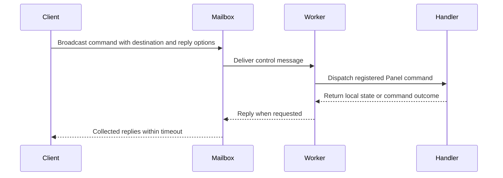

## Overview

Celery exposes two operational channels: events describe worker and task activity, while remote control sends commands to worker mailboxes. An event receiver can maintain an in-memory view of the cluster; inspection asks responding workers for their current local state. Neither replaces the backend result contract in [[Results and State]]. [[Worker Lifecycle and Concurrency]] describes the services and capacity settings that these operational interfaces observe or modify.

Sources: [celery/events/receiver.py:36-88](repo://celery/events/receiver.py#L36-L88), [celery/events/state.py:408-425](repo://celery/events/state.py#L408-L425), [celery/app/control.py:107-117](repo://celery/app/control.py#L107-L117), [celery/worker/pidbox.py:25-54](repo://celery/worker/pidbox.py#L25-L54)

## Publish operational events

`EventDispatcher.publish` adds hostname, process identifier, UTC offset and a logical clock to event fields, then routes by event type with dashes converted to dots. `send` checks whether the dispatcher is enabled and whether the event group is selected. Some groups accumulate buffered events until a size threshold or flush callback; publication errors can also be buffered when offline buffering is enabled. Event fields must be JSON serializable, and transport retry settings are passed to the producer.

Sources: [celery/events/dispatcher.py:116-199](repo://celery/events/dispatcher.py#L116-L199)

The heartbeat service sends worker-online when enabled, schedules repeated worker-heartbeat messages and sends worker-offline on stop. Its payload includes heartbeat frequency, active request count, processed count, load average and software information. Remote enable/disable-events handlers alter task event selection and report when the dispatcher is unavailable. Task receipt and outcome events remain subject to the task's own event flag, so absence of a particular task event is not a result-backend state.

Sources: [celery/worker/heartbeat.py:25-61](repo://celery/worker/heartbeat.py#L25-L61), [celery/worker/control.py:345-367](repo://celery/worker/control.py#L345-L367), [celery/worker/strategy.py:112-117](repo://celery/worker/strategy.py#L112-L117), [celery/worker/request.py:511-513](repo://celery/worker/request.py#L511-L513)

## Receive and reconcile events

`EventReceiver` creates a named queue using the configured exchange, routing key, TTL, expiration, durability and exclusivity. It rejects a queue configured as both exclusive and durable. Its consumer uses automatic acknowledgement and dispatches each event to a type-specific handler or the `*` fallback. Capture can request immediate worker heartbeats on startup, providing an initial observation without waiting for the next periodic heartbeat.

Sources: [celery/events/receiver.py:36-111](repo://celery/events/receiver.py#L36-L111)

The receiver adjusts its logical clock, compensates for the special unsynchronized task-sent clock, optionally localizes event timestamps and records `local_received`. A `State` object processes events under a lock and defaults to bounded LRU collections for 5,000 workers and 10,000 tasks. Task event merging uses state precedence to avoid replacing a later logical state with an earlier event, with special treatment for retry. This is an observation cache that reconciles arrivals, not an unlimited durable task history.

Sources: [celery/events/receiver.py:113-138](repo://celery/events/receiver.py#L113-L138), [celery/events/state.py:305-332](repo://celery/events/state.py#L305-L332), [celery/events/state.py:408-425](repo://celery/events/state.py#L408-L425), [celery/events/state.py:501-503](repo://celery/events/state.py#L501-L503)

The events CLI selects a raw event dump, a snapshot camera or the interactive event view. A custom receiver can instead install application-specific handlers; the state dispatcher also supports group handlers and node join/leave callbacks. These interfaces let a monitor consume the event stream without changing the worker's execution strategy or its result backend.

Sources: [celery/bin/events.py:83-98](repo://celery/bin/events.py#L83-L98), [celery/events/receiver.py:80-88](repo://celery/events/receiver.py#L80-L88), [celery/events/state.py:540-574](repo://celery/events/state.py#L540-L574)

## Inspect worker state

`Inspect._request` broadcasts a command with replies enabled, destination filtering, timeout, optional callback and a reply limit. It flattens replies by worker name, or selects a single destination's response. The CLI exposes timeout, destination and JSON output controls. A missing response means the client did not collect a reply under those conditions; it is not a completed-task result or a guarantee that the worker has no active work.

Sources: [celery/app/control.py:82-117](repo://celery/app/control.py#L82-L117), [celery/app/control.py:755-790](repo://celery/app/control.py#L755-L790), [celery/bin/control.py:153-189](repo://celery/bin/control.py#L153-L189)

| Inspection | What the worker returns |
| --- | --- |
| ping | A pong response |
| stats | Controller statistics |
| active | Requests currently executing |
| reserved | Reserved requests excluding active requests |
| scheduled | ETA/countdown requests held by the worker timer |
| registered | Task registry names and selected attributes, normally excluding built-ins |
| revoked | Locally revoked task identifiers |
| active_queues | Queues currently attached to the task consumer |

Sources: [celery/worker/control.py:398-477](repo://celery/worker/control.py#L398-L477), [celery/worker/control.py:631-637](repo://celery/worker/control.py#L631-L637)

The scheduled inspection reads request objects from the worker timer. It does not query beat's recurring schedule. Likewise, reserved and active come from worker-local request sets, and registered comes from that worker's application registry. Match the question to the inspection boundary: registration checks explain unknown-task failures, while active queues explain which destinations a worker is consuming.

Sources: [celery/worker/control.py:412-448](repo://celery/worker/control.py#L412-L448), [celery/worker/control.py:462-474](repo://celery/worker/control.py#L462-L474), [celery/worker/control.py:631-637](repo://celery/worker/control.py#L631-L637)

## Deliver remote commands

The control bootstep is included only when `worker_enable_remote_control` is enabled and the connection supports fanout exchanges. It creates a regular or green pidbox according to the pool. The pidbox registers `Panel.data` handlers, listens on a broker channel and invokes the appropriate handler for each command. Unknown commands are logged; other handler failures are logged and reset the mailbox. This makes transport capability and worker configuration prerequisites for both inspection and mutation.

Sources: [celery/worker/consumer/control.py:18-33](repo://celery/worker/consumer/control.py#L18-L33), [celery/worker/pidbox.py:25-54](repo://celery/worker/pidbox.py#L25-L54)

Sources: [celery/app/control.py:755-790](repo://celery/app/control.py#L755-L790), [celery/worker/pidbox.py:25-54](repo://celery/worker/pidbox.py#L25-L54), [celery/worker/control.py:398-408](repo://celery/worker/control.py#L398-L408)

## Change limits, capacity and subscriptions

The rate-limit handler validates the rate string, updates the named task and resets consumer buckets. Unknown task names return an error. The time-limit handler changes that task's soft and hard limit attributes. Pool grow and shrink update prefetch as well as pool size, but refuse manual changes when autoscale is enabled; the autoscale command updates its range and fails if no autoscaler exists. These controls operate on receiving workers, so destination selection determines which local configuration changes.

Sources: [celery/worker/control.py:259-319](repo://celery/worker/control.py#L259-L319), [celery/worker/control.py:545-589](repo://celery/worker/control.py#L545-L589), [celery/app/control.py:761-775](repo://celery/app/control.py#L761-L775)

Queue commands schedule `add_task_queue` or `cancel_task_queue` through `consumer.call_soon`, then return their command acknowledgement. `active_queues` can inspect the resulting subscriptions. Because the handler schedules the operation, its immediate response describes acceptance of that request rather than a synchronous audit of every later delivery. Capacity and connection lifecycle remain governed by [[Worker Lifecycle and Concurrency]].

Sources: [celery/worker/control.py:610-637](repo://celery/worker/control.py#L610-L637)

## Revoke identifiers or stamps

Revocation accepts one or more task identifiers and can optionally terminate active execution. Stamped-header revocation adds matching values to worker-local revoked stamp state; without termination it reports that headers were flagged. With termination enabled it scans active requests and terminates matching ones. Incoming requests also compare their stamps and identifiers against revocation state before execution. The stamp metadata originates in [[Canvas Workflows]], and outcome recording follows the request rules in [[Task Execution]].

Sources: [celery/worker/control.py:138-153](repo://celery/worker/control.py#L138-L153), [celery/worker/control.py:160-211](repo://celery/worker/control.py#L160-L211), [celery/worker/request.py:475-508](repo://celery/worker/request.py#L475-L508)

## Add operational extensions

`control_command` and `inspect_command` register handlers and metadata in `Panel`, including aliases, argument descriptions, visibility and default timeout. A worker must import the registration for its pidbox to find the handler. Event extensions use type or wildcard handlers on the receiver, or group handlers on `State`; custom task events can be emitted through `Task.send_event` with JSON-serializable fields and the current request identifier. These are separate extension surfaces for commands and observations.

Sources: [celery/worker/control.py:45-74](repo://celery/worker/control.py#L45-L74), [celery/worker/pidbox.py:25-35](repo://celery/worker/pidbox.py#L25-L35), [celery/events/receiver.py:80-88](repo://celery/events/receiver.py#L80-L88), [celery/events/state.py:540-552](repo://celery/events/state.py#L540-L552), [celery/app/task.py:1003-1027](repo://celery/app/task.py#L1003-L1027)
