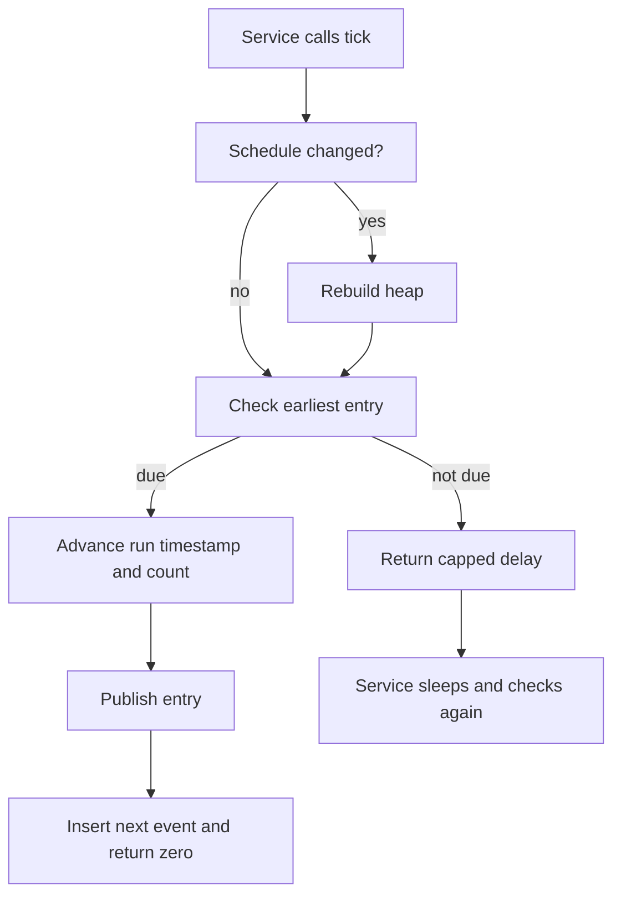

## Overview

Beat is a task producer driven by schedules. It checks when entries are due and publishes their task names and arguments; a worker still performs the actual task. The included periodic-task example starts a worker in one terminal and beat in another. [[Task Publishing]] describes the broker operation beat ultimately invokes, while [[Task Execution]] explains the receiving side. Beat's schedule state records when it sent work, rather than proving that the worker completed it.

Sources: [examples/periodic-tasks/myapp.py:3-15](repo://examples/periodic-tasks/myapp.py#L3-L15), [celery/beat.py:389-421](repo://celery/beat.py#L389-L421)

## Create named schedule entries

`add_periodic_task` converts a signature into a `beat_schedule` entry containing schedule, task name, arguments, keywords and execution options. Its key is an explicit name or the signature representation. Adding the same unnamed signature again replaces the previous entry and emits a warning, so distinct names are required when the same invocation needs multiple independent schedules. Before application configuration completes, additions are queued for later installation through the lifecycle in [[Application and Configuration]].

Sources: [celery/app/base.py:1295-1333](repo://celery/app/base.py#L1295-L1333), [celery/app/base.py:1273-1279](repo://celery/app/base.py#L1273-L1279)

The repository example connects configuration completion to a ten-second interval. Its application defines `say`, configures UTC and registers this handler. The schedule entry stores a signature's task information; it does not run the Python function while the application is being configured.

Sources: [examples/periodic-tasks/myapp.py:31-53](repo://examples/periodic-tasks/myapp.py#L31-L53), [celery/app/base.py:1312-1324](repo://celery/app/base.py#L1312-L1324)

```python
@app.on_after_configure.connect
def setup_periodic_tasks(sender, **kwargs):
    # Calls say('hello') every 10 seconds.
    sender.add_periodic_task(10.0, say.s('hello'), name='add every 10')
```

Sources: [examples/periodic-tasks/myapp.py:50-53](repo://examples/periodic-tasks/myapp.py#L50-L53)

`ScheduleEntry` normalizes the supplied schedule and records `last_run_at` and `total_run_count`. Advancing it creates a new entry with the current timestamp and incremented count. Updating an entry from configuration changes only editable fields such as task, schedule, arguments and options; it does not replace run history. Its `is_due` method delegates to the schedule with the entry's last-run timestamp.

Sources: [celery/beat.py:117-163](repo://celery/beat.py#L117-L163)

## Choose a due-time calculation

Numbers become timedeltas and then interval schedules. An interval schedule computes remaining time from the last run, returning a due flag plus a delay until the next check. Crontab schedules select calendar fields such as minute, hour, weekday, day of month and month. Their optional `beat_cron_starting_deadline` suppresses overdue runs whose latest feasible time is too far in the past, preventing unexpected catch-up outside the configured window.

Sources: [celery/schedules.py:168-173](repo://celery/schedules.py#L168-L173), [celery/schedules.py:323-343](repo://celery/schedules.py#L323-L343), [celery/schedules.py:641-688](repo://celery/schedules.py#L641-L688), [celery/schedules.py:703-714](repo://celery/schedules.py#L703-L714)

Solar schedules compute a named solar event for a latitude and longitude. Construction validates event names and coordinate bounds, then configures an observer. Remaining-time calculation converts the last-run time to UTC and asks the ephemeris for the next event. If the event cannot occur that day, the calculation schedules a later check after the next anti-transit. This is a different scheduling input from either fixed intervals or calendar fields.

Sources: [celery/schedules.py:800-818](repo://celery/schedules.py#L800-L818), [celery/schedules.py:828-856](repo://celery/schedules.py#L828-L856)

## Run one scheduler tick

The scheduler keeps a heap ordered by next check time. It populates the heap from entry `is_due` results and rebuilds it when the schedule changes. Each `tick` inspects the first event and sends at most one due entry. A due entry is removed, reserved to advance its history, published and reinserted with its next time. Returning zero lets the service check again immediately; an empty heap returns the maximum interval, and a not-yet-due entry returns a delay capped by that maximum.

Sources: [celery/beat.py:300-364](repo://celery/beat.py#L300-L364)



Sources: [celery/beat.py:326-364](repo://celery/beat.py#L326-L364), [celery/beat.py:389-418](repo://celery/beat.py#L389-L418), [celery/beat.py:643-655](repo://celery/beat.py#L643-L655)

Reservation intentionally precedes publication so an exception does not leave an entry scheduling forever at the same due time. `apply_async` evaluates entry arguments and keywords, looks up the task locally and either calls that task's `apply_async` or sends the name through the application. It wraps failures as `SchedulingError`; `apply_entry` logs message failures. The `finally` path still increments synchronization accounting and can sync state. A scheduler log about an attempted send therefore is not evidence of successful task execution.

Sources: [celery/beat.py:279-290](repo://celery/beat.py#L279-L290), [celery/beat.py:389-433](repo://celery/beat.py#L389-L433)

## Persist schedule history

`PersistentScheduler` uses a shelve database with a configured filename. It opens with writeback enabled and tests access to stored keys; corruption causes known database files to be removed and reopened. During setup it resets stored data if timezone or UTC-enabled settings changed, merges the configured schedule, installs default entries and stores version and timezone metadata. This makes time configuration part of schedule-history validity, not merely display formatting.

Sources: [celery/beat.py:505-565](repo://celery/beat.py#L505-L565)

Merging removes stored names absent from current configuration, updates editable fields for retained entries and adds new entries. Synchronization occurs based on elapsed monotonic time or a configured task-count threshold. The persistent implementation syncs the shelf, and close syncs before closing storage. The service also closes the scheduler in its final cleanup path, so ordinary shutdown has an explicit persistence step.

Sources: [celery/beat.py:381-387](repo://celery/beat.py#L381-L387), [celery/beat.py:458-472](repo://celery/beat.py#L458-L472), [celery/beat.py:599-605](repo://celery/beat.py#L599-L605), [celery/beat.py:643-659](repo://celery/beat.py#L643-L659)

Beat also installs `celery.backend_cleanup` at 04:00 when result expiration is configured and the backend lacks automatic expiration, unless that schedule entry already exists. It gives the cleanup message a twelve-hour expiration. This couples periodic scheduling to backend retention: a store that requires explicit cleanup needs the scheduled maintenance path, while a backend declaring automatic expiration does not get this default entry.

Sources: [celery/beat.py:268-277](repo://celery/beat.py#L268-L277)

## Start and extend the service

The beat application initializes its loader, optionally creates a pid lock, constructs the service with scheduler class, schedule filename and maximum interval, configures logging and starts it. The service emits initialization signals, repeatedly calls `tick`, sleeps for positive delays and synchronizes when needed. Interrupt or exit requests set its shutdown event and lead to scheduler cleanup. Debug logging in the included example exposes calculated runtimes when diagnosing schedule behavior.

Sources: [celery/apps/beat.py:78-118](repo://celery/apps/beat.py#L78-L118), [celery/beat.py:633-659](repo://celery/beat.py#L633-L659), [examples/periodic-tasks/myapp.py:11-15](repo://examples/periodic-tasks/myapp.py#L11-L15)

Custom scheduler classes are resolved through `celery.beat_schedulers` entry points or an importable class name and receive the app, filename, maximum interval and lazy flag. A custom schedule object is retained by normalization with the app attached, while entries delegate due checks to it. These two extension points separate deciding when an entry is due from storing entries and driving the scheduling loop.

Sources: [celery/beat.py:666-679](repo://celery/beat.py#L666-L679), [celery/schedules.py:703-714](repo://celery/schedules.py#L703-L714), [celery/beat.py:161-163](repo://celery/beat.py#L161-L163)
