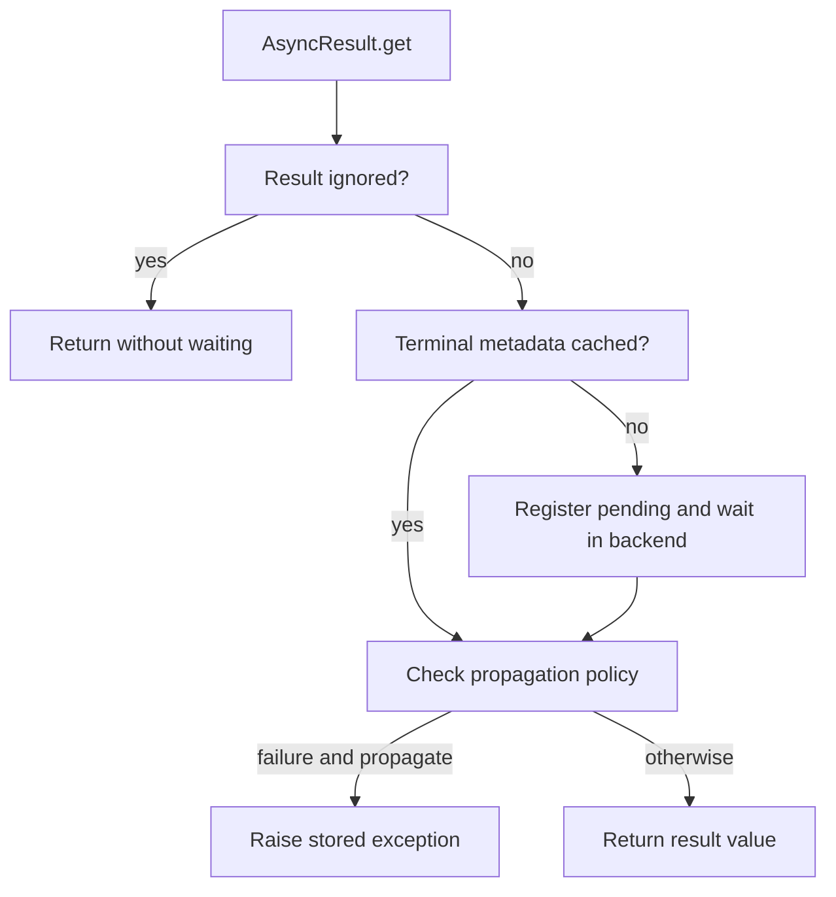

## Overview

An `AsyncResult` associates a task identifier with an application, backend and optional parent. It retrieves state and return data through that backend; constructing the handle does not establish that a task has completed or even that a result record exists. `GroupResult` adds an aggregate identifier around member handles. These objects expose the dependencies built by [[Canvas Workflows]], while [[Result Backends]] explains the storage and transport implementations behind retrieval.

Sources: [celery/result.py:89-101](repo://celery/result.py#L89-L101), [celery/result.py:351-367](repo://celery/result.py#L351-L367), [celery/result.py:470-496](repo://celery/result.py#L470-L496), [celery/result.py:928-952](repo://celery/result.py#L928-L952)

## Interpret state without assuming progress

`ready` checks membership in backend ready states, `successful` checks for `SUCCESS`, and `failed` checks for `FAILURE`. A result can therefore be ready without being successful. The state module distinguishes result completion from events: `RECEIVED` and `REJECTED` are marked as event-only states, and `STARTED` depends on started tracking. An application should not assume every task reports every intermediate state before reaching its final outcome.

Sources: [celery/result.py:369-383](repo://celery/result.py#L369-L383), [celery/states.py:126-151](repo://celery/states.py#L126-L151)

| State | Meaning in the result contract | Ready | Propagated by default |
| --- | --- | --- | --- |
| PENDING | State unknown; assumed pending when an identifier is known | No | No |
| STARTED | Worker started the task with tracking enabled | No | No |
| RETRY | Waiting for another attempt | No | No |
| SUCCESS | Task succeeded | Yes | No |
| FAILURE | Task failed | Yes | Yes |
| REVOKED | Task was revoked | Yes | Yes |

Sources: [celery/states.py:126-147](repo://celery/states.py#L126-L147)

Missing key-value records return `PENDING` and `None`, so pending state alone cannot distinguish waiting work from an unknown, expired or forgotten identifier. `AsyncResult.exists()` delegates to `task_result_exists`. The base implementation tests whether metadata has a non-pending state; key-value backends override this with a direct record check, which can also detect an explicitly stored pending record. Even a negative existence check is about backend records, not proof that a message was never submitted.

Sources: [celery/result.py:351-367](repo://celery/result.py#L351-L367), [celery/backends/base.py:774-783](repo://celery/backends/base.py#L774-L783), [celery/backends/base.py:1148-1169](repo://celery/backends/base.py#L1148-L1169)

## Wait for a value

`get` returns immediately when the handle is marked ignored. Otherwise it guards against synchronous subtask waits, checks parent failures when requested and uses cached terminal metadata if available. A cache miss registers the handle as pending and calls the backend's `wait_for_pending`. The default `propagate=True` raises a stored failure or revocation exception; disabling propagation returns the exception value. The caller's timeout limits waiting and does not terminate the worker's task.

Sources: [celery/result.py:191-269](repo://celery/result.py#L191-L269), [celery/result.py:388-396](repo://celery/result.py#L388-L396)

Sources: [celery/result.py:243-269](repo://celery/result.py#L243-L269), [celery/result.py:388-396](repo://celery/result.py#L388-L396), [celery/backends/base.py:900-916](repo://celery/backends/base.py#L900-L916)

The synchronous backend loop repeatedly retrieves metadata until a ready state, sleeps between attempts and raises on timeout. It rejects `on_message` because that polling interface does not support message callbacks. Asynchronous backends delegate waiting to their result consumer and then apply the same result propagation logic. The `interval` argument therefore is not a universal latency control: the result API explicitly notes that RPC and Redis stores do not use the polling interval.

Sources: [celery/backends/base.py:900-944](repo://celery/backends/base.py#L900-L944), [celery/backends/asynchronous.py:295-309](repo://celery/backends/asynchronous.py#L295-L309), [celery/result.py:215-219](repo://celery/result.py#L215-L219)

## Cache terminal metadata and exceptions

The handle fetches metadata until `_maybe_set_cache` sees a ready state, then decodes and stores it and fulfills `on_ready`. Stored child tuples are reconstructed as result objects. The backend has its own cache, with the common implementation caching successful metadata. Consequently repeated reads of a completed handle can use local data rather than re-query storage. `result` exposes the value or exception object, while `traceback` exposes stored traceback text; remote traceback reconstruction additionally requires `tblib` and `task_remote_tracebacks`.

Sources: [celery/result.py:399-401](repo://celery/result.py#L399-L401), [celery/result.py:461-502](repo://celery/result.py#L461-L502), [celery/backends/base.py:746-772](repo://celery/backends/base.py#L746-L772)

## Inspect collections and dependency trees

For a result set, `ready` requires every member to be ready, `successful` requires every member to succeed and `failed` detects any failed member. `completed_count` counts successful members specifically, not all terminal states. Ordinary `join` visits members in stored order and returns values in that order, passing the remaining overall timeout to each wait. With a callback, each value is delivered to the callback instead of the aggregate list. An exception occupies its member position when propagation is disabled.

Sources: [celery/result.py:644-693](repo://celery/result.py#L644-L693), [celery/result.py:789-825](repo://celery/result.py#L789-L825)

Native iteration delegates to a backend-optimized path and does not support a collection spanning different backends. `supports_native_join` is a backend capability, so a caller should not assume all stores offer the same collection retrieval mechanism. `GroupResult.save` stores the aggregate through `save_group`, `restore` retrieves it and `delete` removes that saved group record. Those methods preserve or remove the group structure; member result cleanup is a separate operation.

Sources: [celery/result.py:453-455](repo://celery/result.py#L453-L455), [celery/result.py:830-844](repo://celery/result.py#L830-L844), [celery/result.py:958-970](repo://celery/result.py#L958-L970), [celery/result.py:1014-1021](repo://celery/result.py#L1014-L1021), [celery/result.py:695-698](repo://celery/result.py#L695-L698)

`collect` follows dependency results and yields pairs of result handles and values, waiting for each through `get`. It depends on task trails being enabled so child identifiers are recorded. `iterdeps` traverses ready children and can raise `IncompleteStream` when incomplete nodes are encountered without intermediate traversal enabled. This makes the graph an observation of recorded workflow relationships, not an independent scheduler that discovers or starts missing child tasks.

Sources: [celery/result.py:282-349](repo://celery/result.py#L282-L349), [celery/result.py:403-410](repo://celery/result.py#L403-L410)

## Release results and handle eager calls

The result API requires eventual `get` or `forget` on returned handles because backends consume resources to store and transmit results. `forget` clears the handle cache, recursively forgets parents, removes pending tracking and asks the backend to forget the task identifier. A result set forgets each member. Destruction removes pending tracking, but that is not the same operation as explicit backend forgetting, so object lifetime should not be treated as a storage-retention policy.

Sources: [celery/result.py:202-207](repo://celery/result.py#L202-L207), [celery/result.py:136-143](repo://celery/result.py#L136-L143), [celery/result.py:444-447](repo://celery/result.py#L444-L447), [celery/result.py:695-698](repo://celery/result.py#L695-L698)

An `EagerResult` already contains its value, state and traceback. It is always ready, resolves `get` locally and has a no-op `forget`. Its propagation logic can still raise a task exception, but its completion does not demonstrate asynchronous backend retrieval. The local execution branch in [[Task Publishing]] explains how such results arise; keep that distinction when using eager calls to check task logic.

Sources: [celery/result.py:1024-1073](repo://celery/result.py#L1024-L1073)
