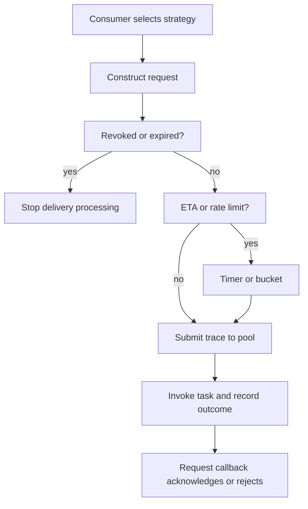

## Overview

A worker turns a delivered message into a request, submits it to an execution pool and interprets the trace outcome. The consumer owns message recognition and strategy selection; the request owns delivery acknowledgements and pool callbacks; the tracer owns task invocation, lifecycle hooks and result recording. [[Task Publishing]] describes the incoming message contract. [[Worker Lifecycle and Concurrency]] covers construction of the consumer and pool around this per-task flow.

Sources: [celery/worker/consumer/consumer.py:716-751](repo://celery/worker/consumer/consumer.py#L716-L751), [celery/worker/strategy.py:119-150](repo://celery/worker/strategy.py#L119-L150), [celery/worker/request.py:341-372](repo://celery/worker/request.py#L341-L372), [celery/app/trace.py:563-627](repo://celery/app/trace.py#L563-L627)

## Recognize and reserve a delivery

`update_strategies` builds one strategy and tracer per registered task. The receive handler reads a protocol-v2 task name from headers; older messages fall back to decoding their payload. A missing strategy invokes the unknown-task handler, which rejects the message, records `NotRegistered`, emits a failed event when available and sends `task_unknown`. Malformed messages and invalid tasks have separate rejection paths, making registration failures distinguishable from message-format failures.

Sources: [celery/worker/consumer/consumer.py:672-751](repo://celery/worker/consumer/consumer.py#L672-L751)

The strategy constructs a request with acknowledgement and rejection callbacks, checks expiration or revocation, and emits `task_received`. It can also emit a task-received event. ETA tasks are placed on the consumer timer; rate-limited tasks enter a token bucket path; tasks with both wait for ETA before rate limiting. Immediate tasks are marked reserved, passed to registered callbacks and handed to the worker's request handler. Reservation therefore precedes execution and can include time spent waiting for capacity.

Sources: [celery/worker/strategy.py:145-208](repo://celery/worker/strategy.py#L145-L208)

Sources: [celery/worker/strategy.py:145-208](repo://celery/worker/strategy.py#L145-L208), [celery/worker/worker.py:223-231](repo://celery/worker/worker.py#L223-L231), [celery/worker/request.py:341-372](repo://celery/worker/request.py#L341-L372), [celery/worker/request.py:596-620](repo://celery/worker/request.py#L596-L620), [celery/worker/request.py:649-696](repo://celery/worker/request.py#L649-L696)

## Submit the trace and establish context

`Request.execute_using_pool` checks revocation again and selects the fast or normal trace entry point. It submits task type, identifier, request metadata, serialized body and content information to `pool.apply_async`. Acceptance, timeout, success and error callbacks remain attached to the request, and task or message time limits become pool timeout arguments. This boundary separates execution in the pool from delivery bookkeeping in the worker.

Sources: [celery/worker/request.py:341-372](repo://celery/worker/request.py#L341-L372)

The tracer builds a `Context`, derives result-publication and started-tracking flags, and pushes task and request stacks before invoking user code. It sends pre-run hooks, calls the loader's task initializer and optionally stores `STARTED` with process and hostname information. It normally calls `task.run` directly, using the task object only when a custom `__call__` exists; the code explicitly removes that extra call for performance. [[Results and State]] explains which recorded states a caller can observe.

Sources: [celery/app/trace.py:374-405](repo://celery/app/trace.py#L374-L405), [celery/app/trace.py:490-506](repo://celery/app/trace.py#L490-L506), [celery/app/trace.py:563-586](repo://celery/app/trace.py#L563-L586)

## Interpret success and failure

The tracer handles `Reject`, `Ignore`, `Retry` and ordinary exceptions separately. On success it dispatches callbacks and chain continuation before storing the result, preserving the child-result trail. Success hooks and signals follow successful storage. Finally it sends post-run hooks, pops the task and request stacks and runs backend and loader cleanup outside eager mode. [[Canvas Workflows]] owns continuation construction; the tracer executes the continuation already embedded in the request.

Sources: [celery/app/trace.py:580-627](repo://celery/app/trace.py#L580-L627), [celery/app/trace.py:632-672](repo://celery/app/trace.py#L632-L672)

Early acknowledgement occurs when the pool accepts a task with `acks_late=False`. Late acknowledgement moves that decision to the outcome callbacks. The table describes this checkout's request behavior; it should be read together with result recording, because acknowledging a broker delivery and storing a backend result are distinct operations.

Sources: [celery/worker/request.py:515-523](repo://celery/worker/request.py#L515-L523), [celery/worker/request.py:590-620](repo://celery/worker/request.py#L590-L620), [celery/worker/request.py:677-711](repo://celery/worker/request.py#L677-L711)

| Outcome | Delivery action |
| --- | --- |
| Success with late acknowledgement | Acknowledge and emit task-succeeded |
| Retry with late acknowledgement | Acknowledge the current delivery and emit task-retried |
| Ignore | Acknowledge |
| Explicit Reject | Reject using the exception's requeue flag |
| Ordinary failure with late acknowledgement | Acknowledge when `acks_on_failure` is enabled; otherwise reject without requeue |
| Lost worker with late acknowledgement | Requeue when `reject_on_worker_lost` is enabled |
| Hard timeout with late acknowledgement | Acknowledge when `acks_on_timeout` is enabled; otherwise requeue |

Sources: [celery/worker/request.py:590-620](repo://celery/worker/request.py#L590-L620), [celery/worker/request.py:649-696](repo://celery/worker/request.py#L649-L696)

A rejection without requeue now records terminal failure and emits the failure signal, avoiding a result stranded in pending or started state. Hard timeout handling records `TimeLimitExceeded` and invokes failure hooks, `after_return` when customized, the failure signal and a failed event outside the cold-shutdown special case. These branches execute in request handling because the child may not have recorded its own outcome.

Sources: [celery/worker/request.py:529-594](repo://celery/worker/request.py#L529-L594), [celery/worker/request.py:649-671](repo://celery/worker/request.py#L649-L671), [celery/worker/request.py:698-717](repo://celery/worker/request.py#L698-L717)

## Retry task work

`Task.retry` increments the request retry counter, chooses a default delay when no ETA or countdown was supplied, and builds a signature from the current request. That signature preserves execution options and delivery information unless overridden. Exceeding the retry limit raises the supplied exception or `MaxRetriesExceededError`. Otherwise the signature is published and `Retry` is raised by default to tell the tracer that this execution has been rescheduled. Failure to publish that retry becomes `Reject` without requeue.

Sources: [celery/app/task.py:732-753](repo://celery/app/task.py#L732-L753), [celery/app/task.py:818-867](repo://celery/app/task.py#L818-L867)

Automatic retry wraps `run` only when `autoretry_for` is configured and a wrapper has not already been installed. `Ignore`, `Retry` and exceptions in `dont_autoretry_for` bypass it. Matching exceptions call `task.retry`, optionally computing exponential backoff with a maximum and jitter. This is an execution policy for selected task failures, separate from the transport retry policy in [[Task Publishing]]. Direct calls and eager execution also have explicit retry branches, so their behavior does not establish broker redelivery behavior.

Sources: [celery/app/autoretry.py:8-66](repo://celery/app/autoretry.py#L8-L66), [celery/app/task.py:824-859](repo://celery/app/task.py#L824-L859)

## Deduplicate successful redelivery

Successful-task deduplication requires late acknowledgement, `worker_deduplicate_successful_tasks` and a persistent backend. On a redelivered request, the tracer checks its local successful-request set and then backend state. A stored `SUCCESS` can skip the body. When callbacks or chain continuation exist but stored children do not, it attempts to dispatch them using the saved return value; extended result metadata is needed to retain the child marker. A dispatch failure raises a requeueing rejection, and the code identifies broker dead-letter or delivery-count limits as the circuit breaker for permanent failures. This is a targeted recovery path, not a general guarantee that task side effects happen once.

Sources: [celery/app/trace.py:379-382](repo://celery/app/trace.py#L379-L382), [celery/app/trace.py:508-561](repo://celery/app/trace.py#L508-L561)
