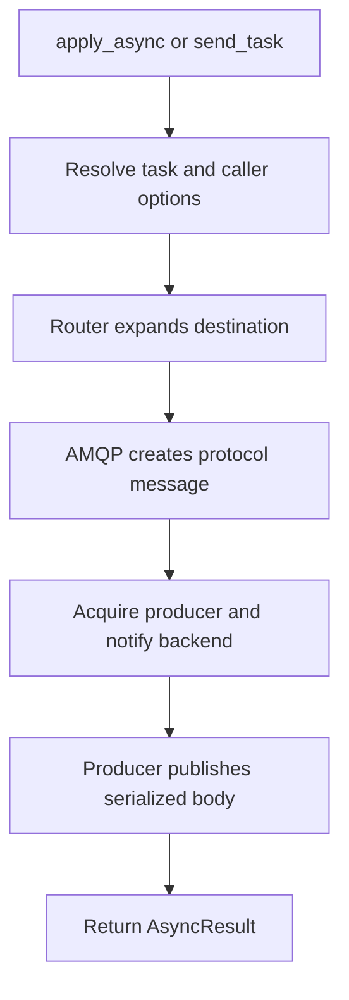

## Overview

Publishing translates a task invocation into a routed broker message. `Task.delay` is the positional and keyword argument shortcut; `Task.apply_async` additionally accepts delivery options; `Celery.send_task` sends a task by name. All three converge on message creation and producer publication except for local eager execution. The registry built in [[Application and Configuration]] supplies task defaults when available, while [[Task Execution]] begins when a worker receives the resulting message.

Sources: [celery/app/task.py:523-537](repo://celery/app/task.py#L523-L537), [celery/app/task.py:675-708](repo://celery/app/task.py#L675-L708), [celery/app/base.py:846-909](repo://celery/app/base.py#L846-L909)

## Select the invocation interface

Use `delay` when every argument belongs to the task body: it forwards its two argument collections directly to `apply_async`. Delivery settings such as `countdown`, `eta`, `expires`, `queue`, serializer, priority and callback links belong to `apply_async` options. Before publication, `apply_async` rejects incompatible task-level soft and hard limits and, when typing is enabled, invokes the generated argument checker. This validation can fail in the producer before any worker sees a message.

Sources: [celery/app/task.py:523-553](repo://celery/app/task.py#L523-L553), [celery/app/task.py:571-614](repo://celery/app/task.py#L571-L614), [celery/app/task.py:659-668](repo://celery/app/task.py#L659-L668)

`send_task` accepts a name and generates an identifier if none is supplied. It can publish without a locally registered task, which supports callers that know the remote task contract but do not import its implementation. It does not honor `task_always_eager`; it warns when that setting is enabled. A result handle is constructed only after the producer call, so publication errors can prevent the method from returning a handle at all.

Sources: [celery/app/base.py:846-896](repo://celery/app/base.py#L846-L896), [celery/app/base.py:1022-1034](repo://celery/app/base.py#L1022-L1034)

## Merge defaults without losing overrides

`apply_async` merges task execution options with caller options, then supplies defaults for `ignore_result` and priority. It passes `task_type=self` to `send_task`, indicating that task defaults were already considered. A plain `send_task` instead looks directly in `_tasks`, avoiding automatic finalization just to test whether a local task exists. If found, non-`None` execution defaults are merged beneath explicit caller options. The distinction avoids a second merge overriding values already resolved by `apply_async`.

Sources: [celery/app/task.py:675-708](repo://celery/app/task.py#L675-L708), [celery/app/base.py:874-909](repo://celery/app/base.py#L874-L909)

Time limits and expiration have an additional omitted-value sentinel because they are explicit `send_task` parameters as well as task options. Omission uses a task-level default; explicit `None` clears it. The implementation removes the corresponding keys from the options mapping before protocol construction so the same argument is not supplied twice. Read this distinction carefully when wrapping `send_task`: blindly supplying `None` changes behavior compared with leaving an argument out.

Sources: [celery/app/base.py:846-854](repo://celery/app/base.py#L846-L854), [celery/app/base.py:911-928](repo://celery/app/base.py#L911-L928)

## Resolve routing

The router expands a queue name into a queue object, queries configured routers in order and uses the first non-`None` response. Caller options are merged with the selected route. Without a route-provided or caller-provided queue, it expands `task_default_queue`. An unresolved queue raises `QueueNotFound`; whether names can be created automatically depends on the configured queue collection and `task_create_missing_queues`. Router implementations may be callables or the older `route_for_task` interface.

Sources: [celery/app/routes.py:66-111](repo://celery/app/routes.py#L66-L111), [celery/app/task.py:576-588](repo://celery/app/task.py#L576-L588)

Sources: [celery/app/task.py:675-708](repo://celery/app/task.py#L675-L708), [celery/app/base.py:897-932](repo://celery/app/base.py#L897-L932), [celery/app/base.py:1006-1034](repo://celery/app/base.py#L1006-L1034), [celery/app/amqp.py:558-579](repo://celery/app/amqp.py#L558-L579)

## Encode timing and workflow metadata

Protocol v2 validates that positional arguments are a list or tuple and keyword arguments a mapping. It converts countdown to a timezone-aware ETA and numeric expiration to a datetime, then serializes dates as ISO strings. Headers carry the task name, identifier, retry count, limits, group information, lineage and stamps. Properties carry correlation and reply information. The body contains arguments plus callbacks, errbacks, chain and chord data; [[Canvas Workflows]] explains how that embedded continuation data drives further submissions.

Sources: [celery/app/amqp.py:326-405](repo://celery/app/amqp.py#L326-L405)

For delayed delivery, `send_task` checks the transport and quorum queues. On supported non-direct exchanges, positive delays can become a routing key targeting the native delayed-delivery exchange. Direct exchanges produce a warning because that path is unsupported and may leave a worker holding the task until ETA. Expiration also becomes a broker expiration option; an already past expiration is clamped to zero with a warning. These branches explain why ETA and expiration affect both message metadata and transport options.

Sources: [celery/app/base.py:934-992](repo://celery/app/base.py#L934-L992)

When a task publishes another task, absent root and parent identifiers are inherited from the current worker task. Priority can also be inherited when `task_inherit_parent_priority` is enabled. The message builder defaults an otherwise absent root identifier to the new task's own identifier. This lineage travels with the message, allowing later execution and result tracking to associate child work with its originating task.

Sources: [celery/app/base.py:994-1015](repo://celery/app/base.py#L994-L1015), [celery/app/amqp.py:367-390](repo://celery/app/amqp.py#L367-L390)

## Publish and observe failures

`send_task` acquires or uses a supplied producer, calls the backend's `on_task_call` unless results are ignored, and invokes the AMQP sender. The sender resolves exchange and routing key, prepares queue declaration, merges retry policy and calls `producer.publish` with serializer, compression, delivery mode, headers and timeouts. It sends `before_task_publish` before that call and `after_task_publish` afterward. Optional `task-sent` events carry the resolved queue and routing information for [[Monitoring and Control]].

Sources: [celery/app/base.py:1022-1034](repo://celery/app/base.py#L1022-L1034), [celery/app/amqp.py:521-579](repo://celery/app/amqp.py#L521-L579), [celery/app/amqp.py:593-605](repo://celery/app/amqp.py#L593-L605)

Publishing retries belong to broker communication: `retry` and `retry_policy` govern the producer operation, and transport failures may raise `OperationalError`. Task execution retries occur later and are covered in [[Task Execution]]. The distinction matters because a worker exception cannot be repaired by changing the producer's retry policy, and successful publication says nothing about whether the task body eventually succeeds.

Sources: [celery/app/task.py:562-569](repo://celery/app/task.py#L562-L569), [celery/app/task.py:646-653](repo://celery/app/task.py#L646-L653), [celery/app/amqp.py:553-576](repo://celery/app/amqp.py#L553-L576), [celery/app/trace.py:580-605](repo://celery/app/trace.py#L580-L605)

## Understand eager execution

With `task_always_eager`, `apply_async` serializes and deserializes the argument pair using the selected serializer, then calls local `apply` inside `denied_join_result`. That round trip checks the serialization boundary even though work runs locally. It bypasses the broker delivery and worker-consumer path, so an eager call cannot verify queue routing or worker registration. Use [[Results and State]] to distinguish its eager result behavior from backend-driven asynchronous results.

Sources: [celery/app/task.py:682-708](repo://celery/app/task.py#L682-L708)
