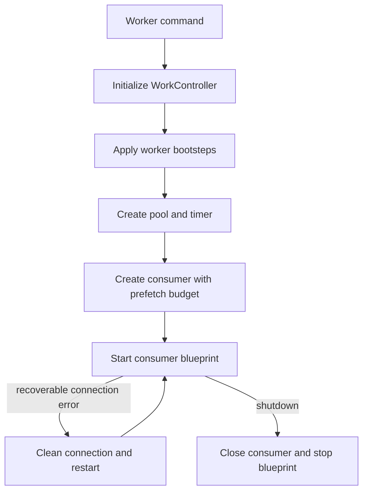

## Overview

The worker wraps task execution in a managed set of services: a pool, consumer, timer, optional event loop, state persistence and optional autoscaling or embedded beat. `WorkController` initializes its loader, applies defaults and builds a bootstep blueprint. That lifecycle determines when work can be received, how much can be buffered and how services recover or stop. Individual request tracing and acknowledgement policies belong to [[Task Execution]]; this page follows the surrounding worker process.

Sources: [celery/worker/worker.py:76-139](repo://celery/worker/worker.py#L76-L139), [celery/worker/components.py:221-246](repo://celery/worker/components.py#L221-L246)

## Start from the command line

The worker CLI accepts application-wide selection through the main command and worker-specific options such as log level, concurrency, pool and prefetch multiplier. It can detach or construct `app.Worker` in the current process after privilege handling. Configuration arguments remaining on the command line are parsed in the worker namespace; malformed keys or values become a usage error. The app import and task discovery rules in [[Application and Configuration]] apply before that worker can receive registered task names.

Sources: [celery/bin/celery.py:135-154](repo://celery/bin/celery.py#L135-L154), [celery/bin/worker.py:162-210](repo://celery/bin/worker.py#L162-L210), [celery/bin/worker.py:324-365](repo://celery/bin/worker.py#L324-L365)

Controller setup selects queues and included modules, chooses CPU count when concurrency is unset and falls back to two if CPU count is unavailable. It creates connection information without establishing a broker connection, chooses whether to use an event loop and emits `worker_init`. Pool aliases are resolved before the blueprint is applied. This separates assembling services from connecting and starting their processing loops.

Sources: [celery/worker/worker.py:101-139](repo://celery/worker/worker.py#L101-L139)

## Assemble bootsteps

The blueprint claims steps, builds their dependency order, instantiates each and includes its services on the parent. Startup calls each included step's `start`. Applications can add worker steps through `app.steps['worker']`; built-ins provide hub, pool, beat, timer, state database, consumer and autoscale components. The consumer component is marked last and receives the chosen pool, timer, controller, callback and worker options. Use this boundary to extend lifecycle behavior without replacing per-task tracing.

Sources: [celery/bootsteps.py:112-117](repo://celery/bootsteps.py#L112-L117), [celery/bootsteps.py:186-212](repo://celery/bootsteps.py#L186-L212), [celery/worker/worker.py:76-88](repo://celery/worker/worker.py#L76-L88), [celery/worker/worker.py:129-139](repo://celery/worker/worker.py#L129-L139), [celery/worker/components.py:221-246](repo://celery/worker/components.py#L221-L246)

Sources: [celery/bin/worker.py:358-365](repo://celery/bin/worker.py#L358-L365), [celery/worker/worker.py:90-139](repo://celery/worker/worker.py#L90-L139), [celery/worker/components.py:138-171](repo://celery/worker/components.py#L138-L171), [celery/worker/components.py:221-246](repo://celery/worker/components.py#L221-L246), [celery/worker/consumer/consumer.py:366-407](repo://celery/worker/consumer/consumer.py#L366-L407), [celery/worker/worker.py:244-267](repo://celery/worker/worker.py#L244-L267)

## Select a concurrency implementation

Pool selection is an alias lookup rather than one implementation with identical capabilities. Prefork is the CLI default. The pool component supplies process limits, task and memory recycling settings, timeouts and semaphore options, but the selected implementation decides which operations it supports. A custom implementation can be named by `CELERY_CUSTOM_WORKER_POOL` and selected with `--pool custom`; its class follows the `BasePool` boundary.

Sources: [celery/bin/worker.py:205-210](repo://celery/bin/worker.py#L205-L210), [celery/worker/components.py:138-171](repo://celery/worker/components.py#L138-L171), [celery/concurrency/__init__.py:11-43](repo://celery/concurrency/__init__.py#L11-L43)

| Pool | Execution mechanism | Visible implementation distinction |
| --- | --- | --- |
| prefork | Multiprocessing pool | Enables timeouts and exposes grow, shrink and terminate-job methods |
| solo | Inline `apply_target` | Forces concurrency one and reports no timeouts |
| threads | `ThreadPoolExecutor` | Submits futures and is not signal-safe |
| gevent | Gevent pool | Spawns greenlets and selects a timeout wrapper when configured |
| eventlet | Eventlet GreenPool | Spawns greenlets and emits pool lifecycle signals |

Sources: [celery/concurrency/prefork.py:95-126](repo://celery/concurrency/prefork.py#L95-L126), [celery/concurrency/solo.py:11-31](repo://celery/concurrency/solo.py#L11-L31), [celery/concurrency/thread.py:30-56](repo://celery/concurrency/thread.py#L30-L56), [celery/concurrency/gevent.py:85-126](repo://celery/concurrency/gevent.py#L85-L126), [celery/concurrency/eventlet.py:88-135](repo://celery/concurrency/eventlet.py#L88-L135)

The top-level executable calls `maybe_patch_concurrency` before importing the CLI, except for the multi command. The pool bootstep warns when a green pool is selected through worker configuration. These ordering choices make early pool selection significant: choosing a concurrency model can affect imports and patching before the worker's ordinary service construction begins, not just the number of execution slots.

Sources: [celery/__main__.py:10-15](repo://celery/__main__.py#L10-L15), [celery/worker/components.py:138-143](repo://celery/worker/components.py#L138-L143)

## Control capacity and prefetch

The consumer's initial prefetch budget is concurrency times the prefetch multiplier; with an autoscale maximum it uses at least one slot times that maximum-based budget. The `--disable-prefetch` option is explicitly limited to Redis brokers and fetches only when a process slot is available. Prefetch determines delivery intake, whereas the pool limit determines execution capacity; acknowledgements and delayed tasks introduce the further distinctions explained in [[Task Execution]].

Sources: [celery/worker/components.py:226-245](repo://celery/worker/components.py#L226-L245), [celery/bin/worker.py:176-203](repo://celery/bin/worker.py#L176-L203)

Autoscale configuration supplies a maximum and minimum, with the minimum used to construct the pool. Updating the maximum also adjusts consumer prefetch. Scale-up records a timestamp; scale-down waits for the keepalive interval and can decline to shrink when all processes are busy. [[Monitoring and Control]] covers the remote commands that invoke these capacity controls while a worker is running.

Sources: [celery/worker/components.py:117-128](repo://celery/worker/components.py#L117-L128), [celery/worker/components.py:154-155](repo://celery/worker/components.py#L154-L155), [celery/worker/autoscale.py:98-138](repo://celery/worker/autoscale.py#L98-L138)

## Recover broker connections

The consumer starts its blueprint inside a restart loop. Recoverable connection errors restart it when retries are enabled; channel errors join that set when `broker_channel_error_retry` is enabled. Startup and later reconnects consult distinct settings when a startup override is present. Disabled retries cause orderly worker shutdown, while exhausting file descriptors triggers termination. Connection establishment delegates retry limits to `ensure_connection` and supplies a shutdown callback so retrying remains interruptible.

Sources: [celery/worker/consumer/consumer.py:366-413](repo://celery/worker/consumer/consumer.py#L366-L413), [celery/worker/consumer/consumer.py:568-622](repo://celery/worker/consumer/consumer.py#L568-L622)

After an established connection fails, cleanup uses a bounded socket timeout and closes the broken connection before restart. Optional cancellation targets active late-acknowledged requests that have not acknowledged. Prefetch reduction can account for still-active work during reconnect, but per-consumer QoS explicitly skips reduction because updates would not reach the already running consumer; it also clears stale reduced state. Those branches avoid a reconnect hang or a worker remaining permanently under its intended prefetch budget.

Sources: [celery/worker/consumer/consumer.py:420-491](repo://celery/worker/consumer/consumer.py#L420-L491)

## Shut down services

Warm shutdown closes consumer intake and stops the blueprint without termination; cold shutdown requests termination. The controller joins the stopped blueprint with bounded socket operations. Signal handling normally maps SIGTERM to warm shutdown and SIGQUIT to cold shutdown, with an environment-controlled SIGTERM remapping. Repeated interactive interrupts can escalate the shutdown path, so the first graceful request and later termination requests have different effects on active work.

Sources: [celery/worker/worker.py:244-267](repo://celery/worker/worker.py#L244-L267), [celery/apps/worker.py:369-395](repo://celery/apps/worker.py#L369-L395), [celery/apps/worker.py:433-446](repo://celery/apps/worker.py#L433-L446)

Soft shutdown adds a configured wait before cold shutdown. The wait is enabled only for a positive `worker_soft_shutdown_timeout` and active requests, unless `worker_enable_soft_shutdown_on_idle` forces the idle case to wait too. Its purpose is to let short in-progress tasks finish before termination proceeds. Per-delivery requeue decisions still depend on the request policies in [[Task Execution]], rather than the shutdown timeout alone.

Sources: [celery/worker/worker.py:412-435](repo://celery/worker/worker.py#L412-L435), [celery/apps/worker.py:408-416](repo://celery/apps/worker.py#L408-L416)
