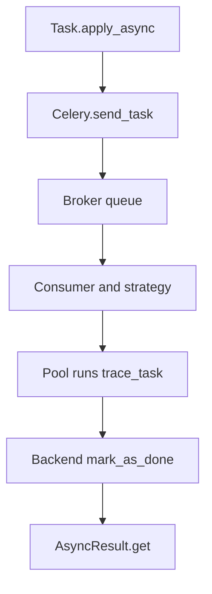

## Overview

Celery is a distributed task queue: a Python program puts a call to a named function on a message broker, and worker processes take the message and run the function. The `Celery` application object holds the broker and result backend connections, the task registry and the configuration, and every other part reads its settings from it.

Sources: [celery/__init__.py:1-3](repo://celery/__init__.py#L1-L3)

Sources: [celery/app/base.py:252-258](repo://celery/app/base.py#L252-L258)

## Parts

| Area | What it does | Page |
| --- | --- | --- |
| Application | Holds broker, backend, settings, registry and AMQP objects | [[Application and Configuration]] |
| Tasks | Turns a function into a task and runs it synchronously or sends it | [[Tasks]] |
| Sending | Builds the task message, routes it to a queue and publishes it | [[Sending Tasks]] |
| Security | Signs and verifies task messages with the auth serializer | [[Message Security]] |
| Signatures | Stores a call (name, arguments, options) to apply later | [[Signatures]] |
| Workflows | Chains, groups and chords built from signatures | [[Chains, Groups and Chords]] |
| Worker | Starts the consumer and pool from a bootstep blueprint | [[Worker Startup]] |
| Execution | Runs one received message and records its outcome | [[Task Execution]] |
| Pools | Runs tasks in prefork, thread, solo, eventlet or gevent workers | [[Concurrency Pools]] |
| Results | Stores task state and return values for later reads | [[Result Backends]] |
| Beat | Sends periodic tasks when their schedule is due | [[Periodic Tasks with Beat]] |
| Control and events | Remote commands to workers and the event stream | [[Remote Control and Events]] |
| Command line | The `celery` command and its subcommands | [[Command-Line Interface]] |
| Signals | Hooks sent at fixed points in task and worker lifecycles | [[Signals]] |

Sources: [celery/app/base.py:252-258](repo://celery/app/base.py#L252-L258)

Sources: [celery/app/task.py:536-545](repo://celery/app/task.py#L536-L545)

Sources: [celery/canvas.py:233-240](repo://celery/canvas.py#L233-L240)

Sources: [celery/worker/worker.py:63-88](repo://celery/worker/worker.py#L63-L88)

Sources: [celery/signals.py:31-40](repo://celery/signals.py#L31-L40)

## Main flow

The diagram follows one task from the call that sends it to the result a caller reads. The list after it names the page that explains each step.

Sources: [celery/app/task.py:683-708](repo://celery/app/task.py#L683-L708)

Sources: [celery/app/base.py:846-860](repo://celery/app/base.py#L846-L860)

Sources: [celery/worker/strategy.py:99-132](repo://celery/worker/strategy.py#L99-L132)

Sources: [celery/app/trace.py:475-478](repo://celery/app/trace.py#L475-L478)

Sources: [celery/backends/base.py:180-186](repo://celery/backends/base.py#L180-L186)

1. `Task.apply_async`: [[Tasks]].
2. `Celery.send_task`: [[Sending Tasks]].
3. The consumer and the message strategy: [[Worker Startup]].
4. The pool and `trace_task`: [[Task Execution]].
5. `mark_as_done` and `AsyncResult.get`: [[Result Backends]].

`Task.apply_async` checks `task_always_eager` first. When it is set, the arguments go through a serialize and deserialize round trip and the task runs in the calling process through `apply`; no message is sent. Otherwise `send_task` publishes the message and returns an `AsyncResult` for the task id.

Sources: [celery/app/task.py:683-708](repo://celery/app/task.py#L683-L708)

Sources: [celery/app/base.py:1028-1034](repo://celery/app/base.py#L1028-L1034)

## Design decisions

Acknowledgement timing is set by `acks_late`, which defaults to `False`. The worker acknowledges the message in `Request.execute` before it runs the task unless the task sets `acks_late`; with `acks_late` it acknowledges after the run.

Sources: [celery/app/defaults.py:267](repo://celery/app/defaults.py#L267)

Sources: [celery/worker/request.py:381-388](repo://celery/worker/request.py#L381-L388)

Arguments travel as serialized data. A message carries the arguments and keyword arguments, which the worker decodes before it calls the task; eager mode repeats that round trip so that a call behaves the same with or without a broker.

Sources: [celery/app/task.py:683-699](repo://celery/app/task.py#L683-L699)

Workflow steps are themselves messages. After a task succeeds, the trace sends its link callbacks and the next chain step as new task messages, parented to the finished task, so the worker that finished one step sends the next. [[Chains, Groups and Chords]] shows how chord and group steps are dispatched.

Sources: [celery/app/trace.py:426-473](repo://celery/app/trace.py#L426-L473)

## Next

- [[Quickstart]]: one task run end to end in code.
- [[Application and Configuration]]: where the settings and the registry come from.
