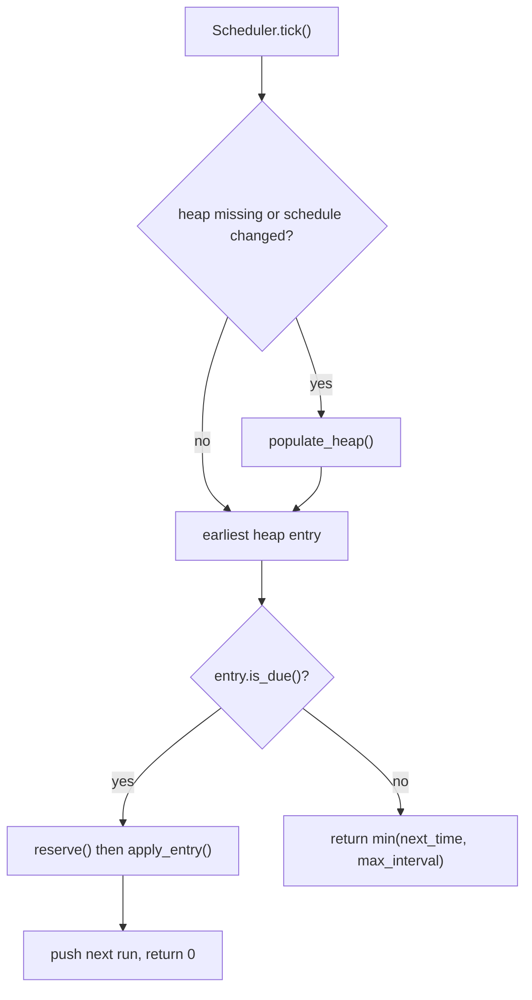

## Overview

`celery beat` is the process that sends periodic tasks. It keeps a schedule of entries, each naming a task, its arguments and a schedule object, and in a loop sends every entry that is due as an ordinary task message, then sleeps until the next one. Beat does not execute tasks; workers consume the messages it sends like any others ([[Sending Tasks]]). Exactly one beat should run per schedule, either as its own process or embedded in a worker with `-B`.

Sources: [celery/beat.py:219-276](repo://celery/beat.py#L219-L276), [celery/beat.py:612-680](repo://celery/beat.py#L612-L680)

When an entry is due is decided by its schedule object (`schedule`, `crontab` or `solar`), described in [[Schedules]].

Sources: [celery/beat.py:82-112](repo://celery/beat.py#L82-L112)

## Declaring periodic tasks

Entries come from the `beat_schedule` setting, a dict from entry name to a dict with `task`, `schedule`, and optionally `args`, `kwargs`, `options` and `relative`. They can also be added in code with `app.add_periodic_task(schedule, sig, args=(), kwargs=(), name=None, **opts)`, usually from an `on_after_configure` handler as in the bundled example:

Sources: [celery/app/base.py:1295-1310](repo://celery/app/base.py#L1295-L1310)

```python
@app.on_after_configure.connect
def setup_periodic_tasks(sender, **kwargs):
    # Calls say('hello') every 10 seconds.
    sender.add_periodic_task(10.0, say.s('hello'), name='add every 10')
```

Sources: [examples/periodic-tasks/myapp.py:50-56](repo://examples/periodic-tasks/myapp.py#L50-L56), [celery/app/base.py:1295-1334](repo://celery/app/base.py#L1295-L1334)

`add_periodic_task` turns the signature into a `beat_schedule` entry (task name, args, kwargs, and the signature's options merged with `opts`) keyed by `name`, or by `repr(sig)` when no name is given. Adding the same unnamed signature twice replaces the first entry and logs a warning suggesting a `name`. Before the app is configured the entry is queued and added when configuration loads ([[Configuration and Loaders]]).

Sources: [celery/app/base.py:1295-1334](repo://celery/app/base.py#L1295-L1334), [celery/app/base.py:1270-1274](repo://celery/app/base.py#L1270-L1274)

`args` and `kwargs` may contain `BeatLazyFunc(func, *args, **kwargs)` values, which are called each time the entry is sent, so a value such as the current time can be computed at send time.

Sources: [celery/beat.py:50-79](repo://celery/beat.py#L50-L79), [celery/beat.py:201-216](repo://celery/beat.py#L201-L216)

## Schedule entries

A `ScheduleEntry` holds `name`, `task`, `args`, `kwargs`, `options`, the `schedule` (converted by `maybe_schedule`, so a number of seconds or a `timedelta` becomes a `schedule`), `last_run_at` (defaulting to now) and `total_run_count`. `is_due()` delegates to the schedule with `last_run_at`. `next(entry)` returns a copy with `last_run_at` set to now and the run count incremented. Two entries are equal when their editable fields (`task`, `args`, `kwargs`, `options`, `schedule`) are equal, and `update(other)` copies only those fields, keeping the run history.

Sources: [celery/beat.py:82-198](repo://celery/beat.py#L82-L198)

## The scheduling loop

`Scheduler.tick()` sends at most one due entry per call and returns how long to sleep:

Sources: [celery/beat.py:326-333](repo://celery/beat.py#L326-L333)

1. If the heap is missing or the schedule changed since the last tick (compared with `schedules_equal`), rebuild it with `populate_heap`: one `(time, priority, entry)` tuple per entry, where the time is now for due entries and now plus the remaining delay otherwise, as a UTC timestamp.
2. Look at the earliest entry and ask it `is_due()`.
3. If due, pop it, `reserve` it (store `next(entry)` in the schedule), send it with `apply_entry`, push the next run back on the heap, and return `0` so the loop ticks again immediately.
4. If not due, return the remaining time, slightly shortened by `adjust` (10 ms), capped at `max_interval`.

Sources: [celery/beat.py:296-363](repo://celery/beat.py#L296-L363)



Sources: [celery/beat.py:326-363](repo://celery/beat.py#L326-L363)

`max_interval` comes from the argument, `beat_max_loop_interval`, or `DEFAULT_MAX_INTERVAL` (300 seconds), and bounds how long beat sleeps, which is also how long it takes to notice a changed schedule.

Sources: [celery/beat.py:43-43](repo://celery/beat.py#L43-L43), [celery/beat.py:255-268](repo://celery/beat.py#L255-L268)

## Sending an entry

`apply_async(entry, producer=None, advance=True)` evaluates lazy arguments and calls the registered task's `apply_async` with the entry's options, or `app.send_task` by name when the task is not registered in beat's process, on a producer created once over a write connection that retries with `broker_connection_max_retries`. Any exception becomes a `SchedulingError`, which `apply_entry` logs; the entry was already advanced by `reserve`, so a failing entry is not retried in a tight loop. The method comment gives that reason: "so we have that done if an exception is raised (doesn't schedule forever.)"

Sources: [celery/beat.py:278-293](repo://celery/beat.py#L278-L293), [celery/beat.py:378-404](repo://celery/beat.py#L378-L404), [celery/beat.py:467-492](repo://celery/beat.py#L467-L492)

After each send, beat counts the task and syncs the schedule when `should_sync()` is true: every `sync_every` seconds (3 minutes) or after `beat_sync_every` tasks when that is set.

Sources: [celery/beat.py:242-246](repo://celery/beat.py#L242-L246), [celery/beat.py:365-371](repo://celery/beat.py#L365-L371), [celery/beat.py:400-417](repo://celery/beat.py#L400-L417)

## Building the schedule

`setup_schedule()` installs default entries and merges `beat_schedule` in place. The default entry is `celery.backend_cleanup`, run daily at 4:00 (`crontab('0', '4', '*')`) with a 12-hour expiry, added only when `result_expires` is set and the result backend does not expire results itself ([[Result Backend Interface]]). `merge_inplace` removes stored entries that are no longer configured, updates the editable fields of existing ones (keeping their `last_run_at`), and adds new ones.

Sources: [celery/beat.py:266-276](repo://celery/beat.py#L266-L276), [celery/beat.py:406-453](repo://celery/beat.py#L406-L453)

The base `Scheduler` keeps entries in memory only; `sync()` does nothing. Subclasses replace `setup_schedule`, the `schedule` property and `sync` to store them elsewhere; the class docstring asks that they be idempotent when created with `lazy=True`, since beat instantiates schedulers lazily for introspection.

Sources: [celery/beat.py:219-232](repo://celery/beat.py#L219-L232), [celery/beat.py:416-501](repo://celery/beat.py#L416-L501)

## PersistentScheduler

The default scheduler (`beat_scheduler = 'celery.beat:PersistentScheduler'`) stores entries in a `shelve` file named by `beat_schedule_filename` (`celerybeat-schedule`, or `-s`/`--schedule`), so `last_run_at` survives restarts and an entry is not sent again just because beat restarted.

Sources: [celery/beat.py:505-520](repo://celery/beat.py#L505-L520), [celery/app/defaults.py:73-82](repo://celery/app/defaults.py#L73-L82)

`setup_schedule` opens the file; if opening fails or reading keys raises, it logs `Removing corrupted schedule file`, deletes the file and its `.db`, `.dat`, `.bak` and `.dir` variants, and starts fresh. It also clears the store when it was written by a version without the `__version__`, `tz` or `utc_enabled` fields, or when the stored `timezone` or `enable_utc` differs from the current configuration, logging a `Reset:` warning, since stored times would be interpreted wrongly. It then merges the configured schedule, installs default entries, records the version, timezone and UTC flag, and syncs. `close()` syncs and closes the file.

Sources: [celery/beat.py:522-609](repo://celery/beat.py#L522-L609)

## Service and the beat program

`Service` owns the loop. `start(embedded_process=False)` sends `beat_init` (and `beat_embedded_init` when embedded), then repeatedly calls `scheduler.tick()`, sleeps the returned interval, and syncs when due, until `stop()` sets the shutdown event or `KeyboardInterrupt`/`SystemExit` is raised; it always ends by closing the scheduler. `get_scheduler()` resolves the scheduler class by name, also accepting aliases registered under the `celery.beat_schedulers` entry-point group.

Sources: [celery/beat.py:612-680](repo://celery/beat.py#L612-L680)

The `celery beat` command applies extra `key=value` arguments to the configuration, drops privileges, and runs `app.Beat(...)`, inside `platforms.detached` with `--detach` ([[Multi and Daemonization]]). `apps.beat.Beat.run()` prints the startup line, runs the loader's worker init (importing task modules) and finalizes the app, sets the process title, creates the pidfile lock, prints a banner with the broker, loader, scheduler and max interval, sets up logging, sets a default socket timeout of 30 seconds, and installs `SIGTERM` and `SIGINT` handlers that sync the schedule before exiting.

Sources: [celery/bin/beat.py:47-72](repo://celery/bin/beat.py#L47-L72), [celery/apps/beat.py:44-160](repo://celery/apps/beat.py#L44-L160)

## Embedded beat

With `celery worker -B`, the worker's `Beat` bootstep creates `EmbeddedService(app, schedule_filename=..., scheduler_cls=...)` ([[Worker Startup and Bootsteps]]). It returns a `_Process`, a separate child process that resets signals, closes inherited file descriptors except standard streams and log files, makes the app current and default, and runs the service with `embedded_process=True`. Without multiprocessing support, or when `thread=True` is passed, it returns a daemon thread running the service with a one-second `max_interval`, so the thread can be stopped "in reasonable time". The worker refuses `-B` with the eventlet and gevent pools.

Sources: [celery/beat.py:682-738](repo://celery/beat.py#L682-L738), [celery/worker/components.py:181-205](repo://celery/worker/components.py#L181-L205)
